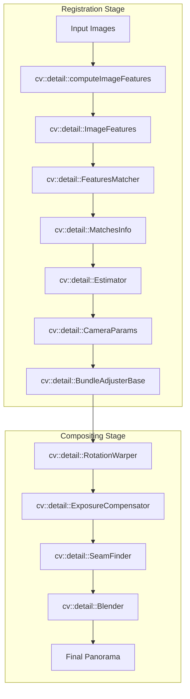
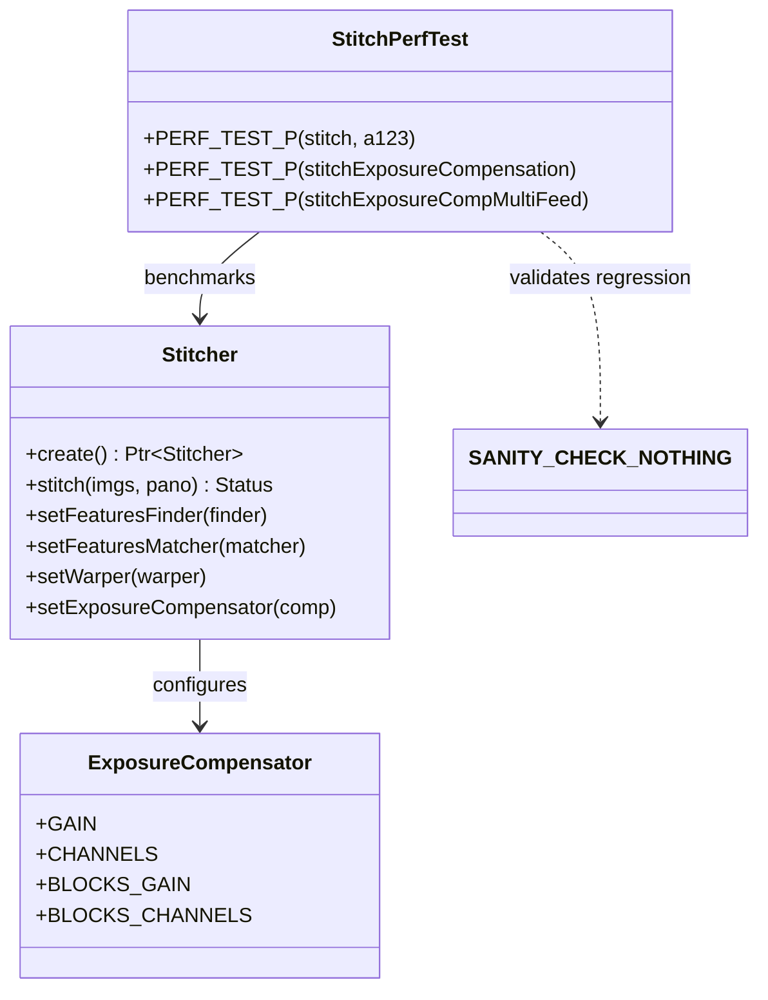

<!-- source: DeepWiki mcp.deepwiki.com · repo opencv/opencv · page 15.2 Stitching Detail API: Matchers, Warpers, Seam Finders, Blenders · fetched 2026-10-30 -->

# Stitching Detail API: Matchers, Warpers, Seam Finders, Blenders

Relevant source files

The following files were used as context for generating this wiki page:

- [modules/core/perf/perf_mat.cpp](modules/core/perf/perf_mat.cpp)
- [modules/stitching/CMakeLists.txt](modules/stitching/CMakeLists.txt)
- [modules/stitching/include/opencv2/stitching.hpp](modules/stitching/include/opencv2/stitching.hpp)
- [modules/stitching/include/opencv2/stitching/detail/autocalib.hpp](modules/stitching/include/opencv2/stitching/detail/autocalib.hpp)
- [modules/stitching/include/opencv2/stitching/detail/blenders.hpp](modules/stitching/include/opencv2/stitching/detail/blenders.hpp)
- [modules/stitching/include/opencv2/stitching/detail/camera.hpp](modules/stitching/include/opencv2/stitching/detail/camera.hpp)
- [modules/stitching/include/opencv2/stitching/detail/exposure_compensate.hpp](modules/stitching/include/opencv2/stitching/detail/exposure_compensate.hpp)
- [modules/stitching/include/opencv2/stitching/detail/matchers.hpp](modules/stitching/include/opencv2/stitching/detail/matchers.hpp)
- [modules/stitching/include/opencv2/stitching/detail/motion_estimators.hpp](modules/stitching/include/opencv2/stitching/detail/motion_estimators.hpp)
- [modules/stitching/include/opencv2/stitching/detail/seam_finders.hpp](modules/stitching/include/opencv2/stitching/detail/seam_finders.hpp)
- [modules/stitching/include/opencv2/stitching/detail/util.hpp](modules/stitching/include/opencv2/stitching/detail/util.hpp)
- [modules/stitching/include/opencv2/stitching/detail/util_inl.hpp](modules/stitching/include/opencv2/stitching/detail/util_inl.hpp)
- [modules/stitching/include/opencv2/stitching/detail/warpers.hpp](modules/stitching/include/opencv2/stitching/detail/warpers.hpp)
- [modules/stitching/include/opencv2/stitching/detail/warpers_inl.hpp](modules/stitching/include/opencv2/stitching/detail/warpers_inl.hpp)
- [modules/stitching/include/opencv2/stitching/warpers.hpp](modules/stitching/include/opencv2/stitching/warpers.hpp)
- [modules/stitching/misc/python/test/test_stitching.py](modules/stitching/misc/python/test/test_stitching.py)
- [modules/stitching/perf/opencl/perf_stitch.cpp](modules/stitching/perf/opencl/perf_stitch.cpp)
- [modules/stitching/perf/perf_estimators.cpp](modules/stitching/perf/perf_estimators.cpp)
- [modules/stitching/perf/perf_main.cpp](modules/stitching/perf/perf_main.cpp)
- [modules/stitching/perf/perf_matchers.cpp](modules/stitching/perf/perf_matchers.cpp)
- [modules/stitching/perf/perf_precomp.hpp](modules/stitching/perf/perf_precomp.hpp)
- [modules/stitching/perf/perf_stich.cpp](modules/stitching/perf/perf_stich.cpp)
- [modules/stitching/src/blenders.cpp](modules/stitching/src/blenders.cpp)
- [modules/stitching/src/exposure_compensate.cpp](modules/stitching/src/exposure_compensate.cpp)
- [modules/stitching/src/matchers.cpp](modules/stitching/src/matchers.cpp)
- [modules/stitching/src/motion_estimators.cpp](modules/stitching/src/motion_estimators.cpp)
- [modules/stitching/src/opencl/warpers.cl](modules/stitching/src/opencl/warpers.cl)
- [modules/stitching/src/precomp.hpp](modules/stitching/src/precomp.hpp)
- [modules/stitching/src/seam_finders.cpp](modules/stitching/src/seam_finders.cpp)
- [modules/stitching/src/stitcher.cpp](modules/stitching/src/stitcher.cpp)
- [modules/stitching/src/util.cpp](modules/stitching/src/util.cpp)
- [modules/stitching/src/warpers.cpp](modules/stitching/src/warpers.cpp)
- [modules/stitching/test/test_exposure_compensate.cpp](modules/stitching/test/test_exposure_compensate.cpp)
- [modules/stitching/test/test_main.cpp](modules/stitching/test/test_main.cpp)
- [modules/stitching/test/test_matchers.cpp](modules/stitching/test/test_matchers.cpp)
- [modules/stitching/test/test_precomp.hpp](modules/stitching/test/test_precomp.hpp)
- [modules/stitching/test/test_wave_correction.cpp](modules/stitching/test/test_wave_correction.cpp)
- [samples/cpp/stitching_detailed.cpp](samples/cpp/stitching_detailed.cpp)

The Stitching Detail API provides a granular set of building blocks for constructing custom image stitching pipelines. While the high-level `cv::Stitcher` class manages the end-to-end process automatically [modules/stitching/src/stitcher.cpp:47-93](), the classes and structures in the `cv::detail` namespace allow for fine-grained control over feature extraction, pairwise matching, camera parameter estimation, projection warping, exposure compensation, seam finding, and multi-band blending.

Sources: `[modules/stitching/src/stitcher.cpp:47-93]()`

---

## Pipeline Architecture and Data Flow

A custom stitching pipeline follows a multi-stage data flow where input images are first converted into feature representations, matched across pairs, aligned into camera rotation/intrinsic models, warped onto a common surface, compensated for illumination differences, seamed, and finally blended into a seamless panorama.

### Pipeline Component Mapping

Sources: `[modules/stitching/src/stitcher.cpp:96-112]`, `[modules/stitching/src/stitcher.cpp:123-220]`, `[samples/cpp/stitching_detailed.cpp:480-700]()`

---

## Feature Matching and Registration

The registration stage establishes geometric relationships and correspondences between input views.

*   `cv::detail::ImageFeatures`: A structure storing an image index, size, keypoints (`std::vector<KeyPoint>`), and descriptors (`UMat`) [modules/stitching/include/opencv2/stitching/detail/matchers.hpp:58-65]().
*   `cv::detail::computeImageFeatures`: Function wrapper to extract features using any `Ptr<Feature2D>` extractor [modules/stitching/include/opencv2/stitching/detail/matchers.hpp:73-77]().
*   `cv::detail::FeaturesMatcher`: Base class for pairwise matching, parallelized using `ParallelLoopBody` [modules/stitching/include/opencv2/stitching/detail/matchers.hpp:117-142](), [modules/stitching/src/matchers.cpp:65-111]().
    *   `BestOf2NearestMatcher`: Identifies the two best matches for each feature and applies distance ratio testing and confidence thresholding [modules/stitching/include/opencv2/stitching/detail/matchers.hpp:182-190]().
    *   `AffineBestOf2NearestMatcher`: Tailored for affine transformation models, often applied in document or scan stitching [modules/stitching/src/stitcher.cpp:81]().
*   `cv::detail::Estimator`: Classes such as `HomographyBasedEstimator` and `AffineBasedEstimator` compute initial focal lengths and rotation matrices `R` from `MatchesInfo` [modules/stitching/src/motion_estimators.cpp:126-192]().

Sources: `[modules/stitching/include/opencv2/stitching/detail/matchers.hpp:58-175]`, `[modules/stitching/src/matchers.cpp:65-192]`, `[modules/stitching/src/motion_estimators.cpp:126-192]()`

---

## Warpers and Geometric Projections

Image warpers project input planes onto a common reference coordinate space defined by camera intrinsics `K` and rotation `R`.

*   `cv::detail::RotationWarper`: The abstract interface providing point projection, backward projection, map building, and image warping [modules/stitching/include/opencv2/stitching/detail/warpers.hpp:59-129]().
*   `cv::detail::ProjectorBase`: Base class holding camera projection parameters including `scale`, intrinsic matrices, and rotation-inverse transformations [modules/stitching/include/opencv2/stitching/detail/warpers.hpp:133-145]().
*   Concrete Implementations:
    *   `SphericalWarper`: Projects images onto a spherical surface [modules/stitching/src/stitcher.cpp:74]().
    *   `CylindricalWarper`: Projects images onto a cylinder [modules/stitching/src/warpers.cpp:55]().
    *   `PlaneWarper`: Projects images onto a flat 2D plane [modules/stitching/src/warpers.cpp:51]().
    *   Additional projections include `FisheyeWarper`, `StereographicWarper`, `PaniniWarper`, and `MercatorWarper` [modules/stitching/src/warpers.cpp:58-82]().

Sources: `[modules/stitching/include/opencv2/stitching/detail/warpers.hpp:59-180]`, `[modules/stitching/src/warpers.cpp:48-123]()`

---

## Seam Finding and Exposure Compensation

Once images are warped into a shared coordinate frame, illumination discrepancies and boundary artifacts must be resolved.

*   `cv::detail::ExposureCompensator`: Base interface for adjusting image gains to eliminate exposure jumps [modules/stitching/src/stitcher.cpp:75](). Concrete classes include `GainCompensator`, `ChannelsCompensator`, `BlocksGainCompensator`, and `BlocksChannelsCompensator` [modules/stitching/perf/perf_stich.cpp:113-122]().
*   `cv::detail::SeamFinder`: Base interface for computing optimal seam masks across overlapping image regions [modules/stitching/include/opencv2/stitching/detail/seam_finders.hpp:58-72]().
    *   `NoSeamFinder`: Stub implementation that performs no seam adjustment [modules/stitching/include/opencv2/stitching/detail/seam_finders.hpp:76-80]().
    *   `VoronoiSeamFinder`: Uses distance transforms on unique intersection regions to establish Voronoi-diagram-based seams [modules/stitching/src/seam_finders.cpp:98-176]().
    *   `GraphCutSeamFinder`: Formulates seam finding as a graph-cut energy minimization problem using color or color-gradient costs [modules/stitching/src/stitcher.cpp:55](), [modules/stitching/src/seam_finders.cpp:178-200]().
    *   `DpSeamFinder`: Implements dynamic programming-based seam estimation [modules/stitching/src/seam_finders.cpp:178-197]().

Sources: `[modules/stitching/include/opencv2/stitching/detail/seam_finders.hpp:58-136]`, `[modules/stitching/src/seam_finders.cpp:50-200]`, `[modules/stitching/perf/perf_stich.cpp:113-122]()`

---

## Blending

The blending stage composites the compensated and seamed images into the final canvas.

*   `cv::detail::Blender`: Base class providing the core `prepare`, `feed`, and `blend` lifecycle [modules/stitching/src/blenders.cpp:80-134](). Operates internally on `CV_16SC3` accumulators.
*   `cv::detail::FeatherBlender`: Blends images using a distance-based weight map and sharpness parameter [modules/stitching/src/blenders.cpp:136-182]().
*   `cv::detail::MultiBandBlender`: Implements multi-band (Laplacian pyramid) blending to seamlessly merge frequencies across multiple bands, preventing ghosting while retaining high-frequency details [modules/stitching/src/stitcher.cpp:56]().

Sources: `[modules/stitching/include/opencv2/stitching/detail/blenders.hpp:58-100]`, `[modules/stitching/src/blenders.cpp:68-182]()`

---

## Performance and Validation

The stitching module relies on extensive performance and unit testing frameworks to validate execution speed, regression bounds, and output quality across backends.

### Performance Testing Architecture

Sources: `[modules/stitching/perf/perf_stich.cpp:30-139]`, `[modules/stitching/CMakeLists.txt:11-13]()`

*   `perf_stich.cpp`: Benchmarks end-to-end execution times using parameterized tests for feature finders (`surf`, `orb`, `akaze`) and exposure compensation strategies [modules/stitching/perf/perf_stich.cpp:30-139]().
*   Output dimensions and metrics are asserted against expected dataset baselines (e.g., verifying canvas widths and heights for test datasets `a1`, `a2`, `a3`) to catch regression errors in warping and camera estimation [modules/stitching/perf/perf_stich.cpp:60-61]().

Sources: `[modules/stitching/perf/perf_stich.cpp:30-139]`, `[modules/stitching/CMakeLists.txt:11-13]()`

---

