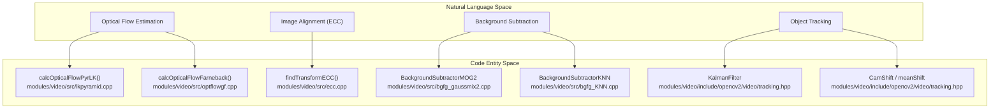
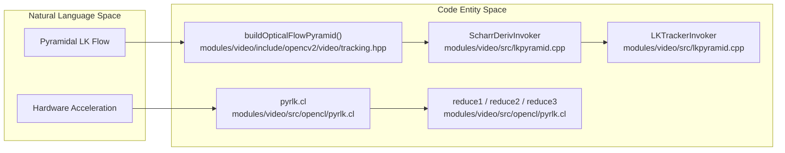

<!-- source: DeepWiki mcp.deepwiki.com · repo opencv/opencv · page 16 Video Analysis · fetched 2026-10-30 -->

# Video Analysis

Relevant source files

The following files were used as context for generating this wiki page:

- [cmake/OpenCVFindFrameworks.cmake](cmake/OpenCVFindFrameworks.cmake)
- [modules/python/test/test_eccms.py](modules/python/test/test_eccms.py)
- [modules/video/CMakeLists.txt](modules/video/CMakeLists.txt)
- [modules/video/include/opencv2/video/tracking.hpp](modules/video/include/opencv2/video/tracking.hpp)
- [modules/video/perf/opencl/perf_optflow_pyrlk.cpp](modules/video/perf/opencl/perf_optflow_pyrlk.cpp)
- [modules/video/perf/perf_ecc.cpp](modules/video/perf/perf_ecc.cpp)
- [modules/video/src/ecc.cpp](modules/video/src/ecc.cpp)
- [modules/video/src/eccms.cpp](modules/video/src/eccms.cpp)
- [modules/video/src/lkpyramid.cpp](modules/video/src/lkpyramid.cpp)
- [modules/video/src/lkpyramid.dispatch.cpp](modules/video/src/lkpyramid.dispatch.cpp)
- [modules/video/src/lkpyramid.hpp](modules/video/src/lkpyramid.hpp)
- [modules/video/src/lkpyramid.simd.hpp](modules/video/src/lkpyramid.simd.hpp)
- [modules/video/src/opencl/pyrlk.cl](modules/video/src/opencl/pyrlk.cl)
- [modules/video/test/ocl/test_optflowpyrlk.cpp](modules/video/test/ocl/test_optflowpyrlk.cpp)
- [modules/video/test/test_ecc.cpp](modules/video/test/test_ecc.cpp)
- [samples/cpp/image_alignment.cpp](samples/cpp/image_alignment.cpp)

The `opencv_video` module provides algorithms for analyzing motion, tracking objects, estimating geometric image alignment, and segmenting background from foreground across video frames. It serves as a core dependency for higher-level video processing pipelines, leveraging CPU multi-threading via `parallel_for_` [modules/video/src/lkpyramid.cpp:69]() and GPU acceleration through OpenCL kernels [modules/video/src/opencl/pyrlk.cl:1-46]().

For detailed technical specifications, low-level algorithmic derivations, and parameter tuning guidelines, refer to the child pages:
- [Optical Flow, Image Alignment, and Object Tracking](#16.1)
- [Background Subtraction](#16.2)

---

## Module Overview and Architecture

The `opencv_video` module is organized around several key functional blocks: sparse and dense optical flow estimation, iterative image alignment using the Enhanced Correlation Coefficient (ECC), background subtraction models, and tracking utilities such as `KalmanFilter` and `CamShift` [modules/video/include/opencv2/video/tracking.hpp:44-53]().

**Title: Video Module Architecture Mapping**

Sources: [modules/video/include/opencv2/video/tracking.hpp:82-108](), [modules/video/src/lkpyramid.cpp:67-157](), [modules/video/src/ecc.cpp:45-47]()

---

## Optical Flow and Image Alignment

Optical flow algorithms compute displacement vectors for pixels between consecutive frames. OpenCV supports sparse tracking via the iterative Lucas-Kanade method across image pyramids (`calcOpticalFlowPyrLK`) [modules/video/include/opencv2/video/tracking.hpp:139-140]() and dense flow via polynomial expansion (`calcOpticalFlowFarneback`) [modules/video/include/opencv2/video/tracking.hpp:226-229](). Image alignment is handled by `findTransformECC`, which maximizes the enhanced correlation coefficient between a template and target image under various motion models (translation, Euclidean, affine, and homography) [modules/video/src/ecc.cpp:45-47]().

**Title: Pyramidal Lucas-Kanade and OpenCL Execution Path**

Sources: [modules/video/include/opencv2/video/tracking.hpp:125-130](), [modules/video/src/lkpyramid.cpp:74-85](), [modules/video/src/opencl/pyrlk.cl:59-108]()

For comprehensive details on optical flow formulations, multi-scale ECC parameters (`ECCParameters`, `findTransformECCMultiScale`), and OpenCL acceleration paths, see [Optical Flow, Image Alignment, and Object Tracking](#16.1).

---

## Background Subtraction and Object Tracking

Background subtraction algorithms maintain statistical foreground/background models per pixel to isolate moving objects. The module provides the `BackgroundSubtractorMOG2` (Gaussian Mixture Model) and `BackgroundSubtractorKNN` (K-Nearest Neighbors) implementations [modules/video/include/opencv2/video/background_segm.hpp:55-339](). 

Object tracking utilities include probabilistic search functions (`meanShift`, `CamShift`) and linear predictive state estimation (`KalmanFilter`) [modules/video/include/opencv2/video/tracking.hpp:82-108,434-484]().

For parameters, incremental update mechanisms, and OpenCL kernels for background subtraction, see [Background Subtraction](#16.2). For tracking implementations and filter configurations, see [Optical Flow, Image Alignment, and Object Tracking](#16.1).

---

## Subpage References

- [Optical Flow, Image Alignment, and Object Tracking](#16.1) — Detailed coverage of Lucas-Kanade pyramidal flow, dense Farneback flow, ECC image alignment, `KalmanFilter`, and `meanShift`/`CAMshift`.
- [Background Subtraction](#16.2) — In-depth documentation of `BackgroundSubtractor`, MOG2, KNN, parameter settings, and OpenCL kernel implementations.

---

