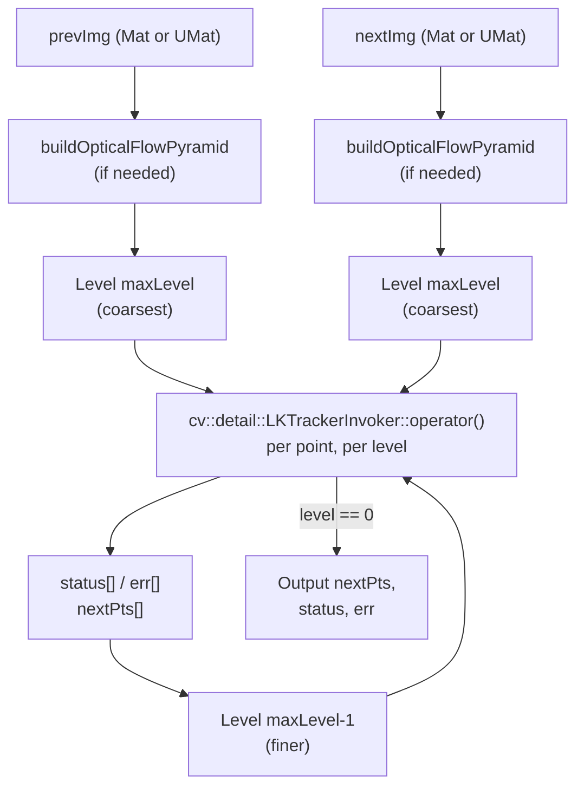
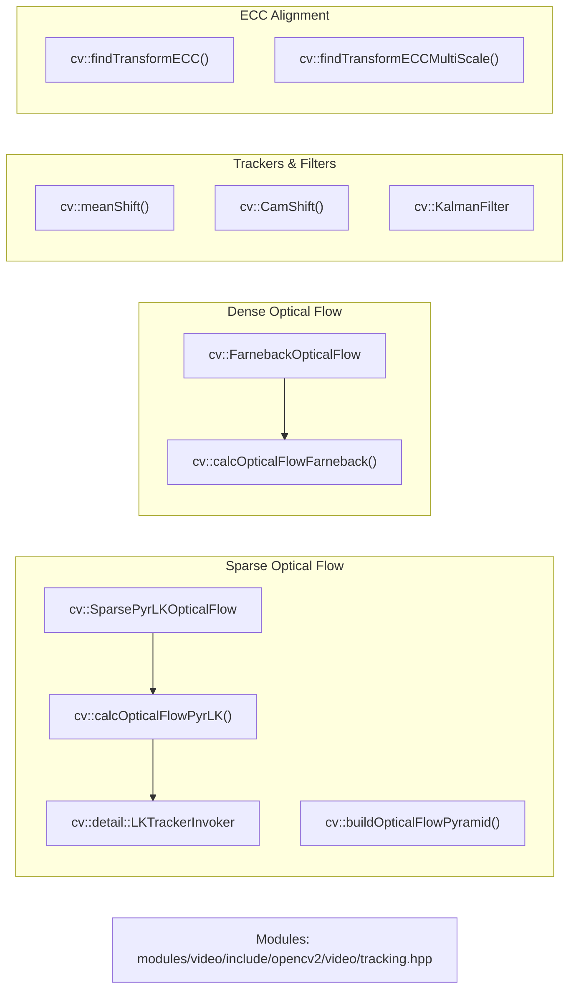
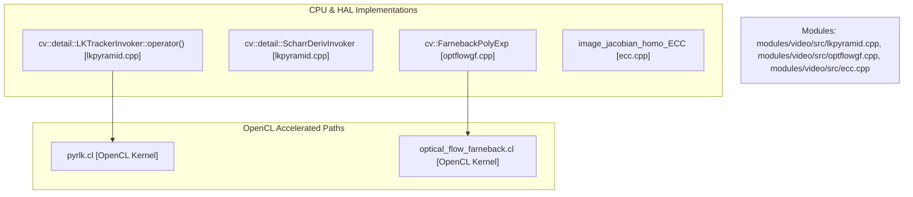

<!-- source: DeepWiki mcp.deepwiki.com · repo opencv/opencv · page 16.1 Optical Flow, Image Alignment, and Object Tracking · fetched 2026-10-30 -->

# Optical Flow, Image Alignment, and Object Tracking

<details>
<summary>Relevant source files</summary>

The following files were used as context for generating this wiki page:

- [cmake/OpenCVFindFrameworks.cmake](cmake/OpenCVFindFrameworks.cmake)
- [modules/python/test/test_eccms.py](modules/python/test/test_eccms.py)
- [modules/video/CMakeLists.txt](modules/video/CMakeLists.txt)
- [modules/video/include/opencv2/video/background_segm.hpp](modules/video/include/opencv2/video/background_segm.hpp)
- [modules/video/include/opencv2/video/tracking.hpp](modules/video/include/opencv2/video/tracking.hpp)
- [modules/video/perf/opencl/perf_bgfg_knn.cpp](modules/video/perf/opencl/perf_bgfg_knn.cpp)
- [modules/video/perf/opencl/perf_bgfg_mog2.cpp](modules/video/perf/opencl/perf_bgfg_mog2.cpp)
- [modules/video/perf/opencl/perf_optflow_pyrlk.cpp](modules/video/perf/opencl/perf_optflow_pyrlk.cpp)
- [modules/video/perf/perf_bgfg_knn.cpp](modules/video/perf/perf_bgfg_knn.cpp)
- [modules/video/perf/perf_bgfg_mog2.cpp](modules/video/perf/perf_bgfg_mog2.cpp)
- [modules/video/perf/perf_bgfg_utils.hpp](modules/video/perf/perf_bgfg_utils.hpp)
- [modules/video/perf/perf_ecc.cpp](modules/video/perf/perf_ecc.cpp)
- [modules/video/src/bgfg_KNN.cpp](modules/video/src/bgfg_KNN.cpp)
- [modules/video/src/bgfg_gaussmix2.cpp](modules/video/src/bgfg_gaussmix2.cpp)
- [modules/video/src/ecc.cpp](modules/video/src/ecc.cpp)
- [modules/video/src/eccms.cpp](modules/video/src/eccms.cpp)
- [modules/video/src/lkpyramid.cpp](modules/video/src/lkpyramid.cpp)
- [modules/video/src/lkpyramid.dispatch.cpp](modules/video/src/lkpyramid.dispatch.cpp)
- [modules/video/src/lkpyramid.hpp](modules/video/src/lkpyramid.hpp)
- [modules/video/src/lkpyramid.simd.hpp](modules/video/src/lkpyramid.simd.hpp)
- [modules/video/src/opencl/bgfg_knn.cl](modules/video/src/opencl/bgfg_knn.cl)
- [modules/video/src/opencl/bgfg_mog2.cl](modules/video/src/opencl/bgfg_mog2.cl)
- [modules/video/src/opencl/optical_flow_farneback.cl](modules/video/src/opencl/optical_flow_farneback.cl)
- [modules/video/src/opencl/pyrlk.cl](modules/video/src/opencl/pyrlk.cl)
- [modules/video/src/optflowgf.cpp](modules/video/src/optflowgf.cpp)
- [modules/video/test/ocl/test_bgfg_mog2.cpp](modules/video/test/ocl/test_bgfg_mog2.cpp)
- [modules/video/test/ocl/test_optflow_farneback.cpp](modules/video/test/ocl/test_optflow_farneback.cpp)
- [modules/video/test/ocl/test_optflowpyrlk.cpp](modules/video/test/ocl/test_optflowpyrlk.cpp)
- [modules/video/test/test_ecc.cpp](modules/video/test/test_ecc.cpp)
- [modules/videoio/perf/perf_camera.impl.hpp](modules/videoio/perf/perf_camera.impl.hpp)
- [modules/videoio/perf/perf_input.cpp](modules/videoio/perf/perf_input.cpp)
- [samples/cpp/image_alignment.cpp](samples/cpp/image_alignment.cpp)

</details>


## Purpose and Scope

This page documents the optical flow, image alignment, and object tracking facilities in the `opencv_video` module. It covers sparse and dense optical flow algorithms (Lucas-Kanade pyramidal flow and Farneback dense flow), the Enhanced Correlation Coefficient (ECC) image alignment algorithm, the `KalmanFilter` class, and the `meanShift`/`CAMShift` trackers, along with their OpenCL execution paths.

Background subtraction (also part of `opencv_video`) is covered separately in [Background Subtraction](#16.2). GPU-accelerated variants of optical flow (CUDA PyrLK and Farneback) are documented in [CUDA and GPU Acceleration](#14). Feature detectors used to seed optical flow (e.g., `goodFeaturesToTrack`) belong to [Feature Detection and Matching (features2d)](#6).

Sources: `[modules/video/include/opencv2/video/tracking.hpp:1-1115]()`, `[modules/video/src/lkpyramid.cpp:1-181]()`

---

## Public API Overview

All public declarations for tracking, optical flow, and image alignment live in `tracking.hpp`.

### Class Hierarchy and Free Functions

The module provides both high-level functional interfaces and an object-oriented `Algorithm`-based hierarchy for configuration persistence and execution.

**Tracking Class Structure:**
```mermaid
classDiagram
    class "Algorithm" {
    }
    class "SparseOpticalFlow" {
        +calc(prevImg, nextImg, prevPts, nextPts, status, err)
    }
    class "SparsePyrLKOpticalFlow" {
        +getWinSize() Size
        +setWinSize(Size)
        +getMaxLevel() int
        +setMaxLevel(int)
        +getTermCriteria() TermCriteria
        +setTermCriteria(TermCriteria)
        +getFlags() int
        +getMinEigThreshold() double
        +create(...) Ptr
    }
    class "DenseOpticalFlow" {
        +calc(I0, I1, flow)
        +collectGarbage()
    }
    class "FarnebackOpticalFlow" {
        +getNumLevels() int
        +getPyrScale() double
        +getWinSize() int
        +getNumIters() int
        +getPolyN() int
        +getPolySigma() double
        +create(...) Ptr
    }
    class "KalmanFilter" {
        +predict(control) Mat
        +correct(measurement) Mat
        +statePre Mat
        +statePost Mat
        +transitionMatrix Mat
        +measurementMatrix Mat
        +processNoiseCov Mat
        +measurementNoiseCov Mat
        +gain Mat
    }
    Algorithm <|-- SparseOpticalFlow
    Algorithm <|-- DenseOpticalFlow
    SparseOpticalFlow <|-- SparsePyrLKOpticalFlow
    DenseOpticalFlow <|-- FarnebackOpticalFlow
```
Sources: `[modules/video/include/opencv2/video/tracking.hpp:434-630]()`

**Core Functions Summary:**

| Function Name | Description / Purpose |
|---|---|
| `cv::buildOpticalFlowPyramid` | Constructs an image pyramid for `calcOpticalFlowPyrLK` |
| `cv::calcOpticalFlowPyrLK` | Calculates sparse optical flow using iterative pyramidal Lucas-Kanade |
| `cv::calcOpticalFlowFarneback` | Calculates dense optical flow using polynomial expansion |
| `cv::meanShift` | Finds an object center on a back-projection image iteratively |
| `cv::CamShift` | Finds an object center, size, and orientation using CAMShift |
| `cv::findTransformECC` | Finds the optimal warp between two images using ECC |
| `cv::findTransformECCMultiScale` | Multi-scale pyramidal version of ECC alignment |

Sources: `[modules/video/include/opencv2/video/tracking.hpp:59-506]()`, `[modules/video/src/eccms.cpp:11-14]()`

---

## Sparse Optical Flow: Lucas-Kanade (PyrLK)

### Algorithm and Implementation
The implementation follows the pyramidal Lucas-Kanade method (`calcOpticalFlowPyrLK`). For each tracked point, a spatial gradient matrix is assembled over a search window. An iterative Newton-Raphson step moves the corresponding window in the next frame.

**Data Flow through `calcOpticalFlowPyrLK` and `LKTrackerInvoker`:**

Sources: `[modules/video/src/lkpyramid.cpp:110-158]()`, `[modules/video/include/opencv2/video/tracking.hpp:134-186]()`

### `buildOpticalFlowPyramid`
`buildOpticalFlowPyramid` pre-computes image levels and gradients [modules/video/include/opencv2/video/tracking.hpp:109-128](). Scharr derivatives are computed via `calcScharrDeriv` (`[modules/video/src/lkpyramid.cpp:59-70]()`) using `ScharrDerivInvoker` (`[modules/video/src/lkpyramid.hpp:12-22]()`). It supports `tryReuseInputImage` to avoid redundant data copying.

### `calcOpticalFlowPyrLK`
Key flags include `OPTFLOW_USE_INITIAL_FLOW` (uses `nextPts` as starting point) and `OPTFLOW_LK_GET_MIN_EIGENVALS` (returns the minimum eigenvalue of the spatial gradient matrix in the `err` vector) [modules/video/include/opencv2/video/tracking.hpp:59-60]().

### OpenCL Acceleration Path (`pyrlk.cl`)
When `UMat` inputs are provided, execution dispatches to OpenCL kernels defined in `[modules/video/src/opencl/pyrlk.cl:1-558]()`. The OpenCL kernels employ local memory tiling (`LM_W` x `LM_H`) and reduction primitives (`reduce1`, `reduce2`, `reduce3`) to cache image patches and compute spatial gradients locally, significantly reducing global memory bandwidth.

Sources: `[modules/video/src/lkpyramid.cpp:1-181]()`, `[modules/video/src/opencl/pyrlk.cl:1-219]()`, `[modules/video/test/ocl/test_optflowpyrlk.cpp:59-153]()`

---

## Dense Optical Flow: Farneback

### `calcOpticalFlowFarneback` and `FarnebackOpticalFlow`
Computes a dense flow field where each pixel contains a 2D displacement vector. The algorithm is based on Gunnar Farneback's two-frame motion estimation using polynomial expansion (`[modules/video/src/optflowgf.cpp:52-55]()`).

- **Polynomial Expansion (`FarnebackPolyExp`)**: Approximates neighborhoods with quadratic polynomials (`[modules/video/src/optflowgf.cpp:116-203]()`).
- **Gaussian Preparation (`FarnebackPrepareGaussian`)**: Computes spatial weighting and inverse matrix components (`[modules/video/src/optflowgf.cpp:60-114]()`).
- **Flags**: `OPTFLOW_FARNEBACK_GAUSSIAN` enables Gaussian smoothing instead of box filtering for neighborhood smoothing (`[modules/video/include/opencv2/video/tracking.hpp:61]()`).

Sources: `[modules/video/src/optflowgf.cpp:43-206]()`, `[modules/video/include/opencv2/video/tracking.hpp:188-229]()`

---

## MeanShift and CAMShift Trackers

### `meanShift`
`meanShift` implements an iterative object search algorithm (`[modules/video/include/opencv2/video/tracking.hpp:89-108]()`). It takes the back-projection of an object histogram (`probImage`) and an initial search window. The mass center of the window is computed, and the window shifts to that center. Iterations repeat until `criteria.maxCount` or `criteria.epsilon` convergence is reached.

### `CamShift`
`CamShift` (Continuously Adaptive MeanShift) extends `meanShift` by finding the object center, size, and orientation (`[modules/video/include/opencv2/video/tracking.hpp:64-83]`). After calling `meanShift`, it uses the zero-th and first image moments of the tracked region to update the search window width, height, and orientation angle, returning a `RotatedRect`.

Sources: `[modules/video/include/opencv2/video/tracking.hpp:64-108]()`

---

## Kalman Filter

### `KalmanFilter` Class
`KalmanFilter` provides a recursive solution to the discrete-data linear filtering problem (`[modules/video/include/opencv2/video/tracking.hpp:434-484]()`). 

**Fields and Operations:**
- `statePre` ($x'_k$): Predicted state before measurement.
- `statePost` ($\hat{x}_k$): Corrected state after measurement.
- `transitionMatrix` ($A$): State transition matrix.
- `measurementMatrix` ($H$): Measurement matrix.
- `processNoiseCov` ($Q$), `measurementNoiseCov` ($R$): Covariance matrices.
- `gain` ($K$): Kalman gain.

**Typical Sequence:**
1. `kf.predict()`: Updates `statePre = transitionMatrix * statePost`.
2. `kf.correct(measurement)`: Computes innovation, updates `gain`, and computes `statePost`.

Sources: `[modules/video/include/opencv2/video/tracking.hpp:434-480]()`

---

## ECC Image Alignment

### `findTransformECC` and `findTransformECCMultiScale`
The Enhanced Correlation Coefficient (ECC) algorithm maximizes the normalized correlation coefficient between a template image and a warped input image. `findTransformECCMultiScale` provides a pyramidal implementation (`[modules/video/src/eccms.cpp:11-14]()`).

**Internal Image Jacobians:**
- Translation: `image_jacobian_translation_ECC` (`[modules/video/src/ecc.cpp:176-184]()`)
- Euclidean: `image_jacobian_euclidean_ECC` (`[modules/video/src/ecc.cpp:122-152]()`)
- Affine: `image_jacobian_affine_ECC` (`[modules/video/src/ecc.cpp:154-174]()`)
- Homography: `image_jacobian_homo_ECC` (`[modules/video/src/ecc.cpp:50-120]()`)

Sources: `[modules/video/src/ecc.cpp:50-188]()`, `[modules/video/test/test_ecc.cpp:43-134]()`, `[modules/video/perf/perf_ecc.cpp:1-73]()`

---

## Code Entity Association

### System-to-Code Mapping: Optical Flow & Tracking

Sources: `[modules/video/include/opencv2/video/tracking.hpp:1-630]()`, `[modules/video/src/lkpyramid.cpp:1-110]()`

### System-to-Code Mapping: Implementation Kernels & Helpers

Sources: `[modules/video/src/lkpyramid.cpp:69-110]()`, `[modules/video/src/optflowgf.cpp:116-203]()`, `[modules/video/src/ecc.cpp:50-120]()`, `[modules/video/src/opencl/pyrlk.cl:1-558]()`

---

