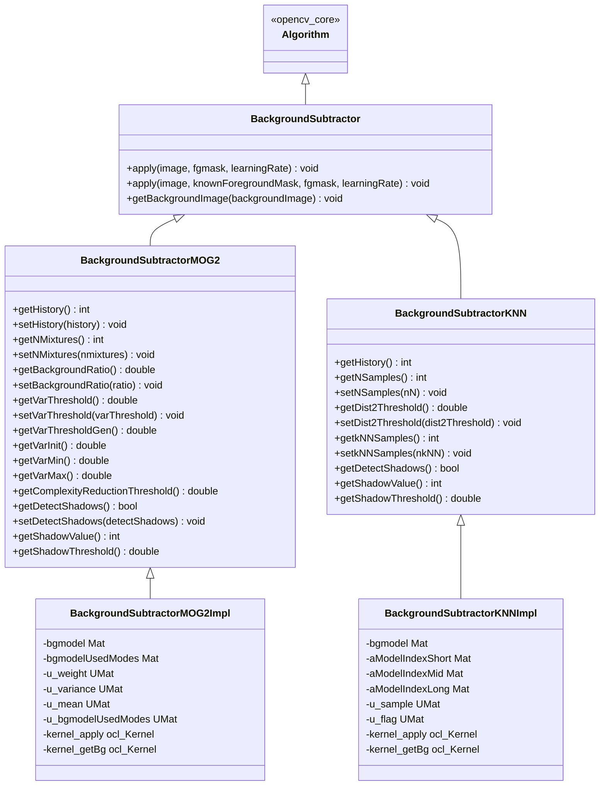
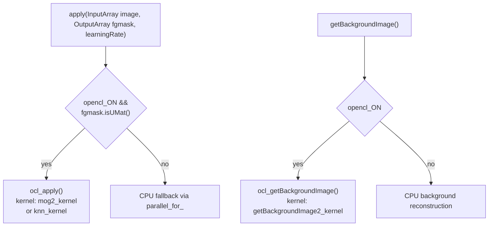
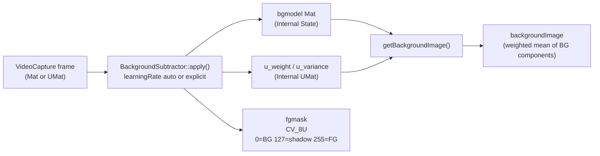

<!-- source: DeepWiki mcp.deepwiki.com · repo opencv/opencv · page 16.2 Background Subtraction · fetched 2026-10-30 -->

# Background Subtraction

<details>
<summary>Relevant source files</summary>

The following files were used as context for generating this wiki page:

- [modules/video/include/opencv2/video/background_segm.hpp](modules/video/include/opencv2/video/background_segm.hpp)
- [modules/video/perf/opencl/perf_bgfg_knn.cpp](modules/video/perf/opencl/perf_bgfg_knn.cpp)
- [modules/video/perf/opencl/perf_bgfg_mog2.cpp](modules/video/perf/opencl/perf_bgfg_mog2.cpp)
- [modules/video/perf/perf_bgfg_knn.cpp](modules/video/perf/perf_bgfg_knn.cpp)
- [modules/video/perf/perf_bgfg_mog2.cpp](modules/video/perf/perf_bgfg_mog2.cpp)
- [modules/video/perf/perf_bgfg_utils.hpp](modules/video/perf/perf_bgfg_utils.hpp)
- [modules/video/src/bgfg_KNN.cpp](modules/video/src/bgfg_KNN.cpp)
- [modules/video/src/bgfg_gaussmix2.cpp](modules/video/src/bgfg_gaussmix2.cpp)
- [modules/video/src/opencl/bgfg_knn.cl](modules/video/src/opencl/bgfg_knn.cl)
- [modules/video/src/opencl/bgfg_mog2.cl](modules/video/src/opencl/bgfg_mog2.cl)
- [modules/video/src/opencl/optical_flow_farneback.cl](modules/video/src/opencl/optical_flow_farneback.cl)
- [modules/video/src/optflowgf.cpp](modules/video/src/optflowgf.cpp)
- [modules/video/test/ocl/test_bgfg_mog2.cpp](modules/video/test/ocl/test_bgfg_mog2.cpp)
- [modules/video/test/ocl/test_optflow_farneback.cpp](modules/video/test/ocl/test_optflow_farneback.cpp)
- [modules/videoio/perf/perf_camera.impl.hpp](modules/videoio/perf/perf_camera.impl.hpp)
- [modules/videoio/perf/perf_input.cpp](modules/videoio/perf/perf_input.cpp)

</details>


## Purpose and Scope

This page covers the background subtraction subsystem in the `opencv_video` module: the `BackgroundSubtractor` abstract interface and its two concrete implementations, `BackgroundSubtractorMOG2` and `BackgroundSubtractorKNN`. These algorithms classify each pixel in a video frame as foreground, background, or shadow by maintaining a per-pixel statistical model that is updated incrementally.

For optical flow, Kalman filtering, and mean-shift tracking, see page [16.1](). For the machine learning algorithms used in other parts of the library, see page [13]().

Sources: [modules/video/include/opencv2/video/background_segm.hpp:55-97]()

---

## Class Hierarchy

The public API lives in [modules/video/include/opencv2/video/background_segm.hpp]().

**Class hierarchy diagram**



Sources: [modules/video/include/opencv2/video/background_segm.hpp:60-338](), [modules/video/src/bgfg_gaussmix2.cpp:121-177](), [modules/video/src/bgfg_KNN.cpp:67-131]()

---

## BackgroundSubtractor Interface

`BackgroundSubtractor` extends `Algorithm` and defines three pure virtual methods:

| Method | Description |
|--------|-------------|
| `apply(image, fgmask, learningRate=-1)` | Process one frame; write 8-bit foreground mask to `fgmask`. |
| `apply(image, knownForegroundMask, fgmask, learningRate=-1)` | Same, but pixels marked in `knownForegroundMask` are forced to foreground and excluded from model updates. |
| `getBackgroundImage(backgroundImage)` | Reconstruct a background image from the current model. |

**`learningRate` semantics:**

- `< 0` — algorithm chooses an automatic rate (decreasing from 1 toward `1/history` as frames accumulate). [modules/video/include/opencv2/video/background_segm.hpp:68-70]()
- `0` — model is frozen; no update. [modules/video/include/opencv2/video/background_segm.hpp:70-70]()
- `1` — model is completely re-initialized from the current frame. [modules/video/include/opencv2/video/background_segm.hpp:70-71]()
- `(0, 1)` — explicit exponential decay rate α.

Sources: [modules/video/include/opencv2/video/background_segm.hpp:60-97]()

---

## MOG2 — Gaussian Mixture Model Subtractor

### Algorithm Summary

`BackgroundSubtractorMOG2` implements the Zivkovic (2004, 2006) adaptive Gaussian mixture algorithm. Each pixel maintains up to `nmixtures` (default 5) Gaussian components. The components are kept sorted by descending `weight/sqrt(variance)` so that dominant background modes remain at the front. [modules/video/src/bgfg_gaussmix2.cpp:43-64]()

**Per-frame update steps (CPU path):**

1. Convert pixel to float.
2. Iterate over existing modes in weight-descending order. [modules/video/src/opencl/bgfg_mog2.cl:84-136]()
3. Compute squared Mahalanobis distance to each component. [modules/video/src/opencl/bgfg_mog2.cl:93-94]()
4. If `dist² < Tg * variance` → pixel fits that component → update weight, mean, variance; bubble the component upward. [modules/video/src/opencl/bgfg_mog2.cl:99-130]()
5. If `totalWeight < TB` and `dist² < Tb * variance` → pixel is background. [modules/video/src/opencl/bgfg_mog2.cl:96-97]()
6. If no component fits and `alphaT > 0` → create a new component (replacing weakest if at capacity). [modules/video/src/opencl/bgfg_mog2.cl:160-190]()
7. Prune components whose weight decays below `-prune`. [modules/video/src/opencl/bgfg_mog2.cl:131-132]()
8. If shadow detection is enabled and pixel is foreground, run shadow detection — output `shadowVal` (default 127) instead of 255. [modules/video/src/opencl/bgfg_mog2.cl:193-219]()

Sources: [modules/video/src/bgfg_gaussmix2.cpp:43-83](), [modules/video/src/bgfg_gaussmix2.cpp:106-118]()

### Factory Function

```cpp
Ptr<BackgroundSubtractorMOG2> createBackgroundSubtractorMOG2(int history=500, double varThreshold=16, bool detectShadows=true)
```

Returns a pointer to a `BackgroundSubtractorMOG2Impl` instance.

Sources: [modules/video/include/opencv2/video/background_segm.hpp:247-249]()

### MOG2 Parameters

| Parameter | Default | Meaning |
|-----------|---------|---------|
| `history` | 500 | Window length; learning rate α = 1/history [modules/video/src/bgfg_gaussmix2.cpp:106]() |
| `nmixtures` | 5 | Max Gaussian components per pixel [modules/video/src/bgfg_gaussmix2.cpp:108]() |
| `varThreshold` (Tb) | 16 | Squared Mahalanobis distance for background classification [modules/video/src/bgfg_gaussmix2.cpp:107]() |
| `varThresholdGen` (Tg) | 9 | Squared Mahalanobis distance to assign pixel to existing component [modules/video/src/bgfg_gaussmix2.cpp:110]() |
| `backgroundRatio` (TB) | 0.9 | Cumulative weight threshold defining "background" components [modules/video/src/bgfg_gaussmix2.cpp:109]() |
| `fVarInit` | 15 | Initial variance for new components [modules/video/src/bgfg_gaussmix2.cpp:111]() |
| `fVarMin` | 4 | Minimum variance clamp [modules/video/src/bgfg_gaussmix2.cpp:113]() |
| `fVarMax` | 75 | Maximum variance clamp [modules/video/src/bgfg_gaussmix2.cpp:112]() |
| `fCT` | 0.05 | Complexity reduction prior (set 0 for Stauffer–Grimson) [modules/video/src/bgfg_gaussmix2.cpp:116]() |
| `detectShadows` | true | Enable shadow classification [modules/video/src/bgfg_gaussmix2.cpp:133]() |
| `nShadowDetection` | 127 | Pixel value written for detected shadows [modules/video/src/bgfg_gaussmix2.cpp:117]() |
| `fTau` | 0.5 | Shadow intensity threshold (Tau) [modules/video/src/bgfg_gaussmix2.cpp:118]() |

Sources: [modules/video/src/bgfg_gaussmix2.cpp:106-118](), [modules/video/include/opencv2/video/background_segm.hpp:105-236]()

### Shadow Detection

Shadow detection checks background components for pixels that are a scaled (darker) version of the background mean. A pixel is classified as shadow if:

- `tau * ||mean||² ≤ dot(pixel, mean) ≤ ||mean||²`  (intensity in valid shadow range) [modules/video/src/opencl/bgfg_mog2.cl:209-209]()
- `dist²(a * mean, pixel) < Tb * variance * a²`  (chromaticity close enough) [modules/video/src/opencl/bgfg_mog2.cl:216-216]()

Where `a = dot(pixel, mean) / dot(mean, mean)`. [modules/video/src/opencl/bgfg_mog2.cl:211-211]()

Sources: [modules/video/src/opencl/bgfg_mog2.cl:193-219]()

---

## KNN — K-Nearest Neighbour Subtractor

### Algorithm Summary

`BackgroundSubtractorKNN` stores a fixed set of raw pixel samples per pixel (rather than parametric Gaussians). Background classification is by k-nearest-neighbour vote. [modules/video/src/bgfg_KNN.cpp:50-56]()

Each pixel maintains `3 * nN` samples split across three circular buffers at different timescales: **Short**, **Mid**, and **Long**. [modules/video/src/bgfg_KNN.cpp:171-184]() This three-tier cascade provides both fast adaptation and long-term stability.

**Per-frame classification:**

1. Compute squared Euclidean distance to each of the stored samples.
2. Count samples within `fTb` distance. [modules/video/src/bgfg_KNN.cpp:86-86]()
3. If the count of background samples within threshold exceeds `nkNN` → pixel is background. [modules/video/src/bgfg_KNN.cpp:83-83]()
4. Otherwise → foreground; optionally run shadow check.

Sources: [modules/video/src/bgfg_KNN.cpp:50-56](), [modules/video/src/bgfg_KNN.cpp:79-95]()

### Factory Function

```cpp
Ptr<BackgroundSubtractorKNN> createBackgroundSubtractorKNN(int history=500, double dist2Threshold=400.0, bool detectShadows=true)
```

Sources: [modules/video/include/opencv2/video/background_segm.hpp:336-338]()

### KNN Parameters

| Parameter | Default | Meaning |
|-----------|---------|---------|
| `history` | 500 | Controls update rates of tier counters [modules/video/src/bgfg_KNN.cpp:59]() |
| `nN` | 7 | Samples per tier (total 3 * nN per pixel) [modules/video/src/bgfg_KNN.cpp:60]() |
| `nkNN` | 3 | k in kNN; number of close samples required for background [modules/video/src/bgfg_KNN.cpp:83]() |
| `dist2Threshold` (Tb) | 400 | Squared Euclidean distance threshold for sample matching [modules/video/src/bgfg_KNN.cpp:61]() |
| `detectShadows` | true | Enable shadow classification [modules/video/src/bgfg_KNN.cpp:89]() |
| `nShadowDetection` | 127 | Mask value for shadows [modules/video/src/bgfg_KNN.cpp:64]() |
| `fTau` | 0.5 | Shadow intensity ratio threshold [modules/video/src/bgfg_KNN.cpp:65]() |

Sources: [modules/video/src/bgfg_KNN.cpp:58-65](), [modules/video/include/opencv2/video/background_segm.hpp:256-326]()

---

## Foreground Mask Encoding

Both algorithms produce an 8-bit mask with the same encoding:

| Value | Meaning |
|-------|---------|
| `0` | Background |
| `127` (default) | Shadow (when `detectShadows=true`) |
| `255` | Foreground |

Sources: [modules/video/src/bgfg_gaussmix2.cpp:117](), [modules/video/src/bgfg_KNN.cpp:64]()

---

## OpenCL Acceleration

Both implementations have OpenCL-accelerated paths that activate when `UMat` is used.

**OpenCL execution flow diagram**



Sources: [modules/video/src/bgfg_gaussmix2.cpp:145-147](), [modules/video/src/bgfg_KNN.cpp:96-98](), [modules/video/src/opencl/bgfg_mog2.cl:40-52]()

**OpenCL kernel sources:**

| Algorithm | Kernel file | Kernel names |
|-----------|-------------|--------------|
| MOG2 | [modules/video/src/opencl/bgfg_mog2.cl]() | `mog2_kernel` [modules/video/src/opencl/bgfg_mog2.cl:40]() |
| KNN | [modules/video/src/opencl/bgfg_knn.cl]() | `knn_kernel`, `getBackgroundImage2_kernel` [modules/video/src/bgfg_KNN.cpp:162]() |

Kernels are compiled with `-D CN=<n> -D NMIXTURES=<n>` (MOG2) or `-D CN=<n> -D NSAMPLES=<n>` (KNN). Shadow detection is conditionally compiled with `-D SHADOW_DETECT`. [modules/video/src/bgfg_KNN.cpp:162](), [modules/video/src/opencl/bgfg_mog2.cl:49]()

Sources: [modules/video/src/bgfg_gaussmix2.cpp:86](), [modules/video/src/bgfg_KNN.cpp:45](), [modules/video/src/bgfg_KNN.cpp:162]()

---

## Usage Pattern

**Data flow diagram**



Sources: [modules/video/include/opencv2/video/background_segm.hpp:60-97](), [modules/video/perf/opencl/perf_bgfg_mog2.cpp:42-48](), [modules/video/perf/perf_bgfg_knn.cpp:37-43]()

---

