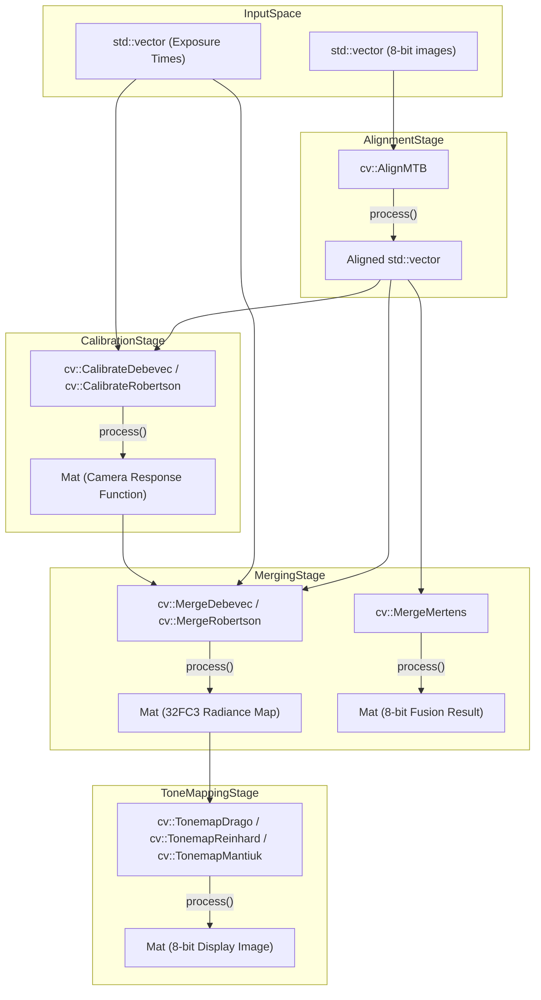

<!-- source: DeepWiki mcp.deepwiki.com · repo opencv/opencv · page 17.1 HDR Imaging and Tone Mapping · fetched 2026-10-30 -->

# HDR Imaging and Tone Mapping

<details>
<summary>Relevant source files</summary>

The following files were used as context for generating this wiki page:

- [modules/photo/include/opencv2/photo.hpp](modules/photo/include/opencv2/photo.hpp)
- [modules/photo/src/align.cpp](modules/photo/src/align.cpp)
- [modules/photo/src/calibrate.cpp](modules/photo/src/calibrate.cpp)
- [modules/photo/src/hdr_common.cpp](modules/photo/src/hdr_common.cpp)
- [modules/photo/src/hdr_common.hpp](modules/photo/src/hdr_common.hpp)
- [modules/photo/src/merge.cpp](modules/photo/src/merge.cpp)
- [modules/photo/src/tonemap.cpp](modules/photo/src/tonemap.cpp)
- [modules/photo/test/test_hdr.cpp](modules/photo/test/test_hdr.cpp)

</details>


The OpenCV HDR pipeline provides a comprehensive suite of algorithms for capturing and processing High Dynamic Range images. This includes tools for aligning multiple exposures, calibrating camera response functions, merging LDR (Low Dynamic Range) sequences into HDR radiance maps, and tone mapping those maps for display on standard 8-bit monitors.

## Pipeline Overview

The standard HDR workflow in OpenCV typically follows these stages:
1.  **Alignment**: Correcting camera shake between exposures using `cv::AlignMTB` [modules/photo/src/align.cpp:50-182]().
2.  **Calibration**: Estimating the Camera Response Function (CRF) using `cv::CalibrateDebevec` or `cv::CalibrateRobertson` [modules/photo/src/calibrate.cpp:51-160]().
3.  **Merging**: Combining exposures into a 32-bit floating-point radiance map using `cv::MergeDebevec` or `cv::MergeRobertson`, or performing direct exposure fusion via `cv::MergeMertens` [modules/photo/src/merge.cpp:50-240]().
4.  **Tone Mapping**: Converting the HDR radiance map back to an 8-bit representation using operators like `cv::TonemapDrago`, `cv::TonemapReinhard`, or `cv::TonemapMantiuk` [modules/photo/src/tonemap.cpp:56-300]().

### HDR Data Flow and Code Entities

The following diagram maps the logical HDR pipeline to the specific OpenCV classes and functions responsible for each stage.

**HDR Pipeline Logic to Code Entity Mapping**

Sources: [modules/photo/include/opencv2/photo.hpp:56-60](), [modules/photo/src/merge.cpp:59-65](), [modules/photo/src/calibrate.cpp:63-70]()

---

## Exposure Alignment

When capturing multiple exposures, small camera movements can cause ghosting artifacts. OpenCV implements the Median Threshold Bitmap (MTB) alignment algorithm.

### AlignMTB
The `cv::AlignMTB` class converts images to binary bitmaps based on the median intensity and uses an image pyramid to calculate the integer shift required to align them [modules/photo/src/align.cpp:50-182]().

*   **Key Function**: `calculateShift(img0, img1)` computes the relative offset [modules/photo/src/align.cpp:119-165]().
*   **Implementation**: It builds a pyramid using `buildPyr` [modules/photo/src/align.cpp:133-134]() and iteratively refines the shift from `maxlevel` down to 0 [modules/photo/src/align.cpp:137-163]().
*   **Exclusion Range**: Uses an `exclude_range` to mask out pixels with intensities too close to the median, increasing robustness against noise [modules/photo/src/align.cpp:53-57]().
*   **Application**: `shiftMat` performs the actual image translation using `copyTo` on specific `Rect` regions calculated from the shift vector [modules/photo/src/align.cpp:167-182]().

Sources: [modules/photo/src/align.cpp:50-182](), [modules/photo/test/test_hdr.cpp:121-147]()

---

## Camera Calibration and Response Functions

The Camera Response Function (CRF) defines the relationship between scene radiance and measured pixel intensity. Estimating the inverse CRF is critical for accurate HDR merging.

### CalibrateDebevec
Implements the algorithm by Debevec and Malik. It solves an overdetermined system of linear equations to find the log-exposure values for each pixel intensity [modules/photo/src/calibrate.cpp:51-159]().
*   **Sampling**: Picks a set of pixel locations either randomly or in a rectangular grid [modules/photo/src/calibrate.cpp:87-109]().
*   **Smoothing**: A `lambda` parameter weights the smoothness equations, which penalize the second derivative of the response curve [modules/photo/src/calibrate.cpp:142-148]().
*   **Optimization**: The system is solved using Singular Value Decomposition (`DECOMP_SVD`) [modules/photo/src/calibrate.cpp:152]().

### CalibrateRobertson
A probabilistic approach to estimate the camera response function. It iteratively improves the estimated response and radiance values, utilizing `RobertsonWeights` which implements a hat-like weighting function [modules/photo/src/hdr_common.cpp:80-95]().

Sources: [modules/photo/src/calibrate.cpp:51-160](), [modules/photo/include/opencv2/photo.hpp:460-500](), [modules/photo/src/hdr_common.cpp:80-95]()

---

## Exposure Merging

Merging combines aligned LDR images into a single 32-bit floating-point radiance map (`CV_32FC3`).

| Algorithm | Class | Requires Times? | Requires Response? | Characteristics |
| :--- | :--- | :--- | :--- | :--- |
| **Debevec** | `cv::MergeDebevec` | Yes | Optional | Uses weighted average of log-exposures [modules/photo/src/merge.cpp:50-148](). |
| **Robertson** | `cv::MergeRobertson` | Yes | Optional | Uses a probabilistic weighting scheme based on a hat function. |
| **Mertens** | `cv::MergeMertens` | No | No | "Exposure Fusion" - merges based on contrast, saturation, and well-exposedness [modules/photo/src/merge.cpp:167-240](). |

### Implementation Detail: MergeDebevec
The `MergeDebevec::process` function utilizes `triangleWeights` [modules/photo/src/hdr_common.cpp:62-78]() to emphasize pixels in the middle of the dynamic range. It uses a Look-Up Table (LUT) for both weights and response values to optimize computation across the image stack [modules/photo/src/merge.cpp:119-140]().

### Implementation Detail: MergeMertens
`cv::MergeMertens` calculates weights for each image based on contrast (Laplacian filter), saturation (standard deviation across channels), and well-exposedness (Gaussian curve around 0.5) [modules/photo/src/merge.cpp:202-225](). The final merge is performed using a Laplacian pyramid to avoid boundary artifacts [modules/photo/src/merge.cpp:230-238]().

Sources: [modules/photo/src/merge.cpp:50-240](), [modules/photo/src/hdr_common.cpp:62-78](), [modules/photo/include/opencv2/photo.hpp:510-580]()

---

## Tone Mapping Operators

Tone mapping compresses the high dynamic range of a radiance map into the limited range of standard displays (0.0-1.0 or 0-255).

### Class Hierarchy and Code Association
The following diagram illustrates the relationship between the base `Tonemap` class and its specialized implementations in the `photo` module.

**Tone Mapping Class Hierarchy**
```mermaid
classDiagram
    class Tonemap {
        <<Interface>>
        +process(src, dst)
        +getGamma()
        +setGamma(gamma)
    }
    class TonemapDrago {
        +getSaturation()
        +getBias()
    }
    class TonemapReinhard {
        +getIntensity()
        +getLightAdaptation()
        +getColorAdaptation()
    }
    class TonemapMantiuk {
        +getScale()
        +getSaturation()
    }
    Tonemap <|-- TonemapDrago
    Tonemap <|-- TonemapReinhard
    Tonemap <|-- TonemapMantiuk
    
    Tonemap : [modules/photo/src/tonemap.cpp:56]
    TonemapDrago : [modules/photo/src/tonemap.cpp:113]
    TonemapReinhard : [modules/photo/src/tonemap.cpp:199]
```

### Operator Details
*   **TonemapDrago**: Based on adaptive logarithmic mapping. It uses a `bias` parameter to control the compression of high luminance values [modules/photo/src/tonemap.cpp:113-160]() and calculates log-mean luminance to scale the image [modules/photo/src/tonemap.cpp:140]().
*   **TonemapReinhard**: Uses photographic practice to map luminance, adjusting `intensity` (overall brightness), `light_adapt` (adaptation to light), and `color_adapt` (chromatic adaptation) [modules/photo/src/tonemap.cpp:199-240]().
*   **TonemapMantiuk**: Preserves local contrast by mapping gradients in the log domain.
*   **TonemapImpl**: The base implementation provides simple linear scaling followed by gamma correction using `pow(dst, 1.0f / gamma, dst)` [modules/photo/src/tonemap.cpp:83]().
*   **mapLuminance**: A utility function used by multiple operators to apply calculated luminance changes back to color channels while preserving saturation [modules/photo/src/hdr_common.cpp:97-107]().

Sources: [modules/photo/src/tonemap.cpp:56-300](), [modules/photo/include/opencv2/photo.hpp:250-450](), [modules/photo/src/hdr_common.cpp:97-107]()

---

