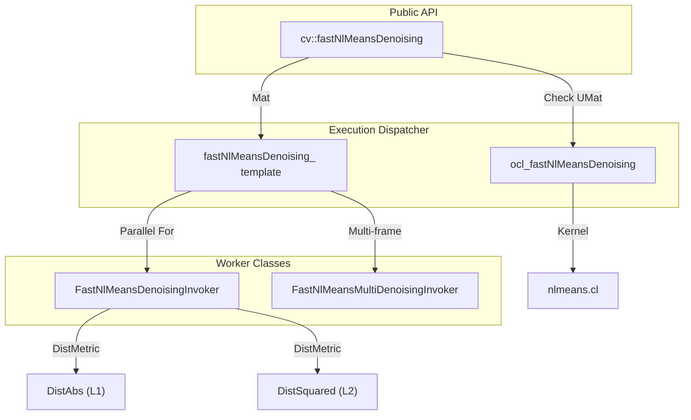
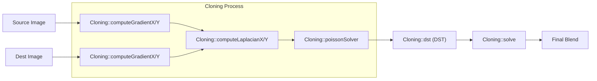
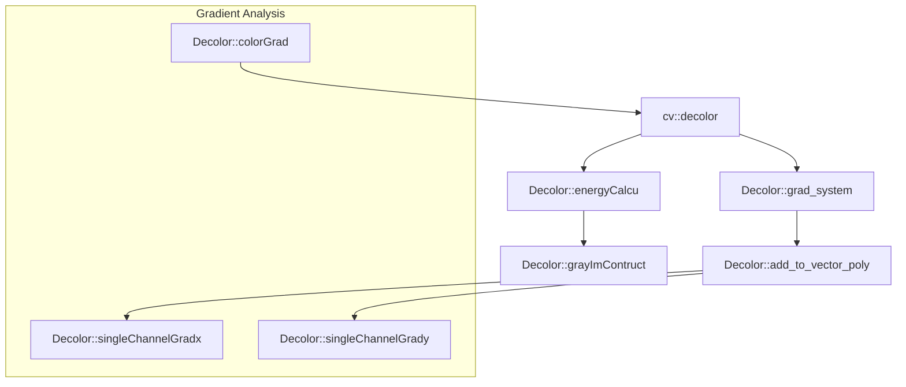

<!-- source: DeepWiki mcp.deepwiki.com · repo opencv/opencv · page 17.2 Denoising, Inpainting, and Seamless Cloning · fetched 2026-10-30 -->

# Denoising, Inpainting, and Seamless Cloning

Relevant source files

The following files were used as context for generating this wiki page:

- [hal/riscv-rvv/src/imgproc/box_filter.cpp](hal/riscv-rvv/src/imgproc/box_filter.cpp)
- [hal/riscv-rvv/src/imgproc/gaussian_blur.cpp](hal/riscv-rvv/src/imgproc/gaussian_blur.cpp)
- [modules/core/perf/perf_compare.cpp](modules/core/perf/perf_compare.cpp)
- [modules/imgproc/perf/perf_blur.cpp](modules/imgproc/perf/perf_blur.cpp)
- [modules/imgproc/perf/perf_cvt_color.cpp](modules/imgproc/perf/perf_cvt_color.cpp)
- [modules/imgproc/perf/perf_filter2d.cpp](modules/imgproc/perf/perf_filter2d.cpp)
- [modules/imgproc/perf/perf_integral.cpp](modules/imgproc/perf/perf_integral.cpp)
- [modules/imgproc/perf/perf_pyramids.cpp](modules/imgproc/perf/perf_pyramids.cpp)
- [modules/imgproc/perf/perf_resize.cpp](modules/imgproc/perf/perf_resize.cpp)
- [modules/imgproc/perf/perf_threshold.cpp](modules/imgproc/perf/perf_threshold.cpp)
- [modules/imgproc/perf/perf_warp.cpp](modules/imgproc/perf/perf_warp.cpp)
- [modules/imgproc/src/demosaicing.cpp](modules/imgproc/src/demosaicing.cpp)
- [modules/imgproc/src/stackblur.cpp](modules/imgproc/src/stackblur.cpp)
- [modules/imgproc/src/sumpixels.simd.hpp](modules/imgproc/src/sumpixels.simd.hpp)
- [modules/imgproc/src/utils.cpp](modules/imgproc/src/utils.cpp)
- [modules/imgproc/test/test_color.cpp](modules/imgproc/test/test_color.cpp)
- [modules/imgproc/test/test_cvtyuv.cpp](modules/imgproc/test/test_cvtyuv.cpp)
- [modules/imgproc/test/test_stackblur.cpp](modules/imgproc/test/test_stackblur.cpp)
- [modules/photo/include/opencv2/photo/photo.hpp](modules/photo/include/opencv2/photo/photo.hpp)
- [modules/photo/perf/opencl/perf_denoising.cpp](modules/photo/perf/opencl/perf_denoising.cpp)
- [modules/photo/perf/perf_inpaint.cpp](modules/photo/perf/perf_inpaint.cpp)
- [modules/photo/src/arrays.hpp](modules/photo/src/arrays.hpp)
- [modules/photo/src/contrast_preserve.cpp](modules/photo/src/contrast_preserve.cpp)
- [modules/photo/src/contrast_preserve.hpp](modules/photo/src/contrast_preserve.hpp)
- [modules/photo/src/denoising.cpp](modules/photo/src/denoising.cpp)
- [modules/photo/src/fast_nlmeans_denoising_invoker.hpp](modules/photo/src/fast_nlmeans_denoising_invoker.hpp)
- [modules/photo/src/fast_nlmeans_denoising_invoker_commons.hpp](modules/photo/src/fast_nlmeans_denoising_invoker_commons.hpp)
- [modules/photo/src/fast_nlmeans_denoising_opencl.hpp](modules/photo/src/fast_nlmeans_denoising_opencl.hpp)
- [modules/photo/src/fast_nlmeans_multi_denoising_invoker.hpp](modules/photo/src/fast_nlmeans_multi_denoising_invoker.hpp)
- [modules/photo/src/inpaint.cpp](modules/photo/src/inpaint.cpp)
- [modules/photo/src/npr.cpp](modules/photo/src/npr.cpp)
- [modules/photo/src/npr.hpp](modules/photo/src/npr.hpp)
- [modules/photo/src/opencl/nlmeans.cl](modules/photo/src/opencl/nlmeans.cl)
- [modules/photo/src/precomp.hpp](modules/photo/src/precomp.hpp)
- [modules/photo/src/seamless_cloning.cpp](modules/photo/src/seamless_cloning.cpp)
- [modules/photo/src/seamless_cloning.hpp](modules/photo/src/seamless_cloning.hpp)
- [modules/photo/src/seamless_cloning_impl.cpp](modules/photo/src/seamless_cloning_impl.cpp)
- [modules/photo/test/ocl/test_denoising.cpp](modules/photo/test/ocl/test_denoising.cpp)
- [modules/photo/test/test_cloning.cpp](modules/photo/test/test_cloning.cpp)
- [modules/photo/test/test_decolor.cpp](modules/photo/test/test_decolor.cpp)
- [modules/photo/test/test_inpaint.cpp](modules/photo/test/test_inpaint.cpp)
- [modules/photo/test/test_npr.cpp](modules/photo/test/test_npr.cpp)
- [modules/stitching/src/opencl/multibandblend.cl](modules/stitching/src/opencl/multibandblend.cl)
- [modules/stitching/test/test_blenders.cpp](modules/stitching/test/test_blenders.cpp)
- [modules/video/perf/perf_optflowpyrlk.cpp](modules/video/perf/perf_optflowpyrlk.cpp)
- [modules/video/test/test_camshift.cpp](modules/video/test/test_camshift.cpp)
- [modules/video/test/test_optflowpyrlk.cpp](modules/video/test/test_optflowpyrlk.cpp)
- [samples/cpp/npr_demo.cpp](samples/cpp/npr_demo.cpp)

This page documents the image restoration and computational photography features within the `opencv_photo` module. These algorithms handle the removal of noise via Non-Local Means, the restoration of missing image regions through inpainting, and the blending of disparate image sources using Poisson partial differential equations, alongside decolorization and non-photorealistic rendering filters.

## 1. Non-Local Means Denoising

The `fastNlMeansDenoising` family of functions implements the Non-Local Means algorithm, which denoises images by averaging pixels with similar surrounding neighborhoods, rather than just local spatial neighbors.

### Implementation Architecture
The core logic is encapsulated in the `FastNlMeansDenoisingInvoker` class, which is executed via `parallel_for_` to distribute processing across CPU cores [modules/photo/src/denoising.cpp:57-60](). The invoker manages a search window and a template window to calculate weights based on patch similarity [modules/photo/src/fast_nlmeans_denoising_invoker.hpp:103-146]().

The algorithm supports several variants:
*   **Single Image:** `cv::fastNlMeansDenoising` for grayscale or multi-channel images [modules/photo/src/denoising.cpp:104-111]().
*   **Color Image:** `cv::fastNlMeansDenoisingColored` which converts to Lab space to denoise the luminance and chrominance components separately.
*   **Video/Multi-frame:** `cv::fastNlMeansDenoisingMulti` which uses temporal redundancy across a sequence of frames [modules/photo/src/fast_nlmeans_multi_denoising_invoker.hpp:54-62]().

### Data Flow and Code Entities

| Entity | Role | Source |
| :--- | :--- | :--- |
| `FastNlMeansDenoisingInvoker` | Template class for parallel CPU execution. | [modules/photo/src/fast_nlmeans_denoising_invoker.hpp:54-92]() |
| `ocl_fastNlMeansDenoising` | OpenCL implementation for GPU acceleration. | [modules/photo/src/fast_nlmeans_denoising_opencl.hpp:79-142]() |
| `DistAbs` / `DistSquared` | Functors defining the distance metric (L1 or L2). | [modules/photo/src/fast_nlmeans_denoising_invoker_commons.hpp:92-214]() |
| `almost_dist2weight` | Precomputed lookup table for exponential weight values to avoid runtime `exp` calls. | [modules/photo/src/fast_nlmeans_denoising_invoker.hpp:134-141]() |
| `ocl_calcAlmostDist2Weight` | OpenCL kernel to precompute weights on GPU. | [modules/photo/src/fast_nlmeans_denoising_opencl.hpp:27-77]() |

### System Map: Denoising Pipeline
The following diagram bridges the high-level API to the internal template-driven execution.

Title: Denoising System Map

Sources: [modules/photo/src/denoising.cpp:48-102](), [modules/photo/src/fast_nlmeans_denoising_invoker.hpp:54-62](), [modules/photo/src/fast_nlmeans_denoising_opencl.hpp:79-81](), [modules/photo/src/fast_nlmeans_denoising_opencl.hpp:123-125]()

---

## 2. Inpainting

The `cv::inpaint` function restores corrupted parts of an image (e.g., removing scratches or text) using information from the neighborhood of the masked region [modules/photo/src/inpaint.cpp:54-55](). It utilizes a priority queue to process pixels from the boundary inward [modules/photo/src/inpaint.cpp:100-152]().

### Supported Methods
1.  **Navier-Stokes (`INPAINT_NS`):** Based on fluid dynamics, propagating image intensity and "vorticity" (isophotes) along the boundaries of the region.
2.  **Telea (`INPAINT_TELEA`):** A Fast Marching Method (FMM) based algorithm that propagates image information from the known boundary into the unknown region using weighted averages of neighborhood pixels [modules/photo/src/inpaint.cpp:195-222]().

Sources: [modules/photo/src/inpaint.cpp:77-81](), [modules/photo/src/inpaint.cpp:168-190]()

---

## 3. Seamless Cloning and Poisson Blending

Seamless cloning allows a source image patch to be inserted into a destination image while automatically adjusting colors and lighting to match the background. This is achieved by solving Poisson partial differential equations.

### The Cloning Class
The internal `Cloning` class handles the gradient-domain processing [modules/photo/src/seamless_cloning.hpp:53-87](). It computes the gradients of the source and destination, modifies them based on the selected flag, and then solves for the final pixel values that satisfy the new gradient field.

### Key Functions
*   **`cv::seamlessClone`**: The primary entry point. It calculates the ROI, generates masks, and invokes the solver [modules/photo/src/seamless_cloning.cpp:67-105]().
*   **`Cloning::solve`**: Implements the discrete solver using a Discrete Sine Transform (DST) to efficiently solve the Poisson equation [modules/photo/src/seamless_cloning_impl.cpp:145-203]().
*   **`Cloning::dst`**: A custom implementation of the Discrete Sine Transform using the OpenCV `dft` function [modules/photo/src/seamless_cloning_impl.cpp:98-143]().
*   **`Cloning::poissonSolver`**: Constructs the Laplacian and boundary conditions for the linear system [modules/photo/src/seamless_cloning_impl.cpp:205-224]().

### Cloning Modes
| Mode | Behavior | Code Constant |
| :--- | :--- | :--- |
| **Normal** | Standard Poisson blending. | `NORMAL_CLONE` |
| **Mixed** | Blends source and destination gradients (useful for transparent objects). | `MIXED_CLONE` |
| **Monochrome** | Ignores source color, keeps destination texture. | `MONOCHROME_TRANSFER` |

### Code Flow: Seamless Cloning
Title: Seamless Cloning Data Flow

Sources: [modules/photo/src/seamless_cloning_impl.cpp:48-96](), [modules/photo/src/seamless_cloning_impl.cpp:205-220](), [modules/photo/src/seamless_cloning.cpp:102-104](), [modules/photo/src/seamless_cloning_impl.cpp:145-162]()

---

## 4. Non-Photorealistic Rendering (NPR)

OpenCV provides filters that transform standard photographs into artistic representations using edge-preserving smoothing techniques.

### Core Filters
*   **`edgePreservingFilter`**: Smooths the image while keeping edges sharp using Recursive Filtering or Normalized Convolution.
*   **`detailEnhance`**: Enhances the details of an image by increasing the contrast of high-frequency components.
*   **`pencilSketch`**: Produces a black-and-white or color sketch.
*   **`stylization`**: Produces a watercolor-like effect.

### Decolorization
The `cv::decolor` function transforms a color image to grayscale while preserving the original color contrast, which is often lost in standard luminance-based conversions [modules/photo/src/contrast_preserve.cpp:53-174](). It uses an optimization-based approach defined in the `Decolor` class [modules/photo/src/contrast_preserve.hpp:50-75]().

### Decolorization Implementation
The `Decolor` class calculates gradients in the Lab color space and optimizes weights for a linear combination of R, G, and B channels to minimize energy loss between color and gray gradients [modules/photo/src/contrast_preserve.hpp:60-75]().

Title: Decolorization Entity Map

Sources: [modules/photo/src/contrast_preserve.cpp:84-89](), [modules/photo/src/contrast_preserve.hpp:70-74](), [modules/photo/src/contrast_preserve.cpp:150-157]()

---

