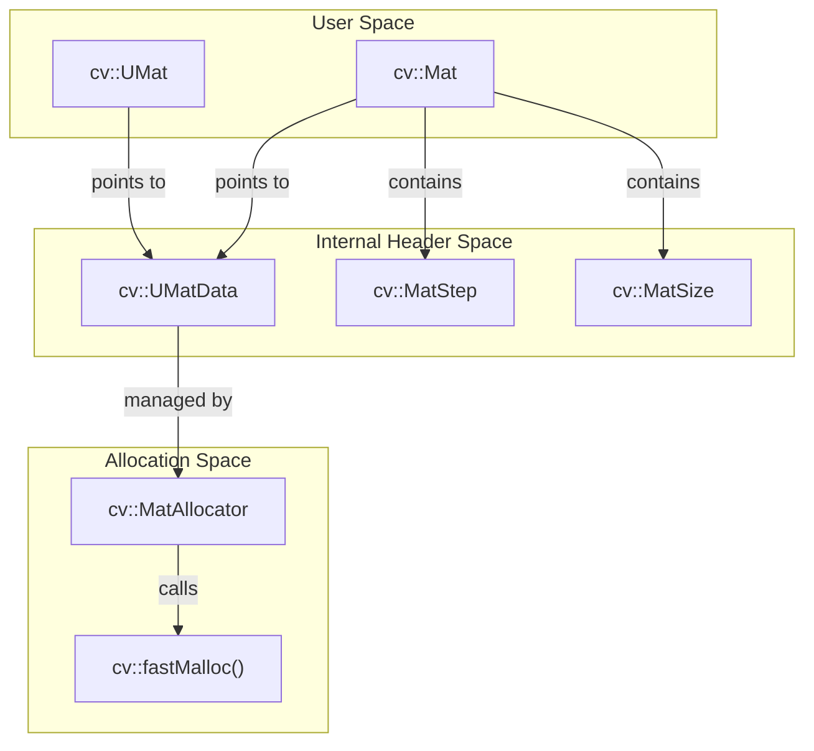
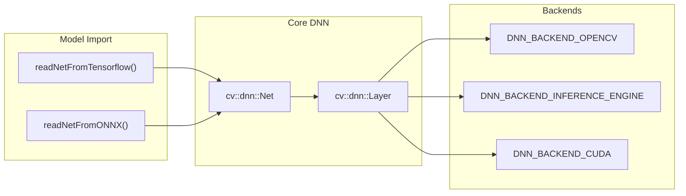

<!-- source: DeepWiki mcp.deepwiki.com · repo opencv/opencv · page 18 Glossary · fetched 2026-10-30 -->

# Glossary

Relevant source files

The following files were used as context for generating this wiki page:

- [cmake/OpenCVCompilerOptimizations.cmake](cmake/OpenCVCompilerOptimizations.cmake)
- [modules/core/include/opencv2/core.hpp](modules/core/include/opencv2/core.hpp)
- [modules/core/include/opencv2/core/base.hpp](modules/core/include/opencv2/core/base.hpp)
- [modules/core/include/opencv2/core/core.hpp](modules/core/include/opencv2/core/core.hpp)
- [modules/core/include/opencv2/core/cv_cpu_dispatch.h](modules/core/include/opencv2/core/cv_cpu_dispatch.h)
- [modules/core/include/opencv2/core/cv_cpu_helper.h](modules/core/include/opencv2/core/cv_cpu_helper.h)
- [modules/core/include/opencv2/core/cvdef.h](modules/core/include/opencv2/core/cvdef.h)
- [modules/core/include/opencv2/core/matx.hpp](modules/core/include/opencv2/core/matx.hpp)
- [modules/core/include/opencv2/core/operations.hpp](modules/core/include/opencv2/core/operations.hpp)
- [modules/core/include/opencv2/core/private.hpp](modules/core/include/opencv2/core/private.hpp)
- [modules/core/include/opencv2/core/types.hpp](modules/core/include/opencv2/core/types.hpp)
- [modules/core/include/opencv2/core/utility.hpp](modules/core/include/opencv2/core/utility.hpp)
- [modules/core/include/opencv2/core/utils/buffer_area.private.hpp](modules/core/include/opencv2/core/utils/buffer_area.private.hpp)
- [modules/core/src/algorithm.cpp](modules/core/src/algorithm.cpp)
- [modules/core/src/buffer_area.cpp](modules/core/src/buffer_area.cpp)
- [modules/core/src/command_line_parser.cpp](modules/core/src/command_line_parser.cpp)
- [modules/core/src/precomp.hpp](modules/core/src/precomp.hpp)
- [modules/core/src/system.cpp](modules/core/src/system.cpp)
- [modules/core/test/test_operations.cpp](modules/core/test/test_operations.cpp)
- [modules/core/test/test_utils.cpp](modules/core/test/test_utils.cpp)
- [platforms/linux/riscv64-071-gcc.toolchain.cmake](platforms/linux/riscv64-071-gcc.toolchain.cmake)

This glossary defines technical terms, domain concepts, and abbreviations specific to the OpenCV codebase. It serves as a reference for onboarding engineers to navigate the architectural patterns and jargon used across the library.

## Core Data Structures and Containers

OpenCV relies on a set of foundational data structures and container classes for representing multi-dimensional numerical arrays, points, rectangles, sizes, and automatic temporary memory buffers. 

For a deep dive into foundational C++/API terms (`Mat`, `UMat`, `MatShape`, `InputArray`, `OutputArray`, `Scalar`, `Point`, `Rect`, `Size`, `RNG`, `Algorithm`, `FileStorage`, `AutoBuffer`), see [Glossary: Core Types and Containers](#18.1).

*   **Mat**: The primary N-dimensional dense numerical single-channel or multi-channel array class, managing headers and reference-counted underlying memory buffers [modules/core/include/opencv2/core/mat.hpp:792-2365]().
*   **UMat (Universal Mat)**: A variant of `Mat` designed for "Transparent API" execution wrapping OpenCL buffers [modules/core/include/opencv2/core/mat.hpp:2490-2720]().
*   **InputArray / OutputArray**: Proxy classes allowing functions to accept multiple container types (`Mat`, `UMat`, `std::vector`, `Scalar`) without template bloat [modules/core/include/opencv2/core/mat.hpp:76-155]().
*   **AutoBuffer**: A helper class providing stack-allocated temporary storage for small buffers, falling back to dynamic heap allocation when necessary [modules/core/include/opencv2/core/utility.hpp:97-156]().

Sources: [modules/core/include/opencv2/core/mat.hpp:76-2720](), [modules/core/include/opencv2/core/utility.hpp:97-156]()

## Build, Packaging, and Runtime Acceleration

The build system leverages custom CMake macros for module discovery, target configuration, and world library packaging. Runtime performance is accelerated via CPU dispatching, Universal SIMD Intrinsics, the Hardware Abstraction Layer (HAL), OpenCL, and CUDA.

For details on build-time logic, packaging, CPU dispatch, and runtime acceleration backends, see [Glossary: Build, Packaging, and Runtime Acceleration](#18.2).

*   **ocv_add_module**: The primary CMake macro used to declare OpenCV modules and manage inter-module dependencies [cmake/OpenCVModule.cmake:124-250]().
*   **opencv_world**: A build configuration consolidating all enabled modules into a single shared or static library [cmake/OpenCVModule.cmake:30-32]().
*   **CPU Dispatching & Universal Intrinsics**: Mechanisms enabling single-source vector code across SSE, AVX, NEON, VSX, and RISC-V RVV [modules/core/include/opencv2/core/cvdef.h:89-98](), [cmake/OpenCVCompilerOptimizations.cmake:1-58]().

Sources: [cmake/OpenCVModule.cmake:30-250](), [cmake/OpenCVCompilerOptimizations.cmake:1-58](), [modules/core/include/opencv2/core/cvdef.h:89-98]()

## DNN, Vision Algorithms, and Module-Specific Terms

OpenCV includes specialized modules for deep learning (`dnn`), feature detection (`features2d`), camera calibration (`calib3d` / geometry modules), video analysis, and object detection.

For details on module-specific terms, neural network layers, model importers, and advanced algorithms, see [Glossary: DNN, Vision Algorithms, and Module-Specific Terms](#18.3).

*   **Net / Layer**: Core abstractions in the `dnn` module representing neural network graph execution structures and individual layers [modules/dnn/include/opencv2/dnn/dnn.hpp:455-1017]().
*   **Pinhole Camera Model**: Geometric model relating 3D world coordinates to 2D image projections via camera intrinsic and extrinsic parameters [modules/core/include/opencv2/core.hpp:129-150]().
*   **ocl4dnn / cuda4dnn**: Optimized backend execution layers mapping DNN operations to OpenCL and CUDA hardware targets.

Sources: [modules/dnn/include/opencv2/dnn/dnn.hpp:455-1017](), [modules/core/include/opencv2/core.hpp:129-150]()

## Code Entity Mapping Diagrams

### Data Structure Relationship
The following diagram illustrates how high-level user data structures map to internal memory management entities.

**Memory Management Architecture**

Sources: [modules/core/include/opencv2/core/mat.hpp:792-2365](), [modules/core/src/system.cpp:108-109]()

### DNN Execution Flow
This diagram shows how the `Net` class interacts with importers and backends.

**DNN Execution Pipeline**

Sources: [modules/dnn/include/opencv2/dnn/dnn.hpp:71-108](), [modules/dnn/include/opencv2/dnn/dnn.hpp:455-1017]()

## Abbreviations Table

| Abbreviation | Full Term | Description | Relevant Code |
| :--- | :--- | :--- | :--- |
| **DNN** | Deep Neural Network | Module for inference of pre-trained models. | [modules/dnn/include/opencv2/dnn/dnn.hpp:62-63]() |
| **HAL** | Hardware Abstraction Layer | Low-level interface for hardware acceleration. | [modules/core/include/opencv2/core/cvdef.h:89-98]() |
| **SIMD** | Single Instruction, Multiple Data | Hardware acceleration via vector instructions. | [modules/core/include/opencv2/core/cv_cpu_dispatch.h:1-50]() |
| **PCH** | Precompiled Headers | Optimization to speed up compilation. | [cmake/OpenCVCompilerOptions.cmake:1-50]() |
| **NCHW** | Batch, Channel, Height, Width | Common tensor layout used in DNN models. | [modules/dnn/include/opencv2/dnn/dnn.hpp:1-100]() |

Sources: [modules/core/src/system.cpp:1-200](), [cmake/OpenCVCompilerOptions.cmake:1-100](), [modules/dnn/include/opencv2/dnn/dnn.hpp:1-100]()

---

