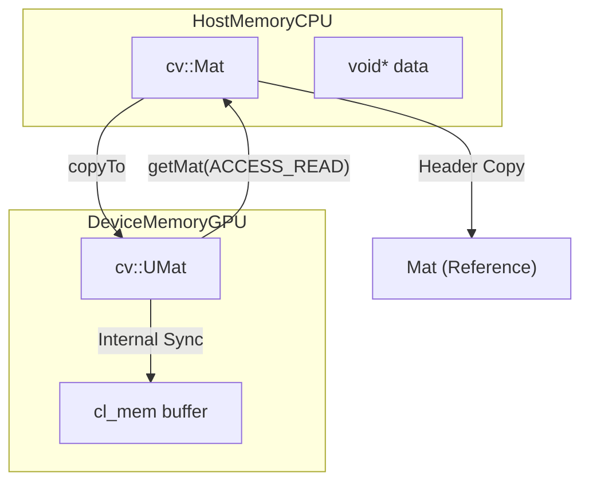
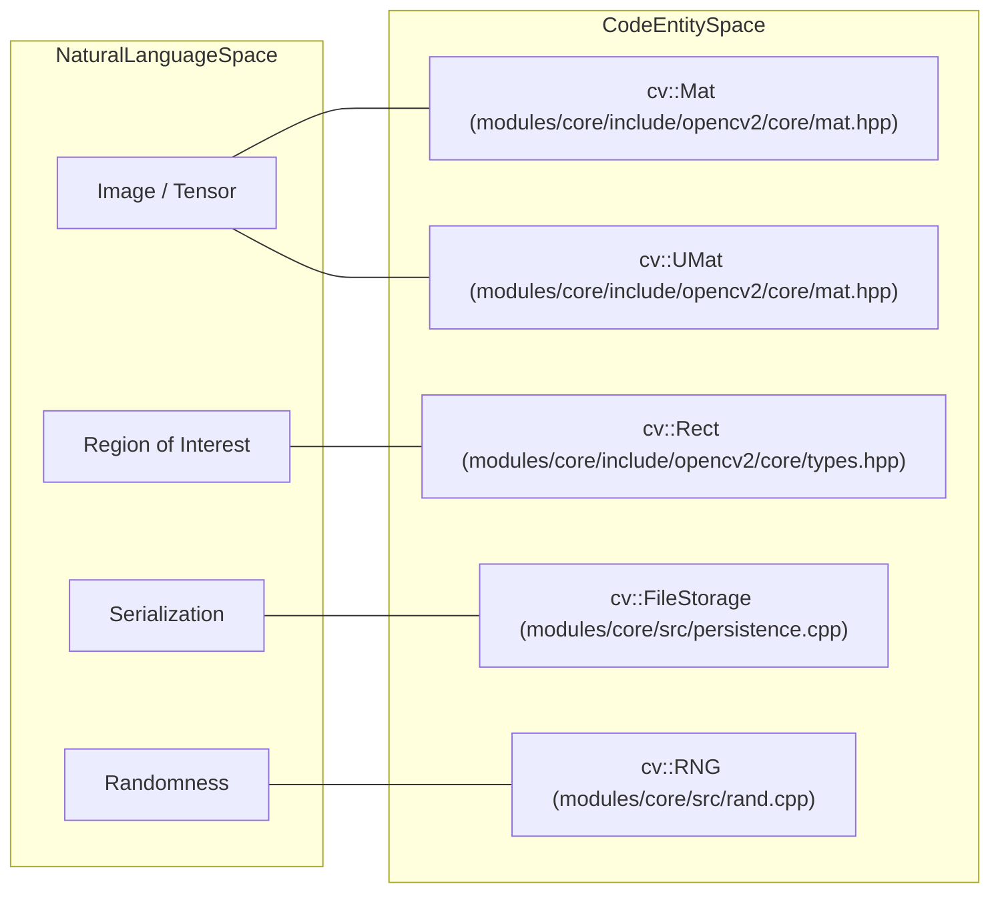

<!-- source: DeepWiki mcp.deepwiki.com · repo opencv/opencv · page 18.1 Glossary: Core Types and Containers · fetched 2026-10-30 -->

# Glossary: Core Types and Containers

Relevant source files

The following files were used as context for generating this wiki page:

- [cmake/OpenCVCompilerOptimizations.cmake](cmake/OpenCVCompilerOptimizations.cmake)
- [modules/core/include/opencv2/core.hpp](modules/core/include/opencv2/core.hpp)
- [modules/core/include/opencv2/core/base.hpp](modules/core/include/opencv2/core/base.hpp)
- [modules/core/include/opencv2/core/core.hpp](modules/core/include/opencv2/core/core.hpp)
- [modules/core/include/opencv2/core/cv_cpu_dispatch.h](modules/core/include/opencv2/core/cv_cpu_dispatch.h)
- [modules/core/include/opencv2/core/cv_cpu_helper.h](modules/core/include/opencv2/core/cv_cpu_helper.h)
- [modules/core/include/opencv2/core/cvdef.h](modules/core/include/opencv2/core/cvdef.h)
- [modules/core/include/opencv2/core/cvstd.hpp](modules/core/include/opencv2/core/cvstd.hpp)
- [modules/core/include/opencv2/core/cvstd.inl.hpp](modules/core/include/opencv2/core/cvstd.inl.hpp)
- [modules/core/include/opencv2/core/mat.hpp](modules/core/include/opencv2/core/mat.hpp)
- [modules/core/include/opencv2/core/mat.inl.hpp](modules/core/include/opencv2/core/mat.inl.hpp)
- [modules/core/include/opencv2/core/matx.hpp](modules/core/include/opencv2/core/matx.hpp)
- [modules/core/include/opencv2/core/ocl.hpp](modules/core/include/opencv2/core/ocl.hpp)
- [modules/core/include/opencv2/core/operations.hpp](modules/core/include/opencv2/core/operations.hpp)
- [modules/core/include/opencv2/core/persistence.hpp](modules/core/include/opencv2/core/persistence.hpp)
- [modules/core/include/opencv2/core/private.hpp](modules/core/include/opencv2/core/private.hpp)
- [modules/core/include/opencv2/core/types.hpp](modules/core/include/opencv2/core/types.hpp)
- [modules/core/include/opencv2/core/utility.hpp](modules/core/include/opencv2/core/utility.hpp)
- [modules/core/include/opencv2/core/utils/buffer_area.private.hpp](modules/core/include/opencv2/core/utils/buffer_area.private.hpp)
- [modules/core/perf/perf_arithm.cpp](modules/core/perf/perf_arithm.cpp)
- [modules/core/src/algorithm.cpp](modules/core/src/algorithm.cpp)
- [modules/core/src/arithm.cpp](modules/core/src/arithm.cpp)
- [modules/core/src/buffer_area.cpp](modules/core/src/buffer_area.cpp)
- [modules/core/src/command_line_parser.cpp](modules/core/src/command_line_parser.cpp)
- [modules/core/src/copy.cpp](modules/core/src/copy.cpp)
- [modules/core/src/matrix.cpp](modules/core/src/matrix.cpp)
- [modules/core/src/matrix_transform.cpp](modules/core/src/matrix_transform.cpp)
- [modules/core/src/matrix_wrap.cpp](modules/core/src/matrix_wrap.cpp)
- [modules/core/src/ocl.cpp](modules/core/src/ocl.cpp)
- [modules/core/src/ocl_disabled.impl.hpp](modules/core/src/ocl_disabled.impl.hpp)
- [modules/core/src/opencl/flip.cl](modules/core/src/opencl/flip.cl)
- [modules/core/src/opencl/gemm.cl](modules/core/src/opencl/gemm.cl)
- [modules/core/src/opencl/transpose.cl](modules/core/src/opencl/transpose.cl)
- [modules/core/src/persistence.cpp](modules/core/src/persistence.cpp)
- [modules/core/src/persistence.hpp](modules/core/src/persistence.hpp)
- [modules/core/src/persistence_base64_encoding.cpp](modules/core/src/persistence_base64_encoding.cpp)
- [modules/core/src/persistence_base64_encoding.hpp](modules/core/src/persistence_base64_encoding.hpp)
- [modules/core/src/persistence_impl.hpp](modules/core/src/persistence_impl.hpp)
- [modules/core/src/persistence_json.cpp](modules/core/src/persistence_json.cpp)
- [modules/core/src/persistence_types.cpp](modules/core/src/persistence_types.cpp)
- [modules/core/src/persistence_xml.cpp](modules/core/src/persistence_xml.cpp)
- [modules/core/src/persistence_yml.cpp](modules/core/src/persistence_yml.cpp)
- [modules/core/src/precomp.hpp](modules/core/src/precomp.hpp)
- [modules/core/src/rand.cpp](modules/core/src/rand.cpp)
- [modules/core/src/system.cpp](modules/core/src/system.cpp)
- [modules/core/src/umatrix.cpp](modules/core/src/umatrix.cpp)
- [modules/core/test/ocl/test_opencl.cpp](modules/core/test/ocl/test_opencl.cpp)
- [modules/core/test/test_arithm.cpp](modules/core/test/test_arithm.cpp)
- [modules/core/test/test_io.cpp](modules/core/test/test_io.cpp)
- [modules/core/test/test_mat.cpp](modules/core/test/test_mat.cpp)
- [modules/core/test/test_operations.cpp](modules/core/test/test_operations.cpp)
- [modules/core/test/test_precomp.hpp](modules/core/test/test_precomp.hpp)
- [modules/core/test/test_rand.cpp](modules/core/test/test_rand.cpp)
- [modules/core/test/test_umat.cpp](modules/core/test/test_umat.cpp)
- [modules/core/test/test_utils.cpp](modules/core/test/test_utils.cpp)
- [modules/dnn/include/opencv2/dnn/shape_utils.hpp](modules/dnn/include/opencv2/dnn/shape_utils.hpp)
- [modules/python/test/test_filestorage_io.py](modules/python/test/test_filestorage_io.py)
- [modules/ts/src/ocl_test.cpp](modules/ts/src/ocl_test.cpp)
- [modules/ts/src/ts_func.cpp](modules/ts/src/ts_func.cpp)
- [platforms/linux/riscv64-071-gcc.toolchain.cmake](platforms/linux/riscv64-071-gcc.toolchain.cmake)

## Purpose and Scope
This page defines foundational C++ data structures and API abstractions used throughout the OpenCV library. These core types handle memory management, N-dimensional array representation, function argument polymorphism, geometric primitives, temporary buffers, and object serialization.

Sources: [modules/core/include/opencv2/core/mat.hpp:107-120](), [modules/core/include/opencv2/core/types.hpp:150-700]()

---

## N-Dimensional Arrays: Mat, UMat, and MatShape

### cv::Mat
`cv::Mat` is an N-dimensional dense numerical single-channel or multi-channel array [modules/core/include/opencv2/core/mat.hpp:792-805](). It consists of a matrix header and a pointer to the underlying data buffer.
- **Reference Counting**: Uses an internal reference counter (`uatomic_int* refcount`) to manage shared buffer ownership across shallow copies [modules/core/include/opencv2/core/mat.hpp:2114-2118]().
- **Data Layout**: Supports layouts such as `NCHW`, `NHWC`, and `BLOCK` (`NC1HWC0`) via the `DataLayout` enum [modules/core/include/opencv2/core/mat.hpp:75-95]().

Sources: [modules/core/include/opencv2/core/mat.hpp:792-810](), [modules/core/include/opencv2/core/mat.hpp:75-95]()

### cv::UMat
`cv::UMat` (Universal Mat) powers OpenCV's Transparent API, enabling automatic offloading of computations to OpenCL-capable devices [modules/core/include/opencv2/core/mat.hpp:2407-2410]().
- **Memory Abstraction**: Uses a `UMatData` handle that abstracts data location between host RAM and device memory [modules/core/src/umatrix.cpp:64-70]().
- **Access Flags**: Accessing data via `getMat(AccessFlag flags)` synchronizes host and device buffers [modules/core/include/opencv2/core/mat.hpp:2490-2492]().

Sources: [modules/core/include/opencv2/core/mat.hpp:2407-2410](), [modules/core/src/umatrix.cpp:64-80](), [modules/core/include/opencv2/core/mat.hpp:2490-2492]()

### cv::MatShape
`cv::MatShape` represents matrix or tensor shapes without heap allocation overhead by storing dimensions in a fixed-size array alongside layout metadata [modules/core/include/opencv2/core/mat.hpp:107-109]().

Sources: [modules/core/include/opencv2/core/mat.hpp:107-120](), [modules/core/src/matrix.cpp:47-60]()

### Diagram: Array Data Flow

Sources: [modules/core/include/opencv2/core/mat.hpp:792-810](), [modules/core/src/ocl.cpp:126-132](), [modules/core/src/umatrix.cpp:64-80]()

---

## API Abstractions: InputArray and OutputArray

OpenCV uses proxy classes to accept multiple container types (`Mat`, `UMat`, `Matx`, `std::vector`) through a unified function signature:
- **cv::_InputArray**: A read-only input proxy [modules/core/include/opencv2/core/mat.inl.hpp:164-176]().
- **cv::_OutputArray**: Derived from `_InputArray`, allowing functions to allocate or resize output containers [modules/core/include/opencv2/core/mat.inl.hpp:265-270]().
- **cv::_InputOutputArray**: Used for in-place operations [modules/core/include/opencv2/core/mat.inl.hpp:343-345]().

Sources: [modules/core/include/opencv2/core/mat.inl.hpp:154-350](), [modules/core/src/matrix_wrap.cpp:60-80]()

---

## Basic Geometric Types and Containers

| Class | Description | Fields / Behavior | Sources |
| :--- | :--- | :--- | :--- |
| `cv::Point_` | 2D Point | `x`, `y` | [modules/core/include/opencv2/core/types.hpp:160-165]() |
| `cv::Size_` | 2D Size | `width`, `height` | [modules/core/include/opencv2/core/types.hpp:300-305]() |
| `cv::Rect_` | 2D Rectangle | `x`, `y`, `width`, `height` | [modules/core/include/opencv2/core/types.hpp:440-445]() |
| `cv::Scalar_` | 4-element vector | `val[4]` (pixel colors) | [modules/core/include/opencv2/core/types.hpp:650-655]() |
| `cv::AutoBuffer` | Temporary buffer | Stack-allocated fixed storage with automatic fallback to heap allocation for large sizes. | [modules/core/include/opencv2/core/cvstd.hpp:189]() |

Sources: [modules/core/include/opencv2/core/types.hpp:150-700](), [modules/core/include/opencv2/core/cvstd.hpp:189]()

---

## System Utilities and Serialization

- **cv::Algorithm**: Base class for non-trivial algorithms (e.g., `Feature2D`), providing a common interface for parameter configuration and state serialization [modules/core/src/algorithm.cpp:55-65]().
- **cv::RNG**: Random number generator implementing a Multiply-With-Carry (MWC) algorithm for fast pseudo-random values (`fill()`, `uniform()`, `gaussian()`) [modules/core/src/rand.cpp:60-75]().
- **cv::FileStorage**: Reads and writes data in XML, YAML, and JSON formats, supporting Base64-encoded binary streams and hierarchical traversal via `FileNode` [modules/core/src/persistence.cpp:16-25]().

Sources: [modules/core/src/algorithm.cpp:50-94](), [modules/core/src/rand.cpp:50-150](), [modules/core/src/persistence.cpp:83-180]()

---

## Code Entity Mapping

### Diagram: Core Entity Mapping

Sources: [modules/core/include/opencv2/core/mat.hpp:792](), [modules/core/include/opencv2/core/types.hpp:440](), [modules/core/src/persistence.cpp:16](), [modules/core/src/rand.cpp:60]()

---

