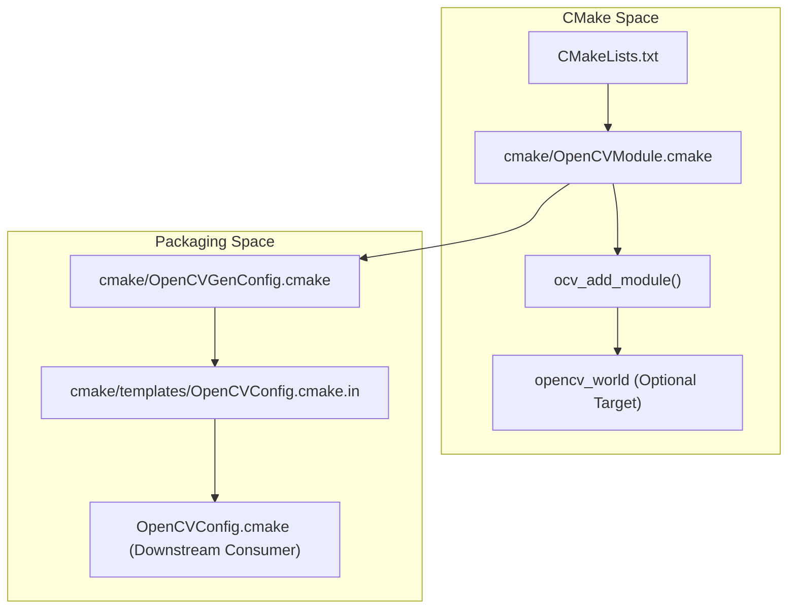
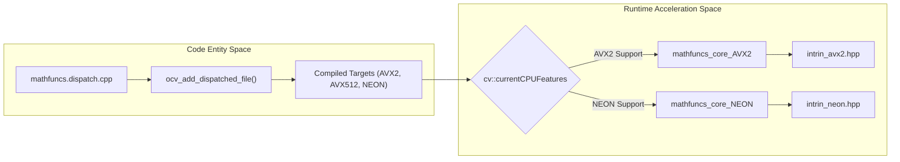

<!-- source: DeepWiki mcp.deepwiki.com · repo opencv/opencv · page 18.2 Glossary: Build, Packaging, and Runtime Acceleration · fetched 2026-10-30 -->

# Glossary: Build, Packaging, and Runtime Acceleration

Relevant source files

The following files were used as context for generating this wiki page:

- [3rdparty/fastcv/fastcv.cmake](3rdparty/fastcv/fastcv.cmake)
- [3rdparty/ippicv/CMakeLists.txt](3rdparty/ippicv/CMakeLists.txt)
- [CMakeLists.txt](CMakeLists.txt)
- [cmake/OpenCVCRTLinkage.cmake](cmake/OpenCVCRTLinkage.cmake)
- [cmake/OpenCVCompilerOptions.cmake](cmake/OpenCVCompilerOptions.cmake)
- [cmake/OpenCVDetectCXXCompiler.cmake](cmake/OpenCVDetectCXXCompiler.cmake)
- [cmake/OpenCVDownload.cmake](cmake/OpenCVDownload.cmake)
- [cmake/OpenCVFindIPP.cmake](cmake/OpenCVFindIPP.cmake)
- [cmake/OpenCVFindIPPIW.cmake](cmake/OpenCVFindIPPIW.cmake)
- [cmake/OpenCVFindLibsGUI.cmake](cmake/OpenCVFindLibsGUI.cmake)
- [cmake/OpenCVFindLibsPerf.cmake](cmake/OpenCVFindLibsPerf.cmake)
- [cmake/OpenCVFindLibsVideo.cmake](cmake/OpenCVFindLibsVideo.cmake)
- [cmake/OpenCVGenConfig.cmake](cmake/OpenCVGenConfig.cmake)
- [cmake/OpenCVInstallLayout.cmake](cmake/OpenCVInstallLayout.cmake)
- [cmake/OpenCVModule.cmake](cmake/OpenCVModule.cmake)
- [cmake/OpenCVPCHSupport.cmake](cmake/OpenCVPCHSupport.cmake)
- [cmake/OpenCVUtils.cmake](cmake/OpenCVUtils.cmake)
- [cmake/mirrors/custom.cmake](cmake/mirrors/custom.cmake)
- [cmake/mirrors/gitcode.cmake](cmake/mirrors/gitcode.cmake)
- [cmake/platforms/OpenCV-Android.cmake](cmake/platforms/OpenCV-Android.cmake)
- [cmake/platforms/OpenCV-Darwin.cmake](cmake/platforms/OpenCV-Darwin.cmake)
- [cmake/platforms/OpenCV-WinRT.cmake](cmake/platforms/OpenCV-WinRT.cmake)
- [cmake/platforms/OpenCV-WindowsCE.cmake](cmake/platforms/OpenCV-WindowsCE.cmake)
- [cmake/templates/OpenCVConfig-version.cmake.in](cmake/templates/OpenCVConfig-version.cmake.in)
- [cmake/templates/OpenCVConfig.cmake.in](cmake/templates/OpenCVConfig.cmake.in)
- [cmake/templates/OpenCVConfig.root-ANDROID.cmake.in](cmake/templates/OpenCVConfig.root-ANDROID.cmake.in)
- [cmake/templates/OpenCVConfig.root-WIN32.cmake.in](cmake/templates/OpenCVConfig.root-WIN32.cmake.in)
- [cmake/templates/cvconfig.h.in](cmake/templates/cvconfig.h.in)
- [doc/tutorials/introduction/config_reference/config_reference.markdown](doc/tutorials/introduction/config_reference/config_reference.markdown)
- [doc/tutorials/introduction/env_reference/env_reference.markdown](doc/tutorials/introduction/env_reference/env_reference.markdown)
- [modules/core/CMakeLists.txt](modules/core/CMakeLists.txt)
- [modules/core/include/opencv2/core/hal/intrin.hpp](modules/core/include/opencv2/core/hal/intrin.hpp)
- [modules/core/include/opencv2/core/hal/intrin_avx.hpp](modules/core/include/opencv2/core/hal/intrin_avx.hpp)
- [modules/core/include/opencv2/core/hal/intrin_avx512.hpp](modules/core/include/opencv2/core/hal/intrin_avx512.hpp)
- [modules/core/include/opencv2/core/hal/intrin_cpp.hpp](modules/core/include/opencv2/core/hal/intrin_cpp.hpp)
- [modules/core/include/opencv2/core/hal/intrin_lasx.hpp](modules/core/include/opencv2/core/hal/intrin_lasx.hpp)
- [modules/core/include/opencv2/core/hal/intrin_lsx.hpp](modules/core/include/opencv2/core/hal/intrin_lsx.hpp)
- [modules/core/include/opencv2/core/hal/intrin_math.hpp](modules/core/include/opencv2/core/hal/intrin_math.hpp)
- [modules/core/include/opencv2/core/hal/intrin_msa.hpp](modules/core/include/opencv2/core/hal/intrin_msa.hpp)
- [modules/core/include/opencv2/core/hal/intrin_neon.hpp](modules/core/include/opencv2/core/hal/intrin_neon.hpp)
- [modules/core/include/opencv2/core/hal/intrin_rvv071.hpp](modules/core/include/opencv2/core/hal/intrin_rvv071.hpp)
- [modules/core/include/opencv2/core/hal/intrin_rvv_scalable.hpp](modules/core/include/opencv2/core/hal/intrin_rvv_scalable.hpp)
- [modules/core/include/opencv2/core/hal/intrin_sse.hpp](modules/core/include/opencv2/core/hal/intrin_sse.hpp)
- [modules/core/include/opencv2/core/hal/intrin_vsx.hpp](modules/core/include/opencv2/core/hal/intrin_vsx.hpp)
- [modules/core/include/opencv2/core/hal/intrin_wasm.hpp](modules/core/include/opencv2/core/hal/intrin_wasm.hpp)
- [modules/core/src/matmul.simd.hpp](modules/core/src/matmul.simd.hpp)
- [modules/core/test/test_intrin.cpp](modules/core/test/test_intrin.cpp)
- [modules/core/test/test_intrin_utils.hpp](modules/core/test/test_intrin_utils.hpp)
- [modules/highgui/CMakeLists.txt](modules/highgui/CMakeLists.txt)
- [modules/java/CMakeLists.txt](modules/java/CMakeLists.txt)
- [samples/android/CMakeLists.txt](samples/android/CMakeLists.txt)
- [samples/android/color-blob-detection/CMakeLists.txt](samples/android/color-blob-detection/CMakeLists.txt)
- [samples/sycl/CMakeLists.txt](samples/sycl/CMakeLists.txt)

This page defines build, packaging, and runtime acceleration terms used across OpenCV (`ocv_add_module`, `opencv_world`, `OpenCVConfig.cmake`, CPU dispatch, Universal Intrinsics, HAL, OpenCL, CUDA, plugins/backends) and details where they reside within `cmake/`, `modules/core/`, and related directories.

---

## 1. Build and Packaging Terms

### `ocv_add_module`
A core CMake macro used to define an OpenCV module, registering it in the build graph, processing dependencies (`REQUIRED`, `OPTIONAL`, `WRAP`), and configuring build targets.

*   **Implementation**: Defined in `cmake/OpenCVModule.cmake` [cmake/OpenCVModule.cmake:124-127]().
*   **Behavior**: Validates module uniqueness [cmake/OpenCVModule.cmake:132-137](), creates user options like `BUILD_opencv_<name>` [cmake/OpenCVModule.cmake:143-149](), and establishes metadata for inclusion in builds or the `opencv_world` target.

### `opencv_world`
A monolithic build configuration where multiple individual OpenCV modules (such as `opencv_core`, `opencv_imgproc`, `opencv_highgui`) are compiled into a single shared or static library (`opencv_world`).

*   **Configuration**: Controlled by `BUILD_opencv_world` option in the root `CMakeLists.txt`.
*   **Mechanism**: Aggregates object files and links dependencies collectively, reducing binary overhead and simplifying linking for downstream projects.

### `OpenCVConfig.cmake`
The CMake configuration package file generated during the build or installation phase, enabling downstream projects to locate and integrate OpenCV via `find_package(OpenCV REQUIRED)`.

*   **Template**: Built from `cmake/templates/OpenCVConfig.cmake.in` [cmake/templates/OpenCVConfig.cmake.in:1-9]().
*   **Contents**: Defines `OpenCV_LIBS`, `OpenCV_INCLUDE_DIRS`, imported target definitions, and version properties (`OpenCV_VERSION`) [cmake/templates/OpenCVConfig.cmake.in:23-33]().

**OpenCV Build and Packaging Flow**

**Sources**: [cmake/OpenCVModule.cmake:124-127](), [cmake/templates/OpenCVConfig.cmake.in:1-33]().

---

## 2. Runtime Acceleration and SIMD Terms

### Universal Intrinsics
A hardware abstraction layer for SIMD (Single Instruction, Multiple Data) operations that maps high-level vector types (`v_float32x4`, `v_uint8x16`) and intrinsics (`v_add`, `v_mul`) to architecture-specific instructions (SSE, AVX, NEON, VSX, RVV).

*   **Headers**: Located in `modules/core/include/opencv2/core/hal/intrin.hpp` and architecture-specific implementations like `modules/core/include/opencv2/core/hal/intrin_sse.hpp` and `modules/core/include/opencv2/core/hal/intrin_neon.hpp` [modules/core/include/opencv2/core/hal/intrin_neon.hpp:46-52]().
*   **Metadata**: Managed via the `VTraits` structure for lane counts and types [modules/core/include/opencv2/core/hal/intrin_neon.hpp:144-148]().

### CPU Dispatching
A mechanism enabling a single compiled OpenCV binary to contain multiple specialized implementations of performance-critical functions for different instruction sets (e.g., AVX2, AVX-512, NEON_FP16, LASX), selecting the best implementation at runtime based on CPU feature detection.

*   **Configuration**: Declared via `ocv_add_dispatched_file` in module `CMakeLists.txt` files (e.g., `modules/core/CMakeLists.txt`) [modules/core/CMakeLists.txt:3-21]().
*   **Execution**: Relies on runtime CPU feature flags queried through core system utilities.

### HAL (Hardware Abstraction Layer)
A low-level interface bridging OpenCV core algorithms with hardware-accelerated vendor libraries or optimized primitives.

*   **Scope**: Houses routines for matrix math, filtering, and arithmetic. For example, Intel Integrated Performance Primitives (IPP) integration is configured in `modules/core/CMakeLists.txt` using flags like `HAVE_IPP` [modules/core/CMakeLists.txt:64-81]().

**CPU Dispatch and SIMD Architecture Mapping**

**Sources**: [modules/core/CMakeLists.txt:3-21](), [modules/core/include/opencv2/core/hal/intrin_neon.hpp:46-52]()

---

## 3. Accelerators and Plugin Architecture

### OpenCL (Transparent API)
An accelerator integration layer allowing operations on `UMat` data structures to execute transparently on OpenCL-compatible GPUs or accelerators without changing host C++ code.

*   **Detection**: Managed by CMake scripts in `cmake/` and integrated via `core` module headers and context managers.

### CUDA
Support for NVIDIA GPU hardware acceleration, providing specialized classes like `cv::cuda::GpuMat` and GPU-accelerated algorithms in dedicated modules (`cudev`, `cudaarithm`, `cudaimgproc`, etc.).

*   **Configuration**: Detected via CMake CUDA support scripts establishing `nvcc` compiler flags and target compute capabilities.

### Plugins and Backends
A dynamic loading architecture used in modules like `videoio`, `highgui`, and `imgcodecs` to load external libraries (such as FFmpeg, GStreamer, GTK, or Qt) at runtime via a plugin registry rather than linking them at compile time.

*   **Implementation**: Utilizes plugin headers and registration macros (e.g., `modules/highgui/CMakeLists.txt` plugin definitions) [modules/highgui/CMakeLists.txt:9-159]().

---

## 4. Summary Table of Build and Acceleration Terms

| Term | Category | Primary Location | Purpose |
| :--- | :--- | :--- | :--- |
| `ocv_add_module` | Build System | `cmake/OpenCVModule.cmake` | Declares and registers an OpenCV module in CMake. |
| `OpenCVConfig.cmake` | Packaging | `cmake/templates/` | Configures package paths and targets for downstream consumers. |
| Universal Intrinsics | SIMD | `modules/core/include/opencv2/core/hal/` | Abstract SIMD vector types across x86, ARM, and RISC-V. |
| CPU Dispatch | Acceleration | `modules/core/CMakeLists.txt` | Builds multi-versioned instruction set files for runtime selection. |
| HAL | Acceleration | `modules/core/src/` / `hal/` | Hardware abstraction layer for vendor-optimized routines. |
| Plugins / Backends | Runtime | `modules/highgui/`, `modules/videoio/` | Dynamically loads third-party GUI or media backends at runtime. |

**Sources**: [cmake/OpenCVModule.cmake:124-127](), [cmake/templates/OpenCVConfig.cmake.in:1-33](), [modules/core/CMakeLists.txt:3-21](), [modules/highgui/CMakeLists.txt:9-159]().

---

