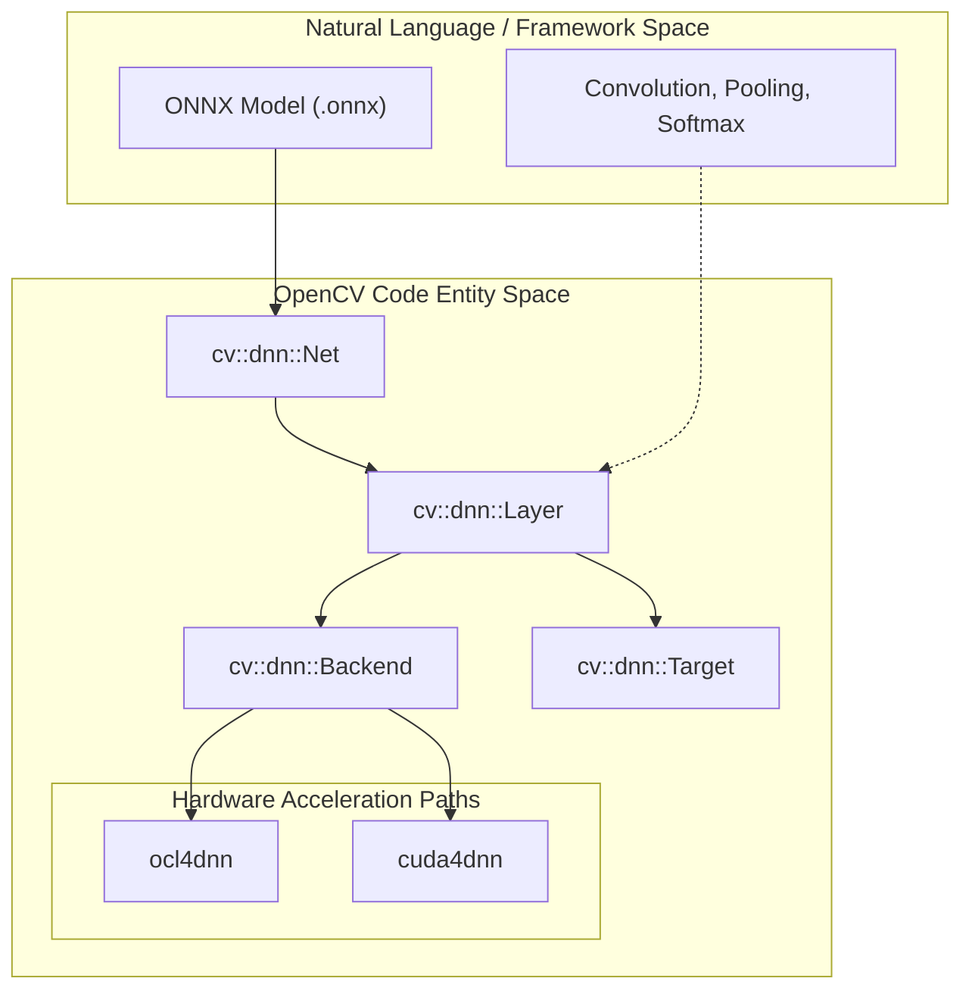
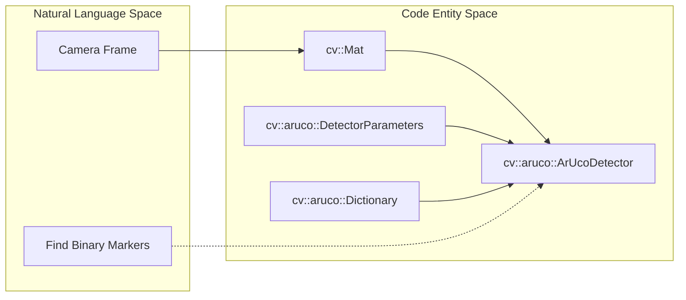

<!-- source: DeepWiki mcp.deepwiki.com · repo opencv/opencv · page 18.3 Glossary: DNN, Vision Algorithms, and Module-Specific Terms · fetched 2026-10-30 -->

# Glossary: DNN, Vision Algorithms, and Module-Specific Terms

Relevant source files

The following files were used as context for generating this wiki page:

- [.gitattributes](.gitattributes)
- [3rdparty/ffmpeg/.gitignore](3rdparty/ffmpeg/.gitignore)
- [3rdparty/ffmpeg/ffmpeg-download.ps1.in](3rdparty/ffmpeg/ffmpeg-download.ps1.in)
- [3rdparty/ffmpeg/ffmpeg.cmake](3rdparty/ffmpeg/ffmpeg.cmake)
- [3rdparty/ffmpeg/readme.txt](3rdparty/ffmpeg/readme.txt)
- [cmake/OpenCVDetectInferenceEngine.cmake](cmake/OpenCVDetectInferenceEngine.cmake)
- [cmake/templates/vs_version.rc.in](cmake/templates/vs_version.rc.in)
- [modules/dnn/CMakeLists.txt](modules/dnn/CMakeLists.txt)
- [modules/dnn/include/opencv2/dnn/dnn.hpp](modules/dnn/include/opencv2/dnn/dnn.hpp)
- [modules/dnn/misc/js/gen_dict.json](modules/dnn/misc/js/gen_dict.json)
- [modules/dnn/misc/objc/gen_dict.json](modules/dnn/misc/objc/gen_dict.json)
- [modules/dnn/misc/python/test/test_dnn.py](modules/dnn/misc/python/test/test_dnn.py)
- [modules/dnn/src/dnn.cpp](modules/dnn/src/dnn.cpp)
- [modules/dnn/src/dnn_common.hpp](modules/dnn/src/dnn_common.hpp)
- [modules/dnn/src/dnn_read.cpp](modules/dnn/src/dnn_read.cpp)
- [modules/dnn/src/graph_block_layout.cpp](modules/dnn/src/graph_block_layout.cpp)
- [modules/dnn/src/graph_const_args.cpp](modules/dnn/src/graph_const_args.cpp)
- [modules/dnn/src/ie_ngraph.cpp](modules/dnn/src/ie_ngraph.cpp)
- [modules/dnn/src/ie_ngraph.hpp](modules/dnn/src/ie_ngraph.hpp)
- [modules/dnn/src/layers/conv2_common.cpp](modules/dnn/src/layers/conv2_common.cpp)
- [modules/dnn/src/layers/conv2_common.hpp](modules/dnn/src/layers/conv2_common.hpp)
- [modules/dnn/src/layers/convolution_layer.cpp](modules/dnn/src/layers/convolution_layer.cpp)
- [modules/dnn/src/layers/fully_connected_layer.cpp](modules/dnn/src/layers/fully_connected_layer.cpp)
- [modules/dnn/src/layers/layers_common.cpp](modules/dnn/src/layers/layers_common.cpp)
- [modules/dnn/src/layers/layers_common.hpp](modules/dnn/src/layers/layers_common.hpp)
- [modules/dnn/src/layers/layers_common.simd.hpp](modules/dnn/src/layers/layers_common.simd.hpp)
- [modules/dnn/src/layers/pooling_layer.cpp](modules/dnn/src/layers/pooling_layer.cpp)
- [modules/dnn/src/layers/randomnormallike_layer.cpp](modules/dnn/src/layers/randomnormallike_layer.cpp)
- [modules/dnn/src/layers/recurrent_layers.cpp](modules/dnn/src/layers/recurrent_layers.cpp)
- [modules/dnn/src/model.cpp](modules/dnn/src/model.cpp)
- [modules/dnn/src/net_openvino.cpp](modules/dnn/src/net_openvino.cpp)
- [modules/dnn/src/op_inf_engine.cpp](modules/dnn/src/op_inf_engine.cpp)
- [modules/dnn/src/op_inf_engine.hpp](modules/dnn/src/op_inf_engine.hpp)
- [modules/dnn/src/op_timvx.cpp](modules/dnn/src/op_timvx.cpp)
- [modules/dnn/src/precomp.hpp](modules/dnn/src/precomp.hpp)
- [modules/dnn/src/tflite/tflite_importer.cpp](modules/dnn/src/tflite/tflite_importer.cpp)
- [modules/dnn/test/test_ie_models.cpp](modules/dnn/test/test_ie_models.cpp)
- [modules/dnn/test/test_misc.cpp](modules/dnn/test/test_misc.cpp)
- [modules/dnn/test/test_model.cpp](modules/dnn/test/test_model.cpp)
- [modules/dnn/test/test_tflite_importer.cpp](modules/dnn/test/test_tflite_importer.cpp)
- [modules/flann/include/opencv2/flann/autotuned_index.h](modules/flann/include/opencv2/flann/autotuned_index.h)
- [modules/flann/include/opencv2/flann/composite_index.h](modules/flann/include/opencv2/flann/composite_index.h)
- [modules/flann/include/opencv2/flann/config.h](modules/flann/include/opencv2/flann/config.h)
- [modules/flann/include/opencv2/flann/flann_base.hpp](modules/flann/include/opencv2/flann/flann_base.hpp)
- [modules/flann/include/opencv2/flann/general.h](modules/flann/include/opencv2/flann/general.h)
- [modules/flann/include/opencv2/flann/ground_truth.h](modules/flann/include/opencv2/flann/ground_truth.h)
- [modules/flann/include/opencv2/flann/hierarchical_clustering_index.h](modules/flann/include/opencv2/flann/hierarchical_clustering_index.h)
- [modules/flann/include/opencv2/flann/index_testing.h](modules/flann/include/opencv2/flann/index_testing.h)
- [modules/flann/include/opencv2/flann/kdtree_index.h](modules/flann/include/opencv2/flann/kdtree_index.h)
- [modules/flann/include/opencv2/flann/kdtree_single_index.h](modules/flann/include/opencv2/flann/kdtree_single_index.h)
- [modules/flann/include/opencv2/flann/kmeans_index.h](modules/flann/include/opencv2/flann/kmeans_index.h)
- [modules/flann/include/opencv2/flann/linear_index.h](modules/flann/include/opencv2/flann/linear_index.h)
- [modules/flann/include/opencv2/flann/logger.h](modules/flann/include/opencv2/flann/logger.h)
- [modules/flann/include/opencv2/flann/lsh_index.h](modules/flann/include/opencv2/flann/lsh_index.h)
- [modules/flann/include/opencv2/flann/lsh_table.h](modules/flann/include/opencv2/flann/lsh_table.h)
- [modules/flann/include/opencv2/flann/nn_index.h](modules/flann/include/opencv2/flann/nn_index.h)
- [modules/flann/include/opencv2/flann/object_factory.h](modules/flann/include/opencv2/flann/object_factory.h)
- [modules/flann/include/opencv2/flann/random.h](modules/flann/include/opencv2/flann/random.h)
- [modules/flann/include/opencv2/flann/sampling.h](modules/flann/include/opencv2/flann/sampling.h)
- [modules/flann/include/opencv2/flann/saving.h](modules/flann/include/opencv2/flann/saving.h)
- [modules/flann/src/flann.cpp](modules/flann/src/flann.cpp)
- [modules/flann/src/precomp.hpp](modules/flann/src/precomp.hpp)
- [modules/objdetect/include/opencv2/objdetect/aruco_board.hpp](modules/objdetect/include/opencv2/objdetect/aruco_board.hpp)
- [modules/objdetect/include/opencv2/objdetect/aruco_detector.hpp](modules/objdetect/include/opencv2/objdetect/aruco_detector.hpp)
- [modules/objdetect/include/opencv2/objdetect/aruco_dictionary.hpp](modules/objdetect/include/opencv2/objdetect/aruco_dictionary.hpp)
- [modules/objdetect/include/opencv2/objdetect/charuco_detector.hpp](modules/objdetect/include/opencv2/objdetect/charuco_detector.hpp)
- [modules/objdetect/misc/java/test/ArucoTest.java](modules/objdetect/misc/java/test/ArucoTest.java)
- [modules/objdetect/perf/perf_aruco.cpp](modules/objdetect/perf/perf_aruco.cpp)
- [modules/objdetect/src/aruco/aruco_board.cpp](modules/objdetect/src/aruco/aruco_board.cpp)
- [modules/objdetect/src/aruco/aruco_detector.cpp](modules/objdetect/src/aruco/aruco_detector.cpp)
- [modules/objdetect/src/aruco/aruco_dictionary.cpp](modules/objdetect/src/aruco/aruco_dictionary.cpp)
- [modules/objdetect/src/aruco/aruco_utils.cpp](modules/objdetect/src/aruco/aruco_utils.cpp)
- [modules/objdetect/src/aruco/aruco_utils.hpp](modules/objdetect/src/aruco/aruco_utils.hpp)
- [modules/objdetect/src/aruco/charuco_detector.cpp](modules/objdetect/src/aruco/charuco_detector.cpp)
- [modules/objdetect/src/aruco/predefined_dictionaries.hpp](modules/objdetect/src/aruco/predefined_dictionaries.hpp)
- [modules/objdetect/src/chessboard.cpp](modules/objdetect/src/chessboard.cpp)
- [modules/objdetect/test/test_aruco_tutorial.cpp](modules/objdetect/test/test_aruco_tutorial.cpp)
- [modules/objdetect/test/test_aruco_utils.cpp](modules/objdetect/test/test_aruco_utils.cpp)
- [modules/objdetect/test/test_aruco_utils.hpp](modules/objdetect/test/test_aruco_utils.hpp)
- [modules/objdetect/test/test_arucodetection.cpp](modules/objdetect/test/test_arucodetection.cpp)
- [modules/objdetect/test/test_boarddetection.cpp](modules/objdetect/test/test_boarddetection.cpp)
- [modules/objdetect/test/test_charucodetection.cpp](modules/objdetect/test/test_charucodetection.cpp)
- [modules/objdetect/test/test_chesscorners.cpp](modules/objdetect/test/test_chesscorners.cpp)
- [modules/videoio/CMakeLists.txt](modules/videoio/CMakeLists.txt)
- [modules/videoio/include/opencv2/videoio.hpp](modules/videoio/include/opencv2/videoio.hpp)
- [modules/videoio/src/backend_plugin.cpp](modules/videoio/src/backend_plugin.cpp)
- [modules/videoio/src/cap.cpp](modules/videoio/src/cap.cpp)
- [modules/videoio/src/cap_ffmpeg.cpp](modules/videoio/src/cap_ffmpeg.cpp)
- [modules/videoio/src/cap_ffmpeg_impl.hpp](modules/videoio/src/cap_ffmpeg_impl.hpp)
- [modules/videoio/src/cap_gstreamer.cpp](modules/videoio/src/cap_gstreamer.cpp)
- [modules/videoio/src/cap_interface.hpp](modules/videoio/src/cap_interface.hpp)
- [modules/videoio/src/cap_mjpeg_decoder.cpp](modules/videoio/src/cap_mjpeg_decoder.cpp)
- [modules/videoio/src/cap_mjpeg_encoder.cpp](modules/videoio/src/cap_mjpeg_encoder.cpp)
- [modules/videoio/src/cap_msmf.cpp](modules/videoio/src/cap_msmf.cpp)
- [modules/videoio/src/cap_msmf.hpp](modules/videoio/src/cap_msmf.hpp)
- [modules/videoio/src/cap_v4l.cpp](modules/videoio/src/cap_v4l.cpp)
- [modules/videoio/src/precomp.hpp](modules/videoio/src/precomp.hpp)
- [modules/videoio/src/videoio_registry.cpp](modules/videoio/src/videoio_registry.cpp)
- [modules/videoio/src/videoio_registry.hpp](modules/videoio/src/videoio_registry.hpp)
- [modules/videoio/test/test_audio.cpp](modules/videoio/test/test_audio.cpp)
- [modules/videoio/test/test_ffmpeg.cpp](modules/videoio/test/test_ffmpeg.cpp)
- [modules/videoio/test/test_gstreamer.cpp](modules/videoio/test/test_gstreamer.cpp)
- [modules/videoio/test/test_orientation.cpp](modules/videoio/test/test_orientation.cpp)
- [modules/videoio/test/test_precomp.hpp](modules/videoio/test/test_precomp.hpp)
- [modules/videoio/test/test_v4l2.cpp](modules/videoio/test/test_v4l2.cpp)
- [modules/videoio/test/test_video_io.cpp](modules/videoio/test/test_video_io.cpp)

## Purpose and Scope
This page provides technical definitions and implementation pointers for key concepts within OpenCV's specialized modules, specifically focusing on Deep Neural Networks (`dnn`), Video I/O (`videoio`), Object Detection (`objdetect`), Image Stitching (`stitching`), Approximate Nearest Neighbor Search (`flann`), and Point Cloud / SLAM processing (`ptcloud`). It bridges domain terminology with concrete codebase entities.

---

## 1. Deep Neural Networks (DNN)

The `dnn` module implements a forward-only inference engine that imports models from various frameworks and executes them using optimized backends.

### 1.1 Core Inference Entities
*   **Net**: The central class representing a functional neural network. It manages the execution graph, internal tensor buffers, and layer connections.
*   **Layer**: The fundamental building block of a `Net`. Each `Layer` represents a specific mathematical operation (e.g., convolution, pooling, activation) [modules/dnn/include/opencv2/dnn/dnn.hpp:153-161]().
*   **Backend**: Specifies the library or hardware-specific API used for layer execution, defined by the `Backend` enum (e.g., `DNN_BACKEND_OPENCV`, `DNN_BACKEND_CUDA`, `DNN_BACKEND_INFERENCE_ENGINE`) [modules/dnn/include/opencv2/dnn/dnn.hpp:71-89]().
*   **Target**: Specifies the target hardware device for a given backend, defined by the `Target` enum (e.g., `DNN_TARGET_CPU`, `DNN_TARGET_OPENCL`, `DNN_TARGET_CUDA`) [modules/dnn/include/opencv2/dnn/dnn.hpp:95-108]().

### 1.2 Model Importers and Graph Simplification
OpenCV uses specialized parsers to translate external model formats (ONNX, TensorFlow, TFLite, Caffe, Darknet) into the internal `Net` representation.
*   **ONNX Importer**: Parses `.onnx` files using Protobuf and translates nodes into OpenCV layer parameters.
*   **Graph Simplifier**: A pre-processing pass that optimizes the computation graph via constant folding and operator fusion.

### 1.3 Acceleration Layers (`ocl4dnn`, `cuda4dnn`)
*   **ocl4dnn**: Internal OpenCL-based execution path for DNN layers, providing hardware acceleration on GPUs via `UMat` memory objects [modules/dnn/src/layers/convolution_layer.cpp:60-63]().
*   **cuda4dnn**: The CUDA-specific implementation path utilizing NVIDIA cuDNN and custom CUDA kernels [modules/dnn/src/layers/convolution_layer.cpp:65-69]().

**DNN Data Flow and Entity Mapping**

*Sources: [modules/dnn/include/opencv2/dnn/dnn.hpp:71-108](), [modules/dnn/src/layers/convolution_layer.cpp:60-69]().*

---

## 2. Video I/O and Capture Backends (`videoio`)

The `videoio` module abstracts platform-specific video hardware, camera streams, and file codecs through a unified interface.

### 2.1 Backend Identifiers (`VideoCaptureAPIs`)
Backends are selected via the `VideoCaptureAPIs` enum when opening streams or files [modules/videoio/include/opencv2/videoio.hpp:91-122]():
*   **CAP_FFMPEG**: Uses FFmpeg for robust video file decoding and network streaming [modules/videoio/include/opencv2/videoio.hpp:114]().
*   **CAP_V4L2**: Video4Linux2, the standard Linux capture interface [modules/videoio/include/opencv2/videoio.hpp:93]().
*   **CAP_MSMF**: Microsoft Media Foundation for Windows camera and media pipeline access [modules/videoio/include/opencv2/videoio.hpp:105]().
*   **CAP_GSTREAMER**: Pipeline-based multimedia framework supporting modular graph configurations [modules/videoio/include/opencv2/videoio.hpp:113]().

### 2.2 Key Implementation Files
*   FFmpeg backend: `modules/videoio/src/cap_ffmpeg_impl.hpp` [modules/videoio/src/cap_ffmpeg_impl.hpp:43-47]()
*   V4L2 backend: `modules/videoio/src/cap_v4l.cpp` [modules/videoio/src/cap_v4l.cpp:1-10]()
*   MSMF backend: `modules/videoio/src/cap_msmf.cpp` [modules/videoio/src/cap_msmf.cpp:7-12]()
*   GStreamer backend: `modules/videoio/src/cap_gstreamer.cpp` [modules/videoio/src/cap_gstreamer.cpp:42-49]()

*Sources: [modules/videoio/include/opencv2/videoio.hpp:91-122](), [modules/videoio/src/cap_ffmpeg_impl.hpp:43-47](), [modules/videoio/src/cap_v4l.cpp:1-10](), [modules/videoio/src/cap_msmf.cpp:7-12](), [modules/videoio/src/cap_gstreamer.cpp:42-49]().*

---

## 3. Object Detection and ArUco (`objdetect`)

The `objdetect` module includes classical pattern recognition and marker-based pose estimation algorithms.

### 3.1 ArUco Dictionaries and Detection
*   **ArUco Dictionary**: A predefined set of binary square markers used for camera calibration and spatial pose estimation [modules/objdetect/include/opencv2/objdetect/aruco_detector.hpp:1-20]().
*   **DetectorParameters**: Configuration settings governing adaptive thresholding, contour filtering, and bit extraction tolerances [modules/objdetect/include/opencv2/objdetect/aruco_detector.hpp:21-40]().

### 3.2 Detection Pipeline

*Sources: [modules/objdetect/include/opencv2/objdetect/aruco_detector.hpp:1-50]().*

---

## 4. Image Stitching (`stitching`)

The `stitching` module constructs panoramas from sets of overlapping images via a multi-stage pipeline managed by the `Stitcher` class.

### 4.1 Stitcher Detail Types
*   **FeaturesMatcher**: Computes pairwise feature matches between images (e.g., `BestOf2NearestMatcher`).
*   **RotationWarper**: Projects image planes onto intermediate surfaces (spherical, cylindrical, planar) to align coordinates.
*   **SeamFinder**: Determines optimal boundary paths through overlapping regions to prevent ghosting artifacts.
*   **Blender**: Performs multi-band frequency blending to smooth exposure and color transitions across seam boundaries.

*Sources: [modules/stitching/include/opencv2/stitching.hpp:1-50]().*

---

## 5. Nearest Neighbor Search (`flann`)

The `flann` module provides Fast Library for Approximate Nearest Neighbors algorithms used in high-dimensional feature matching.

### 5.1 FLANN Index Parameters
*   **IndexParams**: Abstract configuration structure specifying the index type (`LinearIndexParams`, `KDTreeIndexParams`, `KMeansIndexParams`, `LshIndexParams`, or `AutotunedIndexParams`).
*   **SearchParams**: Controls traversal depth and precision trade-offs during query operations (`checks`, `eps`, `sorted`).

*Sources: [modules/flann/include/opencv2/flann/miniflann.hpp:1-40]().*

---

## 6. Point Cloud, Volumetric Reconstruction, and SLAM (`ptcloud`)

The `ptcloud` module provides primitives for 3D data processing, volumetric integration, and visual odometry.

### 6.1 Core Terms
*   **Point Cloud / Mesh I/O**: Functions like `loadPointCloud` and `savePointCloud` supporting formats such as PLY and OBJ.
*   **TSDF Volume**: Truncated Signed Distance Function representation used for real-time volumetric depth fusion and surface reconstruction.
*   **Visual Odometry**: The `cv::slam::VisualOdometry` pipeline tracking camera ego-motion across sequential frames via keyframe bootstrapping and PnP pose estimation.

*Sources: [modules/ptcloud/include/opencv2/ptcloud.hpp:1-40]().*

---

## 7. Summary Table of Module Terms

| Term | Module | Definition | Reference |
| :--- | :--- | :--- | :--- |
| `Net` | `dnn` | Central container class for network graph execution | [modules/dnn/include/opencv2/dnn/dnn.hpp:71]() |
| `Layer` | `dnn` | Base class for neural network operations | [modules/dnn/include/opencv2/dnn/dnn.hpp:153]() |
| `VideoCapture` | `videoio` | Unified interface for video capture and streaming | [modules/videoio/include/opencv2/videoio.hpp:78]() |
| `ArUco` | `objdetect` | Binary square marker system for pose estimation | [modules/objdetect/include/opencv2/objdetect/aruco_detector.hpp:1]() |
| `ocl4dnn` | `dnn` | OpenCL execution acceleration backend for DNN | [modules/dnn/src/layers/convolution_layer.cpp:60]() |
| `IndexParams` | `flann` | Configuration parameters for approximate nearest neighbor index structures | [modules/flann/include/opencv2/flann/miniflann.hpp:1]() |
| `VisualOdometry` | `ptcloud` | Camera motion tracking and SLAM tracking pipeline | [modules/ptcloud/include/opencv2/ptcloud.hpp:1]() |

*Sources: [modules/dnn/include/opencv2/dnn/dnn.hpp:71-161](), [modules/videoio/include/opencv2/videoio.hpp:78-122](), [modules/objdetect/include/opencv2/objdetect/aruco_detector.hpp:1-50]().*