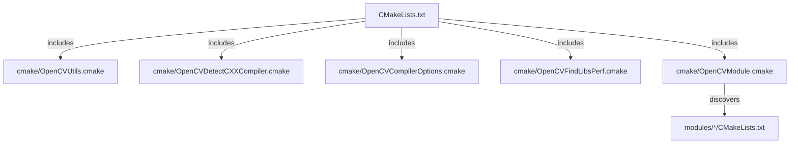

<!-- source: DeepWiki mcp.deepwiki.com · repo opencv/opencv · page 2 Build System · fetched 2026-10-30 -->

# Build System

Relevant source files

The following files were used as context for generating this wiki page:

- [3rdparty/fastcv/fastcv.cmake](3rdparty/fastcv/fastcv.cmake)
- [3rdparty/ippicv/CMakeLists.txt](3rdparty/ippicv/CMakeLists.txt)
- [CMakeLists.txt](CMakeLists.txt)
- [cmake/OpenCVCRTLinkage.cmake](cmake/OpenCVCRTLinkage.cmake)
- [cmake/OpenCVCompilerOptions.cmake](cmake/OpenCVCompilerOptions.cmake)
- [cmake/OpenCVFindLibsGUI.cmake](cmake/OpenCVFindLibsGUI.cmake)
- [cmake/OpenCVFindLibsPerf.cmake](cmake/OpenCVFindLibsPerf.cmake)
- [cmake/OpenCVFindLibsVideo.cmake](cmake/OpenCVFindLibsVideo.cmake)
- [cmake/OpenCVModule.cmake](cmake/OpenCVModule.cmake)
- [cmake/OpenCVPCHSupport.cmake](cmake/OpenCVPCHSupport.cmake)
- [cmake/OpenCVUtils.cmake](cmake/OpenCVUtils.cmake)
- [cmake/templates/cvconfig.h.in](cmake/templates/cvconfig.h.in)
- [modules/core/CMakeLists.txt](modules/core/CMakeLists.txt)
- [modules/highgui/CMakeLists.txt](modules/highgui/CMakeLists.txt)
- [modules/java/CMakeLists.txt](modules/java/CMakeLists.txt)
- [samples/android/CMakeLists.txt](samples/android/CMakeLists.txt)
- [samples/android/color-blob-detection/CMakeLists.txt](samples/android/color-blob-detection/CMakeLists.txt)

This page describes the CMake-based build system used to configure and compile OpenCV. It serves as a high-level parent overview of the root build scripts, the module discovery mechanism, and third-party library integration. 

OpenCV uses a customized CMake build system driven by a root `CMakeLists.txt` script [CMakeLists.txt:1-14](), which coordinates platform checks, compiler detection [cmake/OpenCVDetectCXXCompiler.cmake:1-116](), option parsing [CMakeLists.txt:143-165](), and module registration [cmake/OpenCVModule.cmake:1-55]().

Sources: [CMakeLists.txt:1-14](), [cmake/OpenCVModule.cmake:1-55]()

---

## Build System Architecture Overview

The build configuration flow begins at the root `CMakeLists.txt`, which invokes core utility macros, checks environment parameters, loads toolchain files, and orchestrates target creation through a two-pass module scanning process.

Sources: [CMakeLists.txt:16-139](), [cmake/OpenCVModule.cmake:1-55]()

---

## 2.1. Cross-Platform Build Configuration

The root `CMakeLists.txt` and associated helper scripts handle compiler and architecture detection across diverse operating systems including Windows, Linux, macOS, iOS, and Android [CMakeLists.txt:94-99](). Compiler flags, warning levels, floating-point behaviors, and precompiled headers are configured via `cmake/OpenCVCompilerOptions.cmake` [cmake/OpenCVCompilerOptions.cmake:1-161](). 

For detailed information on platform-specific toolchain configurations, system file overrides, and cross-compilation options, see [Cross-Platform Build Configuration](#2.1).

Sources: [CMakeLists.txt:94-99](), [cmake/OpenCVCompilerOptions.cmake:1-161]()

---

## 2.2. Module Configuration and ocv_add_module

OpenCV modules are registered and managed using custom CMake macros defined in `cmake/OpenCVModule.cmake`. The build system executes a two-pass scanning approach: the first pass collects metadata and resolves required or optional module dependencies, while the second pass creates the actual CMake library targets [cmake/OpenCVModule.cmake:120-144](). This subsystem also manages the assembly of `opencv_world` and generates `OpenCVConfig.cmake` for downstream consumers.

For detailed documentation on module declaration macros, dependency trees, and export configuration, see [Module Configuration and ocv_add_module](#2.2).

Sources: [cmake/OpenCVModule.cmake:1-55](), [cmake/OpenCVModule.cmake:120-144]()

---

## 2.3. Version Management, Packaging, and Platform Builds

Version numbers are centrally defined and propagated to CMake caches, Python packages, Maven artifacts, and Android build scripts. The CPack facility automates the generation of distribution packages (ZIP, DEB, RPM), while specialized python orchestrators like `build_sdk.py` handle multi-ABI Android SDK compilations.

For comprehensive instructions on version propagation, packaging rules, and mobile SDK orchestration, see [Version Management, Packaging, and Platform Builds](#2.3).

Sources: [CMakeLists.txt:125-133]()

---

## 2.4. Third-Party Dependencies and 3rdparty/ Integration

OpenCV relies on a broad set of third-party libraries for image codecs (JPEG, PNG, TIFF, WebP), video I/O, parallel processing backends (TBB), and hardware acceleration (Intel IPP/IPPICV). The build system determines whether to link against system-installed packages or build bundled sources from the `3rdparty/` directory based on user options (`BUILD_*` and `WITH_*`) [CMakeLists.txt:148-165](), [cmake/OpenCVFindLibsPerf.cmake:1-40]().

For detailed analysis of third-party selection logic, bundled library paths, and performance library integration, see [Third-Party Dependencies and 3rdparty/ Integration](#2.4).

Sources: [CMakeLists.txt:148-165](), [cmake/OpenCVFindLibsPerf.cmake:1-40]()

---

