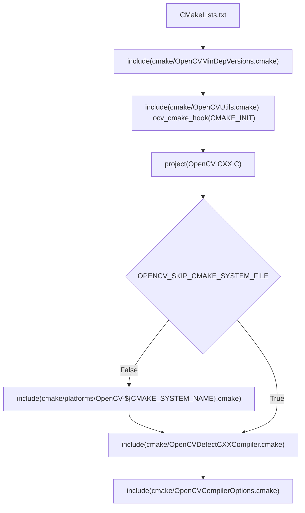
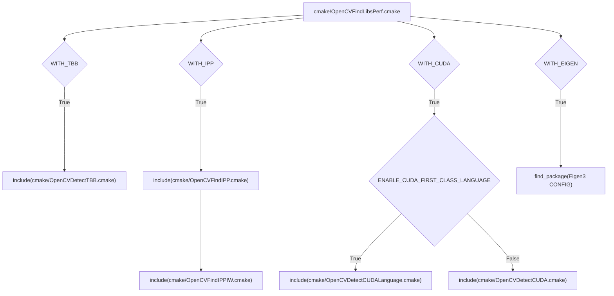

<!-- source: DeepWiki mcp.deepwiki.com · repo opencv/opencv · page 2.1 Cross-Platform Build Configuration · fetched 2026-10-30 -->

# Cross-Platform Build Configuration

<details>
<summary>Relevant source files</summary>

The following files were used as context for generating this wiki page:

- [3rdparty/fastcv/fastcv.cmake](3rdparty/fastcv/fastcv.cmake)
- [3rdparty/ippicv/CMakeLists.txt](3rdparty/ippicv/CMakeLists.txt)
- [CMakeLists.txt](CMakeLists.txt)
- [cmake/OpenCVCRTLinkage.cmake](cmake/OpenCVCRTLinkage.cmake)
- [cmake/OpenCVCompilerOptions.cmake](cmake/OpenCVCompilerOptions.cmake)
- [cmake/OpenCVDetectCXXCompiler.cmake](cmake/OpenCVDetectCXXCompiler.cmake)
- [cmake/OpenCVDownload.cmake](cmake/OpenCVDownload.cmake)
- [cmake/OpenCVFindIPP.cmake](cmake/OpenCVFindIPP.cmake)
- [cmake/OpenCVFindIPPIW.cmake](cmake/OpenCVFindIPPIW.cmake)
- [cmake/OpenCVFindLibsGUI.cmake](cmake/OpenCVFindLibsGUI.cmake)
- [cmake/OpenCVFindLibsPerf.cmake](cmake/OpenCVFindLibsPerf.cmake)
- [cmake/OpenCVFindLibsVideo.cmake](cmake/OpenCVFindLibsVideo.cmake)
- [cmake/OpenCVGenConfig.cmake](cmake/OpenCVGenConfig.cmake)
- [cmake/OpenCVInstallLayout.cmake](cmake/OpenCVInstallLayout.cmake)
- [cmake/OpenCVModule.cmake](cmake/OpenCVModule.cmake)
- [cmake/OpenCVPCHSupport.cmake](cmake/OpenCVPCHSupport.cmake)
- [cmake/OpenCVUtils.cmake](cmake/OpenCVUtils.cmake)
- [cmake/mirrors/custom.cmake](cmake/mirrors/custom.cmake)
- [cmake/mirrors/gitcode.cmake](cmake/mirrors/gitcode.cmake)
- [cmake/platforms/OpenCV-Android.cmake](cmake/platforms/OpenCV-Android.cmake)
- [cmake/platforms/OpenCV-Darwin.cmake](cmake/platforms/OpenCV-Darwin.cmake)
- [cmake/platforms/OpenCV-WinRT.cmake](cmake/platforms/OpenCV-WinRT.cmake)
- [cmake/platforms/OpenCV-WindowsCE.cmake](cmake/platforms/OpenCV-WindowsCE.cmake)
- [cmake/templates/OpenCVConfig-version.cmake.in](cmake/templates/OpenCVConfig-version.cmake.in)
- [cmake/templates/OpenCVConfig.cmake.in](cmake/templates/OpenCVConfig.cmake.in)
- [cmake/templates/OpenCVConfig.root-ANDROID.cmake.in](cmake/templates/OpenCVConfig.root-ANDROID.cmake.in)
- [cmake/templates/OpenCVConfig.root-WIN32.cmake.in](cmake/templates/OpenCVConfig.root-WIN32.cmake.in)
- [cmake/templates/cvconfig.h.in](cmake/templates/cvconfig.h.in)
- [doc/tutorials/introduction/config_reference/config_reference.markdown](doc/tutorials/introduction/config_reference/config_reference.markdown)
- [doc/tutorials/introduction/env_reference/env_reference.markdown](doc/tutorials/introduction/env_reference/env_reference.markdown)
- [modules/core/CMakeLists.txt](modules/core/CMakeLists.txt)
- [modules/highgui/CMakeLists.txt](modules/highgui/CMakeLists.txt)
- [modules/java/CMakeLists.txt](modules/java/CMakeLists.txt)
- [samples/android/CMakeLists.txt](samples/android/CMakeLists.txt)
- [samples/android/color-blob-detection/CMakeLists.txt](samples/android/color-blob-detection/CMakeLists.txt)
- [samples/sycl/CMakeLists.txt](samples/sycl/CMakeLists.txt)

</details>


## Purpose and Scope

This document explains OpenCV's cross-platform build configuration system, which covers platform detection, compiler and architecture identification, compiler flag management, platform-specific differences across Windows, Linux, macOS, iOS, and Android, and the integration of third-party GUI, video, image codec, and performance libraries. The entire configuration pipeline is orchestrated via CMake, driven primarily by the root `CMakeLists.txt` [CMakeLists.txt:1-2051]() and supporting scripts located in the `cmake/` directory.

Sources: [CMakeLists.txt:1-2051]()

## Platform Detection and Configuration

OpenCV employs CMake to detect the target operating system and hardware architecture, loading specialized configuration files early in the initialization sequence.

### Initialization Flow and Platform Loading

When CMake processes the root `CMakeLists.txt` [CMakeLists.txt:1-2051](), it validates minimum version constraints [CMakeLists.txt:16-18](), sets up custom CMake hooks via `ocv_cmake_hook_register_dir()` and `ocv_cmake_hook()` [cmake/OpenCVUtils.cmake:48-68](), bootstraps languages with `project(OpenCV CXX C)` [CMakeLists.txt:78-78](), and attempts to include a system-specific module from `cmake/platforms/OpenCV-${CMAKE_SYSTEM_NAME}.cmake` [CMakeLists.txt:94-99]().

Title: "Build System Bootstrap and Platform Loading Flow"

Sources: [CMakeLists.txt:16-18](), [CMakeLists.txt:42-53](), [CMakeLists.txt:78-78](), [CMakeLists.txt:94-99](), [CMakeLists.txt:139-140](), [cmake/OpenCVUtils.cmake:55-68]()

### Default Installation Paths

The root `CMakeLists.txt` sets the `CMAKE_INSTALL_PREFIX` depending on whether the build is cross-compiled or targeting Windows [CMakeLists.txt:101-112]().

| Condition | Default Prefix | Code Reference |
|-----------|----------------|----------------|
| `NOT CMAKE_CROSSCOMPILING` AND `WIN32` | `${CMAKE_BINARY_DIR}/install` | [CMakeLists.txt:103-104]() |
| `NOT CMAKE_CROSSCOMPILING` AND `NOT WIN32` | `/usr/local` | [CMakeLists.txt:105-106]() |
| `CMAKE_CROSSCOMPILING` | `${CMAKE_BINARY_DIR}/install` | [CMakeLists.txt:109-111]() |

Sources: [CMakeLists.txt:101-112]()

---

## Compiler Detection and Architecture Sinks

Compiler identification and target architecture determination are centralized in `cmake/OpenCVDetectCXXCompiler.cmake` [cmake/OpenCVDetectCXXCompiler.cmake:1-265]().

### Processor Architecture Parsing

The build system inspects `CMAKE_SYSTEM_PROCESSOR` to establish boolean architecture flags (`X86_64`, `X86`, `ARM`, `AARCH64`, `PPC64LE`, `MIPS`, `RISCV`, `LOONGARCH64`) [cmake/OpenCVDetectCXXCompiler.cmake:91-116](). It also guards against 32-bit user spaces running on 64-bit kernels by validating `CMAKE_SIZEOF_VOID_P` [cmake/OpenCVDetectCXXCompiler.cmake:118-138]().

| Target Variable | Matching Pattern (`CMAKE_SYSTEM_PROCESSOR`) |
|-----------------|---------------------------------------------|
| `X86_64` | `amd64.*|x86_64.*|AMD64.*` [cmake/OpenCVDetectCXXCompiler.cmake:94-95]() |
| `X86` | `i686.*|i386.*|x86.*` [cmake/OpenCVDetectCXXCompiler.cmake:96-97]() |
| `AARCH64` | `aarch64.*|AARCH64.*|arm64.*|ARM64.*` [cmake/OpenCVDetectCXXCompiler.cmake:98-99]() |
| `ARM` | `arm.*|ARM.*` [cmake/OpenCVDetectCXXCompiler.cmake:100-101]() |
| `PPC64LE` | `powerpc|ppc64le` [cmake/OpenCVDetectCXXCompiler.cmake:102-103]() |
| `RISCV` | `riscv.*|RISCV.*` [cmake/OpenCVDetectCXXCompiler.cmake:108-109]() |

Sources: [cmake/OpenCVDetectCXXCompiler.cmake:91-116]()

---

## Compiler Flags and Optimization Management

Compiler flags, optimization levels, and warning configurations are managed inside `cmake/OpenCVCompilerOptions.cmake` [cmake/OpenCVCompilerOptions.cmake:1-575]().

### Flag Addition Macros

The macro `add_extra_compiler_option` evaluates whether the host/target compiler supports a given flag via `ocv_check_flag_support` before appending it to `OPENCV_EXTRA_CXX_FLAGS` or `OPENCV_EXTRA_C_FLAGS` [cmake/OpenCVCompilerOptions.cmake:50-60]().

```cmake
macro(add_extra_compiler_option option)
  ocv_check_flag_support(CXX "${option}" _varname "${OPENCV_EXTRA_CXX_FLAGS} ${ARGN}")
  if(${_varname})
    set(OPENCV_EXTRA_CXX_FLAGS "${OPENCV_EXTRA_CXX_FLAGS} ${option}")
  endif()
  ...
endmacro()
```

### Floating-Point Math and Compiler Flags

| Compiler Family | Detection Variable | Key Default / Fast-Math Flags |
|-----------------|--------------------|-------------------------------|
| GCC / Clang | `CV_GCC`, `CV_CLANG` | `-fsigned-char`, `-Wall`, `-ffast-math` (if enabled) [cmake/OpenCVCompilerOptions.cmake:93-94](), [cmake/OpenCVCompilerOptions.cmake:126-129]() |
| MSVC | `MSVC` | `/fp:precise` or `/fp:fast` [cmake/OpenCVCompilerOptions.cmake:98-102]() |
| Intel ICC / ICX | `CV_ICC`, `CV_ICX` | `-fp-model precise`, `-fno-fast-math` [cmake/OpenCVCompilerOptions.cmake:104-124]() |

Sources: [cmake/OpenCVCompilerOptions.cmake:50-130]()

---

## Third-Party Library Integration

OpenCV supports robust detection and conditional compilation of third-party libraries for GUI, video input/output, codecs, and performance primitives.

### GUI Backend Selection (`highgui`)

The `modules/highgui/CMakeLists.txt` script evaluates available GUI toolkits to select a built-in backend (`OPENCV_HIGHGUI_BUILTIN_BACKEND`) or configure dynamic plugins [modules/highgui/CMakeLists.txt:43-195]().

Title: "Performance and Dependency Detection Pipeline in cmake/OpenCVFindLibsPerf.cmake"

Sources: [cmake/OpenCVFindLibsPerf.cmake:6-14](), [cmake/OpenCVFindLibsPerf.cmake:57-78](), [modules/highgui/CMakeLists.txt:43-195]()

### Performance Acceleration Libraries

Mathematics, threading, and hardware acceleration libraries are integrated through specialized detection scripts invoked from `cmake/OpenCVFindLibsPerf.cmake` [cmake/OpenCVFindLibsPerf.cmake:1-189]():
*   **TBB**: Managed by `cmake/OpenCVDetectTBB.cmake` [cmake/OpenCVFindLibsPerf.cmake:6-8]().
*   **IPP & IPPIW**: Discovered via `cmake/OpenCVFindIPP.cmake` and `cmake/OpenCVFindIPPIW.cmake`, linking optimization wrappers and excluding static symbols where appropriate on Linux/Android [cmake/OpenCVFindLibsPerf.cmake:11-38]().
*   **Eigen**: Searched via CMake package configuration (`Eigen3::Eigen`) or manual header path probing (`Eigen/Core`) [cmake/OpenCVFindLibsPerf.cmake:72-138]().
*   **Clp / CoinUtils**: Configured for linear programming optimization solvers [cmake/OpenCVFindLibsPerf.cmake:146-189]().

Sources: [cmake/OpenCVFindLibsPerf.cmake:1-189]()

---

## Summary of Key Configuration Entities

| Code Entity / Function | File Path | Role |
|------------------------|-----------|------|
| `ocv_cmake_hook` | [cmake/OpenCVUtils.cmake:55-68]() | Executes registered third-party or custom build hooks at key points. |
| `add_extra_compiler_option` | [cmake/OpenCVCompilerOptions.cmake:50-60]() | Tests flag compatibility and appends safe options to C/C++ flags. |
| `ocv_add_module` | [cmake/OpenCVModule.cmake:124-151]() | Declares an OpenCV module, its type, and dependencies. |
| `OPENCV_HIGHGUI_BUILTIN_BACKEND` | [modules/highgui/CMakeLists.txt:43-188]() | Selects the active GUI window management framework (Qt, Cocoa, Win32, GTK, Wayland). |

Sources: [cmake/OpenCVUtils.cmake:55-68](), [cmake/OpenCVCompilerOptions.cmake:50-60](), [cmake/OpenCVModule.cmake:124-151](), [modules/highgui/CMakeLists.txt:43-188]()

---

