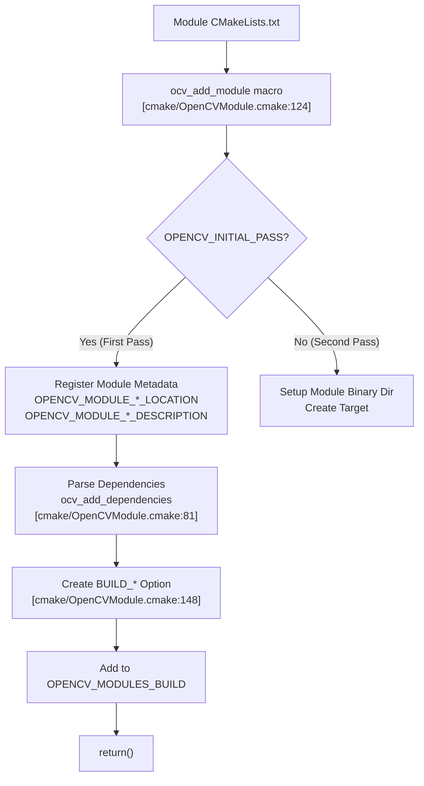
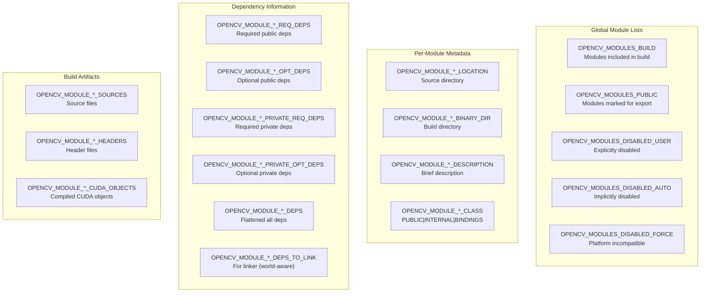
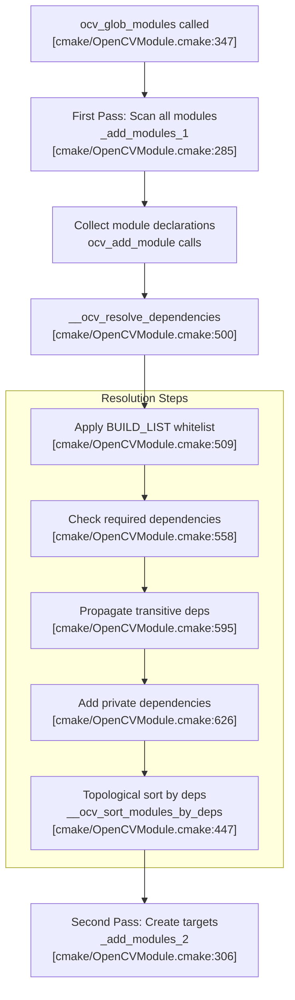
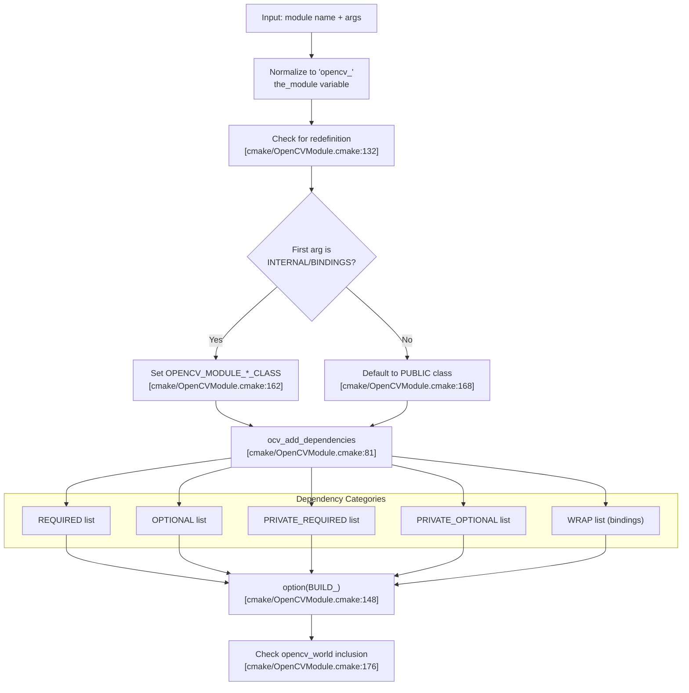
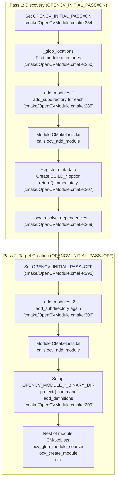
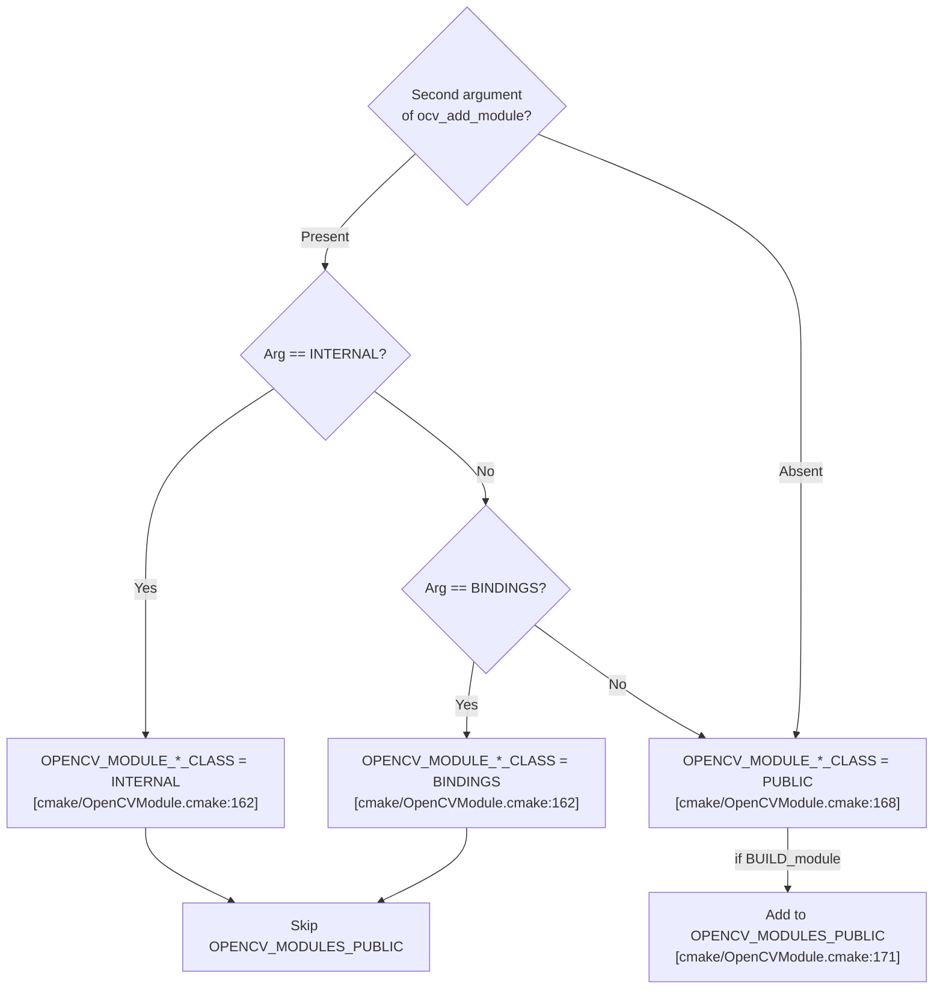
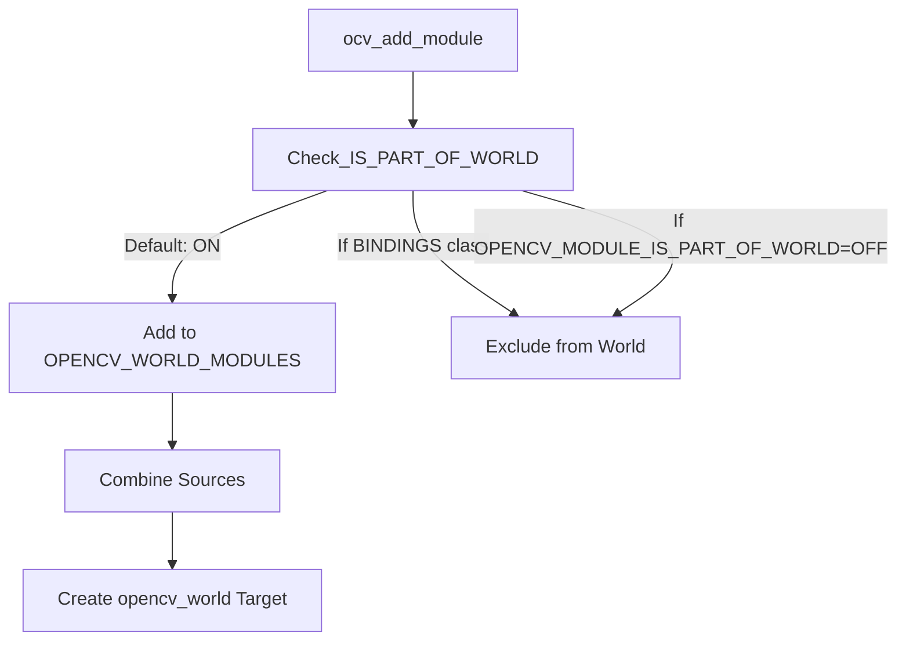
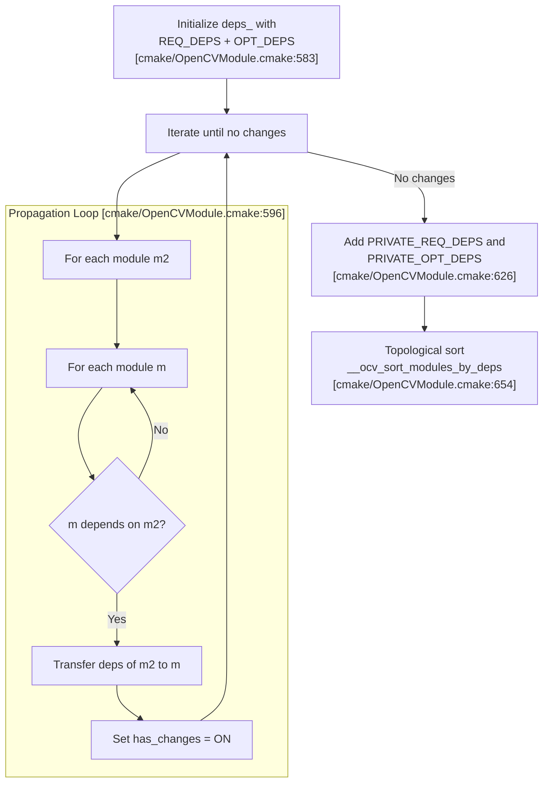

<!-- source: DeepWiki mcp.deepwiki.com · repo opencv/opencv · page 2.2 Module Configuration and ocv_add_module · fetched 2026-10-30 -->

# Module Configuration and ocv_add_module

<details>
<summary>Relevant source files</summary>

The following files were used as context for generating this wiki page:

- [3rdparty/fastcv/fastcv.cmake](3rdparty/fastcv/fastcv.cmake)
- [3rdparty/ippicv/CMakeLists.txt](3rdparty/ippicv/CMakeLists.txt)
- [CMakeLists.txt](CMakeLists.txt)
- [cmake/OpenCVCRTLinkage.cmake](cmake/OpenCVCRTLinkage.cmake)
- [cmake/OpenCVCompilerOptions.cmake](cmake/OpenCVCompilerOptions.cmake)
- [cmake/OpenCVDetectCXXCompiler.cmake](cmake/OpenCVDetectCXXCompiler.cmake)
- [cmake/OpenCVDownload.cmake](cmake/OpenCVDownload.cmake)
- [cmake/OpenCVFindIPP.cmake](cmake/OpenCVFindIPP.cmake)
- [cmake/OpenCVFindIPPIW.cmake](cmake/OpenCVFindIPPIW.cmake)
- [cmake/OpenCVFindLibsGUI.cmake](cmake/OpenCVFindLibsGUI.cmake)
- [cmake/OpenCVFindLibsPerf.cmake](cmake/OpenCVFindLibsPerf.cmake)
- [cmake/OpenCVFindLibsVideo.cmake](cmake/OpenCVFindLibsVideo.cmake)
- [cmake/OpenCVGenAndroidMK.cmake](cmake/OpenCVGenAndroidMK.cmake)
- [cmake/OpenCVGenConfig.cmake](cmake/OpenCVGenConfig.cmake)
- [cmake/OpenCVGenHeaders.cmake](cmake/OpenCVGenHeaders.cmake)
- [cmake/OpenCVGenPkgconfig.cmake](cmake/OpenCVGenPkgconfig.cmake)
- [cmake/OpenCVInstallLayout.cmake](cmake/OpenCVInstallLayout.cmake)
- [cmake/OpenCVModule.cmake](cmake/OpenCVModule.cmake)
- [cmake/OpenCVPCHSupport.cmake](cmake/OpenCVPCHSupport.cmake)
- [cmake/OpenCVUtils.cmake](cmake/OpenCVUtils.cmake)
- [cmake/mirrors/custom.cmake](cmake/mirrors/custom.cmake)
- [cmake/mirrors/gitcode.cmake](cmake/mirrors/gitcode.cmake)
- [cmake/platforms/OpenCV-Android.cmake](cmake/platforms/OpenCV-Android.cmake)
- [cmake/platforms/OpenCV-Darwin.cmake](cmake/platforms/OpenCV-Darwin.cmake)
- [cmake/platforms/OpenCV-WinRT.cmake](cmake/platforms/OpenCV-WinRT.cmake)
- [cmake/platforms/OpenCV-WindowsCE.cmake](cmake/platforms/OpenCV-WindowsCE.cmake)
- [cmake/templates/OpenCV-abi.mk.in](cmake/templates/OpenCV-abi.mk.in)
- [cmake/templates/OpenCV.mk.in](cmake/templates/OpenCV.mk.in)
- [cmake/templates/OpenCVConfig-version.cmake.in](cmake/templates/OpenCVConfig-version.cmake.in)
- [cmake/templates/OpenCVConfig.cmake.in](cmake/templates/OpenCVConfig.cmake.in)
- [cmake/templates/OpenCVConfig.root-ANDROID.cmake.in](cmake/templates/OpenCVConfig.root-ANDROID.cmake.in)
- [cmake/templates/OpenCVConfig.root-WIN32.cmake.in](cmake/templates/OpenCVConfig.root-WIN32.cmake.in)
- [cmake/templates/cvconfig.h.in](cmake/templates/cvconfig.h.in)
- [cmake/templates/opencv-XXX.pc.in](cmake/templates/opencv-XXX.pc.in)
- [doc/tutorials/introduction/config_reference/config_reference.markdown](doc/tutorials/introduction/config_reference/config_reference.markdown)
- [doc/tutorials/introduction/env_reference/env_reference.markdown](doc/tutorials/introduction/env_reference/env_reference.markdown)
- [modules/core/CMakeLists.txt](modules/core/CMakeLists.txt)
- [modules/highgui/CMakeLists.txt](modules/highgui/CMakeLists.txt)
- [modules/java/CMakeLists.txt](modules/java/CMakeLists.txt)
- [samples/android/CMakeLists.txt](samples/android/CMakeLists.txt)
- [samples/android/color-blob-detection/CMakeLists.txt](samples/android/color-blob-detection/CMakeLists.txt)
- [samples/cpp/example_cmake/Makefile](samples/cpp/example_cmake/Makefile)
- [samples/sycl/CMakeLists.txt](samples/sycl/CMakeLists.txt)

</details>


## Purpose and Scope

This document explains OpenCV's module system, focusing on how modules are declared, configured, and built. It covers the `ocv_add_module` macro, dependency resolution, module metadata management, and the two-pass configuration system that enables modular compilation. It also details how `opencv_world` is constructed and how `OpenCVConfig.cmake` is generated for downstream consumers.

For information about cross-platform build configuration and third-party library detection, see [Cross-Platform Build Configuration](2.1). For package generation and version management, see [Version Management and Platform Builds](2.3).

Sources: [cmake/OpenCVModule.cmake:1-32]()

## Module Declaration Overview

OpenCV modules are defined using the `ocv_add_module` macro, which registers a module with the build system and declares its dependencies. Each module contains a `CMakeLists.txt` file that invokes this macro as its first significant action.

**Typical Module Declaration Pattern**

```cmake
ocv_add_module(module_name 
    [INTERNAL|BINDINGS]
    [REQUIRED] dependency1 dependency2
    [OPTIONAL] optional_dep1
    [PRIVATE_REQUIRED] private_dep
    [WRAP] python java)
```

**Module Declaration Flow**



Sources: [cmake/OpenCVModule.cmake:81-117](), [cmake/OpenCVModule.cmake:124-151]()

## Module System Architecture

The module system uses a centralized registry that tracks all modules, their locations, dependencies, and build status. Global CMake cache variables maintain this state across configuration runs.

**Module Registry Structure**



Sources: [cmake/OpenCVModule.cmake:1-25](), [cmake/OpenCVModule.cmake:69-74]()

## Dependency Specification

Dependencies are specified through the `ocv_add_module` and `ocv_add_dependencies` macros. The system supports four dependency types with different visibility and requirement levels.

**Dependency Types and Resolution**

| Dependency Type | Keyword | Visibility | Effect if Missing |
|----------------|---------|------------|------------------|
| Public Required | `REQUIRED` | Exported in CMake config | Module disabled |
| Public Optional | `OPTIONAL` | Exported if available | Ignored |
| Private Required | `PRIVATE_REQUIRED` | Internal only | Module disabled |
| Private Optional | `PRIVATE_OPTIONAL` | Internal only | Ignored |

**Example: core Module Dependencies**
[modules/core/CMakeLists.txt:41-43]()
```cmake
ocv_add_module(core
               OPTIONAL opencv_cudev
               WRAP java objc python js)
```

**Example: highgui Module Dependencies**
[modules/highgui/CMakeLists.txt:3-7]()
```cmake
if(ANDROID)
  ocv_add_module(highgui opencv_imgproc OPTIONAL opencv_imgcodecs opencv_videoio WRAP python)
else()
  ocv_add_module(highgui opencv_imgproc OPTIONAL opencv_imgcodecs opencv_videoio WRAP python java)
endif()
```

**Dependency Resolution Process**



Sources: [cmake/OpenCVModule.cmake:285-324](), [cmake/OpenCVModule.cmake:347-399](), [cmake/OpenCVModule.cmake:447-497](), [cmake/OpenCVModule.cmake:500-695]()

## The ocv_add_module Macro

The `ocv_add_module` macro is the primary interface for module registration. It processes dependency declarations, creates build options, and initializes module metadata.

**Macro Signature and Parameters**

[cmake/OpenCVModule.cmake:119-223]()

```cmake
ocv_add_module(<name> 
    [INTERNAL|BINDINGS] 
    [REQUIRED] <dep1> <dep2> ...
    [OPTIONAL] <opt_dep1> ...
    [PRIVATE_REQUIRED] <priv_dep1> ...
    [PRIVATE_OPTIONAL] <priv_opt1> ...
    [WRAP] <wrapper1> <wrapper2> ...)
```

**Parameter Processing**



Sources: [cmake/OpenCVModule.cmake:81-117](), [cmake/OpenCVModule.cmake:124-223]()

## Two-Pass Configuration System

OpenCV uses a two-pass system: the first pass discovers and registers all modules, while the second pass creates build targets after dependency resolution.

**Two-Pass Execution Model**



Sources: [cmake/OpenCVModule.cmake:130-223](), [cmake/OpenCVModule.cmake:250-324](), [cmake/OpenCVModule.cmake:347-399]()

## Module Classes and Visibility

Modules are categorized into three classes that affect their visibility in the public API and installation packages.

**Module Classification System**

| Class | Declaration | Public API | Installed | Examples |
|-------|------------|------------|-----------|----------|
| `PUBLIC` | Default or explicit | Yes | Yes | `core`, `imgproc`, `dnn` |
| `INTERNAL` | `ocv_add_module(name INTERNAL ...)` | No | No | Test utilities, internal tools |
| `BINDINGS` | `ocv_add_module(name BINDINGS ...)` | No | Yes | `python`, `java` binding generators |

**Class Determination Logic**



Sources: [cmake/OpenCVModule.cmake:161-173]()

## opencv_world and Configuration Generation

OpenCV supports building a single "fat" library called `opencv_world` which combines all enabled modules.

### Construction and Data Flow
The `opencv_world` build logic orchestrates the merging of multiple OpenCV modules into a single binary. This is primarily managed by filtering modules during the configuration phase.

**opencv_world Construction Logic**


- Modules are excluded if they are `BINDINGS` or if the user explicitly disables `OPENCV_MODULE_IS_PART_OF_WORLD` [cmake/OpenCVModule.cmake:176-187]().
- The linker dependencies for world builds are tracked in `OPENCV_MODULE_${the_module}_DEPS_TO_LINK` [cmake/OpenCVModule.cmake:15]().

Sources: [cmake/OpenCVModule.cmake:1-32](), [cmake/OpenCVModule.cmake:176-187]()

### OpenCVConfig.cmake Generation
For downstream consumers using `find_package(OpenCV)`, OpenCV generates a configuration file from a template located at `cmake/templates/OpenCVConfig.cmake.in`.

- **Version Information**: Defines `OpenCV_VERSION_MAJOR`, `MINOR`, and `PATCH` [cmake/templates/OpenCVConfig.cmake.in:48-51]().
- **Include Paths**: Sets `OpenCV_INCLUDE_DIRS` based on the installation path [cmake/templates/OpenCVConfig.cmake.in:103-115]().
- **Target Mapping**: Includes the generated `OpenCVModules.cmake` to import module targets [cmake/templates/OpenCVConfig.cmake.in:120]().
- **Config Remapping**: On Windows/MSVC, it maps `RelWithDebInfo` and `MinSizeRel` to `Release` to prevent ABI mismatches [cmake/templates/OpenCVConfig.cmake.in:135-141]().

Sources: [cmake/templates/OpenCVConfig.cmake.in:1-155]()

## Dependency Resolution Details

The dependency resolution algorithm ensures that all required dependencies are available and propagates transitive dependencies through the module graph.

**Whitelist Filtering**
When `BUILD_LIST` is set [CMakeLists.txt:145](), only specified modules and their dependencies are built.
[cmake/OpenCVModule.cmake:509-541]()

**Topological Sorting Algorithm**
The `__ocv_sort_modules_by_deps` function orders modules so dependencies come before dependents.
[cmake/OpenCVModule.cmake:447-497]()



Sources: [cmake/OpenCVModule.cmake:447-497](), [cmake/OpenCVModule.cmake:509-655]()

## Practical Examples

**Example 1: core Module**
The `core` module is the foundation, specifying optional dependencies like `opencv_cudev`.
[modules/core/CMakeLists.txt:41-43]()

**Example 2: highgui with Backend Detection**
The `highgui` module detects various GUI backends (Qt, Cocoa, Wayland) and conditionally adds source files and libraries.
[modules/highgui/CMakeLists.txt:55-150]()

**Example 3: Module Disabling**
If a module's required dependencies are not found, it is moved to `OPENCV_MODULES_DISABLED_AUTO`.
[cmake/OpenCVModule.cmake:564-573]()

Sources: [modules/core/CMakeLists.txt:41-43](), [modules/highgui/CMakeLists.txt:55-150](), [cmake/OpenCVModule.cmake:564-573]()

## Module Helper Macros

Beyond `ocv_add_module`, several helper macros support module configuration.

| Macro | Purpose | File:Line |
|-------|---------|-----------|
| `ocv_module_disable` | Explicitly disables a module and its dependents | [cmake/OpenCVModule.cmake:226]() |
| `ocv_include_modules` | Adds include directories for specified modules | [cmake/OpenCVModule.cmake:699]() |
| `ocv_module_include_directories` | Adds extra include paths for the current module | [cmake/OpenCVModule.cmake:755]() |
| `ocv_cmake_hook` | Executes registered build system hooks | [cmake/OpenCVUtils.cmake:55]() |

Sources: [cmake/OpenCVModule.cmake:226-772](), [cmake/OpenCVUtils.cmake:55-68]()

---

