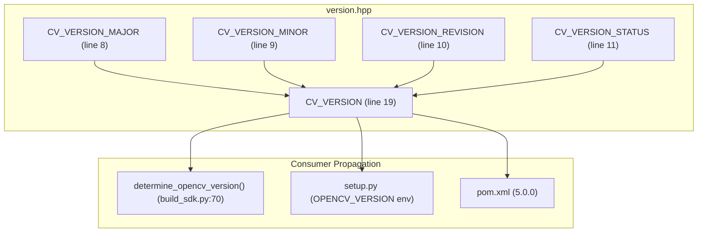
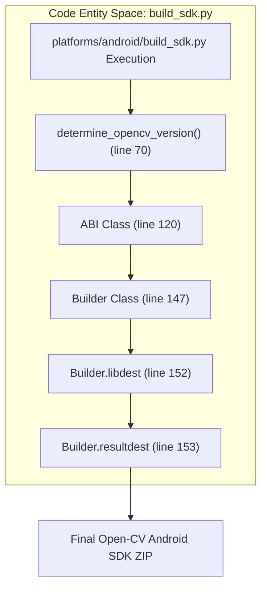

<!-- source: DeepWiki mcp.deepwiki.com · repo opencv/opencv · page 2.3 Version Management, Packaging, and Platform Builds · fetched 2026-10-30 -->

# Version Management, Packaging, and Platform Builds

Relevant source files

The following files were used as context for generating this wiki page:

- [.github/ISSUE_TEMPLATE.md](.github/ISSUE_TEMPLATE.md)
- [.github/ISSUE_TEMPLATE/bug_report.yml](.github/ISSUE_TEMPLATE/bug_report.yml)
- [.github/ISSUE_TEMPLATE/config.yml](.github/ISSUE_TEMPLATE/config.yml)
- [.github/ISSUE_TEMPLATE/documentation.yml](.github/ISSUE_TEMPLATE/documentation.yml)
- [.github/ISSUE_TEMPLATE/feature_request.yml](.github/ISSUE_TEMPLATE/feature_request.yml)
- [.github/PULL_REQUEST_TEMPLATE.md](.github/PULL_REQUEST_TEMPLATE.md)
- [COPYRIGHT](COPYRIGHT)
- [LICENSE](LICENSE)
- [cmake/OpenCVPackaging.cmake](cmake/OpenCVPackaging.cmake)
- [cmake/android/android_gradle_projects.cmake](cmake/android/android_gradle_projects.cmake)
- [doc/LICENSE_BSD.txt](doc/LICENSE_BSD.txt)
- [doc/py_tutorials/py_setup/py_intro/py_intro.markdown](doc/py_tutorials/py_setup/py_intro/py_intro.markdown)
- [doc/tutorials/dnn/dnn_android/dnn_android.markdown](doc/tutorials/dnn/dnn_android/dnn_android.markdown)
- [doc/tutorials/introduction/android_binary_package/android_dev_intro.markdown](doc/tutorials/introduction/android_binary_package/android_dev_intro.markdown)
- [doc/tutorials/introduction/android_binary_package/dev_with_OCV_on_Android.markdown](doc/tutorials/introduction/android_binary_package/dev_with_OCV_on_Android.markdown)
- [doc/tutorials/introduction/clojure_dev_intro/clojure_dev_intro.markdown](doc/tutorials/introduction/clojure_dev_intro/clojure_dev_intro.markdown)
- [doc/tutorials/introduction/cross_referencing/tutorial_cross_referencing.markdown](doc/tutorials/introduction/cross_referencing/tutorial_cross_referencing.markdown)
- [doc/tutorials/introduction/windows_install/windows_install.markdown](doc/tutorials/introduction/windows_install/windows_install.markdown)
- [modules/core/include/opencv2/core/version.hpp](modules/core/include/opencv2/core/version.hpp)
- [modules/dnn/include/opencv2/dnn/version.hpp](modules/dnn/include/opencv2/dnn/version.hpp)
- [modules/java/android_sdk/CMakeLists.txt](modules/java/android_sdk/CMakeLists.txt)
- [modules/java/android_sdk/build.gradle.in](modules/java/android_sdk/build.gradle.in)
- [modules/java/android_sdk/libcxx_helper/CMakeLists.txt](modules/java/android_sdk/libcxx_helper/CMakeLists.txt)
- [modules/java/android_sdk/libcxx_helper/dummy.cpp](modules/java/android_sdk/libcxx_helper/dummy.cpp)
- [modules/js/perf/package.json](modules/js/perf/package.json)
- [modules/python/package/setup.py](modules/python/package/setup.py)
- [platforms/android/build_aar.sh](platforms/android/build_aar.sh)
- [platforms/android/build_sdk.py](platforms/android/build_sdk.py)
- [platforms/android/gradle-wrapper/gradle/wrapper/gradle-wrapper.properties.in](platforms/android/gradle-wrapper/gradle/wrapper/gradle-wrapper.properties.in)
- [platforms/android/ndk-22.config.py](platforms/android/ndk-22.config.py)
- [platforms/maven/opencv-it/pom.xml](platforms/maven/opencv-it/pom.xml)
- [platforms/maven/opencv/pom.xml](platforms/maven/opencv/pom.xml)
- [platforms/maven/pom.xml](platforms/maven/pom.xml)
- [samples/android/15-puzzle/build.gradle.in](samples/android/15-puzzle/build.gradle.in)
- [samples/android/build.gradle.in](samples/android/build.gradle.in)
- [samples/android/camera-calibration/build.gradle.in](samples/android/camera-calibration/build.gradle.in)
- [samples/android/color-blob-detection/build.gradle.in](samples/android/color-blob-detection/build.gradle.in)
- [samples/android/face-detection/build.gradle.in](samples/android/face-detection/build.gradle.in)
- [samples/android/image-manipulations/build.gradle.in](samples/android/image-manipulations/build.gradle.in)
- [samples/android/mobilenet-objdetect/build.gradle.in](samples/android/mobilenet-objdetect/build.gradle.in)
- [samples/android/tutorial-1-camerapreview/build.gradle.in](samples/android/tutorial-1-camerapreview/build.gradle.in)
- [samples/android/tutorial-2-mixedprocessing/build.gradle.in](samples/android/tutorial-2-mixedprocessing/build.gradle.in)
- [samples/android/tutorial-3-cameracontrol/build.gradle.in](samples/android/tutorial-3-cameracontrol/build.gradle.in)
- [samples/android/tutorial-4-opencl/build.gradle.in](samples/android/tutorial-4-opencl/build.gradle.in)
- [samples/cpp/3calibration.cpp](samples/cpp/3calibration.cpp)
- [samples/cpp/stereo_calib.cpp](samples/cpp/stereo_calib.cpp)

## Purpose and Scope

This document describes OpenCV's version management system, CPack-based packaging, and platform-specific build processes. It covers:

- Version numbering scheme and `version.hpp` header definition.
- How version numbers propagate to CMake, Python, Maven, and the Android build script.
- CPack generation of DEB, RPM, and ZIP packages via `cmake/OpenCVPackaging.cmake`.
- `build_sdk.py` orchestration of multi-ABI Android SDK builds.
- Maven artifact generation for Java/JVM platforms.
- Python package distribution (`setup.py`).
- Pkg-config metadata generation for Linux-based systems.

For general build system configuration, see page 2.1. For module-level build details, see page 2.2.

---

## Version Numbering Scheme

OpenCV uses a four-component version scheme defined in `modules/core/include/opencv2/core/version.hpp`.

### Version Components

| Component | Macro | Purpose | Example |
|-----------|-------|---------|---------|
| Major | `CV_VERSION_MAJOR` | API-breaking changes | 5 [modules/core/include/opencv2/core/version.hpp:8-8]() |
| Minor | `CV_VERSION_MINOR` | Feature releases | 1 [modules/core/include/opencv2/core/version.hpp:9-9]() |
| Revision | `CV_VERSION_REVISION` | Bug fixes | 0 [modules/core/include/opencv2/core/version.hpp:10-10]() |
| Status | `CV_VERSION_STATUS` | Development stage | "-dev" [modules/core/include/opencv2/core/version.hpp:11-11]() |

The `CV_VERSION` string is composed by concatenating these macros [modules/core/include/opencv2/core/version.hpp:19-19](). Old-style constants like `CV_MAJOR_VERSION` are maintained for backward compatibility [modules/core/include/opencv2/core/version.hpp:22-24]().

**Version Definition Logic and Propagation**

Sources: [modules/core/include/opencv2/core/version.hpp:1-26](), [platforms/android/build_sdk.py:70-79](), [modules/python/package/setup.py:22-22](), [platforms/maven/pom.xml:4-7]()

---

## Packaging with CPack

OpenCV utilizes CMake's CPack module to generate distribution packages (DEB, RPM, and ZIP). The configuration is centralized in `cmake/OpenCVPackaging.cmake`.

### Package Metadata and Architecture
CPack variables are populated using OpenCV's version variables [cmake/OpenCVPackaging.cmake:20-23](). The script maps OpenCV's internal architecture flags (like `X86_64` or `AARCH64`) to standard package manager architecture strings [cmake/OpenCVPackaging.cmake:27-45]().

| OpenCV Flag | Debian Arch (`CPACK_DEBIAN_PACKAGE_ARCHITECTURE`) | RPM Arch (`CPACK_RPM_PACKAGE_ARCHITECTURE`) |
|-------------|---------------------------------------------------|---------------------------------------------|
| `X86`       | `i386` [cmake/OpenCVPackaging.cmake:28-28]()      | `i686` [cmake/OpenCVPackaging.cmake:29-29]() |
| `X86_64`    | `amd64` [cmake/OpenCVPackaging.cmake:31-31]()     | `x86_64` [cmake/OpenCVPackaging.cmake:32-32]() |
| `ARM`       | `armhf` [cmake/OpenCVPackaging.cmake:34-34]()     | `armhf` [cmake/OpenCVPackaging.cmake:35-35]() |
| `AARCH64`   | `arm64` [cmake/OpenCVPackaging.cmake:37-37]()     | `aarch64` [cmake/OpenCVPackaging.cmake:38-38]() |

### Component-Based Installation
OpenCV supports granular packaging where users can install specific parts of the library. CPack components include:
- `libs`: Shared libraries and data [cmake/OpenCVPackaging.cmake:75-75]().
- `dev`: Development headers and CMake files [cmake/OpenCVPackaging.cmake:72-72]().
- `python`: Python bindings [cmake/OpenCVPackaging.cmake:76-76]().
- `java`: Java bindings [cmake/OpenCVPackaging.cmake:74-74]().

Dependency chains are defined to ensure that high-level components (like `python` or `java`) require the base `libs` component [cmake/OpenCVPackaging.cmake:82-88](). For Linux distributions, the script defines conflict and replacement rules for standard module names like `libopencv-core4.0` [cmake/OpenCVPackaging.cmake:123-141]().

Sources: [cmake/OpenCVPackaging.cmake:1-167]()

---

## Android SDK Build Orchestration

The Android SDK is a multi-ABI (Application Binary Interface) package. Its creation is managed by `platforms/android/build_sdk.py`.

### Version Detection
The script implements `determine_opencv_version` which uses regular expressions to extract version components directly from `version.hpp` [platforms/android/build_sdk.py:70-79](). This allows the script to identify the version without requiring a full CMake configuration pass first.

### Multi-ABI Build Loop
The `Builder` class [platforms/android/build_sdk.py:147-168]() iterates through a list of `ABI` objects (e.g., `armeabi-v7a`, `arm64-v8a`, `x86`, `x86_64`) [platforms/android/build_sdk.py:120-143](). For each ABI, it:
1. Configures a separate CMake build directory.
2. Passes ABI-specific flags like `ANDROID_ABI`, `ANDROID_STL`, and `ANDROID_PLATFORM_ID` [platforms/android/build_sdk.py:125-137]().
3. Executes the build using `ninja` or `make`.
4. Collects results into a unified SDK structure (`OpenCV-android-sdk`) [platforms/android/build_sdk.py:153-153]().

### SDK Packaging Workflow

Sources: [platforms/android/build_sdk.py:1-168]()

---

## Java and Maven Integration

OpenCV provides Maven POM files to support Java dependency management and OSGi bundle creation.

### Project Hierarchy
- **Parent POM**: `platforms/maven/pom.xml` defines the project coordinates (`org.opencv`) and version (e.g., `5.0.0`) [platforms/maven/pom.xml:4-7]().
- **OpenCV Module**: `platforms/maven/opencv/pom.xml` handles the actual JAR creation, including OSGi bundle packaging [platforms/maven/opencv/pom.xml:1-11]().
- **Integration Tests**: `platforms/maven/opencv-it/pom.xml` runs tests against the generated artifacts using the `pax-exam` container [platforms/maven/opencv-it/pom.xml:1-18]().

### Build Lifecycle and Native Libs
The Maven build uses the `exec-maven-plugin` to run shell scripts that check for required system dependencies (like `libpng-dev`, `libjpeg-dev`) [platforms/maven/opencv/pom.xml:64-92](). It also ensures the native library (`libopencv_java.so`) is correctly named based on the version string [platforms/maven/opencv/pom.xml:17-17]().

Sources: [platforms/maven/pom.xml:1-57](), [platforms/maven/opencv/pom.xml:1-151](), [platforms/maven/opencv-it/pom.xml:1-111]()

---

## Python Package Distribution

The `modules/python/package/setup.py` script manages the creation of Python wheels and source distributions.

### Package Configuration
The script detects the version from the `OPENCV_VERSION` environment variable, falling back to `5.0.0` if not set [modules/python/package/setup.py:22-22](). It uses `setuptools.find_packages()` to discover the `cv2` package and its submodules [modules/python/package/setup.py:42-42]().

### Typing Support
OpenCV supports PEP 561 by including a `py.typed` file and collecting all `.pyi` typing stubs generated during the build process [modules/python/package/setup.py:8-15](). These are included in the `package_data` section of the `setuptools.setup` call to enable IDE auto-completion [modules/python/package/setup.py:43-45]().

Sources: [modules/python/package/setup.py:1-82]()

---

