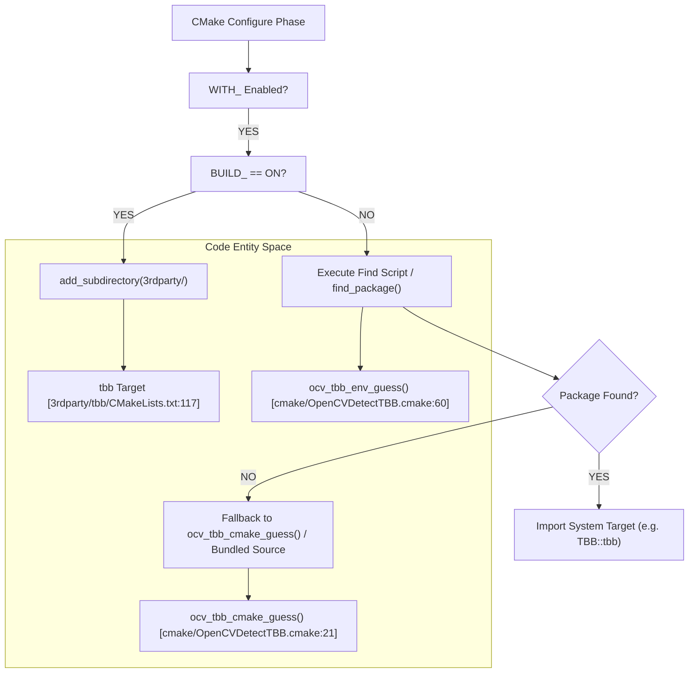
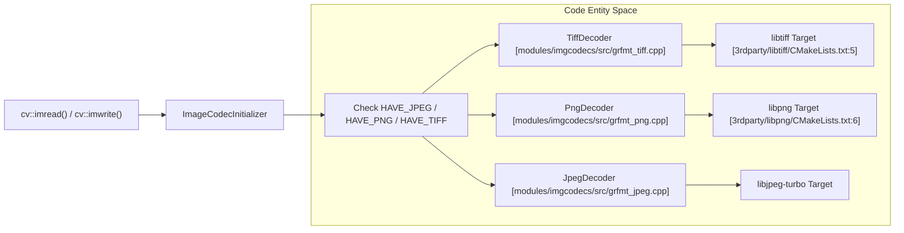
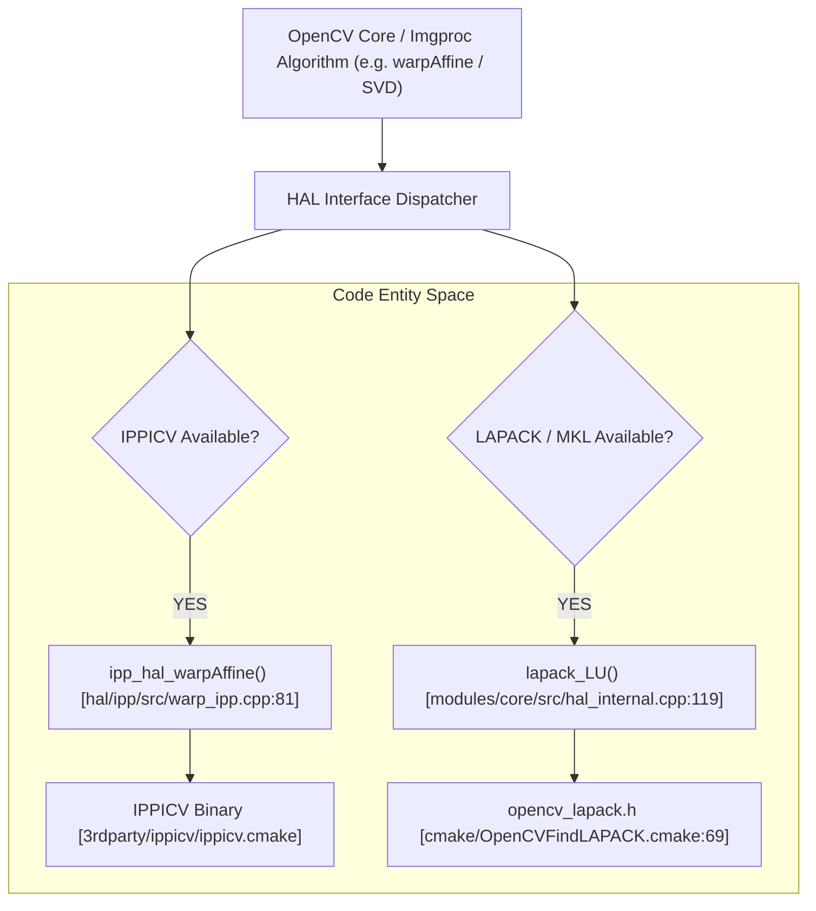

<!-- source: DeepWiki mcp.deepwiki.com · repo opencv/opencv · page 2.4 Third-Party Dependencies and 3rdparty/ Integration · fetched 2026-10-30 -->

# Third-Party Dependencies and 3rdparty/ Integration

Relevant source files

The following files were used as context for generating this wiki page:

- [3rdparty/cpufeatures/CMakeLists.txt](3rdparty/cpufeatures/CMakeLists.txt)
- [3rdparty/ippicv/ippicv.cmake](3rdparty/ippicv/ippicv.cmake)
- [3rdparty/ittnotify/CMakeLists.txt](3rdparty/ittnotify/CMakeLists.txt)
- [3rdparty/libjasper/CMakeLists.txt](3rdparty/libjasper/CMakeLists.txt)
- [3rdparty/libpng/CMakeLists.txt](3rdparty/libpng/CMakeLists.txt)
- [3rdparty/libtiff/CMakeLists.txt](3rdparty/libtiff/CMakeLists.txt)
- [3rdparty/protobuf/CMakeLists.txt](3rdparty/protobuf/CMakeLists.txt)
- [3rdparty/tbb/CMakeLists.txt](3rdparty/tbb/CMakeLists.txt)
- [3rdparty/zlib/CMakeLists.txt](3rdparty/zlib/CMakeLists.txt)
- [cmake/OpenCVDetectTBB.cmake](cmake/OpenCVDetectTBB.cmake)
- [cmake/OpenCVFindAtlas.cmake](cmake/OpenCVFindAtlas.cmake)
- [cmake/OpenCVFindLAPACK.cmake](cmake/OpenCVFindLAPACK.cmake)
- [cmake/OpenCVFindMKL.cmake](cmake/OpenCVFindMKL.cmake)
- [cmake/OpenCVFindOpenBLAS.cmake](cmake/OpenCVFindOpenBLAS.cmake)
- [cmake/checks/lapack_check.cpp](cmake/checks/lapack_check.cpp)
- [cmake/templates/OpenCVConfig-FastCV.cmake.in](cmake/templates/OpenCVConfig-FastCV.cmake.in)
- [hal/ipp/include/ipp_hal_core.hpp](hal/ipp/include/ipp_hal_core.hpp)
- [hal/ipp/include/ipp_utils.hpp](hal/ipp/include/ipp_utils.hpp)
- [hal/ipp/src/cart_polar_ipp.cpp](hal/ipp/src/cart_polar_ipp.cpp)
- [hal/ipp/src/math_ipp.cpp](hal/ipp/src/math_ipp.cpp)
- [hal/ipp/src/mean_ipp.cpp](hal/ipp/src/mean_ipp.cpp)
- [hal/ipp/src/minmax_ipp.cpp](hal/ipp/src/minmax_ipp.cpp)
- [hal/ipp/src/norm_ipp.cpp](hal/ipp/src/norm_ipp.cpp)
- [hal/ipp/src/sum_ipp.cpp](hal/ipp/src/sum_ipp.cpp)
- [hal/ipp/src/transforms_ipp.cpp](hal/ipp/src/transforms_ipp.cpp)
- [hal/ipp/src/warp_ipp.cpp](hal/ipp/src/warp_ipp.cpp)
- [hal/riscv-rvv/src/core/mean.cpp](hal/riscv-rvv/src/core/mean.cpp)
- [modules/core/include/opencv2/core/hal/hal.hpp](modules/core/include/opencv2/core/hal/hal.hpp)
- [modules/core/include/opencv2/core/hal/interface.h](modules/core/include/opencv2/core/hal/interface.h)
- [modules/core/include/opencv2/core/saturate.hpp](modules/core/include/opencv2/core/saturate.hpp)
- [modules/core/include/opencv2/core/traits.hpp](modules/core/include/opencv2/core/traits.hpp)
- [modules/core/perf/perf_dft.cpp](modules/core/perf/perf_dft.cpp)
- [modules/core/perf/perf_dot.cpp](modules/core/perf/perf_dot.cpp)
- [modules/core/perf/perf_math.cpp](modules/core/perf/perf_math.cpp)
- [modules/core/src/channels.cpp](modules/core/src/channels.cpp)
- [modules/core/src/hal_internal.cpp](modules/core/src/hal_internal.cpp)
- [modules/core/src/hal_internal.hpp](modules/core/src/hal_internal.hpp)
- [modules/core/src/hal_replacement.hpp](modules/core/src/hal_replacement.hpp)
- [modules/core/src/lut.cpp](modules/core/src/lut.cpp)
- [modules/core/src/mathfuncs_core.dispatch.cpp](modules/core/src/mathfuncs_core.dispatch.cpp)
- [modules/core/src/mathfuncs_core.simd.hpp](modules/core/src/mathfuncs_core.simd.hpp)
- [modules/core/src/matrix_decomp.cpp](modules/core/src/matrix_decomp.cpp)
- [modules/core/test/test_hal_core.cpp](modules/core/test/test_hal_core.cpp)
- [modules/core/test/test_ptr.cpp](modules/core/test/test_ptr.cpp)
- [modules/stitching/src/autocalib.cpp](modules/stitching/src/autocalib.cpp)
- [modules/stitching/src/camera.cpp](modules/stitching/src/camera.cpp)
- [modules/video/src/optical_flow_io.cpp](modules/video/src/optical_flow_io.cpp)
- [platforms/android/default.config.py](platforms/android/default.config.py)
- [platforms/android/fastcv.config.py](platforms/android/fastcv.config.py)

OpenCV relies on a robust set of third-party libraries to handle compressed formats, image and video codecs, parallel processing frameworks, and architecture-specific performance primitives. This page details how OpenCV's CMake build system selects between system-provided and bundled libraries within the `3rdparty/` directory, highlighting the configuration logic, integration mechanisms for parallel backends like TBB, performance libraries such as IPP/IPPICV, LAPACK, and MKL, and hardware-optimized image codecs.

---

## 1. Dependency Selection and Resolution Logic

OpenCV uses a standardized configuration pattern across its CMake scripts to manage dependencies. For each major third-party library, a configuration flag `WITH_<LIBRARY>` (e.g., `WITH_JPEG`, `WITH_PNG`, `WITH_TBB`, `WITH_IPP`) determines whether OpenCV attempts to incorporate that capability. If enabled, the build system evaluates whether to use a system-installed package or fallback to the bundled source files located in `3rdparty/` via `BUILD_<LIBRARY>` flags.

### System vs. Bundled Evaluation Flow
The detection and configuration sequence typically follows this procedural flow:
1. **Explicit Bundling Request**: If `BUILD_<LIBRARY>` is explicitly set to `ON`, CMake bypasses system checks and adds the local directory from `3rdparty/` [3rdparty/tbb/CMakeLists.txt:107-108]().
2. **System Search**: If `BUILD_<LIBRARY>` is `OFF` or unset, the system queries for installed packages using `find_package()` or custom find scripts [cmake/OpenCVDetectTBB.cmake:22-22]().
3. **Fallback Mechanism**: If the system package is missing or fails version constraints, CMake falls back to the bundled `3rdparty/` target if available [cmake/OpenCVDetectTBB.cmake:115-121]().

The following diagram maps CMake configuration variables and discovery functions to their underlying code entities during dependency resolution:

**Title: Dependency Resolution and Code Entity Mapping**

Sources: [cmake/OpenCVDetectTBB.cmake:21-121](), [3rdparty/tbb/CMakeLists.txt:107-117]()

---

## 2. The `3rdparty/` Directory Layout and Codec Subsystems

The `3rdparty/` directory houses source code, build wrappers, and configurations for essential libraries. OpenCV bundles these libraries to guarantee a predictable build experience across locked-down or minimal target environments (such as Android, iOS, or headless Linux containers).

| Directory | Primary Library | Core Purpose |
| :--- | :--- | :--- |
| `3rdparty/zlib` | ZLIB | Compression backend for PNG, TIFF, and OpenEXR formats [3rdparty/zlib/CMakeLists.txt:6-84]() |
| `3rdparty/libpng` | libpng | PNG decoding/encoding with architecture-specific SIMD filters [3rdparty/libpng/CMakeLists.txt:6-118]() |
| `3rdparty/libtiff` | libtiff | TIFF image and BigTIFF support [3rdparty/libtiff/CMakeLists.txt:5-207]() |
| `3rdparty/protobuf` | Protocol Buffers | Lite and full protobuf runtime for ONNX / DNN model parsing [3rdparty/protobuf/CMakeLists.txt:1-135]() |
| `3rdparty/tbb` | Intel oneTBB | Parallel execution engine for `cv::parallel_for_` [3rdparty/tbb/CMakeLists.txt:2-117]() |
| `3rdparty/ippicv` | IPPICV | Precompiled Intel Integrated Performance Primitives subset [3rdparty/ippicv/ippicv.cmake:1-60]() |

### Codec Integration and Registry Pattern
The `imgcodecs` module registers image encoders and decoders at startup using an initialization registry pattern. 

**Title: Codec Initialization and 3rdparty Binding**

Sources: [3rdparty/libpng/CMakeLists.txt:6-118](), [3rdparty/libtiff/CMakeLists.txt:5-10](), [3rdparty/zlib/CMakeLists.txt:6-84]()

---

## 3. Parallel Backends: Threading Building Blocks (TBB)

OpenCV uses Threading Building Blocks (TBB) as a high-performance parallel backend for `parallel_for_`. The build integration is managed by `cmake/OpenCVDetectTBB.cmake` and `3rdparty/tbb/CMakeLists.txt`.

### TBB Detection and Source Build Logic
1. **Source Download**: If `BUILD_TBB` is enabled, CMake defines `OPENCV_TBB_RELEASE` (e.g., `v2022.1.0`) and invokes `ocv_download()` to fetch the archive from the oneAPI repository [3rdparty/tbb/CMakeLists.txt:8-24]().
2. **CMake Package Discovery**: `ocv_tbb_cmake_guess()` executes `find_package(TBB QUIET COMPONENTS tbb)` searching custom paths in `TBBROOT/cmake` [cmake/OpenCVDetectTBB.cmake:21-22]().
3. **Environment Verification**: `ocv_tbb_env_guess()` scans system environment variables (`CPATH`, `LIBRARY_PATH`, `TBBROOT`) to discover include files like `tbb/tbb.h` and libraries like `tbb` or `tbb_debug` [cmake/OpenCVDetectTBB.cmake:60-67]().

Sources: [cmake/OpenCVDetectTBB.cmake:21-125](), [3rdparty/tbb/CMakeLists.txt:8-178]()

---

## 4. Performance Libraries: IPP, IPPICV, LAPACK, and MKL

Hardware acceleration packages are integrated through specialized detection scripts and Hardware Abstraction Layer (HAL) bindings.

### IPPICV Management
The `3rdparty/ippicv/ippicv.cmake` script selects and downloads platform-specific precompiled binaries for Intel Integrated Performance Primitives (IPPICV):
- **Platform Branching**: Detects macOS (`ippicv_mac`), Linux (`ippicv_lnx`), or Windows (`ippicv_win`) alongside architecture specifiers (`intel64`, `ia32`) [3rdparty/ippicv/ippicv.cmake:7-40]().
- **Integration**: Fetches packages matching explicit cryptographic hashes (`OPENCV_ICV_HASH`) and unpacks them into `${OpenCV_BINARY_DIR}/3rdparty/ippicv` [3rdparty/ippicv/ippicv.cmake:45-55]().
- **HAL Warp Execution**: Functions such as `ipp_hal_warpAffine()` in `hal/ipp/src/warp_ipp.cpp` use IPP's image processing wrappers (`IwiImage`) to accelerate affine transformations when conditions permit [hal/ipp/src/warp_ipp.cpp:77-152]().

### LAPACK and MKL Integration
Matrix decompositions and solver routines in `core` can link against external BLAS/LAPACK implementations, including Intel MKL or Apple Accelerate.
- **LAPACK Check**: `cmake/OpenCVFindLAPACK.cmake` defines `ocv_lapack_check()` which validates C/C++ interface headers (`cblas.h`, `lapacke.h`) and generates a proxy header file (`opencv_lapack.h`) [cmake/OpenCVFindLAPACK.cmake:46-112]().
- **MKL Detection**: `cmake/OpenCVFindMKL.cmake` locates MKL installations via `MKLROOT`, parses `mkl_version.h` to determine version compatibility, and configures single dynamic libraries (`mkl_rt`) or multi-threaded component groupings [cmake/OpenCVFindMKL.cmake:29-155]().

**Title: Performance Library and HAL Acceleration Routing**

Sources: [3rdparty/ippicv/ippicv.cmake:1-60](), [cmake/OpenCVFindLAPACK.cmake:46-136](), [cmake/OpenCVFindMKL.cmake:29-175](), [hal/ipp/src/warp_ipp.cpp:77-152](), [modules/core/src/hal_internal.cpp:119-184]()

---

## 5. Key Build Variables Summary

| Variable Name | Description | Source Reference |
| :--- | :--- | :--- |
| `BUILD_TBB` | Forces compilation of bundled TBB from `3rdparty/tbb` | [3rdparty/tbb/CMakeLists.txt:1-10](), [cmake/OpenCVDetectTBB.cmake:107]() |
| `OPENCV_ICV_HASH` | MD5 hash validation string for IPPICV archive download | [3rdparty/ippicv/ippicv.cmake:12-40]() |
| `MKL_USE_SINGLE_DYNAMIC_LIBRARY` | Instructs MKL detector to link against `mkl_rt` | [cmake/OpenCVFindMKL.cmake:43]() |
| `CBLAS_H_PROXY_PATH` | Path to generated proxy header `opencv_lapack.h` | [cmake/OpenCVFindLAPACK.cmake:69]() |

Sources: [3rdparty/tbb/CMakeLists.txt:1-10](), [3rdparty/ippicv/ippicv.cmake:1-60](), [cmake/OpenCVDetectTBB.cmake:107-125](), [cmake/OpenCVFindLAPACK.cmake:46-113](), [cmake/OpenCVFindMKL.cmake:43-46]()

---

