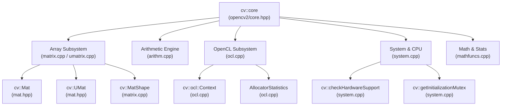
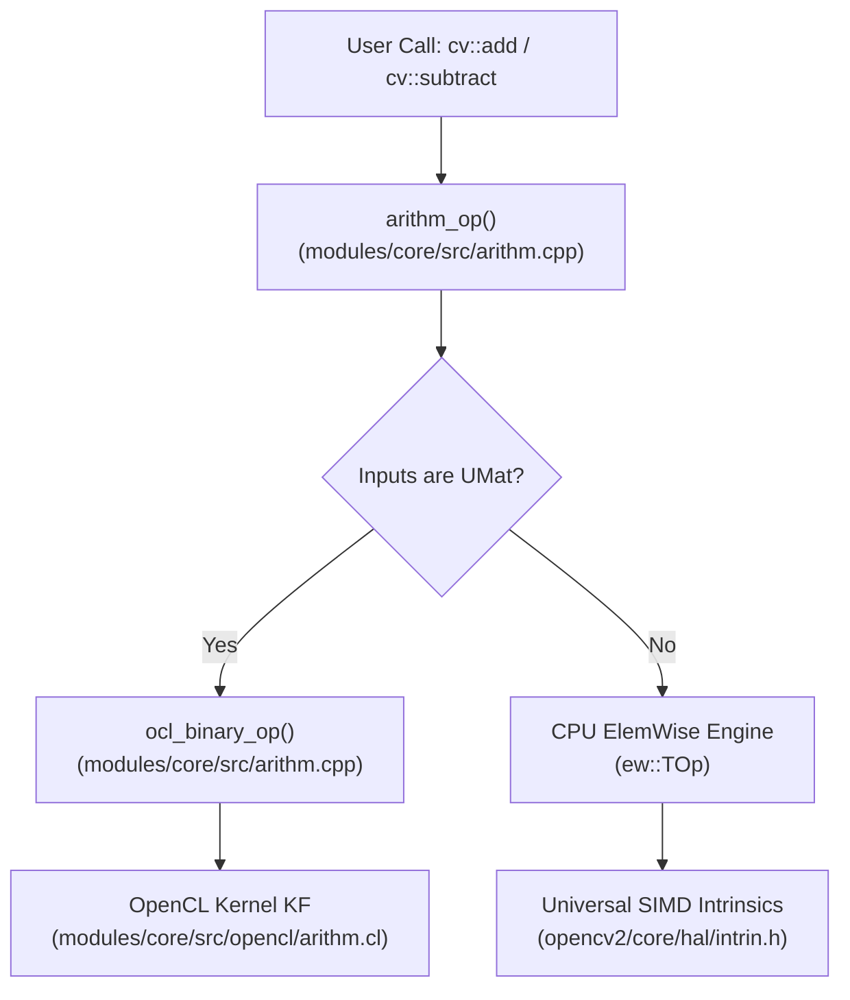

<!-- source: DeepWiki mcp.deepwiki.com · repo opencv/opencv · page 3 Core Module · fetched 2026-10-30 -->

# Core Module

Relevant source files

The following files were used as context for generating this wiki page:

- [cmake/OpenCVCompilerOptimizations.cmake](cmake/OpenCVCompilerOptimizations.cmake)
- [modules/core/include/opencv2/core.hpp](modules/core/include/opencv2/core.hpp)
- [modules/core/include/opencv2/core/base.hpp](modules/core/include/opencv2/core/base.hpp)
- [modules/core/include/opencv2/core/core.hpp](modules/core/include/opencv2/core/core.hpp)
- [modules/core/include/opencv2/core/cv_cpu_dispatch.h](modules/core/include/opencv2/core/cv_cpu_dispatch.h)
- [modules/core/include/opencv2/core/cv_cpu_helper.h](modules/core/include/opencv2/core/cv_cpu_helper.h)
- [modules/core/include/opencv2/core/cvdef.h](modules/core/include/opencv2/core/cvdef.h)
- [modules/core/include/opencv2/core/mat.hpp](modules/core/include/opencv2/core/mat.hpp)
- [modules/core/include/opencv2/core/mat.inl.hpp](modules/core/include/opencv2/core/mat.inl.hpp)
- [modules/core/include/opencv2/core/matx.hpp](modules/core/include/opencv2/core/matx.hpp)
- [modules/core/include/opencv2/core/ocl.hpp](modules/core/include/opencv2/core/ocl.hpp)
- [modules/core/include/opencv2/core/operations.hpp](modules/core/include/opencv2/core/operations.hpp)
- [modules/core/include/opencv2/core/private.hpp](modules/core/include/opencv2/core/private.hpp)
- [modules/core/include/opencv2/core/types.hpp](modules/core/include/opencv2/core/types.hpp)
- [modules/core/include/opencv2/core/utility.hpp](modules/core/include/opencv2/core/utility.hpp)
- [modules/core/include/opencv2/core/utils/buffer_area.private.hpp](modules/core/include/opencv2/core/utils/buffer_area.private.hpp)
- [modules/core/perf/perf_arithm.cpp](modules/core/perf/perf_arithm.cpp)
- [modules/core/src/algorithm.cpp](modules/core/src/algorithm.cpp)
- [modules/core/src/arithm.cpp](modules/core/src/arithm.cpp)
- [modules/core/src/buffer_area.cpp](modules/core/src/buffer_area.cpp)
- [modules/core/src/command_line_parser.cpp](modules/core/src/command_line_parser.cpp)
- [modules/core/src/copy.cpp](modules/core/src/copy.cpp)
- [modules/core/src/matrix.cpp](modules/core/src/matrix.cpp)
- [modules/core/src/matrix_transform.cpp](modules/core/src/matrix_transform.cpp)
- [modules/core/src/matrix_wrap.cpp](modules/core/src/matrix_wrap.cpp)
- [modules/core/src/ocl.cpp](modules/core/src/ocl.cpp)
- [modules/core/src/ocl_disabled.impl.hpp](modules/core/src/ocl_disabled.impl.hpp)
- [modules/core/src/opencl/flip.cl](modules/core/src/opencl/flip.cl)
- [modules/core/src/opencl/gemm.cl](modules/core/src/opencl/gemm.cl)
- [modules/core/src/opencl/transpose.cl](modules/core/src/opencl/transpose.cl)
- [modules/core/src/precomp.hpp](modules/core/src/precomp.hpp)
- [modules/core/src/rand.cpp](modules/core/src/rand.cpp)
- [modules/core/src/system.cpp](modules/core/src/system.cpp)
- [modules/core/src/umatrix.cpp](modules/core/src/umatrix.cpp)
- [modules/core/test/ocl/test_opencl.cpp](modules/core/test/ocl/test_opencl.cpp)
- [modules/core/test/test_arithm.cpp](modules/core/test/test_arithm.cpp)
- [modules/core/test/test_mat.cpp](modules/core/test/test_mat.cpp)
- [modules/core/test/test_operations.cpp](modules/core/test/test_operations.cpp)
- [modules/core/test/test_precomp.hpp](modules/core/test/test_precomp.hpp)
- [modules/core/test/test_rand.cpp](modules/core/test/test_rand.cpp)
- [modules/core/test/test_umat.cpp](modules/core/test/test_umat.cpp)
- [modules/core/test/test_utils.cpp](modules/core/test/test_utils.cpp)
- [modules/ts/src/ocl_test.cpp](modules/ts/src/ocl_test.cpp)
- [modules/ts/src/ts_func.cpp](modules/ts/src/ts_func.cpp)
- [platforms/linux/riscv64-071-gcc.toolchain.cmake](platforms/linux/riscv64-071-gcc.toolchain.cmake)

The `opencv_core` module (`modules/core/`) is the foundational backbone of OpenCV, providing the core array classes, data structures, arithmetic and mathematical operations, system-level utilities, OpenCL acceleration infrastructure, and serialization services that all other modules depend on.

For detailed technical descriptions of specific subsystems, refer to the child pages:
- [Mat and UMat Data Structures](#3.1) — Describe the `Mat` and `UMat` N-dimensional array classes, their memory layout, reference counting, `InputArray` and `OutputArray` abstraction, and how data moves between CPU and GPU memory representations.
- [OpenCL Acceleration and Transparent GPU Execution](#3.2) — Explain how OpenCV integrates OpenCL for GPU acceleration via `UMat`, covering device discovery, context management, kernel compilation, binary caching, and the transparent execution model.
- [System Utilities and Parallel Processing](#3.3) — Document system-level utilities including CPU feature detection, error handling, logging/tracing, filesystem and plugin loading helpers, memory allocation, random number generation, and the `parallel_for_` framework with its TBB, OpenMP, and pthreads backends.
- [Persistence and Serialization (FileStorage)](#3.4) — Document the `FileStorage` class and its support for reading and writing data in XML, YAML, and JSON formats, including Base64 encoding for binary data and the `FileNode` traversal API.
- [SIMD Intrinsics and CPU Dispatching](#3.5) — Explain the universal SIMD intrinsics layer abstracting SSE, AVX, NEON, VSX, and RISC-V RVV under a common API, the CPU dispatch mechanism, and the HAL plugin system.
- [Math, Linear Algebra, and Optimization in core](#3.6) — Document core mathematical services: `mathfuncs.cpp`, LAPACK/BLAS-backed matrix decompositions, DFT/DCT (`dxt.cpp`), norms and statistics, kmeans, and optimization solvers.

---

## Module Layout

The module is organized around a core set of public headers in `modules/core/include/opencv2/core/` and implementation files in `modules/core/src/`. Downstream code typically includes the umbrella header `modules/core/include/opencv2/core.hpp`, which incorporates all component headers.

**Primary Public Headers**

| Header | Purpose |
|---|---|
| `opencv2/core.hpp` | Umbrella header; includes all sub-headers [modules/core/include/opencv2/core.hpp:48-60]() |
| `opencv2/core/cvdef.h` | Compiler macros, type definitions, and `CV_StaticAssert` [modules/core/include/opencv2/core/cvdef.h:45-148]() |
| `opencv2/core/base.hpp` | Error handling codes, `CV_Error`, and assertion macros [modules/core/include/opencv2/core.hpp:148-156]() |
| `opencv2/core/types.hpp` | Geometric primitives: `Point`, `Size`, `Rect`, `Scalar` [modules/core/include/opencv2/core/types.hpp:52-57]() |
| `opencv2/core/mat.hpp` | `Mat`, `UMat`, `_InputArray`, `_OutputArray` definitions [modules/core/include/opencv2/core/mat.hpp:72-155]() |
| `opencv2/core/persistence.hpp` | `FileStorage`, `FileNode` for structured serialization [modules/core/include/opencv2/core/persistence.hpp:59-60]() |
| `opencv2/core/utility.hpp` | Parallel processing (`parallel_for_`), `AutoBuffer`, `TickMeter`, `RNG` [modules/core/include/opencv2/core.hpp:109-110]() |
| `opencv2/core/ocl.hpp` | OpenCL `Context`, `Device`, `Kernel`, and `Queue` abstractions [modules/core/include/opencv2/core.hpp:87-87]() |

Sources: [modules/core/include/opencv2/core.hpp:48-105](), [modules/core/include/opencv2/core/mat.hpp:72-155](), [modules/core/include/opencv2/core/cvdef.h:45-148]()

---

## Component Architecture and Code Mapping

The following diagram associates high-level subsystem concepts in `opencv_core` with their concrete C++ source and header implementations.

**Core Module Entity Map**

Sources: [modules/core/include/opencv2/core.hpp:61-105](), [modules/core/src/matrix.cpp:1-40](), [modules/core/src/ocl.cpp:126-140](), [modules/core/src/system.cpp:74-111]()

---

## Primary Data Structures (`Mat` and `UMat`)

The foundational data container is `Mat`, implemented via `modules/core/src/matrix.cpp` and defined in `modules/core/include/opencv2/core/mat.hpp`. It manages N-dimensional dense arrays with automatic reference-counted memory allocation. The accompanying `MatShape` structure manages tensor dimensions and layout configurations (`NCHW`, `NHWC`, block formats) without heap allocations [modules/core/include/opencv2/core/mat.hpp:107-155]().

`UMat` mirrors `Mat`'s API interface but delegates its backing storage to OpenCL memory buffers, enabling seamless interoperability between host CPU memory and accelerator memory.

For details, see [Mat and UMat Data Structures](#3.1).

Sources: [modules/core/include/opencv2/core/mat.hpp:72-155](), [modules/core/src/matrix.cpp:10-40]()

---

## OpenCL Acceleration and Transparent Execution

OpenCV integrates OpenCL to accelerate matrix and image operations on GPUs. The `opencv_core` module manages OpenCL contexts, command queues, device discovery, and kernel compilation in `modules/core/src/ocl.cpp`. Through `UMat`, algorithms can execute transparently on GPU hardware without requiring explicit host-device data transfer management in user code.

For details, see [OpenCL Acceleration and Transparent GPU Execution](#3.2).

Sources: [modules/core/src/ocl.cpp:42-140]()

---

## System Utilities and Parallel Processing

Platform-dependent services—such as CPU feature detection (`CPUID` and auxiliary vector parsing), thread-safe initialization, error management (`cv::Exception`, `CV_Assert`), memory allocators (`fastMalloc`), logging facilities, and random number generation (`cv::RNG`)—are centralized in `modules/core/src/system.cpp`. Additionally, the parallel execution framework (`parallel_for_`) provides a common abstraction layer dispatching tasks across thread pool backends like Intel TBB, OpenMP, and pthreads.

For details, see [System Utilities and Parallel Processing](#3.3).

Sources: [modules/core/src/system.cpp:74-175]()

---

## Persistence and Serialization (`FileStorage`)

Structured serialization in OpenCV is handled by the `FileStorage` class (`modules/core/src/persistence.cpp`). It supports reading and writing configuration states, numerical vectors, and `Mat` objects into human-readable XML, YAML, and JSON formats. Binary data payloads can be embedded via Base64 encoding, and the `FileNode` API facilitates hierarchical tree traversal.

For details, see [Persistence and Serialization (FileStorage)](#3.4).

Sources: [modules/core/include/opencv2/core/persistence.hpp:59-60]()

---

## SIMD Intrinsics, CPU Dispatching, and HAL

To extract maximum performance from diverse host CPUs, `opencv_core` provides a universal SIMD intrinsics layer (`opencv2/core/hal/intrin.h`) that abstracts instruction sets like SSE2/AVX2, ARM NEON, PowerPC VSX, and RISC-V RVV under a uniform API. The CPU dispatch system builds multiple optimized versions of routines into a single binary and selects the best implementation at runtime. Furthermore, low-level linear algebra and image operations can delegate to vendor-optimized hardware abstraction layer (HAL) plugins like IPP or Carotene.

For details, see [SIMD Intrinsics and CPU Dispatching](#3.5).

Sources: [modules/core/include/opencv2/core.hpp:89-98]()

---

## Mathematical Functions, Linear Algebra, and Optimization

The core module provides extensive mathematical capabilities, including element-wise transcendental functions (`mathfuncs.cpp`), discrete Fourier and cosine transforms (`dxt.cpp`), statistical reducers and norms, kmeans clustering, LAPACK/BLAS-backed matrix decompositions (`lapack.cpp`), and numerical optimization solvers (simplex, conjugate gradient, and linear programming).

For details, see [Math, Linear Algebra, and Optimization in core](#3.6).

Sources: [modules/core/src/mathfuncs.cpp:65-98]()

---

## Execution Flow: Arithmetic Dispatch

The following diagram illustrates how arithmetic operations route execution between OpenCL kernels and CPU routines depending on input container types (`Mat` vs `UMat`).

**Arithmetic Operation Execution Path**

Sources: [modules/core/src/arithm.cpp:68-154]()

---

