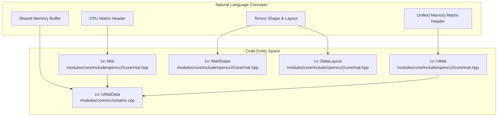
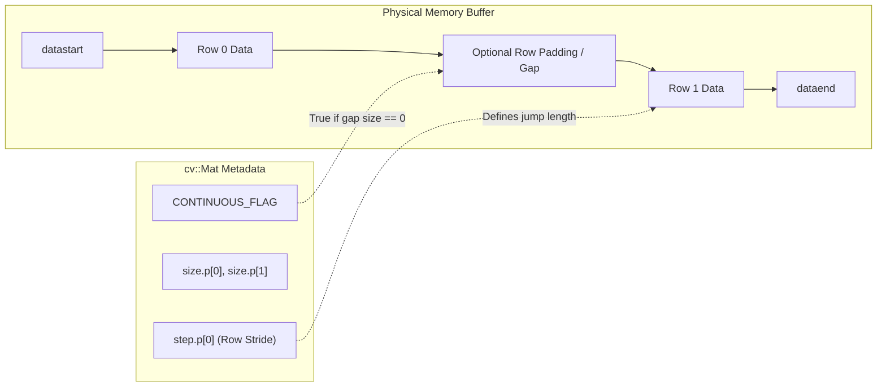
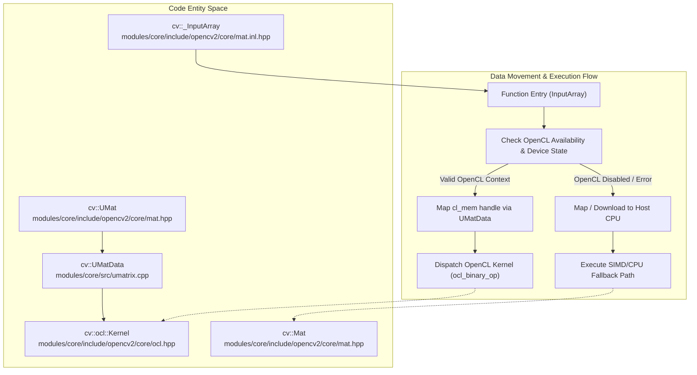

<!-- source: DeepWiki mcp.deepwiki.com · repo opencv/opencv · page 3.1 Mat and UMat Data Structures · fetched 2026-10-30 -->

# Mat and UMat Data Structures

Relevant source files

The following files were used as context for generating this wiki page:

- [modules/core/include/opencv2/core/mat.hpp](modules/core/include/opencv2/core/mat.hpp)
- [modules/core/include/opencv2/core/mat.inl.hpp](modules/core/include/opencv2/core/mat.inl.hpp)
- [modules/core/include/opencv2/core/ocl.hpp](modules/core/include/opencv2/core/ocl.hpp)
- [modules/core/include/opencv2/core/simd_intrinsics.hpp](modules/core/include/opencv2/core/simd_intrinsics.hpp)
- [modules/core/perf/perf_arithm.cpp](modules/core/perf/perf_arithm.cpp)
- [modules/core/src/arithm.cpp](modules/core/src/arithm.cpp)
- [modules/core/src/copy.cpp](modules/core/src/copy.cpp)
- [modules/core/src/intel_gpu_gemm.inl.hpp](modules/core/src/intel_gpu_gemm.inl.hpp)
- [modules/core/src/matmul.dispatch.cpp](modules/core/src/matmul.dispatch.cpp)
- [modules/core/src/matrix.cpp](modules/core/src/matrix.cpp)
- [modules/core/src/matrix_expressions.cpp](modules/core/src/matrix_expressions.cpp)
- [modules/core/src/matrix_iterator.cpp](modules/core/src/matrix_iterator.cpp)
- [modules/core/src/matrix_operations.cpp](modules/core/src/matrix_operations.cpp)
- [modules/core/src/matrix_sparse.cpp](modules/core/src/matrix_sparse.cpp)
- [modules/core/src/matrix_transform.cpp](modules/core/src/matrix_transform.cpp)
- [modules/core/src/matrix_wrap.cpp](modules/core/src/matrix_wrap.cpp)
- [modules/core/src/ocl.cpp](modules/core/src/ocl.cpp)
- [modules/core/src/ocl_disabled.impl.hpp](modules/core/src/ocl_disabled.impl.hpp)
- [modules/core/src/opencl/flip.cl](modules/core/src/opencl/flip.cl)
- [modules/core/src/opencl/gemm.cl](modules/core/src/opencl/gemm.cl)
- [modules/core/src/opencl/intel_gemm.cl](modules/core/src/opencl/intel_gemm.cl)
- [modules/core/src/opencl/transpose.cl](modules/core/src/opencl/transpose.cl)
- [modules/core/src/rand.cpp](modules/core/src/rand.cpp)
- [modules/core/src/umatrix.cpp](modules/core/src/umatrix.cpp)
- [modules/core/test/ocl/test_gemm.cpp](modules/core/test/ocl/test_gemm.cpp)
- [modules/core/test/ocl/test_opencl.cpp](modules/core/test/ocl/test_opencl.cpp)
- [modules/core/test/test_arithm.cpp](modules/core/test/test_arithm.cpp)
- [modules/core/test/test_mat.cpp](modules/core/test/test_mat.cpp)
- [modules/core/test/test_precomp.hpp](modules/core/test/test_precomp.hpp)
- [modules/core/test/test_rand.cpp](modules/core/test/test_rand.cpp)
- [modules/core/test/test_umat.cpp](modules/core/test/test_umat.cpp)
- [modules/ts/src/ocl_test.cpp](modules/ts/src/ocl_test.cpp)
- [modules/ts/src/ts_func.cpp](modules/ts/src/ts_func.cpp)
- [samples/cpp/simd_basic.cpp](samples/cpp/simd_basic.cpp)

## Purpose and Scope

This document details the internal architecture, memory layout, reference counting mechanisms, and data abstractions of OpenCV's primary N-dimensional array classes: `cv::Mat` for CPU-based matrix operations and `cv::UMat` for unified memory operations supporting CPU and OpenCL-accelerated hardware. It covers the `MatShape` structure, memory allocation hierarchies via `MatAllocator` and `UMatData`, the `_InputArray`/`_OutputArray` proxy abstraction, and data flow between CPU and GPU representations.

Sources: [modules/core/include/opencv2/core/mat.hpp:59-106](), [modules/core/src/matrix.cpp:47-124](), [modules/core/src/umatrix.cpp:59-128]()

---

## Core Array Classes and MatShape

OpenCV relies on two main N-dimensional array containers: `cv::Mat` and `cv::UMat`. Both classes manage header metadata separately from the underlying data buffer, which is controlled by a shared reference counting structure (`cv::UMatData`). 

In modern OpenCV versions, matrix shapes are represented by `cv::MatShape` rather than `std::vector<int>`. `MatShape` stores dimensions in a fixed-size stack array (`MAX_DIMS=10`), avoiding heap allocation overhead during shape inference and accommodating specialized deep learning layouts (such as `DATA_LAYOUT_NCHW` or `DATA_LAYOUT_BLOCK`).

*Diagram 1: Mapping natural array concepts to core C++ classes and structs.*

Sources: [modules/core/include/opencv2/core/mat.hpp:75-149](), [modules/core/include/opencv2/core/mat.hpp:796-900](), [modules/core/include/opencv2/core/mat.hpp:2533-2700](), [modules/core/src/matrix.cpp:47-124]()

---

## Memory Layout, Strides, and Continuity

An N-dimensional matrix stores elements in a strided memory buffer. For an $n$-dimensional array, the physical byte offset of an element at coordinates $(i_0, i_1, \dots, i_{n-1})$ is computed using the step array:
$$\text{offset} = \sum_{k=0}^{n-1} i_k \cdot \text{step}[k]$$

### Continuity Flags
A matrix is considered continuous if its rows or planes are packed consecutively in memory without padding gaps. Continuity is tracked by flag bits in `cv::Mat::flags` and updated via `updateContinuityFlag()`. When continuous, multidimensional operations can collapse dimensions and execute as a single 1D vector loop, enabling SIMD vectorization.

*Diagram 2: Relationship between physical memory layout, row padding, and `cv::Mat` metadata strides.*

Sources: [modules/core/include/opencv2/core/mat.hpp:796-900](), [modules/core/src/matrix.cpp:218-308](), [modules/core/src/umatrix.cpp:56-56]()

---

## Reference Counting and Allocator Architecture

Memory allocation and reference tracking are decoupled from the matrix headers using `cv::UMatData` and `cv::MatAllocator`.

### Reference Counting Rules
- `refcount`: Tracks the number of `cv::Mat` headers referencing the buffer [modules/core/src/umatrix.cpp:62-62]().
- `urefcount`: Tracks the number of `cv::UMat` headers referencing the buffer [modules/core/src/umatrix.cpp:62-62]().
- `mapcount`: Tracks active CPU/GPU memory maps [modules/core/src/umatrix.cpp:62-62]().

The underlying buffer is released only when both `refcount == 0` and `urefcount == 0` [modules/core/src/umatrix.cpp:88-110]().

### Allocator Hierarchy
- `cv::MatAllocator`: Abstract base interface defining virtual functions `allocate`, `deallocate`, `map`, and `unmap` [modules/core/include/opencv2/core/mat.hpp:634-660]().
- **Default Host Allocator**: Manages CPU heap memory using `fastMalloc` [modules/core/src/matrix.cpp:126-177]().
- **OpenCL Allocator**: Manages OpenCL device buffers (`cl_mem`) and Shared Virtual Memory (SVM) when available [modules/core/src/ocl.cpp:118-122]().

Sources: [modules/core/include/opencv2/core/mat.hpp:634-746](), [modules/core/src/matrix.cpp:126-199](), [modules/core/src/umatrix.cpp:59-128]()

---

## InputArray and OutputArray Abstraction

To prevent combinatorial explosion of function overloads for `Mat`, `UMat`, `std::vector<T>`, `Matx`, and scalar values, OpenCV employs `cv::_InputArray` and `cv::_OutputArray` as lightweight proxy specifiers.

### Key Proxy Methods
- `getMat()`: Converts the underlying source object to a `cv::Mat` header, invoking buffer mapping if the source resides on an accelerator device [modules/core/include/opencv2/core/mat.inl.hpp:153-200]().
- `getUMat()`: Yields a `cv::UMat` representation, uploading host data to device memory if needed [modules/core/include/opencv2/core/mat.inl.hpp:153-200]().

Sources: [modules/core/include/opencv2/core/mat.hpp:76-155](), [modules/core/include/opencv2/core/mat.inl.hpp:153-200]()

---

## CPU-GPU Data Movement and Transparent Execution

`cv::UMat` integrates with OpenCL via `cv::UMatData::handle`, which stores the `cl_mem` buffer identifier. When algorithms execute via the Transparent API (T-API), operations inspect whether data is resident on the device or host and perform necessary synchronization and transfers.

*Diagram 3: Execution flow and class interactions during Transparent GPU/CPU execution.*

Sources: [modules/core/include/opencv2/core/mat.hpp:796-900](), [modules/core/include/opencv2/core/ocl.hpp:63-71](), [modules/core/src/arithm.cpp:81-154](), [modules/core/src/umatrix.cpp:59-128]()

---

## Sources

- [modules/core/include/opencv2/core/mat.hpp]()
- [modules/core/include/opencv2/core/mat.inl.hpp]()
- [modules/core/include/opencv2/core/ocl.hpp]()
- [modules/core/src/arithm.cpp]()
- [modules/core/src/matrix.cpp]()
- [modules/core/src/ocl.cpp]()
- [modules/core/src/umatrix.cpp]()

---

