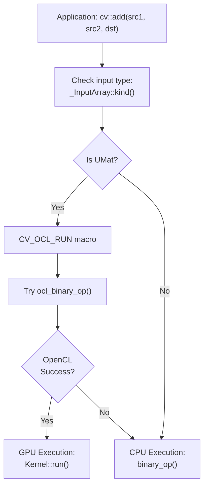
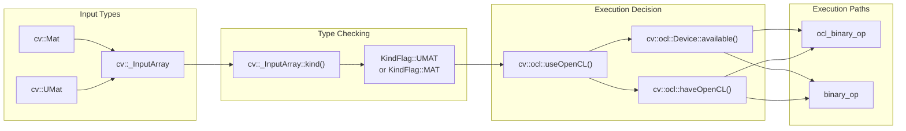
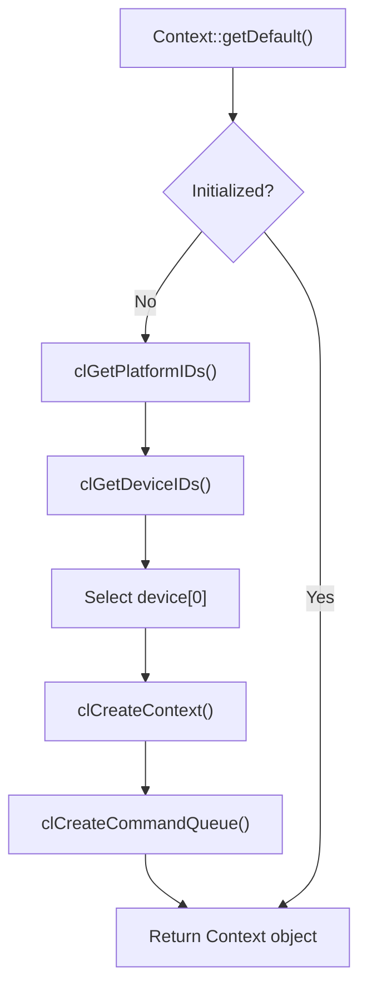
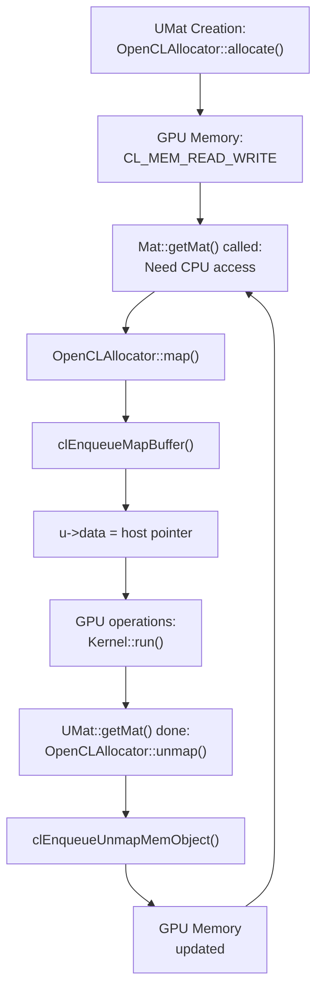
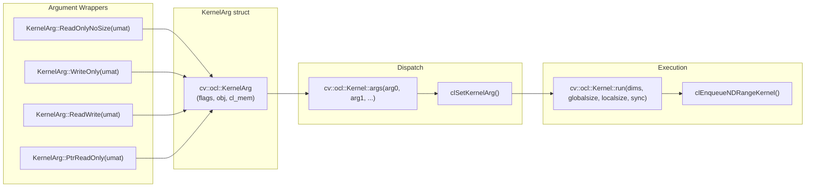

<!-- source: DeepWiki mcp.deepwiki.com · repo opencv/opencv · page 3.2 OpenCL Acceleration and Transparent GPU Execution · fetched 2026-10-30 -->

# OpenCL Acceleration and Transparent GPU Execution

Relevant source files

The following files were used as context for generating this wiki page:

- [modules/core/include/opencv2/core/directx.hpp](modules/core/include/opencv2/core/directx.hpp)
- [modules/core/include/opencv2/core/mat.hpp](modules/core/include/opencv2/core/mat.hpp)
- [modules/core/include/opencv2/core/mat.inl.hpp](modules/core/include/opencv2/core/mat.inl.hpp)
- [modules/core/include/opencv2/core/ocl.hpp](modules/core/include/opencv2/core/ocl.hpp)
- [modules/core/include/opencv2/core/opencl/runtime/autogenerated/opencl_core.hpp](modules/core/include/opencv2/core/opencl/runtime/autogenerated/opencl_core.hpp)
- [modules/core/include/opencv2/core/opencl/runtime/autogenerated/opencl_gl.hpp](modules/core/include/opencv2/core/opencl/runtime/autogenerated/opencl_gl.hpp)
- [modules/core/include/opencv2/core/opencl/runtime/autogenerated/opencl_gl_wrappers.hpp](modules/core/include/opencv2/core/opencl/runtime/autogenerated/opencl_gl_wrappers.hpp)
- [modules/core/include/opencv2/core/opencl/runtime/opencl_core.hpp](modules/core/include/opencv2/core/opencl/runtime/opencl_core.hpp)
- [modules/core/include/opencv2/core/opencl/runtime/opencl_gl.hpp](modules/core/include/opencv2/core/opencl/runtime/opencl_gl.hpp)
- [modules/core/include/opencv2/core/opencl/runtime/opencl_svm_20.hpp](modules/core/include/opencv2/core/opencl/runtime/opencl_svm_20.hpp)
- [modules/core/perf/perf_arithm.cpp](modules/core/perf/perf_arithm.cpp)
- [modules/core/src/arithm.cpp](modules/core/src/arithm.cpp)
- [modules/core/src/copy.cpp](modules/core/src/copy.cpp)
- [modules/core/src/directx.cpp](modules/core/src/directx.cpp)
- [modules/core/src/matrix.cpp](modules/core/src/matrix.cpp)
- [modules/core/src/matrix_transform.cpp](modules/core/src/matrix_transform.cpp)
- [modules/core/src/matrix_wrap.cpp](modules/core/src/matrix_wrap.cpp)
- [modules/core/src/ocl.cpp](modules/core/src/ocl.cpp)
- [modules/core/src/ocl_disabled.impl.hpp](modules/core/src/ocl_disabled.impl.hpp)
- [modules/core/src/opencl/cvtclr_dx.cl](modules/core/src/opencl/cvtclr_dx.cl)
- [modules/core/src/opencl/flip.cl](modules/core/src/opencl/flip.cl)
- [modules/core/src/opencl/gemm.cl](modules/core/src/opencl/gemm.cl)
- [modules/core/src/opencl/runtime/autogenerated/opencl_core_impl.hpp](modules/core/src/opencl/runtime/autogenerated/opencl_core_impl.hpp)
- [modules/core/src/opencl/runtime/autogenerated/opencl_core_static_impl.hpp](modules/core/src/opencl/runtime/autogenerated/opencl_core_static_impl.hpp)
- [modules/core/src/opencl/runtime/autogenerated/opencl_gl_impl.hpp](modules/core/src/opencl/runtime/autogenerated/opencl_gl_impl.hpp)
- [modules/core/src/opencl/runtime/autogenerated/opencl_gl_static_impl.hpp](modules/core/src/opencl/runtime/autogenerated/opencl_gl_static_impl.hpp)
- [modules/core/src/opencl/runtime/generator/common.py](modules/core/src/opencl/runtime/generator/common.py)
- [modules/core/src/opencl/runtime/generator/filter/opencl_gl_functions.list](modules/core/src/opencl/runtime/generator/filter/opencl_gl_functions.list)
- [modules/core/src/opencl/runtime/generator/generate.sh](modules/core/src/opencl/runtime/generator/generate.sh)
- [modules/core/src/opencl/runtime/generator/parser_cl.py](modules/core/src/opencl/runtime/generator/parser_cl.py)
- [modules/core/src/opencl/runtime/generator/template/opencl_core.hpp.in](modules/core/src/opencl/runtime/generator/template/opencl_core.hpp.in)
- [modules/core/src/opencl/runtime/generator/template/opencl_core_impl.hpp.in](modules/core/src/opencl/runtime/generator/template/opencl_core_impl.hpp.in)
- [modules/core/src/opencl/runtime/generator/template/opencl_core_wrappers.hpp.in](modules/core/src/opencl/runtime/generator/template/opencl_core_wrappers.hpp.in)
- [modules/core/src/opencl/runtime/generator/template/opencl_gl.hpp.in](modules/core/src/opencl/runtime/generator/template/opencl_gl.hpp.in)
- [modules/core/src/opencl/runtime/generator/template/opencl_gl_impl.hpp.in](modules/core/src/opencl/runtime/generator/template/opencl_gl_impl.hpp.in)
- [modules/core/src/opencl/runtime/generator/template/opencl_gl_wrappers.hpp.in](modules/core/src/opencl/runtime/generator/template/opencl_gl_wrappers.hpp.in)
- [modules/core/src/opencl/runtime/opencl_core.cpp](modules/core/src/opencl/runtime/opencl_core.cpp)
- [modules/core/src/opencl/transpose.cl](modules/core/src/opencl/transpose.cl)
- [modules/core/src/rand.cpp](modules/core/src/rand.cpp)
- [modules/core/src/umatrix.cpp](modules/core/src/umatrix.cpp)
- [modules/core/src/va_intel.cpp](modules/core/src/va_intel.cpp)
- [modules/core/test/ocl/test_opencl.cpp](modules/core/test/ocl/test_opencl.cpp)
- [modules/core/test/test_arithm.cpp](modules/core/test/test_arithm.cpp)
- [modules/core/test/test_mat.cpp](modules/core/test/test_mat.cpp)
- [modules/core/test/test_precomp.hpp](modules/core/test/test_precomp.hpp)
- [modules/core/test/test_rand.cpp](modules/core/test/test_rand.cpp)
- [modules/core/test/test_umat.cpp](modules/core/test/test_umat.cpp)
- [modules/ts/src/ocl_test.cpp](modules/ts/src/ocl_test.cpp)
- [modules/ts/src/ts_func.cpp](modules/ts/src/ts_func.cpp)
- [samples/directx/d3d10_interop.cpp](samples/directx/d3d10_interop.cpp)
- [samples/directx/d3d11_interop.cpp](samples/directx/d3d11_interop.cpp)
- [samples/directx/d3d9_interop.cpp](samples/directx/d3d9_interop.cpp)
- [samples/directx/d3d9ex_interop.cpp](samples/directx/d3d9ex_interop.cpp)
- [samples/directx/d3dsample.hpp](samples/directx/d3dsample.hpp)
- [samples/directx/winapp.hpp](samples/directx/winapp.hpp)
- [samples/opencl/opencl-opencv-interop.cpp](samples/opencl/opencl-opencv-interop.cpp)
- [samples/opengl/opengl_interop.cpp](samples/opengl/opengl_interop.cpp)
- [samples/opengl/winapp.hpp](samples/opengl/winapp.hpp)

OpenCV's OpenCL acceleration system provides transparent GPU computing through the OpenCL framework. The system's key feature is **transparent execution**: algorithms automatically execute on GPU when `UMat` is used, with automatic fallback to CPU when OpenCL is unavailable or disabled. This transparency allows writing device-agnostic code that automatically leverages available hardware acceleration.

The system consists of three main components:
- **UMat data structure** - GPU-aware matrix that triggers OpenCL execution paths.
- **OpenCL runtime wrappers** - C++ classes wrapping the OpenCL API (`Device`, `Context`, `Queue`, `Program`, `Kernel`) located in `modules/core/include/opencv2/core/ocl.hpp` [modules/core/include/opencv2/core/ocl.hpp:49-70]().
- **Binary program cache** - Persistent storage of compiled kernels for fast startup, implemented within `modules/core/src/ocl.cpp` [modules/core/src/ocl.cpp:44-131]().

For information about Mat and UMat data structures, see page 3.1. For broader system utilities, see page 3.3. For parallel processing abstractions, see page 3.3.

Sources: [modules/core/src/ocl.cpp:44-131](), [modules/core/include/opencv2/core/ocl.hpp:49-70]()

## Transparent Execution Mechanism

The transparent execution mechanism allows algorithms to automatically choose between CPU and GPU execution based on input data types. When functions receive `UMat` inputs, they attempt OpenCL execution; when they receive `Mat` inputs, they execute on CPU via functions like `ocl_binary_op` [modules/core/src/arithm.cpp:81-154]().

**Transparent Execution Flow**

The `CV_OCL_RUN` macro provides the execution switch. When OpenCL execution is unavailable or fails, the code automatically falls through to CPU execution paths.

**Code Entity Mapping: Execution Path Selection**

Key classes and functions for execution control:

| Symbol | Role | Location |
|--------|------|----------|
| `cv::_InputArray::kind()` | Returns `MAT` or `UMAT` flag | [modules/core/include/opencv2/core/mat.hpp:124-124]() |
| `cv::ocl::haveOpenCL()` | Checks if OpenCL is available at runtime | [modules/core/include/opencv2/core/ocl.hpp:54-54]() |
| `cv::ocl::useOpenCL()` | Checks if OpenCL is enabled by user | [modules/core/include/opencv2/core/ocl.hpp:55-55]() |
| `cv::ocl::setUseOpenCL()` | Toggles OpenCL acceleration | [modules/core/include/opencv2/core/ocl.hpp:58-58]() |

Sources: [modules/core/include/opencv2/core/ocl.hpp:54-70](), [modules/core/include/opencv2/core/mat.hpp:66-152](), [modules/core/src/arithm.cpp:81-154]()

## OpenCL Context and Device Management

OpenCL resources are managed through execution contexts initialized lazily. OpenCV maintains a default context and queue for the primary device via `Context::getDefault()` [modules/core/src/ocl.cpp](). The system supports multiple vendors (AMD, Intel, NVIDIA) and handles device-specific optimizations.

**Execution Context Initialization**

The `cv::ocl::Device` class encapsulates OpenCL device properties, including vendor ID, compute units, and memory sizes. The `cv::ocl::Context` class manages the lifetime of the underlying `cl_context`.

| Device Property Method | Description | Location |
|------------------------|-------------|----------|
| `vendorID()` | Returns `VENDOR_AMD`, `VENDOR_INTEL`, or `VENDOR_NVIDIA` | [modules/core/include/opencv2/core/ocl.hpp:193-193]() |
| `maxComputeUnits()` | Queries number of parallel compute units | [modules/core/include/opencv2/core/ocl.hpp:203-203]() |
| `localMemSize()` | Returns size of local memory in bytes | [modules/core/include/opencv2/core/ocl.hpp:156-156]() |
| `isExtensionSupported()` | Checks for specific OpenCL extensions | [modules/core/include/opencv2/core/ocl.hpp:98-98]() |

Sources: [modules/core/include/opencv2/core/ocl.hpp:72-210](), [modules/core/src/ocl.cpp:156-164]()

## UMat and Memory Management

`UMat` provides GPU-aware memory management with automatic data migration between CPU and GPU memory spaces. The system uses `cv::UMatData` to track memory state and trigger migrations when needed [modules/core/src/umatrix.cpp:59-128]().

**UMat Memory State Machine**

**UMatData Structure**

The `cv::UMatData` class tracks memory state through flags and reference counts:
- `urefcount`: Reference count for the `UMat` handle.
- `refcount`: Reference count for the `Mat` header.
- `mapcount`: Tracks active CPU mappings of the GPU buffer.
- `currAllocator`: Points to the `MatAllocator` (e.g., `OpenCLAllocator`) currently managing the data.

Sources: [modules/core/src/umatrix.cpp:59-128](), [modules/core/include/opencv2/core/mat.hpp:75-95]()

## Kernel Compilation and Binary Caching

OpenCL kernels are compiled at runtime and cached as binary programs to eliminate recompilation overhead across program runs. The library provides `cv::ocl::Kernel` and `cv::ocl::KernelArg` abstractions to simplify kernel invocation.

**Code Entity Mapping: Kernel Argument and Execution Pipeline**

Key kernel execution steps:
1. `cv::ocl::KernelArg` constructors extract the `cl_mem` handle from `UMat` and set appropriate access flags.
2. `cv::ocl::Kernel::args()` accepts variadic arguments and performs the underlying `clSetKernelArg` calls.
3. `cv::ocl::Kernel::run()` executes the kernel on the command queue with specified global and local work sizes.

Sources: [modules/core/include/opencv2/core/ocl.hpp:426-470](), [modules/core/include/opencv2/core/ocl.hpp:525-565]()

## Runtime Configuration and Interoperability

OpenCL behavior is controlled through environment variables and build-time flags processed in `modules/core/src/ocl.cpp` [modules/core/src/ocl.cpp:142-164](). OpenCV also supports interoperability with external OpenCL and OpenGL/DirectX code.

| Configuration Option | Environment Variable | Purpose |
|---------------------|---------------------|---------|
| Enable OpenCL | `OPENCV_OPENCL_RUNTIME` | Selects OpenCL runtime path or "disabled" |
| Raise Error | `OPENCV_OPENCL_RAISE_ERROR` | Throws exception on OCL failure instead of fallback |
| Abort on Build | `OPENCV_OPENCL_ABORT_ON_BUILD_ERROR` | Aborts process if kernel fails to compile |

**Interoperability Example**
The `samples/opencl/opencl-opencv-interop.cpp` sample demonstrates how to query platform information using OpenCL runtime calls and integrate them with OpenCV's `cv::ocl` wrappers.

Sources: [modules/core/src/ocl.cpp:142-164](), [modules/core/src/opencl/runtime/opencl_core.cpp:68-76](), [samples/opencl/opencl-opencv-interop.cpp:41-97]()

---

