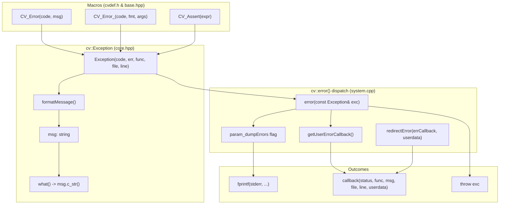
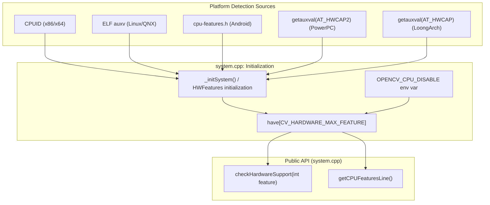
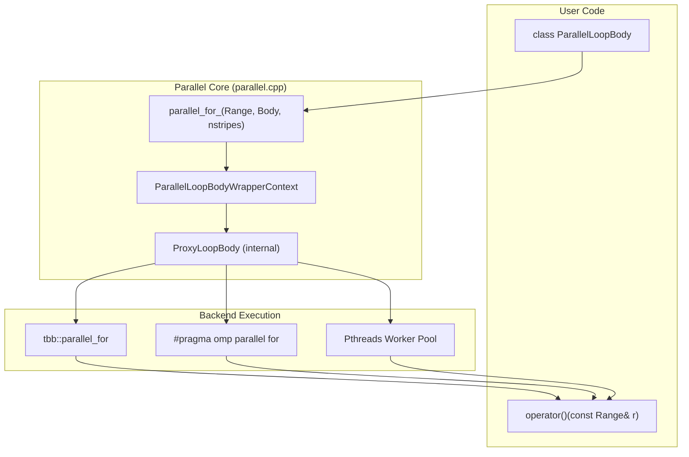

<!-- source: DeepWiki mcp.deepwiki.com · repo opencv/opencv · page 3.3 System Utilities and Parallel Processing · fetched 2026-10-30 -->

# System Utilities and Parallel Processing

Relevant source files

The following files were used as context for generating this wiki page:

- [cmake/OpenCVCompilerOptimizations.cmake](cmake/OpenCVCompilerOptimizations.cmake)
- [modules/core/include/opencv2/core.hpp](modules/core/include/opencv2/core.hpp)
- [modules/core/include/opencv2/core/base.hpp](modules/core/include/opencv2/core/base.hpp)
- [modules/core/include/opencv2/core/check.hpp](modules/core/include/opencv2/core/check.hpp)
- [modules/core/include/opencv2/core/core.hpp](modules/core/include/opencv2/core/core.hpp)
- [modules/core/include/opencv2/core/cv_cpu_dispatch.h](modules/core/include/opencv2/core/cv_cpu_dispatch.h)
- [modules/core/include/opencv2/core/cv_cpu_helper.h](modules/core/include/opencv2/core/cv_cpu_helper.h)
- [modules/core/include/opencv2/core/cvdef.h](modules/core/include/opencv2/core/cvdef.h)
- [modules/core/include/opencv2/core/matx.hpp](modules/core/include/opencv2/core/matx.hpp)
- [modules/core/include/opencv2/core/operations.hpp](modules/core/include/opencv2/core/operations.hpp)
- [modules/core/include/opencv2/core/private.hpp](modules/core/include/opencv2/core/private.hpp)
- [modules/core/include/opencv2/core/types.hpp](modules/core/include/opencv2/core/types.hpp)
- [modules/core/include/opencv2/core/utility.hpp](modules/core/include/opencv2/core/utility.hpp)
- [modules/core/include/opencv2/core/utils/buffer_area.private.hpp](modules/core/include/opencv2/core/utils/buffer_area.private.hpp)
- [modules/core/include/opencv2/core/utils/filesystem.hpp](modules/core/include/opencv2/core/utils/filesystem.hpp)
- [modules/core/include/opencv2/core/utils/filesystem.private.hpp](modules/core/include/opencv2/core/utils/filesystem.private.hpp)
- [modules/core/include/opencv2/core/utils/logger.defines.hpp](modules/core/include/opencv2/core/utils/logger.defines.hpp)
- [modules/core/include/opencv2/core/utils/logger.hpp](modules/core/include/opencv2/core/utils/logger.hpp)
- [modules/core/include/opencv2/core/utils/logtag.hpp](modules/core/include/opencv2/core/utils/logtag.hpp)
- [modules/core/include/opencv2/core/utils/plugin_loader.private.hpp](modules/core/include/opencv2/core/utils/plugin_loader.private.hpp)
- [modules/core/src/algorithm.cpp](modules/core/src/algorithm.cpp)
- [modules/core/src/buffer_area.cpp](modules/core/src/buffer_area.cpp)
- [modules/core/src/bufferpool.impl.hpp](modules/core/src/bufferpool.impl.hpp)
- [modules/core/src/check.cpp](modules/core/src/check.cpp)
- [modules/core/src/command_line_parser.cpp](modules/core/src/command_line_parser.cpp)
- [modules/core/src/glob.cpp](modules/core/src/glob.cpp)
- [modules/core/src/logger.cpp](modules/core/src/logger.cpp)
- [modules/core/src/parallel.cpp](modules/core/src/parallel.cpp)
- [modules/core/src/precomp.hpp](modules/core/src/precomp.hpp)
- [modules/core/src/system.cpp](modules/core/src/system.cpp)
- [modules/core/src/trace.cpp](modules/core/src/trace.cpp)
- [modules/core/src/utils/datafile.cpp](modules/core/src/utils/datafile.cpp)
- [modules/core/src/utils/filesystem.cpp](modules/core/src/utils/filesystem.cpp)
- [modules/core/src/utils/logtagconfig.hpp](modules/core/src/utils/logtagconfig.hpp)
- [modules/core/src/utils/logtagconfigparser.cpp](modules/core/src/utils/logtagconfigparser.cpp)
- [modules/core/src/utils/logtagconfigparser.hpp](modules/core/src/utils/logtagconfigparser.hpp)
- [modules/core/src/utils/logtagmanager.cpp](modules/core/src/utils/logtagmanager.cpp)
- [modules/core/src/utils/logtagmanager.hpp](modules/core/src/utils/logtagmanager.hpp)
- [modules/core/src/utils/plugin_loader.impl.hpp](modules/core/src/utils/plugin_loader.impl.hpp)
- [modules/core/src/utils/samples.cpp](modules/core/src/utils/samples.cpp)
- [modules/core/test/test_logger_replace.cpp](modules/core/test/test_logger_replace.cpp)
- [modules/core/test/test_logtagconfigparser.cpp](modules/core/test/test_logtagconfigparser.cpp)
- [modules/core/test/test_logtagmanager.cpp](modules/core/test/test_logtagmanager.cpp)
- [modules/core/test/test_misc.cpp](modules/core/test/test_misc.cpp)
- [modules/core/test/test_operations.cpp](modules/core/test/test_operations.cpp)
- [modules/core/test/test_utils.cpp](modules/core/test/test_utils.cpp)
- [modules/ts/CMakeLists.txt](modules/ts/CMakeLists.txt)
- [modules/ts/include/opencv2/ts.hpp](modules/ts/include/opencv2/ts.hpp)
- [modules/ts/include/opencv2/ts/cuda_test.hpp](modules/ts/include/opencv2/ts/cuda_test.hpp)
- [modules/ts/include/opencv2/ts/ts_ext.hpp](modules/ts/include/opencv2/ts/ts_ext.hpp)
- [modules/ts/include/opencv2/ts/ts_gtest.h](modules/ts/include/opencv2/ts/ts_gtest.h)
- [modules/ts/include/opencv2/ts/ts_perf.hpp](modules/ts/include/opencv2/ts/ts_perf.hpp)
- [modules/ts/src/cuda_test.cpp](modules/ts/src/cuda_test.cpp)
- [modules/ts/src/precomp.hpp](modules/ts/src/precomp.hpp)
- [modules/ts/src/ts.cpp](modules/ts/src/ts.cpp)
- [modules/ts/src/ts_arrtest.cpp](modules/ts/src/ts_arrtest.cpp)
- [modules/ts/src/ts_gtest.cpp](modules/ts/src/ts_gtest.cpp)
- [modules/ts/src/ts_perf.cpp](modules/ts/src/ts_perf.cpp)
- [modules/ts/src/ts_tags.cpp](modules/ts/src/ts_tags.cpp)
- [modules/ts/src/ts_tags.hpp](modules/ts/src/ts_tags.hpp)
- [modules/videoio/cmake/plugin.cmake](modules/videoio/cmake/plugin.cmake)
- [modules/videoio/src/cap_winrt/CaptureFrameGrabber.cpp](modules/videoio/src/cap_winrt/CaptureFrameGrabber.cpp)
- [modules/videoio/src/cap_winrt/CaptureFrameGrabber.hpp](modules/videoio/src/cap_winrt/CaptureFrameGrabber.hpp)
- [modules/videoio/src/cap_winrt/MFIncludes.hpp](modules/videoio/src/cap_winrt/MFIncludes.hpp)
- [modules/videoio/src/cap_winrt/MediaSink.hpp](modules/videoio/src/cap_winrt/MediaSink.hpp)
- [modules/videoio/src/cap_winrt/MediaStreamSink.hpp](modules/videoio/src/cap_winrt/MediaStreamSink.hpp)
- [platforms/linux/riscv64-071-gcc.toolchain.cmake](platforms/linux/riscv64-071-gcc.toolchain.cmake)
- [platforms/scripts/valgrind.supp](platforms/scripts/valgrind.supp)
- [platforms/scripts/valgrind_3rdparty.supp](platforms/scripts/valgrind_3rdparty.supp)
- [platforms/wince/arm-wince-headless-overrides.cmake](platforms/wince/arm-wince-headless-overrides.cmake)
- [platforms/wince/readme.md](platforms/wince/readme.md)

This document covers OpenCV's system-level infrastructure including error handling, CPU feature detection, the parallel processing framework, configuration parameters, timing utilities, and memory allocation helpers. These components provide cross-platform system services that support the entire OpenCV library.

For information about memory management and data structures, see page 3.1. For details about OpenCL acceleration, see page 3.2. For persistence and serialization, see page 3.4.

## Overview

The core module provides essential system utilities that enable:
- **Error Handling**: Exception-based error reporting with customizable callbacks and `CV_Error`/`CV_Assert` macros.
- **CPU Feature Detection**: Runtime detection of SIMD capabilities (SSE, AVX, NEON, VSX, LoongArch, etc.).
- **Parallel Processing**: Unified abstraction over multiple threading backends (`tbb`, `openmp`, `gcd`, `pthreads`, `ms-concurrency`).
- **Memory Allocation**: Cache-aligned `fastMalloc`/`fastFree` and stack-buffered `AutoBuffer`.
- **Random Number Generation**: `RNG` class with multiple distributions and thread-local state.
- **Configuration**: Environment variable-based runtime configuration parameters (`utils::getConfigurationParameterBool`, etc.).
- **Timing & Instrumentation**: High-resolution performance measurement utilities (`getTickCount`, `TickMeter`) and instrumentation.

Sources: [modules/core/src/system.cpp:74-112](), [modules/core/src/parallel.cpp:140-155](), [modules/core/include/opencv2/core/utility.hpp:71-102]()

---

## Error Handling and Exceptions

OpenCV uses a comprehensive exception-based error handling system centered around the `cv::Exception` class and customizable error callbacks.

### Exception Class Structure

The `cv::Exception` class extends `std::exception` and provides detailed diagnostic context:

| Field | Type | Description |
|-------|------|-------------|
| `code` | `int` | Error code from `cv::Error::Code` enum [modules/core/include/opencv2/core/base.hpp:68-124]() |
| `err` | `String` | Error description message |
| `func` | `String` | Function name where error occurred |
| `file` | `String` | Source file name |
| `line` | `int` | Line number in source file |
| `msg` | `String` | Formatted error message |

Sources: [modules/core/include/opencv2/core.hpp:119-146](), [modules/core/include/opencv2/core/base.hpp:66-125]()

### Error Generation and Handling Data Flow

The `Exception::formatMessage()` method constructs detailed error descriptions. If the environment variable `OPENCV_DUMP_ERRORS` is set (default true in debug/Android builds), errors are automatically dumped to `stderr` [modules/core/src/system.cpp:100-106]().

Sources: [modules/core/include/opencv2/core.hpp:119-156](), [modules/core/include/opencv2/core/cvdef.h:88-109](), [modules/core/src/system.cpp:100-106]()

---

## CPU Feature Detection

OpenCV performs runtime detection of CPU features to select optimized SIMD paths across various hardware architectures.

### Platform-Specific Detection Mechanisms

### Feature Detection Implementation Table

| Platform | Detection Method | Source Reference |
|----------|------------------|----------------|
| x86/x64 | `CPUID` instruction queries | [modules/core/src/system.cpp:463-548]() |
| ARM/Unix | `Elf64_auxv_t` auxiliary vector parsing | [modules/core/src/system.cpp:132-147]() |
| ARM Android | `cpu-features.h` library integration | [modules/core/src/system.cpp:149-151]() |
| PowerPC | `getauxval` with `AT_HWCAP2` / VSX flags | [modules/core/src/system.cpp:154-168]() |
| LoongArch | `getauxval` with `AT_HWCAP` (LSX/LASX) | [modules/core/src/system.cpp:170-174]() |

Runtime dispatching relies on `CPU_BASELINE` and `CPU_DISPATCH` configurations established via CMake [cmake/OpenCVCompilerOptimizations.cmake:50-58]().

Sources: [modules/core/src/system.cpp:132-174](), [modules/core/include/opencv2/core/cvdef.h:307-366]()

---

## Parallel Processing Framework

OpenCV provides a unified parallel processing interface via `cv::parallel_for_`, wrapping multiple native multi-threading backends.

### Supported Parallel Backends

| Backend | Macro / Identifier | Source Reference |
|---------|--------------------|------------------|
| Intel Threading Building Blocks (TBB) | `HAVE_TBB` (`"tbb"`) | [modules/core/src/parallel.cpp:105-115](), [modules/core/src/parallel.cpp:141]() |
| OpenMP | `HAVE_OPENMP` (`"openmp"`) | [modules/core/src/parallel.cpp:126-127](), [modules/core/src/parallel.cpp:145]() |
| Apple Grand Central Dispatch (GCD) | `HAVE_GCD` (`"gcd"`) | [modules/core/src/parallel.cpp:128-130](), [modules/core/src/parallel.cpp:147]() |
| POSIX Threads (Pthreads fallback) | `HAVE_PTHREADS_PF` (`"pthreads"`) | [modules/core/src/parallel.cpp:135-137](), [modules/core/src/parallel.cpp:153]() |
| Microsoft Concurrency Runtime | `HAVE_CONCURRENCY` (`"ms-concurrency"`) | [modules/core/src/parallel.cpp:133-134](), [modules/core/src/parallel.cpp:151]() |

### Parallel Loop Execution Flow

The `ParallelLoopBodyWrapperContext` ensures correct propagation of thread-local states, floating-point environment controls, and instrumentation metrics across worker threads [modules/core/src/parallel.cpp:201-308]().

Sources: [modules/core/src/parallel.cpp:105-155](), [modules/core/src/parallel.cpp:201-389]()

---

## Memory Allocation and Buffers

OpenCV implements specialized memory allocation helpers to minimize overhead and ensure SIMD data alignment.

### `fastMalloc` and `fastFree`
`fastMalloc` allocates memory aligned to 16, 32, or 64-byte boundaries (depending on target SIMD width), preventing false sharing and supporting vectorized load/store instructions. `allocSingletonBuffer` uses `fastMalloc` for internal static singleton buffers [modules/core/src/system.cpp:107-108]().

### `AutoBuffer`
The `AutoBuffer<_Tp, fixed_size>` template class provides stack-allocated temporary storage for small buffers, transparently falling back to heap allocation if the requested size exceeds `fixed_size`. By default, `fixed_size` allocates space for elements totaling ~1KB [modules/core/include/opencv2/core/utility.hpp:98-102]().

Sources: [modules/core/include/opencv2/core/utility.hpp:113-165]()

---

## Random Number Generation and Timing

### Random Number Generation (`cv::RNG`)
The `cv::RNG` class provides a fast pseudo-random number generator. When used inside `parallel_for_`, seed propagation ensures thread-safe and reproducible random streams across worker threads. It supports uniform (`randu`) and normal (`randn`) distributions [modules/ts/src/ts_perf.cpp:95-118]().

### Timing Utilities
OpenCV provides high-resolution performance counters:
- `getTickCount()`: Returns CPU/OS tick counts [modules/core/src/system.cpp:908-950]().
- `getTickFrequency()`: Returns frequency of ticks per second [modules/core/src/system.cpp:952-984]().
- `TickMeter`: Helper class for measuring execution time across multiple algorithm iterations [modules/core/include/opencv2/core/utility.hpp:292-443]().

Sources: [modules/core/include/opencv2/core/utility.hpp:450-600](), [modules/ts/src/ts_perf.cpp:95-118]()

---

