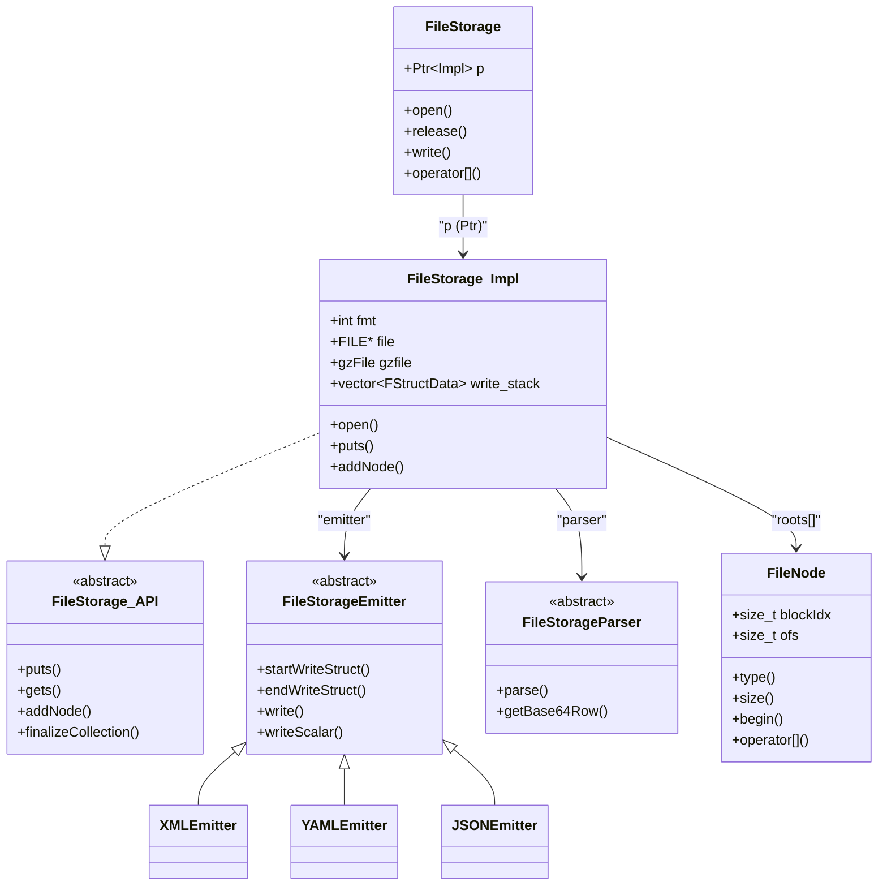

<!-- source: DeepWiki mcp.deepwiki.com · repo opencv/opencv · page 3.4 Persistence and Serialization (FileStorage) · fetched 2026-10-30 -->

# Persistence and Serialization (FileStorage)

<details>
<summary>Relevant source files</summary>

The following files were used as context for generating this wiki page:

- [doc/tutorials/core/adding_images/adding_images.markdown](doc/tutorials/core/adding_images/adding_images.markdown)
- [doc/tutorials/core/basic_linear_transform/basic_linear_transform.markdown](doc/tutorials/core/basic_linear_transform/basic_linear_transform.markdown)
- [doc/tutorials/core/file_input_output_with_xml_yml/file_input_output_with_xml_yml.markdown](doc/tutorials/core/file_input_output_with_xml_yml/file_input_output_with_xml_yml.markdown)
- [doc/tutorials/core/how_to_scan_images/how_to_scan_images.markdown](doc/tutorials/core/how_to_scan_images/how_to_scan_images.markdown)
- [doc/tutorials/core/how_to_use_OpenCV_parallel_for_/how_to_use_OpenCV_parallel_for_.markdown](doc/tutorials/core/how_to_use_OpenCV_parallel_for_/how_to_use_OpenCV_parallel_for_.markdown)
- [doc/tutorials/core/how_to_use_OpenCV_parallel_for_new/how_to_use_OpenCV_parallel_for_new.markdown](doc/tutorials/core/how_to_use_OpenCV_parallel_for_new/how_to_use_OpenCV_parallel_for_new.markdown)
- [doc/tutorials/core/mat_operations.markdown](doc/tutorials/core/mat_operations.markdown)
- [doc/tutorials/core/mat_the_basic_image_container/mat_the_basic_image_container.markdown](doc/tutorials/core/mat_the_basic_image_container/mat_the_basic_image_container.markdown)
- [doc/tutorials/core/table_of_content_core.markdown](doc/tutorials/core/table_of_content_core.markdown)
- [doc/tutorials/gpu/gpu-basics-similarity/gpu_basics_similarity.markdown](doc/tutorials/gpu/gpu-basics-similarity/gpu_basics_similarity.markdown)
- [doc/tutorials/imgproc/gausian_median_blur_bilateral_filter/gausian_median_blur_bilateral_filter.markdown](doc/tutorials/imgproc/gausian_median_blur_bilateral_filter/gausian_median_blur_bilateral_filter.markdown)
- [doc/tutorials/introduction/display_image/display_image.markdown](doc/tutorials/introduction/display_image/display_image.markdown)
- [doc/tutorials/introduction/load_save_image/load_save_image.markdown](doc/tutorials/introduction/load_save_image/load_save_image.markdown)
- [doc/tutorials/tutorials.markdown](doc/tutorials/tutorials.markdown)
- [modules/core/include/opencv2/core/cvstd.hpp](modules/core/include/opencv2/core/cvstd.hpp)
- [modules/core/include/opencv2/core/cvstd.inl.hpp](modules/core/include/opencv2/core/cvstd.inl.hpp)
- [modules/core/include/opencv2/core/persistence.hpp](modules/core/include/opencv2/core/persistence.hpp)
- [modules/core/src/out.cpp](modules/core/src/out.cpp)
- [modules/core/src/persistence.cpp](modules/core/src/persistence.cpp)
- [modules/core/src/persistence.hpp](modules/core/src/persistence.hpp)
- [modules/core/src/persistence_base64_encoding.cpp](modules/core/src/persistence_base64_encoding.cpp)
- [modules/core/src/persistence_base64_encoding.hpp](modules/core/src/persistence_base64_encoding.hpp)
- [modules/core/src/persistence_impl.hpp](modules/core/src/persistence_impl.hpp)
- [modules/core/src/persistence_json.cpp](modules/core/src/persistence_json.cpp)
- [modules/core/src/persistence_types.cpp](modules/core/src/persistence_types.cpp)
- [modules/core/src/persistence_xml.cpp](modules/core/src/persistence_xml.cpp)
- [modules/core/src/persistence_yml.cpp](modules/core/src/persistence_yml.cpp)
- [modules/core/test/test_io.cpp](modules/core/test/test_io.cpp)
- [modules/dnn/include/opencv2/dnn/shape_utils.hpp](modules/dnn/include/opencv2/dnn/shape_utils.hpp)
- [modules/python/test/test_filestorage_io.py](modules/python/test/test_filestorage_io.py)
- [samples/cpp/cout_mat.cpp](samples/cpp/cout_mat.cpp)
- [samples/cpp/delaunay2.cpp](samples/cpp/delaunay2.cpp)
- [samples/cpp/tutorial_code/core/file_input_output/file_input_output.cpp](samples/cpp/tutorial_code/core/file_input_output/file_input_output.cpp)
- [samples/cpp/tutorial_code/core/how_to_use_OpenCV_parallel_for_/how_to_use_OpenCV_parallel_for_.cpp](samples/cpp/tutorial_code/core/how_to_use_OpenCV_parallel_for_/how_to_use_OpenCV_parallel_for_.cpp)
- [samples/cpp/tutorial_code/core/mat_operations/mat_operations.cpp](samples/cpp/tutorial_code/core/mat_operations/mat_operations.cpp)
- [samples/cpp/tutorial_code/core/mat_the_basic_image_container/mat_the_basic_image_container.cpp](samples/cpp/tutorial_code/core/mat_the_basic_image_container/mat_the_basic_image_container.cpp)
- [samples/python/tutorial_code/core/file_input_output/file_input_output.py](samples/python/tutorial_code/core/file_input_output/file_input_output.py)

</details>


This page documents OpenCV's file persistence system: the `FileStorage` class and the supporting `FileNode` / `FileNodeIterator` API used to read and write structured data in XML, YAML, and JSON formats, including Base64 encoding for binary arrays. The system lives entirely in the `opencv_core` module. For information about the broader `core` module data structures such as `Mat`, see [3.1]().

---

## Purpose and Scope

`FileStorage` provides a single, uniform API to serialize and deserialize:

- Primitive scalars (int, int64, float, double, string) [modules/core/include/opencv2/core/persistence.hpp:68-70]().
- OpenCV matrices (`Mat`, `SparseMat`, N-dimensional matrices) [modules/core/src/persistence_types.cpp:11-114]().
- User-defined types via free-function overloads of `write()` / `read()` [modules/core/src/persistence_types.cpp:229-255]().
- Arbitrarily nested maps (key-value) and sequences (ordered lists) [modules/core/include/opencv2/core/persistence.hpp:144-154]().

The format (XML, YAML, or JSON) is determined from the filename extension (".xml", ".yml"/".yaml", and ".json") or by an explicit flag [modules/core/include/opencv2/core/persistence.hpp:72-76](). Binary matrix data can be embedded as Base64 text using the `BASE64` flag, enabling lossless round-trips inside text files [modules/core/include/opencv2/core/persistence.hpp:312-314]().

---

## Core Classes

### Class Overview

| Class | Role | Header |
|---|---|---|
| `FileStorage` | Public API: open/close file, write data | [modules/core/include/opencv2/core/persistence.hpp:260-426]() |
| `FileNode` | Read-only node in the parsed tree | [modules/core/include/opencv2/core/persistence.hpp:440-580]() |
| `FileNodeIterator` | STL-style iterator over `FileNode` children | [modules/core/include/opencv2/core/persistence.hpp:582-660]() |
| `FileStorage::Impl` | Internal state and I/O implementation | [modules/core/src/persistence_impl.hpp:23-180]() |
| `FileStorage_API` | Abstract interface used by emitters and parsers | [modules/core/src/persistence.hpp:134-185]() |
| `FileStorageEmitter` | Abstract write-side interface | [modules/core/src/persistence.hpp:187-202]() |
| `FileStorageParser` | Abstract read-side interface | [modules/core/src/persistence.hpp:204-210]() |
| `XMLEmitter` / `XMLParser` | XML format implementation | [modules/core/src/persistence_xml.cpp:25-31]() |
| `YAMLEmitter` / `YAMLParser` | YAML format implementation | [modules/core/src/persistence_yml.cpp:17-23]() |
| `JSONEmitter` / `JSONParser` | JSON format implementation | [modules/core/src/persistence_json.cpp:11-17]() |

**Sources:** [modules/core/include/opencv2/core/persistence.hpp:254-660](), [modules/core/src/persistence.hpp:134-220]()

---

### `FileStorage`

Defined in [modules/core/include/opencv2/core/persistence.hpp:260-426]().

**Open modes** (the `Mode` enum) [modules/core/include/opencv2/core/persistence.hpp:304-323]():

| Flag | Value | Meaning |
|---|---|---|
| `READ` | 0 | Open for reading; entire file is parsed into memory |
| `WRITE` | 1 | Open for writing; creates or truncates |
| `APPEND` | 2 | Append to an existing file |
| `MEMORY` | 4 | Read from / write to an in-memory string buffer |
| `FORMAT_XML` | `1<<3` | Force XML format |
| `FORMAT_YAML` | `2<<3` | Force YAML format |
| `FORMAT_JSON` | `3<<3` | Force JSON format |
| `FORMAT_AUTO` | 0 | Detect from file extension |
| `BASE64` | 64 | Embed binary arrays as Base64 text |

**Key methods:**

| Method | Purpose |
|---|---|
| `open(filename, flags)` | Opens a file or memory buffer [modules/core/include/opencv2/core/persistence.hpp:343-344]() |
| `isOpened()` | True once the file is successfully opened [modules/core/include/opencv2/core/persistence.hpp:352]() |
| `release()` | Flushes and closes; also writes closing tags [modules/core/include/opencv2/core/persistence.hpp:358]() |
| `releaseAndGetString()` | Flushes and returns buffer content for `MEMORY` mode [modules/core/include/opencv2/core/persistence.hpp:364]() |
| `operator[](name)` | Returns a top-level `FileNode` by name [modules/core/include/opencv2/core/persistence.hpp:387-388]() |
| `writeRaw(fmt, vec, len)` | Write a typed binary array using format spec [modules/core/include/opencv2/core/persistence.hpp:404]() |
| `startWriteStruct(...)` | Begin a nested map or sequence [modules/core/include/opencv2/core/persistence.hpp:413]() |

**Sources:** [modules/core/include/opencv2/core/persistence.hpp:260-426]()

---

### `FileNode`

Defined in [modules/core/include/opencv2/core/persistence.hpp:440-580]().

When a file is opened for reading, the document is parsed into a tree of `FileNode` objects held inside `FileStorage::Impl`. `FileNode` is a lightweight handle (block index + byte offset) into that storage.

**Node type flags** [modules/core/include/opencv2/core/persistence.hpp:451-464]():
`NONE`, `INT`, `REAL`, `STR`, `SEQ`, `MAP`, `FLOW`, `EMPTY`, `NAMED`.

**Key methods:**

| Method | Purpose |
|---|---|
| `type()` | Returns the node-type constant [modules/core/include/opencv2/core/persistence.hpp:488]() |
| `isInt()`, `isReal()`, `isString()`, `isSeq()`, `isMap()` | Type predicates [modules/core/include/opencv2/core/persistence.hpp:494-502]() |
| `operator int()`, `operator double()`, `operator string()` | Scalar extraction [modules/core/include/opencv2/core/persistence.hpp:510-514]() |
| `operator[](name)` | Look up child by key (for maps) [modules/core/include/opencv2/core/persistence.hpp:528-529]() |
| `operator[](i)` | Look up child by index (for sequences) [modules/core/include/opencv2/core/persistence.hpp:533-534]() |
| `readRaw(fmt, vec, len)` | Bulk-read typed binary array [modules/core/include/opencv2/core/persistence.hpp:554]() |

**Sources:** [modules/core/include/opencv2/core/persistence.hpp:440-580]()

---

## Architecture

Architecture of the FileStorage System

```mermaid
flowchart TD
    "User"["User Code"]
    "cv::FileStorage"["cv::FileStorage (public API)"]
    "cv::FileStorage::Impl"["cv::FileStorage::Impl\n(cv::fs::FileStorage_API)"]
    "cv::fs::FileStorageEmitter"["cv::fs::FileStorageEmitter\n(write path)"]
    "cv::fs::FileStorageParser"["cv::fs::FileStorageParser\n(read path)"]
    "cv::fs::XMLEmitter"["cv::fs::XMLEmitter"]
    "cv::fs::YAMLEmitter"["cv::fs::YAMLEmitter"]
    "cv::fs::JSONEmitter"["cv::fs::JSONEmitter"]
    "cv::fs::XMLParser"["cv::fs::XMLParser"]
    "cv::fs::YAMLParser"["cv::fs::YAMLParser"]
    "cv::fs::JSONParser"["cv::fs::JSONParser"]
    "Base64ContextEmitter"["cv::base64::Base64ContextEmitter"]
    "cv::FileNode"["cv::FileNode tree\n(in-memory)"]
    "IO"["FILE* / gzFile / strbuf"]

    "User" -->|"operator<<"| "cv::FileStorage"
    "User" -->|"operator[]"| "cv::FileNode"
    "cv::FileStorage" --> "cv::FileStorage::Impl"
    "cv::FileStorage::Impl" -->|"write path"| "cv::fs::FileStorageEmitter"
    "cv::FileStorage::Impl" -->|"read path"| "cv::fs::FileStorageParser"
    "cv::fs::FileStorageEmitter" --> "cv::fs::XMLEmitter"
    "cv::fs::FileStorageEmitter" --> "cv::fs::YAMLEmitter"
    "cv::fs::FileStorageEmitter" --> "cv::fs::JSONEmitter"
    "cv::fs::FileStorageParser" --> "cv::fs::XMLParser"
    "cv::fs::FileStorageParser" --> "cv::fs::YAMLParser"
    "cv::fs::FileStorageParser" --> "cv::fs::JSONParser"
    "cv::FileStorage::Impl" -->|"Base64 Encoding"| "Base64ContextEmitter"
    "Base64ContextEmitter" --> "cv::FileStorage::Impl"
    "cv::fs::XMLParser" -->|"addNode()"| "cv::FileNode"
    "cv::fs::YAMLParser" -->|"addNode()"| "cv::FileNode"
    "cv::fs::JSONParser" -->|"addNode()"| "cv::FileNode"
    "cv::FileStorage::Impl" --> "IO"
```

**Sources:** [modules/core/src/persistence.hpp:134-220](), [modules/core/src/persistence_impl.hpp:23-100](), [modules/core/src/persistence_base64_encoding.cpp:12-132]()

---

Class relationships and file locations



**Sources:** [modules/core/src/persistence_impl.hpp:23-200](), [modules/core/src/persistence.hpp:134-220](), [modules/core/include/opencv2/core/persistence.hpp:440-580]()

---

## Writing Data

### Streaming Operator and Nested Structures

The `<<` operator is the primary write interface [modules/core/include/opencv2/core/persistence.hpp:92-98]().
- **Sequences:** Opened with `"["`, closed with `"]"` [modules/core/include/opencv2/core/persistence.hpp:106-108]().
- **Maps:** Opened with `"{"`, closed with `"}"` [modules/core/include/opencv2/core/persistence.hpp:105]().
- **Compact Style:** Compact variants use `"[:"` and `"{:"` [modules/core/include/opencv2/core/persistence.hpp:105-108]().

### Format Specification (`writeRaw`)

`FileStorage::writeRaw(fmt, vec, len)` writes typed binary arrays using format characters [modules/core/src/persistence.cpp:179-186]():

| Char | Type | C++ Type |
|---|---|---|
| `u` / `b` | `CV_8U` | `uchar` |
| `c` | `CV_8S` | `schar` |
| `w` | `CV_16U` | `ushort` |
| `s` | `CV_16S` | `short` |
| `i` | `CV_32S` | `int` |
| `f` | `CV_32F` | `float` |
| `d` | `CV_64F` | `double` |

**Sources:** [modules/core/src/persistence.cpp:179-212](), [modules/core/src/persistence_types.cpp:11-45]()

---

## Base64 Binary Encoding

OpenCV supports encoding binary data into text files using Base64 to ensure portability and human-readability while maintaining precision.

- **Header:** A 24-byte header is generated containing the data type string [modules/core/src/persistence_base64_encoding.cpp:134-145]().
- **Encoding:** Data is processed in 3-byte chunks to produce 4-character Base64 output [modules/core/src/persistence_base64_encoding.cpp:147-196]().
- **Context:** The `Base64ContextEmitter` manages buffers and indentation for the encoded output [modules/core/src/persistence_base64_encoding.cpp:12-132]().

**Sources:** [modules/core/src/persistence_base64_encoding.cpp](), [modules/core/src/persistence.hpp:29-39]()

---

## Format-Specific Details

### XML
- **Tags:** Uses `<key>value</key>` for map elements and `<_>value</_>` for sequence elements [modules/core/src/persistence_xml.cpp:61-86]().
- **Attributes:** Supports `type_id` for custom structures [modules/core/src/persistence_xml.cpp:120-125]().

### YAML
- **Indentation:** Uses `CV_YML_INDENT` (3 spaces) for hierarchy [modules/core/src/persistence_yml.cpp:10]().
- **Binary:** Encodes binary data with `!!binary |` tag [modules/core/src/persistence_yml.cpp:39-45]().

### JSON
- **Syntax:** Implements standard JSON `{"key": value}` and `[value1, value2]` syntax [modules/core/src/persistence_json.cpp:42-45]().
- **Escaping:** Handles string escaping for characters like `\n`, `\r`, `\t`, and quotes [modules/core/src/persistence_json.cpp:118-130]().

**Sources:** [modules/core/src/persistence_xml.cpp](), [modules/core/src/persistence_yml.cpp](), [modules/core/src/persistence_json.cpp]()

---

