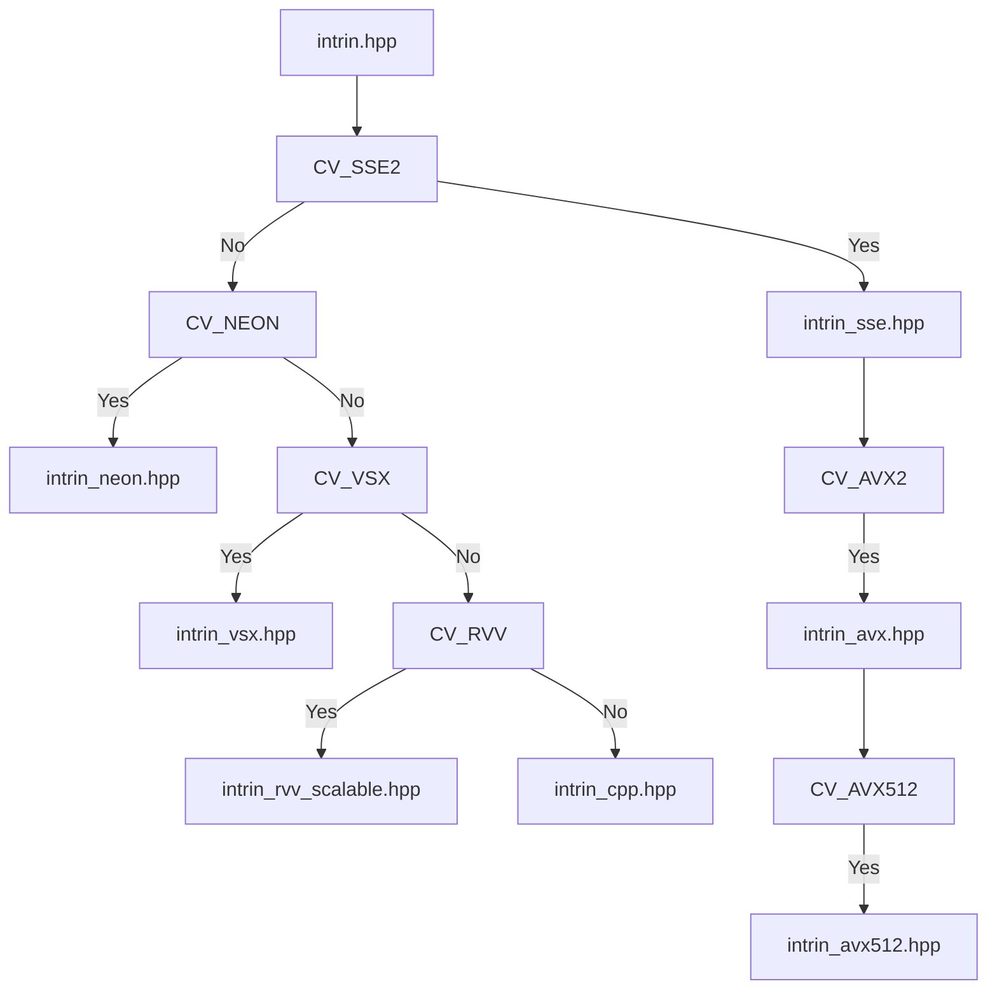
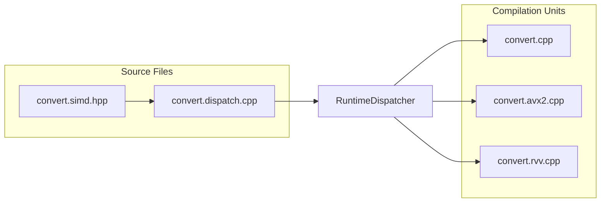
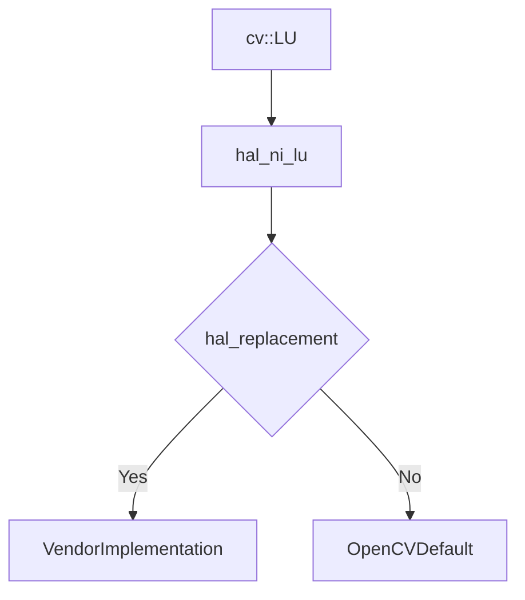

<!-- source: DeepWiki mcp.deepwiki.com · repo opencv/opencv · page 3.5 SIMD Intrinsics and CPU Dispatching · fetched 2026-10-30 -->

# SIMD Intrinsics and CPU Dispatching

Relevant source files

The following files were used as context for generating this wiki page:

- [3rdparty/ippicv/ippicv.cmake](3rdparty/ippicv/ippicv.cmake)
- [cmake/OpenCVFindAtlas.cmake](cmake/OpenCVFindAtlas.cmake)
- [cmake/OpenCVFindLAPACK.cmake](cmake/OpenCVFindLAPACK.cmake)
- [cmake/OpenCVFindMKL.cmake](cmake/OpenCVFindMKL.cmake)
- [cmake/OpenCVFindOpenBLAS.cmake](cmake/OpenCVFindOpenBLAS.cmake)
- [cmake/checks/lapack_check.cpp](cmake/checks/lapack_check.cpp)
- [cmake/templates/OpenCVConfig-FastCV.cmake.in](cmake/templates/OpenCVConfig-FastCV.cmake.in)
- [hal/ipp/include/ipp_hal_core.hpp](hal/ipp/include/ipp_hal_core.hpp)
- [hal/ipp/include/ipp_utils.hpp](hal/ipp/include/ipp_utils.hpp)
- [hal/ipp/src/cart_polar_ipp.cpp](hal/ipp/src/cart_polar_ipp.cpp)
- [hal/ipp/src/math_ipp.cpp](hal/ipp/src/math_ipp.cpp)
- [hal/ipp/src/mean_ipp.cpp](hal/ipp/src/mean_ipp.cpp)
- [hal/ipp/src/minmax_ipp.cpp](hal/ipp/src/minmax_ipp.cpp)
- [hal/ipp/src/norm_ipp.cpp](hal/ipp/src/norm_ipp.cpp)
- [hal/ipp/src/sum_ipp.cpp](hal/ipp/src/sum_ipp.cpp)
- [hal/ipp/src/transforms_ipp.cpp](hal/ipp/src/transforms_ipp.cpp)
- [hal/ipp/src/warp_ipp.cpp](hal/ipp/src/warp_ipp.cpp)
- [hal/riscv-rvv/src/core/mean.cpp](hal/riscv-rvv/src/core/mean.cpp)
- [modules/core/include/opencv2/core/hal/hal.hpp](modules/core/include/opencv2/core/hal/hal.hpp)
- [modules/core/include/opencv2/core/hal/interface.h](modules/core/include/opencv2/core/hal/interface.h)
- [modules/core/include/opencv2/core/hal/intrin.hpp](modules/core/include/opencv2/core/hal/intrin.hpp)
- [modules/core/include/opencv2/core/hal/intrin_avx.hpp](modules/core/include/opencv2/core/hal/intrin_avx.hpp)
- [modules/core/include/opencv2/core/hal/intrin_avx512.hpp](modules/core/include/opencv2/core/hal/intrin_avx512.hpp)
- [modules/core/include/opencv2/core/hal/intrin_cpp.hpp](modules/core/include/opencv2/core/hal/intrin_cpp.hpp)
- [modules/core/include/opencv2/core/hal/intrin_lasx.hpp](modules/core/include/opencv2/core/hal/intrin_lasx.hpp)
- [modules/core/include/opencv2/core/hal/intrin_lsx.hpp](modules/core/include/opencv2/core/hal/intrin_lsx.hpp)
- [modules/core/include/opencv2/core/hal/intrin_math.hpp](modules/core/include/opencv2/core/hal/intrin_math.hpp)
- [modules/core/include/opencv2/core/hal/intrin_msa.hpp](modules/core/include/opencv2/core/hal/intrin_msa.hpp)
- [modules/core/include/opencv2/core/hal/intrin_neon.hpp](modules/core/include/opencv2/core/hal/intrin_neon.hpp)
- [modules/core/include/opencv2/core/hal/intrin_rvv071.hpp](modules/core/include/opencv2/core/hal/intrin_rvv071.hpp)
- [modules/core/include/opencv2/core/hal/intrin_rvv_scalable.hpp](modules/core/include/opencv2/core/hal/intrin_rvv_scalable.hpp)
- [modules/core/include/opencv2/core/hal/intrin_sse.hpp](modules/core/include/opencv2/core/hal/intrin_sse.hpp)
- [modules/core/include/opencv2/core/hal/intrin_vsx.hpp](modules/core/include/opencv2/core/hal/intrin_vsx.hpp)
- [modules/core/include/opencv2/core/hal/intrin_wasm.hpp](modules/core/include/opencv2/core/hal/intrin_wasm.hpp)
- [modules/core/include/opencv2/core/saturate.hpp](modules/core/include/opencv2/core/saturate.hpp)
- [modules/core/include/opencv2/core/traits.hpp](modules/core/include/opencv2/core/traits.hpp)
- [modules/core/perf/perf_addWeighted.cpp](modules/core/perf/perf_addWeighted.cpp)
- [modules/core/perf/perf_convertTo.cpp](modules/core/perf/perf_convertTo.cpp)
- [modules/core/perf/perf_dft.cpp](modules/core/perf/perf_dft.cpp)
- [modules/core/perf/perf_dot.cpp](modules/core/perf/perf_dot.cpp)
- [modules/core/perf/perf_math.cpp](modules/core/perf/perf_math.cpp)
- [modules/core/perf/perf_merge.cpp](modules/core/perf/perf_merge.cpp)
- [modules/core/perf/perf_split.cpp](modules/core/perf/perf_split.cpp)
- [modules/core/src/arithm.simd.hpp](modules/core/src/arithm.simd.hpp)
- [modules/core/src/channels.cpp](modules/core/src/channels.cpp)
- [modules/core/src/convert.dispatch.cpp](modules/core/src/convert.dispatch.cpp)
- [modules/core/src/convert.hpp](modules/core/src/convert.hpp)
- [modules/core/src/convert.simd.hpp](modules/core/src/convert.simd.hpp)
- [modules/core/src/convert_scale.simd.hpp](modules/core/src/convert_scale.simd.hpp)
- [modules/core/src/hal_internal.cpp](modules/core/src/hal_internal.cpp)
- [modules/core/src/hal_internal.hpp](modules/core/src/hal_internal.hpp)
- [modules/core/src/hal_replacement.hpp](modules/core/src/hal_replacement.hpp)
- [modules/core/src/lut.cpp](modules/core/src/lut.cpp)
- [modules/core/src/mathfuncs_core.dispatch.cpp](modules/core/src/mathfuncs_core.dispatch.cpp)
- [modules/core/src/mathfuncs_core.simd.hpp](modules/core/src/mathfuncs_core.simd.hpp)
- [modules/core/src/matmul.simd.hpp](modules/core/src/matmul.simd.hpp)
- [modules/core/src/matrix_decomp.cpp](modules/core/src/matrix_decomp.cpp)
- [modules/core/test/test_fp8.cpp](modules/core/test/test_fp8.cpp)
- [modules/core/test/test_hal_core.cpp](modules/core/test/test_hal_core.cpp)
- [modules/core/test/test_intrin.cpp](modules/core/test/test_intrin.cpp)
- [modules/core/test/test_intrin_utils.hpp](modules/core/test/test_intrin_utils.hpp)
- [modules/core/test/test_ptr.cpp](modules/core/test/test_ptr.cpp)
- [modules/stitching/src/autocalib.cpp](modules/stitching/src/autocalib.cpp)
- [modules/stitching/src/camera.cpp](modules/stitching/src/camera.cpp)
- [modules/video/src/optical_flow_io.cpp](modules/video/src/optical_flow_io.cpp)
- [platforms/android/default.config.py](platforms/android/default.config.py)
- [platforms/android/fastcv.config.py](platforms/android/fastcv.config.py)

## Purpose and Scope

This page covers three interconnected systems in the OpenCV core and imgproc modules:

1.  **Universal Intrinsics** — A C++ abstraction layer (`v_*` / `vx_*` types and functions) that provides a unified API for SIMD instruction sets including SSE, AVX, NEON, VSX, and RISC-V RVV [modules/core/include/opencv2/core/hal/intrin.hpp:95-97]().
2.  **CPU Dispatching** — A mechanism to compile multiple optimized code paths (e.g., one for SSE4.2, one for AVX2) into a single binary and select the fastest supported path at runtime [modules/core/src/convert.dispatch.cpp:1-20]().
3.  **Hardware Abstraction Layer (HAL)** — A replacement system allowing low-level functions to be swapped with vendor-specific libraries like Intel IPP, ARM Carotene, or RISC-V RVV HAL [modules/core/src/hal_replacement.hpp:45-68]().

---

## Universal Intrinsics Layer

OpenCV abstracts hardware-specific registers into "Universal" types. The exact bit length and lane count are deduced at compile-time based on the architecture or hardware capabilities [modules/core/include/opencv2/core/hal/intrin_neon.hpp:144-149]().

### Backend Selection
The top-level header `intrin.hpp` acts as a dispatcher, including the specific architecture header based on compiler definitions.

**Diagram: SIMD Backend Selection Flow**

Sources: [modules/core/include/opencv2/core/hal/intrin.hpp:45-55](), [modules/core/include/opencv2/core/hal/intrin_cpp.hpp:56-72]()

### Vector Types and Mapping
Intrinsics support 8-bit to 64-bit integers and floating-point types. Types are wrapped in structures like `v_uint8x16` which encapsulate the native SIMD register [modules/core/include/opencv2/core/hal/intrin_neon.hpp:157-167]().

| Universal Type | Element Type | 128-bit Lanes | SSE Mapping | NEON Mapping |
| :--- | :--- | :--- | :--- | :--- |
| `v_uint8x16` | `uchar` | 16 | `__m128i` | `uint8x16_t` |
| `v_int16x8` | `short` | 8 | `__m128i` | `int16x8_t` |
| `v_float32x4` | `float` | 4 | `__m128` | `float32x4_t` |
| `v_float64x2` | `double` | 2 | `__m128d` | `float64x2_t` |

Sources: [modules/core/include/opencv2/core/hal/intrin_neon.hpp:157-175](), [modules/core/include/opencv2/core/hal/intrin_sse.hpp:73-97]()

---

## CPU Dispatching Mechanism

OpenCV uses a "multi-path" binary approach. Code is written once using Universal Intrinsics in a `.simd.hpp` file and then compiled multiple times with different compiler flags specified in CMake.

### Dispatch Architecture
1.  **Baseline**: The minimum instruction set required to run the library (e.g., SSE2 on x86_64).
2.  **Dispatch**: Optional instruction sets (AVX2, AVX512, RVV) for which the compiler generates separate code blocks.

**Diagram: Dispatch Code Entity Space**

Sources: [modules/core/src/convert.dispatch.cpp:1-25](), [modules/core/include/opencv2/core/hal/intrin_cpp.hpp:81-107]()

### Key Macros and Detection
- `CV_CPU_OPTIMIZATION_NAMESPACE_BEGIN`: Wraps SIMD code in a specific namespace to prevent symbol collisions between different optimization paths [modules/core/test/test_intrin_utils.hpp:7-8]().
- `checkHardwareSupport(int feature)`: Queries CPU capabilities at runtime to select the optimal path.
- `CV_CPU_SSE2`, `CV_CPU_AVX2`, etc.: Enum constants used for feature detection.

Sources: [modules/core/include/opencv2/core/hal/intrin_cpp.hpp:78-80](), [modules/core/include/opencv2/core/hal/intrin_rvv_scalable.hpp:31-33]()

---

## Hardware Abstraction Layer (HAL)

The HAL allows for the complete replacement of OpenCV's default C++ loops with highly optimized vendor-specific functions or plugins [modules/core/src/hal_replacement.hpp:45-68]().

### Replacement Interface
Vendors can override functions by providing specialized implementations in `hal_replacement.hpp`. If a replacement exists, core functions will call the optimized version instead of the generic loop [modules/core/src/hal_replacement.hpp:61-68]().

**Diagram: HAL Replacement Logic**

Sources: [modules/core/src/hal_replacement.hpp:118-135](), [modules/core/src/hal_internal.cpp:118-135]()

### Integrated HAL Implementations
- **IPP (Intel)**: Integrated via `hal/ipp` and managed via CMake configurations [3rdparty/ippicv/ippicv.cmake:1-60]().
- **Carotene (ARM)**: Provides NEON-optimized paths for image processing functions.
- **RISC-V RVV HAL**: Leverages vector extensions for RISC-V platforms [modules/core/include/opencv2/core/hal/intrin_rvv_scalable.hpp:33-40]().

Sources: [3rdparty/ippicv/ippicv.cmake:1-40](), [modules/core/include/opencv2/core/hal/intrin_rvv_scalable.hpp:1-15]()

---

## Testing and Validation

Intrinsics are tested using a template-based framework that compares SIMD results against scalar references across all supported types [modules/core/test/test_intrin_utils.hpp:40-62]().

- **Data Alignment**: Tests verify both `vx_load` (potentially unaligned) and `v_store` (aligned) operations [modules/core/test/test_intrin_utils.hpp:60-67]().
- **Saturation**: Specialized casts like `pack_saturate_cast` ensure that integer overflows are handled according to OpenCV's saturation rules [modules/core/test/test_intrin_utils.hpp:206-212]().
- **VTraits**: The `VTraits<R>` structure provides metadata about vector types, such as `vlanes()` (number of elements) and `max_nlanes` [modules/core/test/test_intrin_utils.hpp:42-49]().

Sources: [modules/core/test/test_intrin_utils.hpp:40-229]()

---

