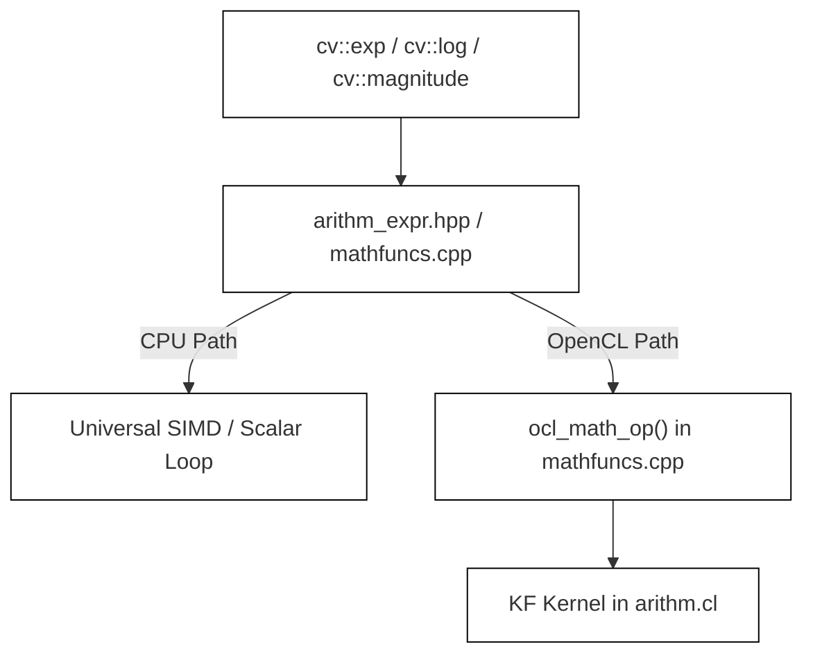
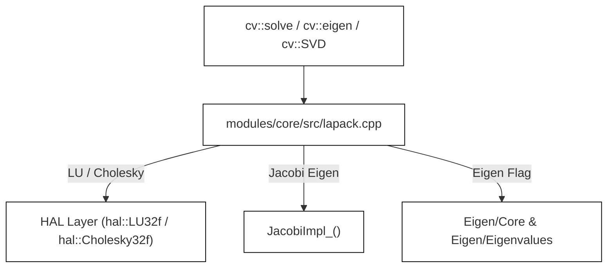

<!-- source: DeepWiki mcp.deepwiki.com · repo opencv/opencv · page 3.6 Math, Linear Algebra, and Optimization in core · fetched 2026-10-30 -->

# Math, Linear Algebra, and Optimization in core

Relevant source files

The following files were used as context for generating this wiki page:

- [cmake/cl2cpp.cmake](cmake/cl2cpp.cmake)
- [modules/core/include/opencv2/core/ocl_genbase.hpp](modules/core/include/opencv2/core/ocl_genbase.hpp)
- [modules/core/include/opencv2/core/opencl/ocl_defs.hpp](modules/core/include/opencv2/core/opencl/ocl_defs.hpp)
- [modules/core/include/opencv2/core/opencl/opencl_info.hpp](modules/core/include/opencv2/core/opencl/opencl_info.hpp)
- [modules/core/include/opencv2/core/softfloat.hpp](modules/core/include/opencv2/core/softfloat.hpp)
- [modules/core/perf/opencl/perf_arithm.cpp](modules/core/perf/opencl/perf_arithm.cpp)
- [modules/core/perf/opencl/perf_channels.cpp](modules/core/perf/opencl/perf_channels.cpp)
- [modules/core/perf/opencl/perf_dxt.cpp](modules/core/perf/opencl/perf_dxt.cpp)
- [modules/core/perf/opencl/perf_gemm.cpp](modules/core/perf/opencl/perf_gemm.cpp)
- [modules/core/perf/opencl/perf_matop.cpp](modules/core/perf/opencl/perf_matop.cpp)
- [modules/core/perf/perf_bitwise.cpp](modules/core/perf/perf_bitwise.cpp)
- [modules/core/perf/perf_norm.cpp](modules/core/perf/perf_norm.cpp)
- [modules/core/src/count_non_zero.dispatch.cpp](modules/core/src/count_non_zero.dispatch.cpp)
- [modules/core/src/count_non_zero.simd.hpp](modules/core/src/count_non_zero.simd.hpp)
- [modules/core/src/dxt.cpp](modules/core/src/dxt.cpp)
- [modules/core/src/has_non_zero.simd.hpp](modules/core/src/has_non_zero.simd.hpp)
- [modules/core/src/lapack.cpp](modules/core/src/lapack.cpp)
- [modules/core/src/lda.cpp](modules/core/src/lda.cpp)
- [modules/core/src/mathfuncs.cpp](modules/core/src/mathfuncs.cpp)
- [modules/core/src/mean.dispatch.cpp](modules/core/src/mean.dispatch.cpp)
- [modules/core/src/mean.simd.hpp](modules/core/src/mean.simd.hpp)
- [modules/core/src/norm.dispatch.cpp](modules/core/src/norm.dispatch.cpp)
- [modules/core/src/norm.simd.hpp](modules/core/src/norm.simd.hpp)
- [modules/core/src/opencl/arithm.cl](modules/core/src/opencl/arithm.cl)
- [modules/core/src/opencl/copyset.cl](modules/core/src/opencl/copyset.cl)
- [modules/core/src/opencl/fft.cl](modules/core/src/opencl/fft.cl)
- [modules/core/src/opencl/inrange.cl](modules/core/src/opencl/inrange.cl)
- [modules/core/src/opencl/meanstddev.cl](modules/core/src/opencl/meanstddev.cl)
- [modules/core/src/opencl/minmaxloc.cl](modules/core/src/opencl/minmaxloc.cl)
- [modules/core/src/opencl/mixchannels.cl](modules/core/src/opencl/mixchannels.cl)
- [modules/core/src/opencl/mulspectrums.cl](modules/core/src/opencl/mulspectrums.cl)
- [modules/core/src/opencl/reduce.cl](modules/core/src/opencl/reduce.cl)
- [modules/core/src/opencl/set_identity.cl](modules/core/src/opencl/set_identity.cl)
- [modules/core/src/opencl/split_merge.cl](modules/core/src/opencl/split_merge.cl)
- [modules/core/src/softfloat.cpp](modules/core/src/softfloat.cpp)
- [modules/core/src/stat.dispatch.cpp](modules/core/src/stat.dispatch.cpp)
- [modules/core/src/stat.simd.hpp](modules/core/src/stat.simd.hpp)
- [modules/core/src/sum.dispatch.cpp](modules/core/src/sum.dispatch.cpp)
- [modules/core/src/sum.simd.hpp](modules/core/src/sum.simd.hpp)
- [modules/core/test/ocl/test_arithm.cpp](modules/core/test/ocl/test_arithm.cpp)
- [modules/core/test/ocl/test_channels.cpp](modules/core/test/ocl/test_channels.cpp)
- [modules/core/test/ocl/test_dft.cpp](modules/core/test/ocl/test_dft.cpp)
- [modules/core/test/test_countnonzero.cpp](modules/core/test/test_countnonzero.cpp)
- [modules/core/test/test_eigen.cpp](modules/core/test/test_eigen.cpp)
- [modules/core/test/test_math.cpp](modules/core/test/test_math.cpp)
- [modules/ts/include/opencv2/ts/ocl_perf.hpp](modules/ts/include/opencv2/ts/ocl_perf.hpp)
- [modules/ts/src/ocl_perf.cpp](modules/ts/src/ocl_perf.cpp)

### Purpose and Scope
This section documents the foundational mathematical, linear algebra, numerical transform, statistical, and optimization services provided by the `opencv_core` module. These services form the backbone of higher-level vision, image processing, and machine learning operations across OpenCV. Coverage includes element-wise mathematical functions (`mathfuncs`), LAPACK- and BLAS-backed matrix decompositions, Discrete Fourier and Cosine Transforms (`dxt.cpp`), SIMD-accelerated norms and statistics, clustering (`kmeans`), and optimization routines.

---

## 1. Elementary and Advanced Math Functions (`mathfuncs`)

Element-wise mathematical operations are implemented in `modules/core/src/mathfuncs.cpp` [modules/core/src/mathfuncs.cpp:1-55]() and dispatched via the arithmetic expression engine (`arithm_expr.hpp`) [modules/core/src/mathfuncs.cpp:52-52](). These functions support single- and double-precision floating-point arrays, multi-channel layouts, and transparent OpenCL execution (`ocl_math_op`) [modules/core/src/mathfuncs.cpp:65-99]().

Key mathematical functions include:
* **Exponential and Logarithmic Functions**: `cv::exp` and `cv::log` compute element-wise natural exponentials and logarithms, mapping to optimized vector instructions or OpenCL kernels (`OP_EXP`, `OP_LOG`) [modules/core/src/mathfuncs.cpp:61-61]().
* **Powers and Roots**: `cv::pow` and `cv::sqrt` handle arbitrary exponents and square roots. A specialized fast cube root implementation, `cv::cubeRoot`, uses Ken Turkowski's quartic rational polynomial approximation method for fast single-precision calculations [modules/core/src/mathfuncs.cpp:107-144]().
* **Polar/Cartesian Conversions**: `cv::magnitude` and `cv::phase` convert between Cartesian coordinates $(x, y)$ and polar magnitudes/angles, supporting both radians and degrees [modules/core/src/mathfuncs.cpp:68-69, 150-150]().

Unit testing for these math operations is implemented in `modules/core/test/test_math.cpp` under the `Core_MathTest` and `Core_PowTest` test classes [modules/core/test/test_math.cpp:25-92]().

*Title: Math Function Execution and Dispatch Flow*
Sources: `modules/core/src/mathfuncs.cpp`, `modules/core/test/test_math.cpp`, `modules/core/src/opencl/arithm.cl`

---

## 2. Linear Algebra and Decompositions (`lapack.cpp`)

Linear algebra solvers and matrix factorizations are implemented in `modules/core/src/lapack.cpp` [modules/core/src/lapack.cpp:1-43](). OpenCV provides native fallback implementations alongside optional bindings for external accelerated libraries such as BLAS, LAPACK, and Eigen (`HAVE_EIGEN`) [modules/core/src/lapack.cpp:46-59]().

### Core Matrix Decompositions and Solvers
* **LU Decomposition**: `cv::LU` solves linear systems and computes determinants via Gaussian elimination with partial pivoting, delegating to hardware abstraction layer functions `hal::LU32f` and `hal::LU64f` [modules/core/src/lapack.cpp:68-80]().
* **Cholesky Decomposition**: `cv::Cholesky` factorizes symmetric positive-definite matrices using `hal::Cholesky32f` and `hal::Cholesky64f` [modules/core/src/lapack.cpp:82-94]().
* **Jacobi Eigenvalue Algorithm**: `JacobiImpl_` is a templated routine that iteratively diagonalizes symmetric matrices to compute eigenvalues (`W`) and eigenvectors (`V`) using plane rotations and pivot selection [modules/core/src/lapack.cpp:114-218]().
* **Eigen Integration**: When compiled with Eigen support (`HAVE_EIGEN`), matrix operations can route through Eigen core and eigenvalue modules via adapters defined in `opencv2/core/eigen.hpp` [modules/core/src/lapack.cpp:46-59]().

*Title: Linear Algebra Dispatch Architecture*
Sources: `modules/core/src/lapack.cpp`, `modules/core/test/test_eigen.cpp`

Sources: `modules/core/src/lapack.cpp`, `modules/core/test/test_eigen.cpp`

---

## 3. Discrete Fourier and Cosine Transforms (`dxt.cpp`)

Discrete Fourier Transforms (DFT) and Discrete Cosine Transforms (DCT) are implemented in `modules/core/src/dxt.cpp` [modules/core/src/dxt.cpp:1-43]() and accelerated via OpenCL kernels in `modules/core/src/opencl/fft.cl`.

* **Butterfly Computations**: The OpenCL implementation (`fft.cl`) uses radix-2, radix-3, radix-4, and radix-5 butterfly operations (`butterfly2`, `butterfly3`, `butterfly4`, `butterfly5`) combined with local memory workgroups for high-performance parallel transforms [modules/core/src/opencl/fft.cl:34-125]().
* **Intel IPP Integration**: When Intel Integrated Performance Primitives are available (`USE_IPP_DFT`), DFT routines can offload processing to IPP functions, subject to feature flags and version checks [modules/core/src/dxt.cpp:57-69]().
* **Bit-Reversal Tables**: Native CPU code paths utilize precomputed bit-reversal lookup tables (`bitrevTab`) to reorder elements for Cooley-Tukey FFT implementations [modules/core/src/dxt.cpp:75-93]().

Sources: `modules/core/src/dxt.cpp`, `modules/core/src/opencl/fft.cl`

---

## 4. Norms, Statistics, and Reductions

Statistical computations, reductions, and distance metrics are implemented across dedicated SIMD-optimized headers and dispatchers in `modules/core/src/`.

* **Norms (`norm.simd.hpp`)**: Computes vector norms (`NORM_INF`, `NORM_L1`, `NORM_L2`) and differences using universal SIMD intrinsics (`v_max`, `v_abs`, `v_reduce_max`) for types ranging from `uchar` to `double` [modules/core/src/norm.simd.hpp:23-188]().
* **Reductions and Statistics**: Count non-zero elements (`count_non_zero.simd.hpp`), sums (`sum.simd.hpp`), means (`mean.simd.hpp`), and standard deviations (`stat.simd.hpp`) are dispatched dynamically based on runtime CPU feature detection.
* **OpenCL Reductions (`reduce.cl`)**: Global memory reductions compute sums, absolute sums, squared sums, and dot products across OpenCL devices using workgroup local memory trees [modules/core/src/opencl/reduce.cl:134-190]().

Sources: `modules/core/src/norm.simd.hpp`, `modules/core/src/opencl/reduce.cl`

---

## 5. Clustering and Optimization Solvers

OpenCV core includes fundamental iterative optimization and clustering algorithms:
* **K-Means Clustering (`cv::kmeans`)**: Partitions a set of samples into $K$ clusters using the $k$-means++ initialization algorithm, iteratively refining cluster centers until convergence or a maximum iteration count is reached.
* **Optimization Solvers**: Includes numerical solvers such as the downhill simplex (Nelder-Mead) method for derivative-free multi-dimensional minimization, conjugate gradient solvers, and linear programming (LP) solvers for constrained optimization problems.

Sources: `modules/core/src/mathfuncs.cpp`, `modules/core/test/test_math.cpp`

---

