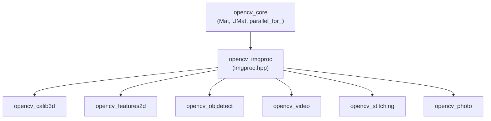
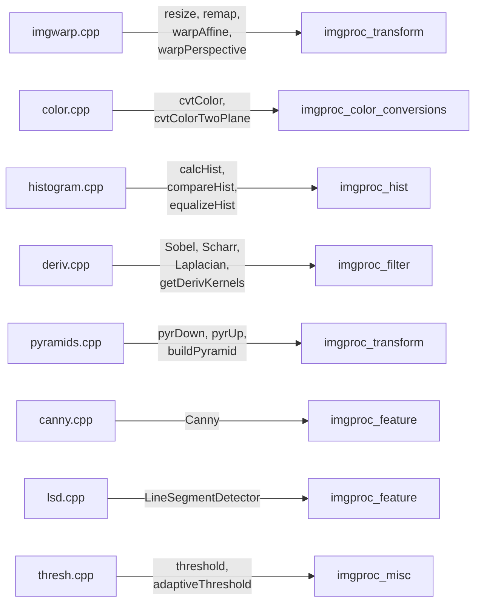

<!-- source: DeepWiki mcp.deepwiki.com · repo opencv/opencv · page 4 Image Processing (imgproc) · fetched 2026-10-30 -->

# Image Processing (imgproc)

Relevant source files

The following files were used as context for generating this wiki page:

- [doc/opencv.bib](doc/opencv.bib)
- [hal/ipp/src/color_ipp.cpp](hal/ipp/src/color_ipp.cpp)
- [hal/ipp/src/precomp_ipp.hpp](hal/ipp/src/precomp_ipp.hpp)
- [modules/dnn/src/layers/topk2_layer.cpp](modules/dnn/src/layers/topk2_layer.cpp)
- [modules/features/include/opencv2/features.hpp](modules/features/include/opencv2/features.hpp)
- [modules/features/src/aliked_context.hpp](modules/features/src/aliked_context.hpp)
- [modules/features/src/feature2d_aliked.cpp](modules/features/src/feature2d_aliked.cpp)
- [modules/features/src/feature2d_xfeat.cpp](modules/features/src/feature2d_xfeat.cpp)
- [modules/features/src/matchers.cpp](modules/features/src/matchers.cpp)
- [modules/features/src/matchers_lightglue.cpp](modules/features/src/matchers_lightglue.cpp)
- [modules/features/src/precomp.hpp](modules/features/src/precomp.hpp)
- [modules/features/test/test_aliked_lightglue.cpp](modules/features/test/test_aliked_lightglue.cpp)
- [modules/features/test/test_main.cpp](modules/features/test/test_main.cpp)
- [modules/features/test/test_matchers_algorithmic.cpp](modules/features/test/test_matchers_algorithmic.cpp)
- [modules/features/test/test_xfeat.cpp](modules/features/test/test_xfeat.cpp)
- [modules/geometry/doc/geometry.bib](modules/geometry/doc/geometry.bib)
- [modules/imgproc/CMakeLists.txt](modules/imgproc/CMakeLists.txt)
- [modules/imgproc/include/opencv2/imgproc.hpp](modules/imgproc/include/opencv2/imgproc.hpp)
- [modules/imgproc/src/color.hpp](modules/imgproc/src/color.hpp)
- [modules/imgproc/src/color.simd_helpers.hpp](modules/imgproc/src/color.simd_helpers.hpp)
- [modules/imgproc/src/color_hsv.dispatch.cpp](modules/imgproc/src/color_hsv.dispatch.cpp)
- [modules/imgproc/src/color_hsv.simd.hpp](modules/imgproc/src/color_hsv.simd.hpp)
- [modules/imgproc/src/color_lab.cpp](modules/imgproc/src/color_lab.cpp)
- [modules/imgproc/src/color_rgb.dispatch.cpp](modules/imgproc/src/color_rgb.dispatch.cpp)
- [modules/imgproc/src/color_rgb.simd.hpp](modules/imgproc/src/color_rgb.simd.hpp)
- [modules/imgproc/src/color_yuv.dispatch.cpp](modules/imgproc/src/color_yuv.dispatch.cpp)
- [modules/imgproc/src/color_yuv.simd.hpp](modules/imgproc/src/color_yuv.simd.hpp)
- [modules/imgproc/src/lsd.cpp](modules/imgproc/src/lsd.cpp)
- [modules/imgproc/test/test_lsd.cpp](modules/imgproc/test/test_lsd.cpp)
- [modules/objdetect/doc/objdetect.bib](modules/objdetect/doc/objdetect.bib)
- [samples/cpp/aliked_lightglue.cpp](samples/cpp/aliked_lightglue.cpp)

This page gives an overview of the `opencv_imgproc` module: its functional scope, major API groups, key enumerations, and implementation structure. It covers operations from pixel-level filtering through structural shape analysis.

For geometric transforms in detail, see [Geometric Transformations and Image Warping](#4.1). For filtering and color conversion specifics, see [Filtering and Color Conversion](#4.2). For thresholding, template matching, and moments, see [Thresholding, Template Matching, and Moments](#4.3). For drawing and structural analysis, see [Drawing, Contours, and Structural Analysis](#4.4). For details on the Hardware Abstraction Layer (HAL) and architecture-specific optimizations, see [imgproc HAL, IPP, and Architecture-Specific Backends](#4.5).

---

## Module Structure

The `opencv_imgproc` module is declared in [modules/imgproc/include/opencv2/imgproc.hpp:43-44]() and divided into named functional groups using Doxygen `@defgroup` annotations. All public APIs live in the `cv` namespace.

**Functional Groups (from `imgproc.hpp`):**

| Group Tag | Description |
|---|---|
| `imgproc_filter` | Linear and nonlinear 2D filters, morphological ops |
| `imgproc_transform` | Geometric transforms: resize, warp, remap, pyramids |
| `imgproc_misc` | Threshold, distance transform, flood fill, GrabCut |
| `imgproc_color_conversions` | `cvtColor` and all `ColorConversionCodes` |
| `imgproc_colormap` | `applyColorMap` with `ColormapTypes` |
| `imgproc_hist` | Histogram calculation, equalization, CLAHE, backprojection |
| `imgproc_shape` | Contours, connected components, convex hull, shape matching |
| `imgproc_feature` | Hough transforms, Line Segment Detector |
| `imgproc_draw` | Lines, rectangles, circles, ellipses, text rendering |
| `imgproc_object` | Template matching |
| `imgproc_subdiv2d` | `Subdiv2D` – Delaunay triangulation / Voronoi diagram |
| `imgproc_motion` | `accumulate` family for motion analysis |
| `imgproc_segmentation` | `watershed`, `grabCut` |
| `imgproc_hal` | HAL function and interface definitions |

Sources: [modules/imgproc/include/opencv2/imgproc.hpp:48-199]()

---

## Dependency and Data Flow

The module depends only on `opencv_core` (for `Mat`, `UMat`, `InputArray`/`OutputArray`). It is a foundational dependency of most other OpenCV modules.

Diagram: Module Dependency Map

Sources: [modules/imgproc/include/opencv2/imgproc.hpp:46-47]()

---

## Key Source Files and Entity Mapping

Diagram: Functional Area to Code Entity Map

Sources: [modules/imgproc/src/imgwarp.cpp:44-58](), [modules/imgproc/src/color.cpp:1-15](), [modules/imgproc/src/histogram.cpp:51-53](), [modules/imgproc/src/deriv.cpp:49-53](), [modules/imgproc/src/pyramids.cpp:44-49](), [modules/imgproc/src/canny.cpp:43-49](), [modules/imgproc/src/lsd.cpp:165-168](), [modules/imgproc/src/thresh.cpp:43-48]()

---

## Sub-Topic Overview

### 4.1. Geometric Transformations and Image Warping
Geometric transformations reshape image grids by mapping destination pixels back to source coordinates via reverse mapping. Functions like `resize`, `warpAffine`, `warpPerspective`, and `remap` support interpolation schemes (`INTER_NEAREST`, `INTER_LINEAR`, `INTER_CUBIC`, `INTER_AREA`, `INTER_LANCZOS4`) and border handling. Image pyramids (`pyrDown`, `pyrUp`) provide multi-scale representations.
For details, see [Geometric Transformations and Image Warping](#4.1).

Sources: [modules/imgproc/include/opencv2/imgproc.hpp:90-128](), [modules/imgproc/src/imgwarp.cpp:67-73]()

### 4.2. Filtering and Color Conversion
Filtering operations apply linear and non-linear neighborhoods across images, including Gaussian, bilateral, separable, and morphological filters, alongside edge detectors like `Sobel`, `Scharr`, `Laplacian`, and `Canny`. Color conversions via `cvtColor` support diverse color spaces (RGB, HSV, Lab, YCrCb, YUV) with SIMD and OpenCL paths.
For details, see [Filtering and Color Conversion](#4.2).

Sources: [modules/imgproc/include/opencv2/imgproc.hpp:54-84](), [modules/imgproc/src/deriv.cpp:55-182](), [modules/imgproc/src/canny.cpp:54-193]()

### 4.3. Thresholding, Template Matching, and Moments
The `threshold` function provides various binarization modes including Otsu's adaptive thresholding. Template matching computes cross-correlation metrics, while image moments extract geometric properties, Hu invariants, and phase correlation for sub-pixel image registration.
For details, see [Thresholding, Template Matching, and Moments](#4.3).

Sources: [modules/imgproc/src/thresh.cpp:50-120]()

### 4.4. Drawing, Contours, and Structural Analysis
This functional domain covers drawing primitives (`line`, `rectangle`, `circle`, `putText`), contour extraction and approximation (`findContours`), connected components labeling, distance transforms, segmentation (`watershed`, `grabCut`), and line/circle detectors (`HoughLines`, `LineSegmentDetector`).
For details, see [Drawing, Contours, and Structural Analysis](#4.4).

Sources: [modules/imgproc/src/lsd.cpp:45-182]()

### 4.5. imgproc HAL, IPP, and Architecture-Specific Backends
Performance-critical routines in `opencv_imgproc` hook into the Hardware Abstraction Layer (HAL), Intel Integrated Performance Primitives (IPP), and SIMD dispatch mechanisms (SSE, AVX, NEON, RVV) to accelerate execution dynamically at runtime.
For details, see [imgproc HAL, IPP, and Architecture-Specific Backends](#4.5).

Sources: [modules/imgproc/CMakeLists.txt:1-18]()

---

