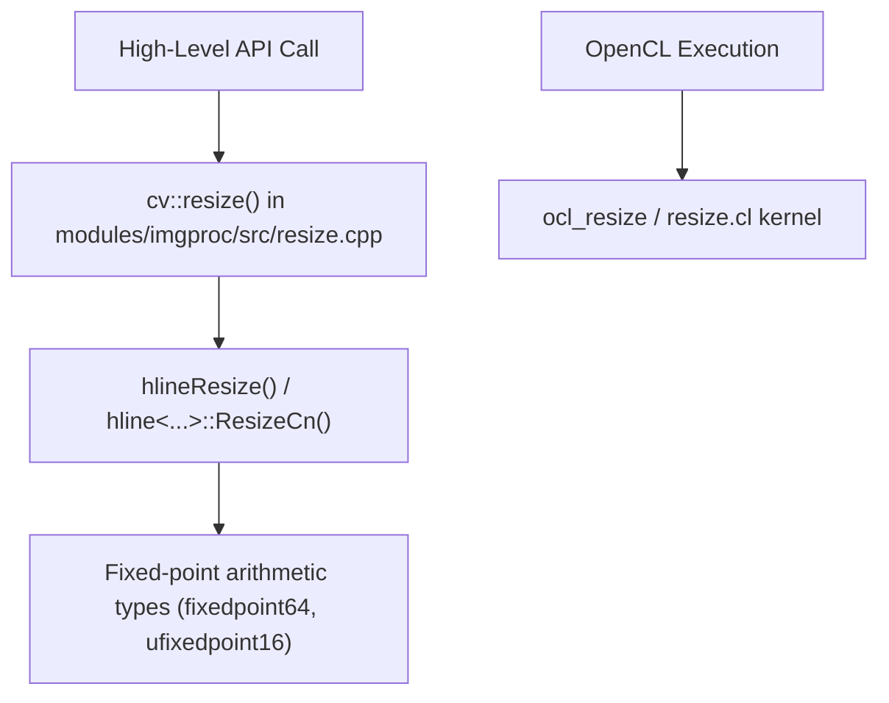
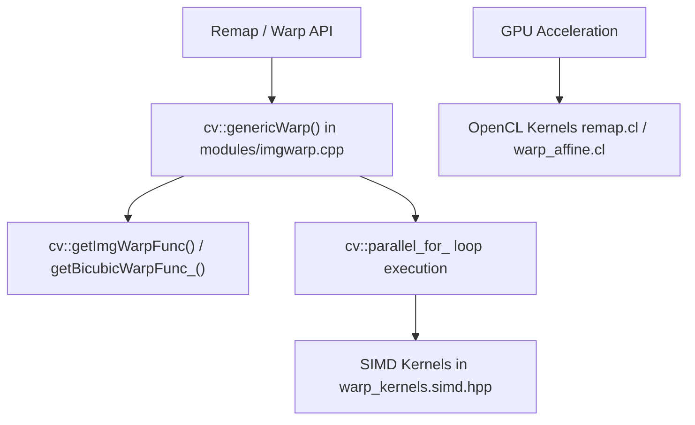
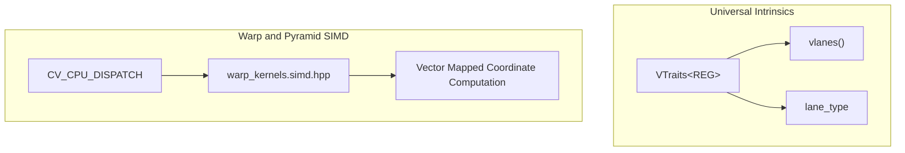

<!-- source: DeepWiki mcp.deepwiki.com · repo opencv/opencv · page 4.1 Geometric Transformations and Image Warping · fetched 2026-10-30 -->

# Geometric Transformations and Image Warping

Relevant source files

The following files were used as context for generating this wiki page:

- [hal/ipp/src/resize_ipp.cpp](hal/ipp/src/resize_ipp.cpp)
- [modules/core/src/parallel/parallel.cpp](modules/core/src/parallel/parallel.cpp)
- [modules/core/src/parallel/registry_parallel.impl.hpp](modules/core/src/parallel/registry_parallel.impl.hpp)
- [modules/imgproc/perf/opencl/perf_color.cpp](modules/imgproc/perf/opencl/perf_color.cpp)
- [modules/imgproc/perf/opencl/perf_imgwarp.cpp](modules/imgproc/perf/opencl/perf_imgwarp.cpp)
- [modules/imgproc/perf/opencl/perf_moments.cpp](modules/imgproc/perf/opencl/perf_moments.cpp)
- [modules/imgproc/perf/opencl/perf_pyramid.cpp](modules/imgproc/perf/opencl/perf_pyramid.cpp)
- [modules/imgproc/perf/perf_remap.cpp](modules/imgproc/perf/perf_remap.cpp)
- [modules/imgproc/src/color.cpp](modules/imgproc/src/color.cpp)
- [modules/imgproc/src/imgwarp.avx2.cpp](modules/imgproc/src/imgwarp.avx2.cpp)
- [modules/imgproc/src/imgwarp.cpp](modules/imgproc/src/imgwarp.cpp)
- [modules/imgproc/src/imgwarp.hpp](modules/imgproc/src/imgwarp.hpp)
- [modules/imgproc/src/imgwarp.sse4_1.cpp](modules/imgproc/src/imgwarp.sse4_1.cpp)
- [modules/imgproc/src/opencl/remap.cl](modules/imgproc/src/opencl/remap.cl)
- [modules/imgproc/src/opencl/resize.cl](modules/imgproc/src/opencl/resize.cl)
- [modules/imgproc/src/opencl/warp_affine.cl](modules/imgproc/src/opencl/warp_affine.cl)
- [modules/imgproc/src/opencl/warp_perspective.cl](modules/imgproc/src/opencl/warp_perspective.cl)
- [modules/imgproc/src/opencl/warp_transform.cl](modules/imgproc/src/opencl/warp_transform.cl)
- [modules/imgproc/src/resize.avx2.cpp](modules/imgproc/src/resize.avx2.cpp)
- [modules/imgproc/src/resize.cpp](modules/imgproc/src/resize.cpp)
- [modules/imgproc/src/resize.hpp](modules/imgproc/src/resize.hpp)
- [modules/imgproc/src/resize.sse4_1.cpp](modules/imgproc/src/resize.sse4_1.cpp)
- [modules/imgproc/src/warp_common.hpp](modules/imgproc/src/warp_common.hpp)
- [modules/imgproc/src/warp_common.scalar.hpp](modules/imgproc/src/warp_common.scalar.hpp)
- [modules/imgproc/src/warp_common.vector.hpp](modules/imgproc/src/warp_common.vector.hpp)
- [modules/imgproc/src/warp_kernels.simd.hpp](modules/imgproc/src/warp_kernels.simd.hpp)
- [modules/imgproc/test/ocl/test_color.cpp](modules/imgproc/test/ocl/test_color.cpp)
- [modules/imgproc/test/ocl/test_warp.cpp](modules/imgproc/test/ocl/test_warp.cpp)
- [modules/imgproc/test/test_imgwarp.cpp](modules/imgproc/test/test_imgwarp.cpp)
- [modules/imgproc/test/test_imgwarp_strict.cpp](modules/imgproc/test/test_imgwarp_strict.cpp)
- [modules/ts/include/opencv2/ts/ocl_test.hpp](modules/ts/include/opencv2/ts/ocl_test.hpp)

This page documents the geometric transformation and image warping functions in the `opencv_imgproc` module: `resize`, `remap`, `warpAffine`, `warpPerspective`, and the image pyramid functions `pyrDown`/`pyrUp`. It covers interpolation methods, border extrapolation modes, internal implementation structure, and OpenCL/SIMD acceleration paths.

For color space conversions (e.g., `cvtColor`), see page [Filtering and Color Conversion](#4.2). For camera undistortion and perspective transforms derived from calibration, see page [Camera Models and Calibration Algorithms](#8.1) and [Pose Estimation (solvePnP) and Geometric Transforms](#8.2). For GPU (CUDA) variants of these operations, see page [CUDA and GPU Acceleration](#14).

Sources: [modules/imgproc/src/imgwarp.cpp:58-61](), [modules/imgproc/src/resize.cpp:56-63]()

---

## Public API Overview

All functions live in the `cv` namespace. Their declarations appear in `modules/imgproc/include/opencv2/imgproc.hpp`.

| Function | Purpose | Transform type |
|---|---|---|
| `resize` | Scale an image to a new size | Scale (separable) |
| `remap` | Apply an arbitrary pixel map | Free-form per-pixel |
| `warpAffine` | Apply a 2×3 affine matrix | Affine |
| `warpPerspective` | Apply a 3×3 homography | Projective |
| `pyrDown` | Gaussian downsample by 2× | Fixed pyramid kernel |
| `pyrUp` | Upsample by 2× | Fixed pyramid kernel |
| `getRotationMatrix2D` | Compute a rotation/scale 2×3 matrix | Helper |
| `getPerspectiveTransform` | Compute a 3×3 homography from point correspondences | Helper |
| `getAffineTransform` | Compute a 2×3 affine matrix from point correspondences | Helper |

Sources: [modules/imgproc/src/imgwarp.cpp:58-61](), [modules/imgproc/src/resize.cpp:56-63]()

---

## Interpolation Methods

The interpolation mode is passed as an integer flag, defined in the `InterpolationFlags` enum.

| Flag | Value | Kernel size | Notes |
|---|---|---|---|
| `INTER_NEAREST` | 0 | 1×1 | No blending, snap to nearest |
| `INTER_LINEAR` | 1 | 2×2 | Bilinear; default for most functions |
| `INTER_CUBIC` | 2 | 4×4 | Bicubic with `A = -0.75` |
| `INTER_AREA` | 3 | varies | Area averaging; preferred for downscaling |
| `INTER_LANCZOS4` | 4 | 8×8 | Lanczos with window size 4 |
| `INTER_LINEAR_EXACT` | 5 | 2×2 | Bit-exact bilinear; integer-only |
| `INTER_NEAREST_EXACT` | 6 | 1×1 | Bit-exact nearest; matches PIL |

### Interpolation Coefficient Tables

All non-nearest interpolation modes pre-compute lookup tables at startup. These tables cache fractional-position weights at sub-pixel resolution `INTER_TAB_SIZE = 32` (5 bits).

The system uses `getImgWarpFunc` to dispatch to the correct interpolation implementation based on the image type and interpolation method. For example, `INTER_CUBIC` triggers a dispatch via `CV_CPU_DISPATCH(getBicubicWarpFunc_, ...)` [modules/imgproc/src/imgwarp.cpp:67-73]().

Fixed-point arithmetic typically uses `FIXPT_SCALE = 1.f/32` within parallel loops to handle sub-pixel offsets [modules/imgproc/src/imgwarp.cpp:119]().

Sources: [modules/imgproc/src/imgwarp.cpp:65-73](), [modules/imgproc/src/imgwarp.cpp:118-120]()

---

## Border Extrapolation Modes

When a mapped pixel falls outside the source image, the border mode determines what value to use.

| Flag | Behavior | Example (border is `|`) |
|---|---|---|
| `BORDER_CONSTANT` | Fill with a fixed value (default: 0) | `000|abcdef|000` |
| `BORDER_REPLICATE` | Repeat the edge pixel | `aaa|abcdef|fff` |
| `BORDER_REFLECT` | Mirror across the edge | `cba|abcdef|fed` |
| `BORDER_REFLECT_101` | Mirror, excluding the edge pixel | `dcb|abcdef|edc` |
| `BORDER_WRAP` | Tile the image | `cde|abcdef|abc` |
| `BORDER_TRANSPARENT` | Leave destination pixels unchanged | (no fill) |

The transformation functions like `genericWarp` handle borders by converting the user-provided `Scalar` border value to raw data using `scalarToRawData` [modules/imgproc/src/imgwarp.cpp:115-116]().

Sources: [modules/imgproc/src/imgwarp.cpp:115-126]()

---

## `resize`

**Source:** [modules/imgproc/src/resize.cpp]()

`resize` scales an image to a new `Size` or by `fx`/`fy` scale factors. Internally it decomposes the 2D resampling into separable horizontal and vertical passes.

### Internal Pipeline and Code Entity Mapping

**Figure: Resize system-to-code mapping**

Sources: [modules/imgproc/src/resize.cpp:68-118](), [modules/imgproc/src/opencl/resize.cl]()

### Key Internal Functions

- `hlineResize<ET, FT, n, mulall>` – Applies a 1D resampling filter of kernel width `n` along each source row into a temporary buffer. Specialized for cn=1,2,3,4. [modules/imgproc/src/resize.cpp:76-111]()
- `hlineResizeCn` – Dispatcher that selects the appropriate `hline<...>::ResizeCn` specialization. [modules/imgproc/src/resize.cpp:112-118]()
- **Fixed-point arithmetic**: Uses specialized types like `ufixedpoint16` or `fixedpoint32` depending on the input depth to ensure precision during interpolation [modules/imgproc/src/resize.cpp:68-73]().

Sources: [modules/imgproc/src/resize.cpp:68-118]()

---

## `remap`

**Source:** [modules/imgproc/src/imgwarp.cpp]()

`remap` applies a free-form geometric map. The caller provides two maps specifying where each destination pixel samples from in the source image.

### Remap Dispatch Architecture

**Figure: Remap CPU dispatch and warping workflow**

Sources: [modules/imgproc/src/imgwarp.cpp:67-150](), [modules/imgproc/src/warp_kernels.simd.hpp:107-131](), [modules/imgproc/src/opencl/warp_affine.cl]()

The `genericWarp` function handles the high-level logic for `remap`, `warpAffine`, and `warpPerspective`. It determines if the map is relative or absolute and checks for valid map types (e.g., `CV_32FC2` for interleaved or `CV_16SC2` for fixed-point) [modules/imgproc/src/imgwarp.cpp:133-137]().

Sources: [modules/imgproc/src/imgwarp.cpp:75-140](), [modules/imgproc/src/opencl/remap.cl]()

---

## `warpAffine` and `warpPerspective`

**Source:** [modules/imgproc/src/imgwarp.cpp](), [modules/imgproc/src/opencl/warp_affine.cl](), [modules/imgproc/src/opencl/warp_perspective.cl]()

Both functions use a transformation matrix `M` to compute coordinates.

- `warpAffine`: Uses a 2×3 matrix. If `M.rows == 2`, the system sets `warpAffine = true` [modules/imgproc/src/imgwarp.cpp:130]().
- `warpPerspective`: Uses a 3×3 matrix. If `M.rows == 3`, the system sets `warpPerspective = true` [modules/imgproc/src/imgwarp.cpp:131]().

In `genericWarp`, the transformation is computed inside a `parallel_for_` block. For `warpAffine`, coordinates are calculated via affine matrix products [modules/imgproc/src/imgwarp.cpp:129-170]().

Sources: [modules/imgproc/src/imgwarp.cpp:129-170](), [modules/imgproc/src/opencl/warp_affine.cl]()

---

## Image Pyramids (`pyrDown` / `pyrUp`)

**Source:** [modules/imgproc/src/pyramids.cpp](), [modules/imgproc/src/opencl/pyr_down.cl](), [modules/imgproc/src/opencl/pyr_up.cl]()

Image pyramids are used for multi-scale image processing. Both functions use a fixed Gaussian kernel.

### `pyrDown`

Smooths with a 5-tap kernel then sub-samples by 2×.
- **Horizontal Pass**: `PyrDownVecH<T1, T2, cn>` – SIMD-specialized for various channel counts [modules/imgproc/src/pyramids.cpp:87-99]().
- **Vertical Pass**: `PyrDownVecV<T1, T2>` handles the column-wise smoothing [modules/imgproc/src/pyramids.cpp:79]().

### `pyrUp`

Upsamples by 2× then smooths.
- **Horizontal Pass**: `PyrUpVecH` [modules/imgproc/src/pyramids.cpp:74]().
- **Vertical Pass**: `PyrUpVecV` and `PyrUpVecVOneRow` [modules/imgproc/src/pyramids.cpp:81-83]().

Sources: [modules/imgproc/src/pyramids.cpp:74-145]()

---

## SIMD Acceleration and CPU Dispatch

Hot paths are accelerated using universal SIMD intrinsics, including support for scalable vectors (e.g., RISC-V RVV) via runtime CPU dispatch.

**Figure: SIMD Traits and Vector Execution**

Sources: [modules/core/include/opencv2/core/hal/intrin_rvv_scalable.hpp:42-105](), [modules/imgproc/src/warp_kernels.simd.hpp:10-68]()

Sources: [modules/imgproc/src/warp_kernels.simd.hpp:1-131](), [modules/core/include/opencv2/core/hal/intrin_rvv_scalable.hpp:42-105]()

---

## Testing and Verification

Correctness is verified through the `ts` module and Google Test.

| Test Class | File | Purpose |
|---|---|---|
| `CV_ImgWarpBaseTest` | `modules/imgproc/test/test_imgwarp.cpp` | Base class for warping tests, handles parameter reading and array filling [modules/imgproc/test/test_imgwarp.cpp:48-63](). |
| `WarpAffine` | `modules/imgproc/test/ocl/test_warp.cpp` | OpenCL warp validation tests [modules/imgproc/test/ocl/test_warp.cpp:70-114](). |

Sources: [modules/imgproc/test/test_imgwarp.cpp:48-120](), [modules/imgproc/test/ocl/test_warp.cpp:70-114]()

---

