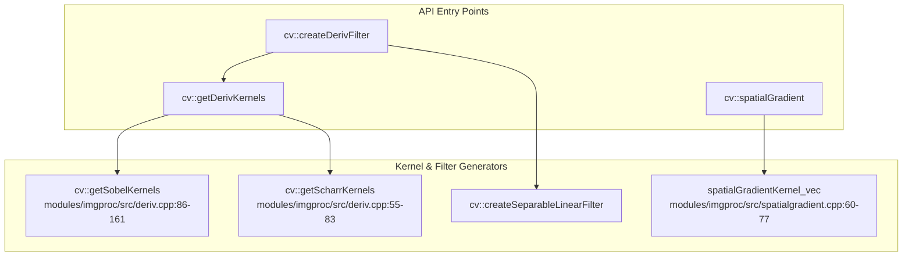
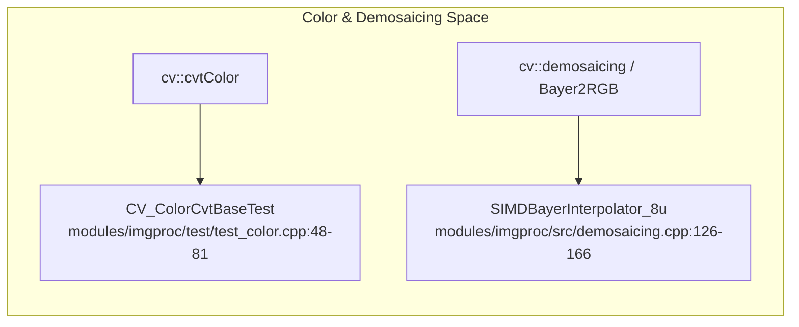

<!-- source: DeepWiki mcp.deepwiki.com · repo opencv/opencv · page 4.2 Filtering and Color Conversion · fetched 2026-10-30 -->

# Filtering and Color Conversion

Relevant source files

The following files were used as context for generating this wiki page:

- [hal/ipp/src/color_ipp.cpp](hal/ipp/src/color_ipp.cpp)
- [hal/ipp/src/precomp_ipp.hpp](hal/ipp/src/precomp_ipp.hpp)
- [hal/riscv-rvv/include/imgproc.hpp](hal/riscv-rvv/include/imgproc.hpp)
- [hal/riscv-rvv/src/imgproc/box_filter.cpp](hal/riscv-rvv/src/imgproc/box_filter.cpp)
- [hal/riscv-rvv/src/imgproc/canny.cpp](hal/riscv-rvv/src/imgproc/canny.cpp)
- [hal/riscv-rvv/src/imgproc/gaussian_blur.cpp](hal/riscv-rvv/src/imgproc/gaussian_blur.cpp)
- [hal/riscv-rvv/src/imgproc/histogram.cpp](hal/riscv-rvv/src/imgproc/histogram.cpp)
- [hal/riscv-rvv/src/imgproc/integral.cpp](hal/riscv-rvv/src/imgproc/integral.cpp)
- [hal/riscv-rvv/src/imgproc/laplacian.cpp](hal/riscv-rvv/src/imgproc/laplacian.cpp)
- [hal/riscv-rvv/src/imgproc/scharr.cpp](hal/riscv-rvv/src/imgproc/scharr.cpp)
- [hal/riscv-rvv/src/imgproc/sobel.cpp](hal/riscv-rvv/src/imgproc/sobel.cpp)
- [hal/riscv-rvv/src/imgproc/spatialgradient.cpp](hal/riscv-rvv/src/imgproc/spatialgradient.cpp)
- [modules/core/perf/perf_compare.cpp](modules/core/perf/perf_compare.cpp)
- [modules/imgcodecs/test/test_main.cpp](modules/imgcodecs/test/test_main.cpp)
- [modules/imgproc/CMakeLists.txt](modules/imgproc/CMakeLists.txt)
- [modules/imgproc/perf/perf_blur.cpp](modules/imgproc/perf/perf_blur.cpp)
- [modules/imgproc/perf/perf_corners.cpp](modules/imgproc/perf/perf_corners.cpp)
- [modules/imgproc/perf/perf_cvt_color.cpp](modules/imgproc/perf/perf_cvt_color.cpp)
- [modules/imgproc/perf/perf_filter2d.cpp](modules/imgproc/perf/perf_filter2d.cpp)
- [modules/imgproc/perf/perf_integral.cpp](modules/imgproc/perf/perf_integral.cpp)
- [modules/imgproc/perf/perf_laplacian.cpp](modules/imgproc/perf/perf_laplacian.cpp)
- [modules/imgproc/perf/perf_pyramids.cpp](modules/imgproc/perf/perf_pyramids.cpp)
- [modules/imgproc/perf/perf_resize.cpp](modules/imgproc/perf/perf_resize.cpp)
- [modules/imgproc/perf/perf_spatialgradient.cpp](modules/imgproc/perf/perf_spatialgradient.cpp)
- [modules/imgproc/perf/perf_threshold.cpp](modules/imgproc/perf/perf_threshold.cpp)
- [modules/imgproc/perf/perf_warp.cpp](modules/imgproc/perf/perf_warp.cpp)
- [modules/imgproc/src/canny.cpp](modules/imgproc/src/canny.cpp)
- [modules/imgproc/src/clahe.cpp](modules/imgproc/src/clahe.cpp)
- [modules/imgproc/src/color.hpp](modules/imgproc/src/color.hpp)
- [modules/imgproc/src/color.simd_helpers.hpp](modules/imgproc/src/color.simd_helpers.hpp)
- [modules/imgproc/src/color_hsv.dispatch.cpp](modules/imgproc/src/color_hsv.dispatch.cpp)
- [modules/imgproc/src/color_hsv.simd.hpp](modules/imgproc/src/color_hsv.simd.hpp)
- [modules/imgproc/src/color_lab.cpp](modules/imgproc/src/color_lab.cpp)
- [modules/imgproc/src/color_rgb.dispatch.cpp](modules/imgproc/src/color_rgb.dispatch.cpp)
- [modules/imgproc/src/color_rgb.simd.hpp](modules/imgproc/src/color_rgb.simd.hpp)
- [modules/imgproc/src/color_yuv.dispatch.cpp](modules/imgproc/src/color_yuv.dispatch.cpp)
- [modules/imgproc/src/color_yuv.simd.hpp](modules/imgproc/src/color_yuv.simd.hpp)
- [modules/imgproc/src/corner.cpp](modules/imgproc/src/corner.cpp)
- [modules/imgproc/src/demosaicing.cpp](modules/imgproc/src/demosaicing.cpp)
- [modules/imgproc/src/deriv.cpp](modules/imgproc/src/deriv.cpp)
- [modules/imgproc/src/histogram.cpp](modules/imgproc/src/histogram.cpp)
- [modules/imgproc/src/opencl/bilateral.cl](modules/imgproc/src/opencl/bilateral.cl)
- [modules/imgproc/src/opencl/clahe.cl](modules/imgproc/src/opencl/clahe.cl)
- [modules/imgproc/src/opencl/covardata.cl](modules/imgproc/src/opencl/covardata.cl)
- [modules/imgproc/src/opencl/filter2DSmall.cl](modules/imgproc/src/opencl/filter2DSmall.cl)
- [modules/imgproc/src/opencl/filterSepCol.cl](modules/imgproc/src/opencl/filterSepCol.cl)
- [modules/imgproc/src/opencl/filterSepRow.cl](modules/imgproc/src/opencl/filterSepRow.cl)
- [modules/imgproc/src/opencl/filterSep_singlePass.cl](modules/imgproc/src/opencl/filterSep_singlePass.cl)
- [modules/imgproc/src/opencl/filterSmall.cl](modules/imgproc/src/opencl/filterSmall.cl)
- [modules/imgproc/src/opencl/laplacian5.cl](modules/imgproc/src/opencl/laplacian5.cl)
- [modules/imgproc/src/opencl/morph.cl](modules/imgproc/src/opencl/morph.cl)
- [modules/imgproc/src/opencl/pyr_down.cl](modules/imgproc/src/opencl/pyr_down.cl)
- [modules/imgproc/src/opencl/pyr_up.cl](modules/imgproc/src/opencl/pyr_up.cl)
- [modules/imgproc/src/opencl/pyramid_up.cl](modules/imgproc/src/opencl/pyramid_up.cl)
- [modules/imgproc/src/pyramids.cpp](modules/imgproc/src/pyramids.cpp)
- [modules/imgproc/src/spatialgradient.cpp](modules/imgproc/src/spatialgradient.cpp)
- [modules/imgproc/src/stackblur.cpp](modules/imgproc/src/stackblur.cpp)
- [modules/imgproc/src/sumpixels.simd.hpp](modules/imgproc/src/sumpixels.simd.hpp)
- [modules/imgproc/src/thresh.cpp](modules/imgproc/src/thresh.cpp)
- [modules/imgproc/src/utils.cpp](modules/imgproc/src/utils.cpp)
- [modules/imgproc/test/ocl/test_filters.cpp](modules/imgproc/test/ocl/test_filters.cpp)
- [modules/imgproc/test/ocl/test_pyramids.cpp](modules/imgproc/test/ocl/test_pyramids.cpp)
- [modules/imgproc/test/test_color.cpp](modules/imgproc/test/test_color.cpp)
- [modules/imgproc/test/test_cvtyuv.cpp](modules/imgproc/test/test_cvtyuv.cpp)
- [modules/imgproc/test/test_filter.cpp](modules/imgproc/test/test_filter.cpp)
- [modules/imgproc/test/test_histograms.cpp](modules/imgproc/test/test_histograms.cpp)
- [modules/imgproc/test/test_pyramid.cpp](modules/imgproc/test/test_pyramid.cpp)
- [modules/imgproc/test/test_stackblur.cpp](modules/imgproc/test/test_stackblur.cpp)
- [modules/imgproc/test/test_thresh.cpp](modules/imgproc/test/test_thresh.cpp)
- [modules/photo/perf/perf_inpaint.cpp](modules/photo/perf/perf_inpaint.cpp)
- [modules/photo/src/inpaint.cpp](modules/photo/src/inpaint.cpp)
- [modules/photo/test/test_inpaint.cpp](modules/photo/test/test_inpaint.cpp)
- [modules/stitching/src/opencl/multibandblend.cl](modules/stitching/src/opencl/multibandblend.cl)
- [modules/stitching/test/test_blenders.cpp](modules/stitching/test/test_blenders.cpp)
- [modules/video/perf/perf_optflowpyrlk.cpp](modules/video/perf/perf_optflowpyrlk.cpp)
- [modules/video/test/test_camshift.cpp](modules/video/test/test_camshift.cpp)
- [modules/video/test/test_optflowpyrlk.cpp](modules/video/test/test_optflowpyrlk.cpp)
- [modules/videoio/test/test_main.cpp](modules/videoio/test/test_main.cpp)

This document covers fundamental image processing operations in OpenCV's `imgproc` module: image filtering (Gaussian, bilateral, morphological, separable filters), color space conversions via `cvtColor` and demosaicing, edge detection (Canny, Sobel, Scharr, Laplacian), spatial gradients, histograms, and CLAHE. These functions execute on both CPU (leveraging SIMD intrinsics and IPP) and GPU (via OpenCL transparent execution).

---

## 1. Image Filtering and Edge Detection

Image filtering modifies pixel values based on local neighborhoods. OpenCV implements separable filtering, custom linear convolution, edge detection, and morphological transformations.

### 1.1 Separable and Derivative Filters
Separable filters decompose a 2D convolution kernel into two 1D passes (horizontal and vertical), reducing complexity from $O(K^2)$ to $O(K)$. 
- **Sobel and Scharr Kernels**: `getDerivKernels` constructs derivative kernels [modules/imgproc/src/deriv.cpp:165-172]() by routing to either `getScharrKernels` (for 3x3 optimized kernels) [modules/imgproc/src/deriv.cpp:55-83]() or `getSobelKernels` (for arbitrary odd sizes up to 31) [modules/imgproc/src/deriv.cpp:86-161]().
- **Deriv Filter Creation**: `createDerivFilter` builds a separable linear filter engine using `createSeparableLinearFilter` [modules/imgproc/src/deriv.cpp:175-182]().
- **Spatial Gradients**: The `spatialGradient` function computes first-order image derivatives in both $x$ and $y$ directions simultaneously for 8-bit single-channel images, using SIMD vectorization paths (`spatialGradientKernel_vec`) [modules/imgproc/src/spatialgradient.cpp:60-121]().

**Derivative and Gradient Generation Architecture**

Sources: [modules/imgproc/src/deriv.cpp:55-182](), [modules/imgproc/src/spatialgradient.cpp:60-121]()

### 1.2 Edge Detection: Canny
The Canny edge detector is implemented via `cv::Canny`, supporting both CPU and OpenCL execution paths. 
- **OpenCL Execution**: `ocl_Canny` dispatches custom OpenCL kernel execution (`stage1_with_sobel`, `stage1_without_sobel`, and `stage2_hysteresis`) depending on whether custom derivatives are provided and whether a 3x3 Sobel aperture is used [modules/imgproc/src/canny.cpp:53-184]().

### 1.3 Image Pyramids
Pyramid downsampling and upsampling (`pyrDown`, `pyrUp`) rely on neighborhood averaging and expansion. SIMD-optimized vector routines (such as `PyrDownVecH` for horizontal passes) accelerate these transforms when hardware vector units are present [modules/imgproc/src/pyramids.cpp:65-112]().

Sources: [modules/imgproc/src/deriv.cpp:55-182](), [modules/imgproc/src/canny.cpp:53-184](), [modules/imgproc/src/pyramids.cpp:65-112](), [modules/imgproc/src/spatialgradient.cpp:60-121]()

---

## 2. Color Space Conversions and Demosaicing

The `cv::cvtColor` function provides conversion across more than 150 color spaces (RGB, BGR, Grayscale, HSV, HLS, Lab, Luv, YCrCb, YUV).

### 2.1 Conversion Architecture and Testing
Conversion logic evaluates input matrices and routes data to optimized CPU routines or OpenCL accelerated programs. Color conversion correctness is validated using comprehensive test suites such as `CV_ColorCvtBaseTest` [modules/imgproc/test/test_color.cpp:48-81](). Performance benchmarks are defined across various depth types (`CvtMode`, `CvtMode16U`, `CvtMode32F`) in `perf_cvt_color.cpp` [modules/imgproc/perf/perf_cvt_color.cpp:57-156]().

### 2.2 Demosaicing (Bayer to RGB/Gray)
Color filter array (CFA) interpolation converts raw single-channel Bayer pattern images into multi-channel RGB or grayscale images.
- **SIMD Acceleration**: `SIMDBayerInterpolator_8u` utilizes architecture-specific vector intrinsics (such as NEON or general SIMD wrappers) to process row data efficiently during bayer-to-gray and bayer-to-rgb interpolations [modules/imgproc/src/demosaicing.cpp:126-166]().

**Color Conversion and Demosaicing Entity Map**

Sources: [modules/imgproc/src/demosaicing.cpp:126-166](), [modules/imgproc/test/test_color.cpp:48-81](), [modules/imgproc/perf/perf_cvt_color.cpp:57-156]()

---

## 3. Histograms and Contrast Enhancement

### 3.1 Histogram Calculation
Histograms are computed using `cv::calcHist`. Internal helpers prepare image pointers and strides (`histPrepareImages`) [modules/imgproc/src/histogram.cpp:127-191]() and build fast lookup tables (`calcHistLookupTables_8u`) for 8-bit images to accelerate bin indexing [modules/imgproc/src/histogram.cpp:57-124]().

### 3.2 Contrast Limited Adaptive Histogram Equalization (CLAHE)
CLAHE enhances image contrast by computing local histograms over tile regions and clipping contrast amplification to suppress noise propagation. It includes optimized implementations for both CPU and OpenCL backends.

Sources: [modules/imgproc/src/histogram.cpp:57-191]()

---

## 4. Summary of Processing Backends

| Operation Category | Primary API Function | CPU / SIMD Support | OpenCL / GPU Support |
|---|---|---|---|
| **Separable / Deriv Filters** | `sepFilter2D`, `Sobel`, `Scharr` | Universal Intrinsics, IPP | `filterSepRow.cl`, `filterSepCol.cl` |
| **Edge Detection** | `Canny`, `spatialGradient` | SIMD vector kernels | `canny.oclsrc` (`stage1_with_sobel`, etc.) |
| **Color Conversion** | `cvtColor` | Optimized scalar/SIMD blocks | `ocl_cvtColor` pipelines |
| **Demosaicing** | `cvtColor` (Bayer codes) | `SIMDBayerInterpolator_8u` | OpenCL demosaicing shaders |
| **Histograms & CLAHE** | `calcHist`, `equalizeHist`, `createCLAHE` | Lookup table acceleration | Tile-based OpenCL kernels |

Sources: [modules/imgproc/src/deriv.cpp:55-182](), [modules/imgproc/src/canny.cpp:53-184](), [modules/imgproc/src/histogram.cpp:57-191](), [modules/imgproc/src/spatialgradient.cpp:60-121]()

---

