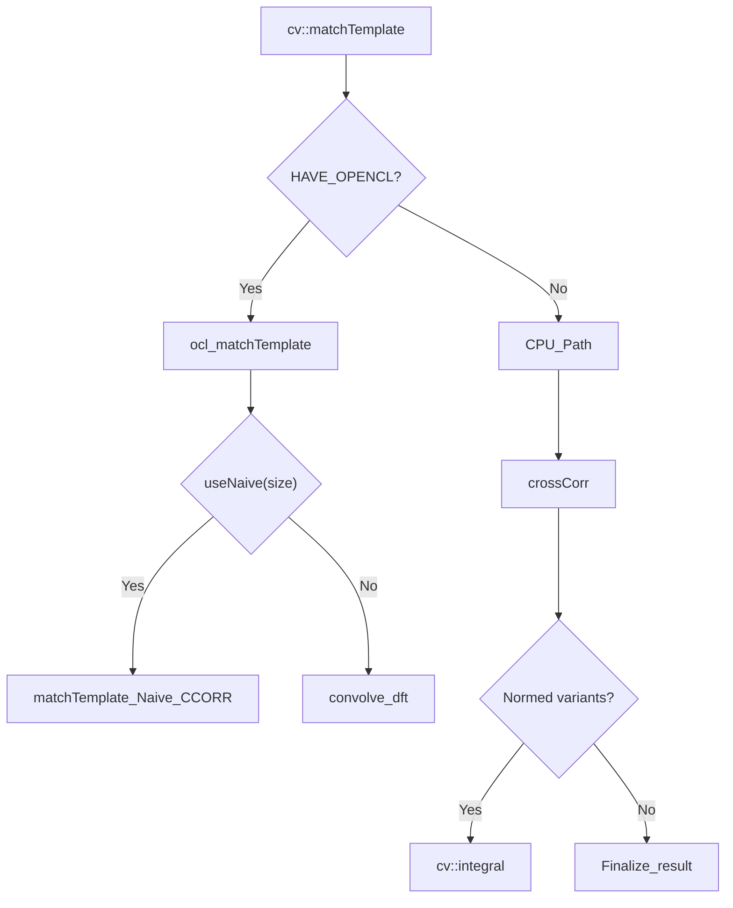
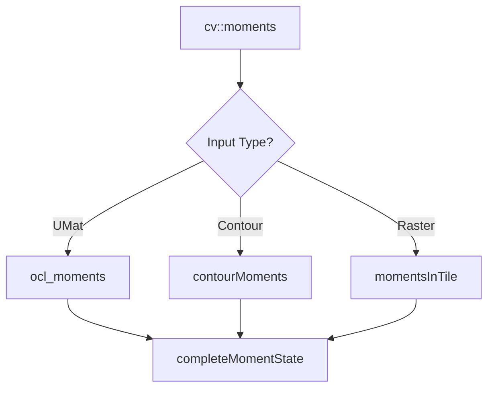
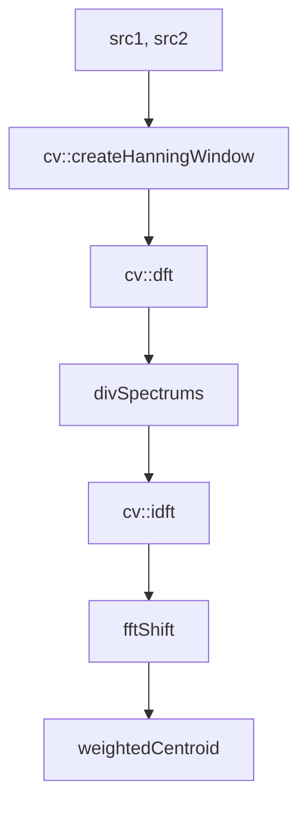

<!-- source: DeepWiki mcp.deepwiki.com · repo opencv/opencv · page 4.3 Thresholding, Template Matching, and Moments · fetched 2026-10-30 -->

# Thresholding, Template Matching, and Moments

<details>
<summary>Relevant source files</summary>

The following files were used as context for generating this wiki page:

- [hal/ipp/src/matchtemplate_ipp.cpp](hal/ipp/src/matchtemplate_ipp.cpp)
- [modules/core/misc/js/gen_dict.json](modules/core/misc/js/gen_dict.json)
- [modules/core/src/opencl/convert.cl](modules/core/src/opencl/convert.cl)
- [modules/core/src/opencl/copymakeborder.cl](modules/core/src/opencl/copymakeborder.cl)
- [modules/core/test/ocl/test_matrix_operation.cpp](modules/core/test/ocl/test_matrix_operation.cpp)
- [modules/core/test/test_dxt.cpp](modules/core/test/test_dxt.cpp)
- [modules/imgproc/misc/js/gen_dict.json](modules/imgproc/misc/js/gen_dict.json)
- [modules/imgproc/perf/opencl/perf_filters.cpp](modules/imgproc/perf/opencl/perf_filters.cpp)
- [modules/imgproc/perf/opencl/perf_imgproc.cpp](modules/imgproc/perf/opencl/perf_imgproc.cpp)
- [modules/imgproc/perf/opencl/perf_matchTemplate.cpp](modules/imgproc/perf/opencl/perf_matchTemplate.cpp)
- [modules/imgproc/perf/perf_corners.cpp](modules/imgproc/perf/perf_corners.cpp)
- [modules/imgproc/perf/perf_phasecorr.cpp](modules/imgproc/perf/perf_phasecorr.cpp)
- [modules/imgproc/src/canny.cpp](modules/imgproc/src/canny.cpp)
- [modules/imgproc/src/corner.cpp](modules/imgproc/src/corner.cpp)
- [modules/imgproc/src/deriv.cpp](modules/imgproc/src/deriv.cpp)
- [modules/imgproc/src/filterengine.hpp](modules/imgproc/src/filterengine.hpp)
- [modules/imgproc/src/histogram.cpp](modules/imgproc/src/histogram.cpp)
- [modules/imgproc/src/opencl/calc_back_project.cl](modules/imgproc/src/opencl/calc_back_project.cl)
- [modules/imgproc/src/opencl/canny.cl](modules/imgproc/src/opencl/canny.cl)
- [modules/imgproc/src/opencl/filter2D.cl](modules/imgproc/src/opencl/filter2D.cl)
- [modules/imgproc/src/opencl/integral_sum.cl](modules/imgproc/src/opencl/integral_sum.cl)
- [modules/imgproc/src/opencl/match_template.cl](modules/imgproc/src/opencl/match_template.cl)
- [modules/imgproc/src/opencl/medianFilter.cl](modules/imgproc/src/opencl/medianFilter.cl)
- [modules/imgproc/src/opencl/pyr_down.cl](modules/imgproc/src/opencl/pyr_down.cl)
- [modules/imgproc/src/opencl/pyr_up.cl](modules/imgproc/src/opencl/pyr_up.cl)
- [modules/imgproc/src/opencl/pyramid_up.cl](modules/imgproc/src/opencl/pyramid_up.cl)
- [modules/imgproc/src/phasecorr.cpp](modules/imgproc/src/phasecorr.cpp)
- [modules/imgproc/src/pyramids.cpp](modules/imgproc/src/pyramids.cpp)
- [modules/imgproc/src/templmatch.cpp](modules/imgproc/src/templmatch.cpp)
- [modules/imgproc/src/thresh.cpp](modules/imgproc/src/thresh.cpp)
- [modules/imgproc/test/ocl/test_canny.cpp](modules/imgproc/test/ocl/test_canny.cpp)
- [modules/imgproc/test/ocl/test_filter2d.cpp](modules/imgproc/test/ocl/test_filter2d.cpp)
- [modules/imgproc/test/ocl/test_histogram.cpp](modules/imgproc/test/ocl/test_histogram.cpp)
- [modules/imgproc/test/ocl/test_imgproc.cpp](modules/imgproc/test/ocl/test_imgproc.cpp)
- [modules/imgproc/test/ocl/test_match_template.cpp](modules/imgproc/test/ocl/test_match_template.cpp)
- [modules/imgproc/test/ocl/test_medianfilter.cpp](modules/imgproc/test/ocl/test_medianfilter.cpp)
- [modules/imgproc/test/ocl/test_pyramids.cpp](modules/imgproc/test/ocl/test_pyramids.cpp)
- [modules/imgproc/test/ocl/test_sepfilter2d.cpp](modules/imgproc/test/ocl/test_sepfilter2d.cpp)
- [modules/imgproc/test/test_canny.cpp](modules/imgproc/test/test_canny.cpp)
- [modules/imgproc/test/test_histograms.cpp](modules/imgproc/test/test_histograms.cpp)
- [modules/imgproc/test/test_pc.cpp](modules/imgproc/test/test_pc.cpp)
- [modules/imgproc/test/test_pyramid.cpp](modules/imgproc/test/test_pyramid.cpp)
- [modules/imgproc/test/test_templmatch.cpp](modules/imgproc/test/test_templmatch.cpp)
- [modules/imgproc/test/test_templmatchmask.cpp](modules/imgproc/test/test_templmatchmask.cpp)
- [modules/imgproc/test/test_thresh.cpp](modules/imgproc/test/test_thresh.cpp)
- [modules/photo/include/opencv2/photo/segmentation.hpp](modules/photo/include/opencv2/photo/segmentation.hpp)
- [modules/photo/misc/js/gen_dict.json](modules/photo/misc/js/gen_dict.json)
- [modules/photo/perf/perf_intelligent_scissors.cpp](modules/photo/perf/perf_intelligent_scissors.cpp)
- [modules/photo/src/intelligent_scissors.cpp](modules/photo/src/intelligent_scissors.cpp)
- [modules/photo/test/test_intelligent_scissors.cpp](modules/photo/test/test_intelligent_scissors.cpp)
- [samples/cpp/tutorial_code/snippets/photo_segmentation.cpp](samples/cpp/tutorial_code/snippets/photo_segmentation.cpp)

</details>


This page covers three related pixel-level and region-level analysis subsystems in `opencv_imgproc`: the `threshold` function (including Otsu automatic threshold selection), the `matchTemplate` function (all six comparison methods), the `moments` and `HuMoments` functions, and `phaseCorrelate` for sub-pixel image registration. All are part of the `imgproc` module.

For filtering and color conversion (Canny, Gaussian blur, etc.), see [4.2](). For contour finding and structural analysis that consumes moment output, see [4.4]().

---

## Thresholding

### Overview

The entry point is `cv::threshold`, implemented in `modules/imgproc/src/thresh.cpp`. It classifies every pixel in a source image against a scalar threshold value and writes the result to a destination image of the same type [modules/imgproc/src/thresh.cpp:1-50]().

The function signature is:

```cpp
double cv::threshold(InputArray src, OutputArray dst,
                     double thresh, double maxval, int type)
```

The `type` parameter is a combination of a base threshold type and optional flags (`THRESH_OTSU`, `THRESH_TRIANGLE`). The return value is the computed threshold when Otsu or Triangle mode is active; otherwise it echoes the input `thresh`.

### Threshold Types

| Constant | Pixel rule | Applies to |
|---|---|---|
| `THRESH_BINARY` | `dst = src > thresh ? maxval : 0` | All supported depths |
| `THRESH_BINARY_INV` | `dst = src <= thresh ? maxval : 0` | All supported depths |
| `THRESH_TRUNC` | `dst = min(src, thresh)` | All supported depths |
| `THRESH_TOZERO` | `dst = src > thresh ? src : 0` | All supported depths |
| `THRESH_TOZERO_INV` | `dst = src <= thresh ? src : 0` | All supported depths |

The per-pixel logic is implemented by the inline templates `threshBinary`, `threshBinaryInv`, `threshTrunc`, `threshToZero`, and `threshToZeroInv` at [modules/imgproc/src/thresh.cpp:50-78]().

### Supported Data Types and Dispatch

The top-level dispatcher routes to type-specific internal functions:
- `thresh_8u` — `uchar`, uses a lookup table or SIMD acceleration [modules/imgproc/src/thresh.cpp:181-195]().
- SIMD paths use the universal intrinsics layer (`v_uint8`, `v_int16`, `v_float32`, etc.) so the same source compiles to SSE, AVX, NEON, or RVV depending on the build target [modules/imgproc/src/thresh.cpp:43-47]().

### Otsu Automatic Threshold Selection

When `type` includes `THRESH_OTSU`, the threshold value is computed automatically from the image histogram. This mode is restricted to `CV_8U` single-channel inputs, maximizing inter-class variance [modules/imgproc/src/thresh.cpp:1-100]().

**Sources:** [modules/imgproc/src/thresh.cpp:43-1310](), [modules/imgproc/test/test_thresh.cpp:1-100]()

---

## Template Matching

### Overview

`cv::matchTemplate` slides a template image over a source image and computes a comparison score at every valid position. The result is a single-channel `CV_32F` matrix of size `(W - w + 1) × (H - h + 1)` where `W×H` is the image size and `w×h` is the template size [modules/imgproc/src/templmatch.cpp:45-54]().

```cpp
void cv::matchTemplate(InputArray image, InputArray templ,
                       OutputArray result, int method,
                       InputArray mask = noArray())
```

### Comparison Methods

| Constant | Value | Formula | Best match |
|---|---|---|---|
| `TM_SQDIFF` | 0 | `Σ(I(x,y) - T(x,y))²` | Minimum |
| `TM_SQDIFF_NORMED` | 1 | normalized squared difference | Minimum → 0 |
| `TM_CCORR` | 2 | `Σ I(x,y)·T(x,y)` | Maximum |
| `TM_CCORR_NORMED` | 3 | normalized cross-correlation | Maximum → 1 |
| `TM_CCOEFF` | 4 | `Σ (I - Ī)·(T - T̄)` | Maximum |
| `TM_CCOEFF_NORMED` | 5 | normalized coefficient | Maximum → 1 |

### Computation Strategy: DFT vs. Naive

Title: matchTemplate computation flow


The core DFT-based convolution function is `crossCorr` [modules/imgproc/src/templmatch.cpp:56-170](). It multiplies spectra with `mulSpectrums` (conjugate multiplication gives cross-correlation).

### OpenCL Kernel Details

The OpenCL kernels are in [modules/imgproc/src/opencl/match_template.cl](). They are compiled conditionally using preprocessor flags such as `CCORR`, `SQDIFF`, and `CCOEFF` [modules/imgproc/src/templmatch.cpp:97-101]().

**Sources:** [modules/imgproc/src/templmatch.cpp:45-1051](), [modules/imgproc/src/opencl/match_template.cl:1-190]()

---

## Image Moments

### The `Moments` Struct

`cv::Moments` holds spatial, central, and normalized central moments. Central moments are translation-invariant, computed relative to the centroid `(cx, cy) = (m10/m00, m01/m00)` [modules/imgproc/src/histogram.cpp:1-50]().

### `cv::moments()` — Dispatch Chain

Title: moments execution dispatch


### Tiled Raster Computation

For raster images, `cv::moments` processes the image in tiles, deriving central and normalized moments from the spatial moments via `completeMomentState` [modules/imgproc/src/histogram.cpp:1-100]().

**Sources:** [modules/imgproc/src/histogram.cpp:1-191]()

---

## Phase Correlation

### Overview

`cv::phaseCorrelate` estimates the translational shift between two images at sub-pixel precision using the cross-power spectrum [modules/imgproc/src/phasecorr.cpp:1-50]().

Title: phaseCorrelate pipeline


### Key Helper Functions

| Function | File | Purpose |
|---|---|---|
| `magSpectrums` | [modules/imgproc/src/phasecorr.cpp:46-160]() | Computes magnitude of complex spectrum |
| `fftShift` | [modules/imgproc/src/phasecorr.cpp:162-200]() | Rearranges quadrants to put DC at center |

**Sources:** [modules/imgproc/src/phasecorr.cpp:1-484]()

---

## Acceleration Summary

| Function | CPU SIMD | IPP | OpenCL |
|---|---|---|---|
| `threshold` | Yes [modules/imgproc/src/thresh.cpp:45]() | Yes [modules/imgproc/src/thresh.cpp:197]() | Yes [modules/imgproc/src/thresh.cpp:44]() |
| `matchTemplate` | No (DFT-based) | Yes | Yes [modules/imgproc/src/templmatch.cpp:56]() |
| `moments` | Yes | Yes | Yes |
| `phaseCorrelate` | Inherits from `dft` | Inherits | No direct kernel |

**Sources:** [modules/imgproc/src/thresh.cpp:43-50](), [modules/imgproc/src/templmatch.cpp:56-60]()

---

