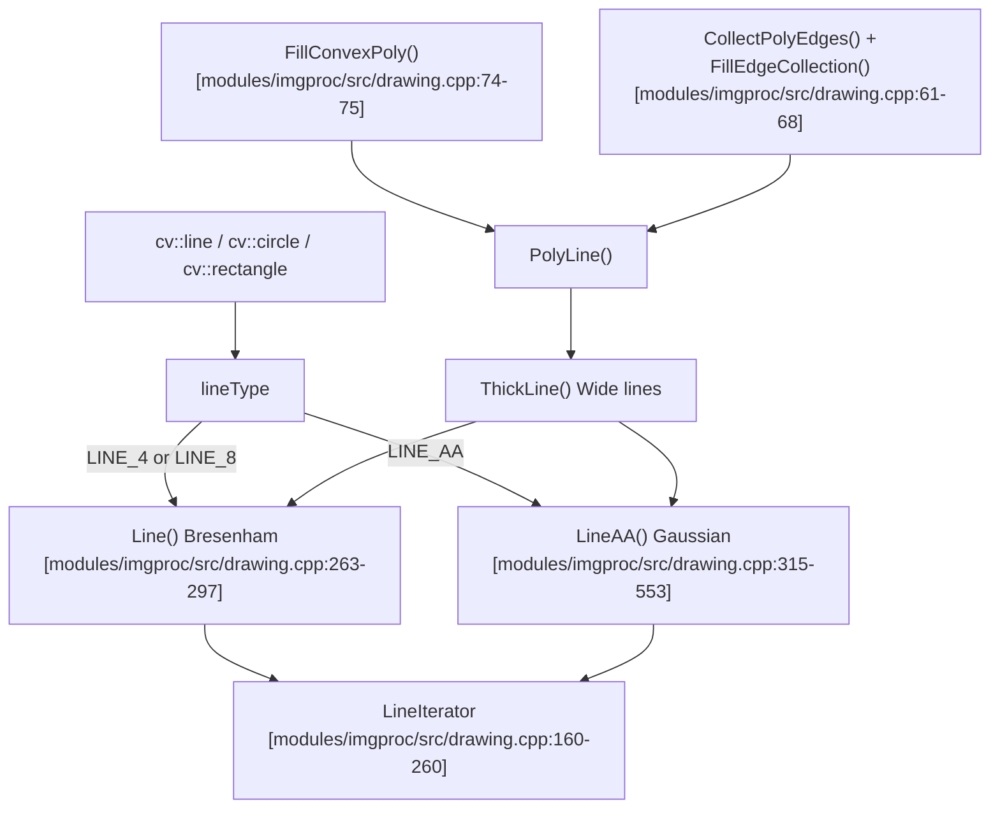
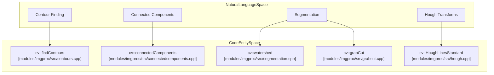

<!-- source: DeepWiki mcp.deepwiki.com · repo opencv/opencv · page 4.4 Drawing, Contours, and Structural Analysis · fetched 2026-10-30 -->

# Drawing, Contorurs, and Structural Analysis

<details>
<summary>Relevant source files</summary>

The following files were used as context for generating this wiki page:

- [doc/js_tutorials/js_gui/js_trackbar/js_trackbar.markdown](doc/js_tutorials/js_gui/js_trackbar/js_trackbar.markdown)
- [doc/py_tutorials/py_gui/py_trackbar/py_trackbar.markdown](doc/py_tutorials/py_gui/py_trackbar/py_trackbar.markdown)
- [doc/tutorials/imgproc/random_generator_and_text/random_generator_and_text.markdown](doc/tutorials/imgproc/random_generator_and_text/random_generator_and_text.markdown)
- [hal/ipp/src/distancetransform_ipp.cpp](hal/ipp/src/distancetransform_ipp.cpp)
- [hal/riscv-rvv/src/imgproc/resize.cpp](hal/riscv-rvv/src/imgproc/resize.cpp)
- [modules/core/include/opencv2/core/hal/msa_macros.h](modules/core/include/opencv2/core/hal/msa_macros.h)
- [modules/core/include/opencv2/core/optim.hpp](modules/core/include/opencv2/core/optim.hpp)
- [modules/core/src/batch_distance.cpp](modules/core/src/batch_distance.cpp)
- [modules/core/src/conjugate_gradient.cpp](modules/core/src/conjugate_gradient.cpp)
- [modules/core/src/downhill_simplex.cpp](modules/core/src/downhill_simplex.cpp)
- [modules/core/src/kmeans.cpp](modules/core/src/kmeans.cpp)
- [modules/core/src/lpsolver.cpp](modules/core/src/lpsolver.cpp)
- [modules/core/test/test_conjugate_gradient.cpp](modules/core/test/test_conjugate_gradient.cpp)
- [modules/core/test/test_downhill_simplex.cpp](modules/core/test/test_downhill_simplex.cpp)
- [modules/core/test/test_lpsolver.cpp](modules/core/test/test_lpsolver.cpp)
- [modules/imgproc/include/opencv2/imgproc/imgproc.hpp](modules/imgproc/include/opencv2/imgproc/imgproc.hpp)
- [modules/imgproc/misc/python/test/test_imgproc.py](modules/imgproc/misc/python/test/test_imgproc.py)
- [modules/imgproc/perf/perf_houghcircles.cpp](modules/imgproc/perf/perf_houghcircles.cpp)
- [modules/imgproc/perf/perf_houghlines.cpp](modules/imgproc/perf/perf_houghlines.cpp)
- [modules/imgproc/src/ccl_bolelli_forest.inc.hpp](modules/imgproc/src/ccl_bolelli_forest.inc.hpp)
- [modules/imgproc/src/ccl_bolelli_forest_firstline.inc.hpp](modules/imgproc/src/ccl_bolelli_forest_firstline.inc.hpp)
- [modules/imgproc/src/ccl_bolelli_forest_lastline.inc.hpp](modules/imgproc/src/ccl_bolelli_forest_lastline.inc.hpp)
- [modules/imgproc/src/ccl_bolelli_forest_singleline.inc.hpp](modules/imgproc/src/ccl_bolelli_forest_singleline.inc.hpp)
- [modules/imgproc/src/connectedcomponents.cpp](modules/imgproc/src/connectedcomponents.cpp)
- [modules/imgproc/src/cornersubpix.cpp](modules/imgproc/src/cornersubpix.cpp)
- [modules/imgproc/src/distransform.cpp](modules/imgproc/src/distransform.cpp)
- [modules/imgproc/src/drawing.cpp](modules/imgproc/src/drawing.cpp)
- [modules/imgproc/src/grabcut.cpp](modules/imgproc/src/grabcut.cpp)
- [modules/imgproc/src/hough.cpp](modules/imgproc/src/hough.cpp)
- [modules/imgproc/src/opencl/histogram.cl](modules/imgproc/src/opencl/histogram.cl)
- [modules/imgproc/src/opencl/hough_lines.cl](modules/imgproc/src/opencl/hough_lines.cl)
- [modules/imgproc/src/samplers.cpp](modules/imgproc/src/samplers.cpp)
- [modules/imgproc/src/segmentation.cpp](modules/imgproc/src/segmentation.cpp)
- [modules/imgproc/test/ocl/test_houghlines.cpp](modules/imgproc/test/ocl/test_houghlines.cpp)
- [modules/imgproc/test/test_connectedcomponents.cpp](modules/imgproc/test/test_connectedcomponents.cpp)
- [modules/imgproc/test/test_contours.cpp](modules/imgproc/test/test_contours.cpp)
- [modules/imgproc/test/test_cornersubpix.cpp](modules/imgproc/test/test_cornersubpix.cpp)
- [modules/imgproc/test/test_distancetransform.cpp](modules/imgproc/test/test_distancetransform.cpp)
- [modules/imgproc/test/test_drawing.cpp](modules/imgproc/test/test_drawing.cpp)
- [modules/imgproc/test/test_grabcut.cpp](modules/imgproc/test/test_grabcut.cpp)
- [modules/imgproc/test/test_houghcircles.cpp](modules/imgproc/test/test_houghcircles.cpp)
- [modules/imgproc/test/test_houghlines.cpp](modules/imgproc/test/test_houghlines.cpp)
- [modules/imgproc/test/test_imgproc_umat.cpp](modules/imgproc/test/test_imgproc_umat.cpp)
- [modules/imgproc/test/test_resize_bitexact.cpp](modules/imgproc/test/test_resize_bitexact.cpp)
- [modules/imgproc/test/test_watershed.cpp](modules/imgproc/test/test_watershed.cpp)
- [modules/photo/test/test_denoise_tvl1.cpp](modules/photo/test/test_denoise_tvl1.cpp)
- [modules/python/test/test_watershed.py](modules/python/test/test_watershed.py)
- [samples/cpp/connected_components.cpp](samples/cpp/connected_components.cpp)
- [samples/cpp/demhist.cpp](samples/cpp/demhist.cpp)
- [samples/cpp/tutorial_code/snippets/imgproc_HoughLinesPointSet.cpp](samples/cpp/tutorial_code/snippets/imgproc_HoughLinesPointSet.cpp)

</details>


This page covers drawing primitives and text, contour finding and approximation, connected components labeling, distance transform, watershed/grabcut segmentation, Hough line and circle transforms, and structural analysis utilities implemented in the `opencv_imgproc` module under `modules/imgproc/`.

For image filtering, edge detection, and color conversion, see page [4.2](). For thresholding, moments, and template matching, see page [4.3](). For geometric image transforms, see page [4.1]().

---

## Drawing Primitives

### Overview

All drawing functions take a `Mat` image as `InputOutputArray` and write to it directly. Key shared parameters:

| Parameter | Description |
|-----------|-------------|
| `color` | `Scalar` in BGR order; for grayscale only the first element is used |
| `thickness` | Positive = outline width; `FILLED` (-1) = solid fill |
| `lineType` | Controls rendering quality (see table below) |
| `shift` | Fixed-point fractional bits in coordinates (sub-pixel precision) |

**Line type constants** (defined in `imgproc.hpp`):

| Constant | Value | Description |
|----------|-------|-------------|
| `LINE_4` | 4 | 4-connected Bresenham |
| `LINE_8` | 8 | 8-connected Bresenham (default) |
| `LINE_AA` | 16 | Antialiased (8-bit images only) |
| `FILLED` | -1 | Filled solid shape |

### Core Drawing Functions

| Function | Output |
|----------|--------|
| `line` | Segment between two `Point`s |
| `arrowedLine` | Segment with arrowhead tip |
| `rectangle` | Axis-aligned rectangle |
| `circle` | Circle |
| `ellipse` | Full or partial ellipse / arc |
| `fillConvexPoly` | Filled convex polygon (fast path) |
| `fillPoly` | Filled arbitrary polygon |
| `polylines` | Open or closed polyline outline |
| `drawMarker` | Predefined marker shapes (cross, star, etc.) |
| `drawContours` | Renders contours from `findContours` output |
| `putText` | Hershey-font rasterized text |
| `getTextSize` | Computes text bounding box without drawing |

### Sub-pixel Coordinate Encoding

The drawing engine uses a 16-bit fixed-point internal representation. The constant `XY_SHIFT = 16` is set at [modules/imgproc/src/drawing.cpp:47]() and `XY_ONE = 1 << XY_SHIFT`. When a caller passes `shift = s`, a logical coordinate `x` is passed as `x << s`. This allows antialiased shapes to be drawn at sub-pixel positions without floating-point coordinates.

### Internal Rendering Pipeline

**Drawing Primitive Rendering Pipeline**



Sources: [modules/imgproc/src/drawing.cpp:46-553](), [modules/imgproc/include/opencv2/imgproc.hpp:48-64]()

### `LineIterator`

`LineIterator` is a public class that iterates over all pixel addresses between two points using Bresenham's algorithm. It is used internally by all line-drawing routines and is also available directly:

[modules/imgproc/src/drawing.cpp:160-260]()

It supports both 4-connected and 8-connected traversal. When constructed with a `Mat`, it operates in pointer mode (the `++` operator advances an internal `uchar*`). When constructed without a `Mat`, it returns `Point` values only. The iterator handles clipping via `clipLine` [modules/imgproc/src/drawing.cpp:81-158]().

### Antialiased Lines

`LineAA` [modules/imgproc/src/drawing.cpp:315-553]() blends two neighboring pixels per step using a pre-computed Gaussian-shaped filter. Antialiasing is only applied to 1-, 3-, and 4-channel `CV_8U` images. For other types, `LineAA` falls back to the non-antialiased `Line`.

### Text Rendering

`putText` uses Hershey vector fonts. Available face constants:

| Constant | Style |
|----------|-------|
| `FONT_HERSHEY_SIMPLEX` | Normal-weight sans-serif |
| `FONT_HERSHEY_PLAIN` | Small sans-serif |
| `FONT_HERSHEY_DUPLEX` | Double-stroke sans-serif |
| `FONT_HERSHEY_COMPLEX` | Serif |
| `FONT_HERSHEY_TRIPLEX` | Triple-stroke serif |
| `FONT_HERSHEY_SCRIPT_SIMPLEX` | Cursive |
| `FONT_ITALIC` | Italic modifier (bitwise OR with any face) |

`getTextSize` computes the bounding box and baseline of a string without drawing.

Sources: [modules/imgproc/src/drawing.cpp:46-553]()

---

## Contour Finding and Approximation

### `findContours`

`findContours` scans a binary image, modifying pixel values in place (replacing them with border index labels), and outputs contours as vectors of `Point`.

```cpp
findContours(InputArray image,
             OutputArrayOfArrays contours,
             OutputArray hierarchy,
             int mode,
             int method,
             Point offset = Point())
```

### Retrieval Modes (`RetrievalModes`)

| Constant | Value | Effect |
|----------|-------|--------|
| `RETR_EXTERNAL` | 0 | Outermost contours only; no hierarchy |
| `RETR_LIST` | 1 | All contours, flat list, no hierarchy |
| `RETR_CCOMP` | 2 | Two-level: outer boundary and holes |
| `RETR_TREE` | 3 | Full recursive hierarchy |

### Approximation Modes (`ContourApproximationModes`)

| Constant | Value | Effect |
|----------|-------|--------|
| `CHAIN_APPROX_NONE` | 1 | Store every border pixel |
| `CHAIN_APPROX_SIMPLE` | 2 | Compress horizontal/vertical/diagonal runs |

### Contour Hierarchy

When `mode` is `RETR_CCOMP` or `RETR_TREE`, a `hierarchy` vector of `Vec4i` is populated. For contour index `i`:

| `hierarchy[i]` index | Meaning |
|----------------------|---------|
| `[0]` | Index of next sibling |
| `[1]` | Index of previous sibling |
| `[2]` | Index of first child |
| `[3]` | Index of parent |

A value of `-1` means no such entry exists.

Sources: [modules/imgproc/test/test_contours.cpp:102-109](), [modules/imgproc/test/test_contours.cpp:153-155]()

---

## Connected Components Labeling

### API

`connectedComponents` assigns a unique integer label to each disjoint region in a binary image. `connectedComponentsWithStats` additionally computes spatial metrics.

### Algorithm Selection (`ConnectedComponentsAlgorithmsTypes`)

| Constant | Algorithm |
|----------|-----------|
| `CCL_WU` | Wu's algorithm |
| `CCL_GRANA` | Grana's BBDT |
| `CCL_BOLELLI` | Bolelli's Spaghetti |
| `CCL_SPAGHETTI` | Spaghetti |
| `CCL_BBDT` | Block-Based Decision Tree |

### Internal Statistics Accumulation

The `CCStatsOp` struct [modules/imgproc/src/connectedcomponents.cpp:91-100]() accumulates per-component bounding-box limits and centroid sums during labeling passes. A `NoOp` struct [modules/imgproc/src/connectedcomponents.cpp:55-85]() is used as a zero-cost policy when only labels are needed (no stats).

| Stat Constant | Index | Description |
|---------------|-------|-------------|
| `CC_STAT_LEFT` | 0 | Bounding box left x |
| `CC_STAT_TOP` | 1 | Bounding box top y |
| `CC_STAT_WIDTH` | 2 | Bounding box width |
| `CC_STAT_HEIGHT` | 3 | Bounding box height |
| `CC_STAT_AREA` | 4 | Total pixel count |

Sources: [modules/imgproc/src/connectedcomponents.cpp:55-176](), [modules/imgproc/test/test_connectedcomponents.cpp:81-82]()

---

## Distance Transform

`distanceTransform` calculates the distance to the closest zero pixel for each pixel of the source image.

### Distance Metrics

| Constant | Metric | Implementation |
|----------|--------|----------------|
| `DIST_L1` | Manhattan | Chamfer 3x3 |
| `DIST_L2` | Euclidean | Precise or Chamfer |
| `DIST_C` | Chessboard | Chamfer 3x3 |

### Implementation Details
For Chamfer transforms, the library uses 3x3 [modules/imgproc/src/distransform.cpp:170-220]() or 5x5 masks. The precise Euclidean distance uses a specialized two-pass algorithm. The implementation uses fixed-point arithmetic `DIST_SHIFT = 16` [modules/imgproc/src/distransform.cpp:48]() and `CV_FLT_TO_FIX` [modules/imgproc/src/distransform.cpp:49]() for performance.

Sources: [modules/imgproc/src/distransform.cpp:48-96]()

---

## Watershed and GrabCut Segmentation

### Watershed Segmentation
The `watershed` algorithm [modules/imgproc/src/segmentation.cpp:88-216]() treats the image as a topographic surface.
- Uses a priority queue of `WSNode` [modules/imgproc/src/segmentation.cpp:52-57]() structures.
- `WSQueue` [modules/imgproc/src/segmentation.cpp:60-64]() manages these nodes.
- Pixels are labeled as `WSHED` (-1) or `IN_QUEUE` (-2) during processing [modules/imgproc/src/segmentation.cpp:93-94]().

### GrabCut Segmentation
`grabcut` performs interactive foreground extraction using iterated graph cuts as described by Rother et al.
- Implemented via the `GMM` (Gaussian Mixture Model) class [modules/imgproc/src/grabcut.cpp:60-88]() which manages 5 components per region.
- Relies on underlying min-cut solvers in `detail::GCGraph` [modules/imgproc/src/grabcut.cpp:43]() to minimize energy functions balancing regional color distributions and boundary smoothness.

Sources: [modules/imgproc/src/segmentation.cpp:49-160](), [modules/imgproc/src/grabcut.cpp:60-111]()

---

## Hough Transforms

### Hough Line Transform

**Standard Hough (`HOUGH_STANDARD`)**  
Votes each edge pixel into a 2D `(rho, theta)` accumulator. Implementation: `HoughLinesStandard` [modules/imgproc/src/hough.cpp:120-172]().
- Uses `computeNumangle` [modules/imgproc/src/hough.cpp:72-81]() to determine angular resolution.
- Uses `createTrigTable` [modules/imgproc/src/hough.cpp:83-93]() for pre-computed sin/cos values.
- Local maxima are found via `findLocalMaximums` [modules/imgproc/src/hough.cpp:96-108]().

**OpenCL Acceleration**  
The OpenCL kernel `fill_accum_local` [modules/imgproc/src/opencl/hough_lines.cl:89-136]() uses local memory to speed up accumulator updates.

### Hough Circle Transform

`HoughCircles` uses the 21HT gradient method. Implementation: `HoughCirclesImpl` [modules/imgproc/src/hough.cpp]().

Sources: [modules/imgproc/src/hough.cpp:54-172](), [modules/imgproc/src/opencl/hough_lines.cl:57-136]()

---

## Structural Analysis Module Map

**imgproc Structural Analysis and Segmentation Code Map**



Sources: [modules/imgproc/src/drawing.cpp](), [modules/imgproc/src/connectedcomponents.cpp](), [modules/imgproc/src/hough.cpp](), [modules/imgproc/src/distransform.cpp](), [modules/imgproc/src/segmentation.cpp](), [modules/imgproc/src/grabcut.cpp]()

---

