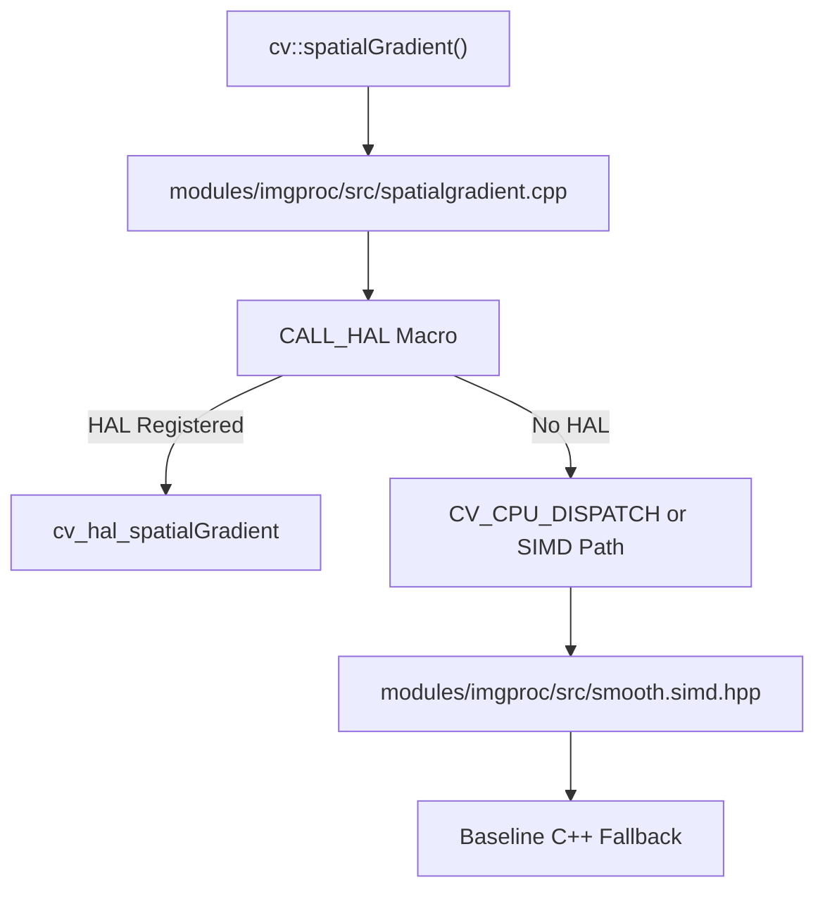
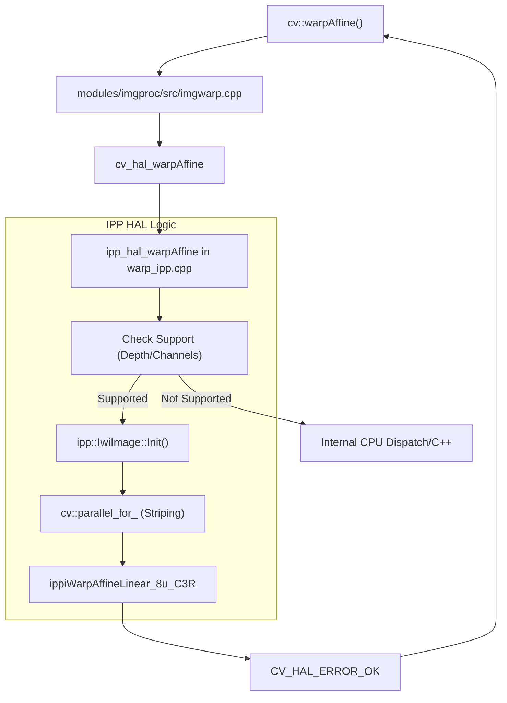

<!-- source: DeepWiki mcp.deepwiki.com · repo opencv/opencv · page 4.5 imgproc HAL, IPP, and Architecture-Specific Backends · fetched 2026-10-30 -->

# imgproc HAL, IPP, and Architecture-Specific Backends

Relevant source files

The following files were used as context for generating this wiki page:

- [3rdparty/ippicv/ippicv.cmake](3rdparty/ippicv/ippicv.cmake)
- [cmake/templates/OpenCVConfig-FastCV.cmake.in](cmake/templates/OpenCVConfig-FastCV.cmake.in)
- [hal/ipp/CMakeLists.txt](hal/ipp/CMakeLists.txt)
- [hal/ipp/include/ipp_hal_core.hpp](hal/ipp/include/ipp_hal_core.hpp)
- [hal/ipp/include/ipp_hal_imgproc.hpp](hal/ipp/include/ipp_hal_imgproc.hpp)
- [hal/ipp/include/ipp_utils.hpp](hal/ipp/include/ipp_utils.hpp)
- [hal/ipp/src/box_filter_ipp.cpp](hal/ipp/src/box_filter_ipp.cpp)
- [hal/ipp/src/cart_polar_ipp.cpp](hal/ipp/src/cart_polar_ipp.cpp)
- [hal/ipp/src/filter_ipp.cpp](hal/ipp/src/filter_ipp.cpp)
- [hal/ipp/src/math_ipp.cpp](hal/ipp/src/math_ipp.cpp)
- [hal/ipp/src/mean_ipp.cpp](hal/ipp/src/mean_ipp.cpp)
- [hal/ipp/src/minmax_ipp.cpp](hal/ipp/src/minmax_ipp.cpp)
- [hal/ipp/src/norm_ipp.cpp](hal/ipp/src/norm_ipp.cpp)
- [hal/ipp/src/sum_ipp.cpp](hal/ipp/src/sum_ipp.cpp)
- [hal/ipp/src/transforms_ipp.cpp](hal/ipp/src/transforms_ipp.cpp)
- [hal/ipp/src/warp_ipp.cpp](hal/ipp/src/warp_ipp.cpp)
- [hal/riscv-rvv/include/imgproc.hpp](hal/riscv-rvv/include/imgproc.hpp)
- [hal/riscv-rvv/src/core/mean.cpp](hal/riscv-rvv/src/core/mean.cpp)
- [hal/riscv-rvv/src/imgproc/canny.cpp](hal/riscv-rvv/src/imgproc/canny.cpp)
- [hal/riscv-rvv/src/imgproc/histogram.cpp](hal/riscv-rvv/src/imgproc/histogram.cpp)
- [hal/riscv-rvv/src/imgproc/integral.cpp](hal/riscv-rvv/src/imgproc/integral.cpp)
- [hal/riscv-rvv/src/imgproc/laplacian.cpp](hal/riscv-rvv/src/imgproc/laplacian.cpp)
- [hal/riscv-rvv/src/imgproc/scharr.cpp](hal/riscv-rvv/src/imgproc/scharr.cpp)
- [hal/riscv-rvv/src/imgproc/sobel.cpp](hal/riscv-rvv/src/imgproc/sobel.cpp)
- [hal/riscv-rvv/src/imgproc/spatialgradient.cpp](hal/riscv-rvv/src/imgproc/spatialgradient.cpp)
- [modules/core/perf/perf_dft.cpp](modules/core/perf/perf_dft.cpp)
- [modules/core/perf/perf_dot.cpp](modules/core/perf/perf_dot.cpp)
- [modules/core/perf/perf_math.cpp](modules/core/perf/perf_math.cpp)
- [modules/core/src/mathfuncs_core.dispatch.cpp](modules/core/src/mathfuncs_core.dispatch.cpp)
- [modules/core/src/mathfuncs_core.simd.hpp](modules/core/src/mathfuncs_core.simd.hpp)
- [modules/core/test/test_hal_core.cpp](modules/core/test/test_hal_core.cpp)
- [modules/imgproc/include/opencv2/imgproc/hal/hal.hpp](modules/imgproc/include/opencv2/imgproc/hal/hal.hpp)
- [modules/imgproc/perf/perf_laplacian.cpp](modules/imgproc/perf/perf_laplacian.cpp)
- [modules/imgproc/perf/perf_spatialgradient.cpp](modules/imgproc/perf/perf_spatialgradient.cpp)
- [modules/imgproc/src/box_filter.dispatch.cpp](modules/imgproc/src/box_filter.dispatch.cpp)
- [modules/imgproc/src/box_filter.simd.hpp](modules/imgproc/src/box_filter.simd.hpp)
- [modules/imgproc/src/filter.dispatch.cpp](modules/imgproc/src/filter.dispatch.cpp)
- [modules/imgproc/src/filter.hpp](modules/imgproc/src/filter.hpp)
- [modules/imgproc/src/filter.simd.hpp](modules/imgproc/src/filter.simd.hpp)
- [modules/imgproc/src/fixedpoint.inl.hpp](modules/imgproc/src/fixedpoint.inl.hpp)
- [modules/imgproc/src/hal_replacement.hpp](modules/imgproc/src/hal_replacement.hpp)
- [modules/imgproc/src/median_blur.dispatch.cpp](modules/imgproc/src/median_blur.dispatch.cpp)
- [modules/imgproc/src/morph.dispatch.cpp](modules/imgproc/src/morph.dispatch.cpp)
- [modules/imgproc/src/morph.simd.hpp](modules/imgproc/src/morph.simd.hpp)
- [modules/imgproc/src/smooth.dispatch.cpp](modules/imgproc/src/smooth.dispatch.cpp)
- [modules/imgproc/src/smooth.simd.hpp](modules/imgproc/src/smooth.simd.hpp)
- [modules/imgproc/src/spatialgradient.cpp](modules/imgproc/src/spatialgradient.cpp)
- [modules/imgproc/test/test_filter.cpp](modules/imgproc/test/test_filter.cpp)
- [modules/imgproc/test/test_smooth_bitexact.cpp](modules/imgproc/test/test_smooth_bitexact.cpp)
- [modules/imgproc/test/test_structuring_element.cpp](modules/imgproc/test/test_structuring_element.cpp)
- [platforms/android/default.config.py](platforms/android/default.config.py)
- [platforms/android/fastcv.config.py](platforms/android/fastcv.config.py)

The `imgproc` module employs a multi-layered optimization strategy to achieve high performance across diverse hardware. This architecture allows OpenCV to swap generic C++ implementations for highly optimized routines provided by Intel Integrated Performance Primitives (IPP), architecture-specific Hardware Abstraction Layers (HAL), or SIMD-accelerated kernels.

## Architecture Overview

The optimization flow in `imgproc` typically follows a hierarchical dispatch mechanism. When a user calls a function like `cv::filter2D` or `cv::cvtColor`, the library attempts to execute the most efficient implementation available in the following order:
1. **OpenCL / Transparent API**: If a `UMat` is used and OpenCL is available.
2. **HAL Replacement**: If a hardware-specific backend (like IPP or a custom HAL) provides an optimized version.
3. **CPU Dispatch (SIMD)**: If no HAL replacement is found, the library runs a SIMD-optimized kernel (SSE, AVX, NEON, RVV) selected at runtime based on the CPU features.
4. **Baseline C++**: The fallback implementation.

### Natural Language to Code Entity Map

| System Concept | Code Entity | Role |
| :--- | :--- | :--- |
| **HAL Interface** | `modules/imgproc/src/hal_replacement.hpp` | Defines the C-style hooks for external backends. |
| **IPP Backend** | `hal/ipp/include/ipp_hal_imgproc.hpp` | Bridges OpenCV HAL calls to Intel IPP functions. |
| **SIMD Dispatcher** | `modules/imgproc/src/filter.dispatch.cpp` | Manages runtime selection of SIMD kernels. |
| **Universal Intrinsics** | `modules/core/include/opencv2/core/hal/intrin.hpp` | Abstract SIMD API used by `imgproc` kernels. |
| **RVV Backend** | `hal/riscv-rvv/include/imgproc.hpp` | RISC-V Vector extension implementation of HAL. |

Sources: [modules/imgproc/src/hal_replacement.hpp:45-68](), [hal/ipp/include/ipp_hal_imgproc.hpp:18-40](), [modules/imgproc/src/filter.dispatch.cpp:50-58](), [modules/imgproc/src/spatialgradient.cpp:116-121]().

---

## The HAL Replacement Layer

The Hardware Abstraction Layer (HAL) provides a set of function pointers and macros that allow third-party libraries to override OpenCV's default behavior without modifying the core logic of the `imgproc` module.

### Implementation Pattern: `CALL_HAL`
Most `imgproc` functions use the `CALL_HAL` macro. This macro checks if a HAL implementation is registered for the specific operation and data type. If the HAL function returns `CV_HAL_ERROR_OK`, the function returns immediately; otherwise, it falls back to the internal implementation.

**Example: Spatial Gradient Dispatch**
In `cv::spatialGradient`, the HAL is invoked before the SIMD/C++ loops:
[modules/imgproc/src/spatialgradient.cpp:116-121]()

### HAL Interface Definitions
The `hal_replacement.hpp` file contains the `inline` wrappers that return `CV_HAL_ERROR_NOT_IMPLEMENTED` by default. Backends like IPP override these by defining the corresponding macro (e.g., `#define cv_hal_filter_stateless ...`).

**Key HAL Structures:**
* `cvhalFilter2D`: A dummy structure used to store backend-specific filtering contexts (e.g., IPP's `IwiFilterPipeline`). [modules/imgproc/src/hal_replacement.hpp:87-87]()
* `hal_ni_filter_stateless`: The entry point for stateless 2D filtering. [modules/imgproc/src/hal_replacement.hpp:116-121]()

Sources: [modules/imgproc/src/hal_replacement.hpp:70-121](), [modules/imgproc/src/spatialgradient.cpp:96-121]().

---

## IPP Backend Integration

Intel IPP is integrated via a dedicated HAL implementation located in `hal/ipp`. This backend translates OpenCV's HAL calls into IPP's Image Processing for Windows (IW) or core IPP calls.

### Backend Structure and CMake Integration
The IPP HAL is built as a static library `ipphal` within the `3rdparty` infrastructure, governed by CMake configurations:
* **Headers**: `ipp_hal_imgproc.hpp` maps `cv_hal_*` macros to `ipp_hal_*` functions. [hal/ipp/include/ipp_hal_imgproc.hpp:21-25]()
* **Source**: Files like `warp_ipp.cpp` implement the logic to handle border types, interpolation, and multi-threading via `parallel_for_`. [hal/ipp/src/warp_ipp.cpp:81-156]()
* **Package Management**: Download scripts like `3rdparty/ippicv/ippicv.cmake` fetch prebuilt IPPICV binaries matching the platform and architecture targets. [3rdparty/ippicv/ippicv.cmake:1-60]()

### Diagram: IPP HAL Data Flow
This diagram illustrates how a call to `cv::warpAffine` is routed through the IPP HAL.

Sources: [hal/ipp/include/ipp_hal_imgproc.hpp:21-25](), [hal/ipp/src/warp_ipp.cpp:81-156](), [hal/ipp/CMakeLists.txt:11-30](), [3rdparty/ippicv/ippicv.cmake:1-60]().

---

## CPU Dispatch and SIMD Backends

When a HAL implementation is unavailable, `imgproc` uses a **CPU Dispatch** mechanism. This allows a single binary to contain multiple versions of the same algorithm, optimized for different SIMD instruction sets (SSE4.1, AVX2, NEON, RVV, etc.).

### Dispatch Mechanism
1. **`.dispatch.cpp`**: Contains the high-level logic and the `CV_CPU_DISPATCH` macro call. [modules/imgproc/src/filter.dispatch.cpp:173-175]()
2. **`.simd.hpp`**: Contains the actual implementation using **Universal Intrinsics** (`v_uint8`, `v_add`, etc.). This file is compiled multiple times with different compiler flags. [modules/imgproc/src/smooth.simd.hpp:85-90]()
3. **`CMakeLists.txt`**: Defines which instruction sets are enabled for target translation units.

### Architecture-Specific HALs (RVV, Carotene)
Backends like `riscv-rvv` provide optimized implementations specifically for architectures that might not be covered by standard IPP or where Universal Intrinsics are not sufficient.
* **RISC-V RVV**: Located in `hal/riscv-rvv/src/imgproc/`. It implements functions like `spatialGradient` using native RVV primitives.

Sources: [modules/imgproc/src/filter.dispatch.cpp:56-58](), [modules/imgproc/src/smooth.simd.hpp:1-93](), [modules/core/src/mathfuncs_core.simd.hpp:105-141]().

---

## Adding and Validating Optimized Paths

To add a new optimized path (e.g., a new HAL backend or a SIMD kernel):

1. **Define the Interface**: If adding a HAL, ensure the operation is defined in `modules/imgproc/src/hal_replacement.hpp`.
2. **Implement the Backend**: Create a new file in `hal/<backend>/src/` and map the `cv_hal_` macros in a corresponding header.
3. **Validation**: Use the `imgproc` test suite. The `ts` (Testing System) module provides base classes for consistency checking.
    * `CV_FilterBaseTest`: Used to validate filtering operations. [modules/imgproc/test/test_filter.cpp:46-69]()
    * **Accuracy Checks**: Tests compare the optimized output against a `REF_OUTPUT` generated by a reference C++ implementation. [modules/imgproc/test/test_filter.cpp:72-83]()

### Comparison Logic
The testing framework ensures that optimizations do not introduce regression or significant floating-point drift across different backends.

Sources: [modules/imgproc/src/hal_replacement.hpp:76-85](), [modules/imgproc/test/test_filter.cpp:46-156]().

---

