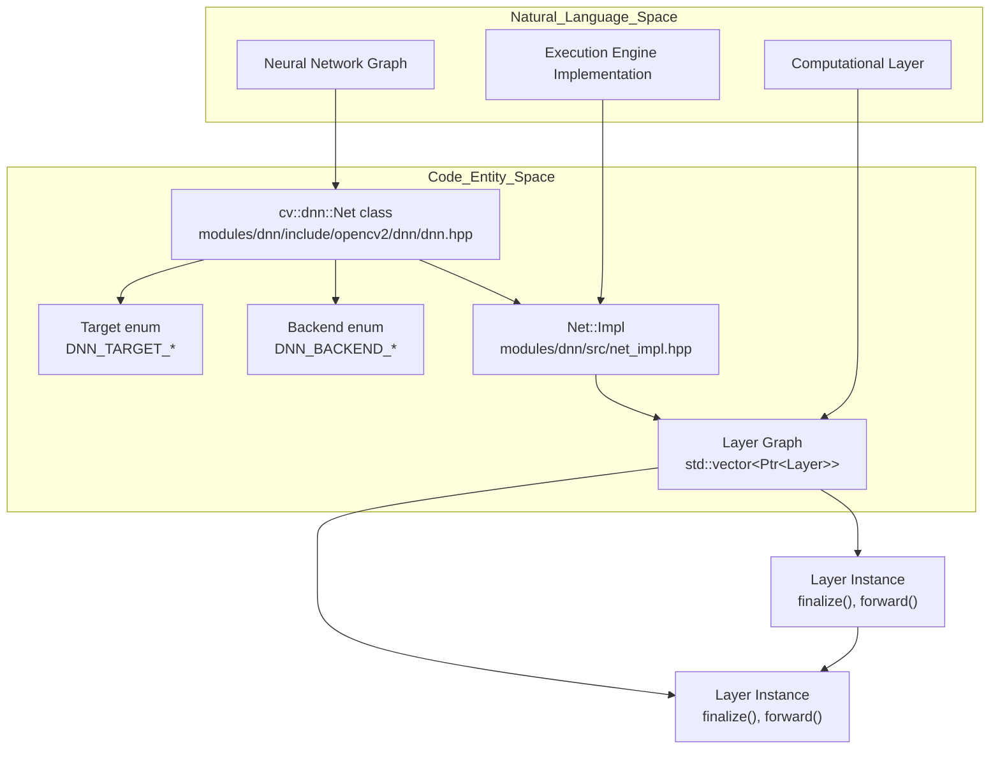
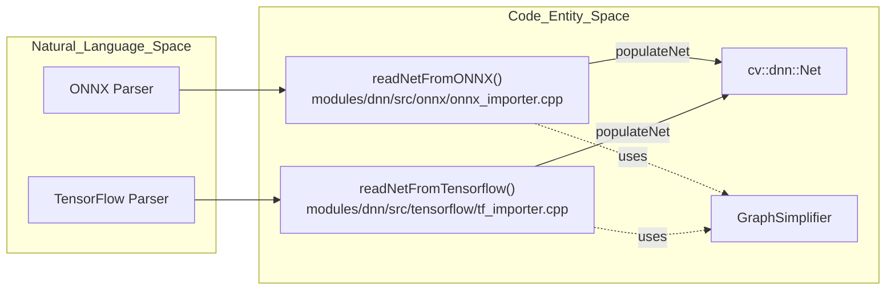

<!-- source: DeepWiki mcp.deepwiki.com · repo opencv/opencv · page 5 Deep Neural Networks (DNN) · fetched 2026-10-30 -->

# Deep Neural Networks (DNN)

Relevant source files

The following files were used as context for generating this wiki page:

- [cmake/OpenCVDetectInferenceEngine.cmake](cmake/OpenCVDetectInferenceEngine.cmake)
- [modules/dnn/CMakeLists.txt](modules/dnn/CMakeLists.txt)
- [modules/dnn/include/opencv2/dnn/dnn.hpp](modules/dnn/include/opencv2/dnn/dnn.hpp)
- [modules/dnn/misc/js/gen_dict.json](modules/dnn/misc/js/gen_dict.json)
- [modules/dnn/misc/objc/gen_dict.json](modules/dnn/misc/objc/gen_dict.json)
- [modules/dnn/misc/python/test/test_dnn.py](modules/dnn/misc/python/test/test_dnn.py)
- [modules/dnn/src/dnn.cpp](modules/dnn/src/dnn.cpp)
- [modules/dnn/src/dnn_common.hpp](modules/dnn/src/dnn_common.hpp)
- [modules/dnn/src/dnn_read.cpp](modules/dnn/src/dnn_read.cpp)
- [modules/dnn/src/graph_block_layout.cpp](modules/dnn/src/graph_block_layout.cpp)
- [modules/dnn/src/graph_buffer_allocator.cpp](modules/dnn/src/graph_buffer_allocator.cpp)
- [modules/dnn/src/graph_const_args.cpp](modules/dnn/src/graph_const_args.cpp)
- [modules/dnn/src/graph_const_fold.cpp](modules/dnn/src/graph_const_fold.cpp)
- [modules/dnn/src/ie_ngraph.cpp](modules/dnn/src/ie_ngraph.cpp)
- [modules/dnn/src/ie_ngraph.hpp](modules/dnn/src/ie_ngraph.hpp)
- [modules/dnn/src/kv_cache_manager.cpp](modules/dnn/src/kv_cache_manager.cpp)
- [modules/dnn/src/kv_cache_manager.hpp](modules/dnn/src/kv_cache_manager.hpp)
- [modules/dnn/src/layer.cpp](modules/dnn/src/layer.cpp)
- [modules/dnn/src/layer_internals.hpp](modules/dnn/src/layer_internals.hpp)
- [modules/dnn/src/layers/attention_layer.cpp](modules/dnn/src/layers/attention_layer.cpp)
- [modules/dnn/src/layers/attention_onnxai_layer.cpp](modules/dnn/src/layers/attention_onnxai_layer.cpp)
- [modules/dnn/src/layers/conv2_common.cpp](modules/dnn/src/layers/conv2_common.cpp)
- [modules/dnn/src/layers/conv2_common.hpp](modules/dnn/src/layers/conv2_common.hpp)
- [modules/dnn/src/layers/convolution_layer.cpp](modules/dnn/src/layers/convolution_layer.cpp)
- [modules/dnn/src/layers/fully_connected_layer.cpp](modules/dnn/src/layers/fully_connected_layer.cpp)
- [modules/dnn/src/layers/layers_common.cpp](modules/dnn/src/layers/layers_common.cpp)
- [modules/dnn/src/layers/layers_common.hpp](modules/dnn/src/layers/layers_common.hpp)
- [modules/dnn/src/layers/layers_common.simd.hpp](modules/dnn/src/layers/layers_common.simd.hpp)
- [modules/dnn/src/layers/pooling_layer.cpp](modules/dnn/src/layers/pooling_layer.cpp)
- [modules/dnn/src/layers/randomnormallike_layer.cpp](modules/dnn/src/layers/randomnormallike_layer.cpp)
- [modules/dnn/src/layers/recurrent_layers.cpp](modules/dnn/src/layers/recurrent_layers.cpp)
- [modules/dnn/src/legacy_backend.cpp](modules/dnn/src/legacy_backend.cpp)
- [modules/dnn/src/model.cpp](modules/dnn/src/model.cpp)
- [modules/dnn/src/net.cpp](modules/dnn/src/net.cpp)
- [modules/dnn/src/net_impl.cpp](modules/dnn/src/net_impl.cpp)
- [modules/dnn/src/net_impl.hpp](modules/dnn/src/net_impl.hpp)
- [modules/dnn/src/net_impl2.cpp](modules/dnn/src/net_impl2.cpp)
- [modules/dnn/src/net_impl_backend.cpp](modules/dnn/src/net_impl_backend.cpp)
- [modules/dnn/src/net_openvino.cpp](modules/dnn/src/net_openvino.cpp)
- [modules/dnn/src/op_inf_engine.cpp](modules/dnn/src/op_inf_engine.cpp)
- [modules/dnn/src/op_inf_engine.hpp](modules/dnn/src/op_inf_engine.hpp)
- [modules/dnn/src/precomp.hpp](modules/dnn/src/precomp.hpp)
- [modules/dnn/src/tflite/tflite_importer.cpp](modules/dnn/src/tflite/tflite_importer.cpp)
- [modules/dnn/test/test_ie_models.cpp](modules/dnn/test/test_ie_models.cpp)
- [modules/dnn/test/test_misc.cpp](modules/dnn/test/test_misc.cpp)
- [modules/dnn/test/test_model.cpp](modules/dnn/test/test_model.cpp)
- [modules/dnn/test/test_tflite_importer.cpp](modules/dnn/test/test_tflite_importer.cpp)
- [samples/dnn/gemma3_inference.py](samples/dnn/gemma3_inference.py)
- [samples/dnn/qwen_inference.py](samples/dnn/qwen_inference.py)

## Purpose and Scope

The `opencv_dnn` module provides a unified interface for loading and executing deep neural network models from multiple frameworks. It enables inference (forward pass) for pre-trained models in formats including ONNX, TensorFlow, Caffe, Darknet, and TFLite. The module abstracts hardware acceleration through a backend/target system that supports CPU, OpenCL, CUDA, Intel OpenVINO, and other execution engines.

This page provides a high-level overview of the module's architecture, model import pipeline, execution system, and hardware backends. Because this is a parent page, detailed technical deep dives are delegated to specialized child pages covering importers, execution engines, OpenVINO, hardware acceleration paths (ocl4dnn/cuda4dnn), LLM/attention components, and the layer catalog.

**Sources:** [modules/dnn/include/opencv2/dnn/dnn.hpp:42-109](), [modules/dnn/CMakeLists.txt:5-23]()

## Core Architecture

### Network Representation: cv::dnn::Net

The `cv::dnn::Net` class represents a loaded neural network as a directed acyclic graph (DAG) of layers. Each network maintains a graph of `Layer` instances connected by data dependencies, input/output blob shapes, and preferred backends.

**Key Methods:**
- `Net::setInput()`: Sets input data for the network [modules/dnn/include/opencv2/dnn/dnn.hpp:745-751]().
- `Net::forward()`: Executes forward pass and returns output [modules/dnn/include/opencv2/dnn/dnn.hpp:768-774]().
- `Net::setPreferableBackend()`: Selects execution backend [modules/dnn/include/opencv2/dnn/dnn.hpp:601-605]().
- `Net::setPreferableTarget()`: Selects target device [modules/dnn/include/opencv2/dnn/dnn.hpp:612-616]().

**Sources:** [modules/dnn/include/opencv2/dnn/dnn.hpp:567-892](), [modules/dnn/test/test_onnx_importer.cpp:101-135]()

### Layer Abstraction

The `cv::dnn::Layer` class provides a common interface for all layer types. Each layer implements `finalize()` to compute output shapes and `forward()` to execute computations [modules/dnn/include/opencv2/dnn/dnn.hpp:240-269](). For details on the complete layer catalog and optimized CPU kernels, see [Layer Catalog and CPU Kernels](#5.6).

**Sources:** [modules/dnn/include/opencv2/dnn/dnn.hpp:220-403](), [modules/dnn/include/opencv2/dnn/all_layers.hpp:49-160]()

## Model Importers (ONNX, TensorFlow, Caffe, Darknet)

The DNN module provides family functions like `readNet()` and format-specific importers to parse model files from external frameworks (`.onnx`, `.pb`, `.pbtxt`, `.cfg`, `.weights`, `.tflite`) and translate them into OpenCV's internal `Net` graph structure. Graph simplification passes and constant folding are applied during import to optimize the graph.

For details on parser internals, node-to-layer translation, and framework-specific quirks, see [Model Importers (ONNX, TensorFlow, Caffe, Darknet)](#5.1).

**Sources:** [modules/dnn/src/onnx/onnx_importer.cpp:77-93](), [modules/dnn/src/tensorflow/tf_importer.cpp:9-13]()

## Network Execution and Backend Selection

The `Net` class manages layer graphs, handles memory allocation for intermediate blobs via buffer allocation schemes (`net_impl` / `net_impl2`), and performs layer fusion (such as combining convolutions with activations or biases). Additionally, the high-level `Model` API classes (`ClassificationModel`, `SegmentationModel`, `DetectionModel`, etc.) wrap `Net` to simplify image preprocessing and postprocessing pipelines.

For details on execution graphs, buffer allocation, and backend/target configuration, see [Network Execution and Backend Selection](#5.2).

**Sources:** [modules/dnn/include/opencv2/dnn/dnn.hpp:71-109](), [modules/dnn/src/layers/convolution_layer.cpp:174-189]()

## OpenVINO / Inference Engine Integration

When built with Intel OpenVINO support (`WITH_OPENVINO`), OpenCV can delegate inference execution to the OpenVINO runtime via `DNN_BACKEND_INFERENCE_ENGINE`. This integration translates OpenCV layer graphs into OpenVINO nGraph / OpenVINO Runtime representations (`ov::Core`, `NgraphCustomOp`), enabling hardware acceleration across Intel CPUs, GPUs, and VPUs.

For details on build-time detection, runtime graph translation, and plugin management, see [OpenVINO / Inference Engine Integration](#5.3).

**Sources:** [cmake/OpenCVDetectInferenceEngine.cmake:1-15](), [modules/dnn/src/op_inf_engine.cpp:72-125](), [modules/dnn/src/ie_ngraph.cpp:109-171]()

## DNN OpenCL and CUDA Execution Paths (ocl4dnn, cuda4dnn)

For hardware acceleration outside of OpenVINO, the DNN module includes two dedicated execution sub-systems: `ocl4dnn` for OpenCL-enabled devices and `cuda4dnn` for NVIDIA GPUs. These backends map high-level network layers directly to tuned OpenCL kernels or CUDA primitives (`Convolution`, `Pooling`, `InnerProduct`), respecting tensor layout requirements and performing backend capability checks per layer.

For details on kernel auto-tuning, tensor layouts, and specific primitive implementations, see [DNN OpenCL and CUDA Execution Paths (ocl4dnn, cuda4dnn)](#5.4).

**Sources:** [modules/dnn/CMakeLists.txt:26-69](), [modules/dnn/src/layers/convolution_layer.cpp:60-69](), [modules/dnn/src/layers/pooling_layer.cpp:65-75]()

## Modern DNN Layers: Attention, KV Cache, and Fusion

To support modern transformer architectures and Large Language Models (LLMs), the `opencv_dnn` module implements advanced components such as scaled dot-product attention layers (`attention_layer.cpp`), key-value cache managers (`kv_cache_manager.cpp`), and specialized graph fusion passes (such as `MatMul`-to-`GEMM` conversion and constant folding).

For details on LLM-oriented components and graph optimization passes, see [Modern DNN Layers: Attention, KV Cache, and Fusion](#5.5).

**Sources:** [modules/dnn/src/layers/attention_layer.cpp:1-50](), [modules/dnn/src/kv_cache_manager.cpp:1-40]()

## Layer Catalog and CPU Kernels

The core of OpenCV's CPU execution lies in `modules/dnn/src/layers`, which houses concrete implementations for slicing, concatenation, softmax, batch normalization, pooling, and resizing. Performance-critical operations leverage optimized CPU kernels (such as Winograd convolutions, `fast_gemm`, and SIMD dispatch paths across AVX, NEON, and RISC-V RVV).

For a complete map of layer implementations and optimized CPU routines, see [Layer Catalog and CPU Kernels](#5.6).

**Sources:** [modules/dnn/CMakeLists.txt:7-21](), [modules/dnn/src/layers/convolution_layer.cpp:78-160]()

## Testing and Validation

The module includes comprehensive test suites under `modules/dnn/test/` to verify parity between frameworks, validate layer accuracy, and check backend conformance.
- `DNNTestLayer`: Base fixture class for model and layer unit tests [modules/dnn/test/test_model.cpp:21-34]().
- Model integration tests validate end-to-end classification, object detection, and segmentation against reference data [modules/dnn/test/test_model.cpp:96-159]().

**Sources:** [modules/dnn/test/test_model.cpp:21-160]()

---

