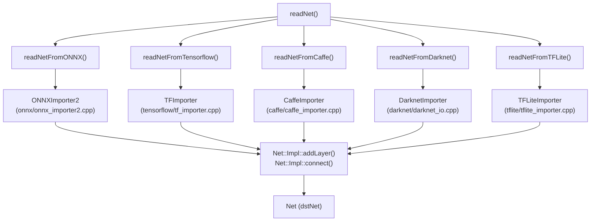
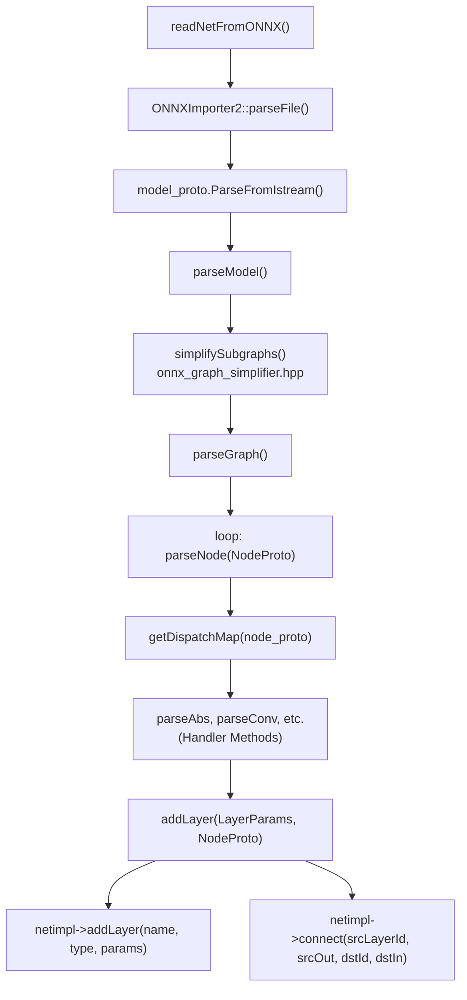
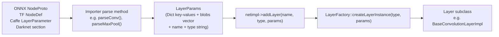

<!-- source: DeepWiki mcp.deepwiki.com · repo opencv/opencv · page 5.1 Model Importers (ONNX, TensorFlow, Caffe, Darknet) · fetched 2026-10-30 -->

# Model Importers (ONNX, TensorFlow, Caffe, Darknet)

Relevant source files

The following files were used as context for generating this wiki page:

- [cmake/OpenCVDetectInferenceEngine.cmake](cmake/OpenCVDetectInferenceEngine.cmake)
- [modules/dnn/CMakeLists.txt](modules/dnn/CMakeLists.txt)
- [modules/dnn/include/opencv2/dnn/all_layers.hpp](modules/dnn/include/opencv2/dnn/all_layers.hpp)
- [modules/dnn/include/opencv2/dnn/dnn.hpp](modules/dnn/include/opencv2/dnn/dnn.hpp)
- [modules/dnn/misc/js/gen_dict.json](modules/dnn/misc/js/gen_dict.json)
- [modules/dnn/misc/objc/gen_dict.json](modules/dnn/misc/objc/gen_dict.json)
- [modules/dnn/misc/python/test/test_dnn.py](modules/dnn/misc/python/test/test_dnn.py)
- [modules/dnn/perf/perf_layer.cpp](modules/dnn/perf/perf_layer.cpp)
- [modules/dnn/perf/perf_net.cpp](modules/dnn/perf/perf_net.cpp)
- [modules/dnn/src/dnn.cpp](modules/dnn/src/dnn.cpp)
- [modules/dnn/src/dnn_common.hpp](modules/dnn/src/dnn_common.hpp)
- [modules/dnn/src/dnn_read.cpp](modules/dnn/src/dnn_read.cpp)
- [modules/dnn/src/graph_block_layout.cpp](modules/dnn/src/graph_block_layout.cpp)
- [modules/dnn/src/graph_const_args.cpp](modules/dnn/src/graph_const_args.cpp)
- [modules/dnn/src/graph_simplifier.cpp](modules/dnn/src/graph_simplifier.cpp)
- [modules/dnn/src/graph_simplifier.hpp](modules/dnn/src/graph_simplifier.hpp)
- [modules/dnn/src/ie_ngraph.cpp](modules/dnn/src/ie_ngraph.cpp)
- [modules/dnn/src/ie_ngraph.hpp](modules/dnn/src/ie_ngraph.hpp)
- [modules/dnn/src/init.cpp](modules/dnn/src/init.cpp)
- [modules/dnn/src/layers/clip_layer.cpp](modules/dnn/src/layers/clip_layer.cpp)
- [modules/dnn/src/layers/conv2_common.cpp](modules/dnn/src/layers/conv2_common.cpp)
- [modules/dnn/src/layers/conv2_common.hpp](modules/dnn/src/layers/conv2_common.hpp)
- [modules/dnn/src/layers/convolution_layer.cpp](modules/dnn/src/layers/convolution_layer.cpp)
- [modules/dnn/src/layers/fully_connected_layer.cpp](modules/dnn/src/layers/fully_connected_layer.cpp)
- [modules/dnn/src/layers/layers_common.cpp](modules/dnn/src/layers/layers_common.cpp)
- [modules/dnn/src/layers/layers_common.hpp](modules/dnn/src/layers/layers_common.hpp)
- [modules/dnn/src/layers/layers_common.simd.hpp](modules/dnn/src/layers/layers_common.simd.hpp)
- [modules/dnn/src/layers/matmulnbits_layer.cpp](modules/dnn/src/layers/matmulnbits_layer.cpp)
- [modules/dnn/src/layers/nary_eltwise_layers.cpp](modules/dnn/src/layers/nary_eltwise_layers.cpp)
- [modules/dnn/src/layers/pooling_layer.cpp](modules/dnn/src/layers/pooling_layer.cpp)
- [modules/dnn/src/layers/randomnormallike_layer.cpp](modules/dnn/src/layers/randomnormallike_layer.cpp)
- [modules/dnn/src/layers/recurrent_layers.cpp](modules/dnn/src/layers/recurrent_layers.cpp)
- [modules/dnn/src/model.cpp](modules/dnn/src/model.cpp)
- [modules/dnn/src/net_openvino.cpp](modules/dnn/src/net_openvino.cpp)
- [modules/dnn/src/onnx/onnx_graph_simplifier.cpp](modules/dnn/src/onnx/onnx_graph_simplifier.cpp)
- [modules/dnn/src/onnx/onnx_graph_simplifier.hpp](modules/dnn/src/onnx/onnx_graph_simplifier.hpp)
- [modules/dnn/src/onnx/onnx_importer.cpp](modules/dnn/src/onnx/onnx_importer.cpp)
- [modules/dnn/src/onnx/onnx_importer2.cpp](modules/dnn/src/onnx/onnx_importer2.cpp)
- [modules/dnn/src/op_inf_engine.cpp](modules/dnn/src/op_inf_engine.cpp)
- [modules/dnn/src/op_inf_engine.hpp](modules/dnn/src/op_inf_engine.hpp)
- [modules/dnn/src/precomp.hpp](modules/dnn/src/precomp.hpp)
- [modules/dnn/src/tensorflow/tf_graph_simplifier.cpp](modules/dnn/src/tensorflow/tf_graph_simplifier.cpp)
- [modules/dnn/src/tensorflow/tf_graph_simplifier.hpp](modules/dnn/src/tensorflow/tf_graph_simplifier.hpp)
- [modules/dnn/src/tensorflow/tf_importer.cpp](modules/dnn/src/tensorflow/tf_importer.cpp)
- [modules/dnn/src/tflite/tflite_importer.cpp](modules/dnn/src/tflite/tflite_importer.cpp)
- [modules/dnn/test/test_backends.cpp](modules/dnn/test/test_backends.cpp)
- [modules/dnn/test/test_caffe_importer.cpp](modules/dnn/test/test_caffe_importer.cpp)
- [modules/dnn/test/test_common.hpp](modules/dnn/test/test_common.hpp)
- [modules/dnn/test/test_common.impl.hpp](modules/dnn/test/test_common.impl.hpp)
- [modules/dnn/test/test_darknet_importer.cpp](modules/dnn/test/test_darknet_importer.cpp)
- [modules/dnn/test/test_ie_models.cpp](modules/dnn/test/test_ie_models.cpp)
- [modules/dnn/test/test_layers.cpp](modules/dnn/test/test_layers.cpp)
- [modules/dnn/test/test_misc.cpp](modules/dnn/test/test_misc.cpp)
- [modules/dnn/test/test_model.cpp](modules/dnn/test/test_model.cpp)
- [modules/dnn/test/test_onnx_conformance.cpp](modules/dnn/test/test_onnx_conformance.cpp)
- [modules/dnn/test/test_onnx_conformance_layer_filter__openvino.inl.hpp](modules/dnn/test/test_onnx_conformance_layer_filter__openvino.inl.hpp)
- [modules/dnn/test/test_onnx_conformance_layer_filter_opencv_all_denylist.inl.hpp](modules/dnn/test/test_onnx_conformance_layer_filter_opencv_all_denylist.inl.hpp)
- [modules/dnn/test/test_onnx_conformance_layer_parser_denylist.inl.hpp](modules/dnn/test/test_onnx_conformance_layer_parser_denylist.inl.hpp)
- [modules/dnn/test/test_onnx_importer.cpp](modules/dnn/test/test_onnx_importer.cpp)
- [modules/dnn/test/test_tf_importer.cpp](modules/dnn/test/test_tf_importer.cpp)
- [modules/dnn/test/test_tflite_importer.cpp](modules/dnn/test/test_tflite_importer.cpp)

## Purpose and Scope

This page describes the framework-specific importers in OpenCV's `opencv_dnn` module that translate external model formats into OpenCV's internal `Net` representation. It covers the `readNet` family of public API functions, the internal importer classes, graph simplification passes, operator dispatch mechanisms, and data-layout handling for ONNX, TensorFlow, Caffe, Darknet, and TFLite.

For details on the `Net` class itself, layer execution, and backend selection after a model is loaded, see page [5.2]().

---

## Build Requirements

All importers (except Darknet and TFLite) are compiled only when **Protocol Buffers** (`HAVE_PROTOBUF`) is available at build time [modules/dnn/src/onnx/onnx_importer.cpp:24](). The CMake variable `OPENCV_DNN_EXTERNAL_PROTOBUF` is used when linking against a system-installed Protobuf library [modules/dnn/CMakeLists.txt:109]().

| Importer | Proto schema | Generated sources |
|---|---|---|
| ONNX | `src/onnx/opencv-onnx.proto` | `opencv-onnx.pb.h` [modules/dnn/src/onnx/onnx_importer.cpp:43]() |
| TensorFlow | `src/tensorflow/*.proto` | `tf_io.hpp` [modules/dnn/src/tensorflow/tf_importer.cpp:25]() |
| Caffe | `src/caffe/opencv-caffe.proto` | — |
| Darknet | — (custom text parser) | — |
| TFLite | — (FlatBuffers) | `tflite_importer.cpp` [modules/dnn/src/tflite/tflite_importer.cpp:20]() |

TFLite support is a separate conditional feature gated on `HAVE_FLATBUFFERS` [modules/dnn/src/tflite/tflite_importer.cpp:20]().

---

## Public API

All importers are surfaced through free functions declared in `modules/dnn/include/opencv2/dnn/dnn.hpp`.

### Format-specific functions

| Function | Architecture file | Secondary (weights) file |
|---|---|---|
| `readNetFromONNX(onnxFile)` | `.onnx` (protobuf binary) | — |
| `readNetFromTensorflow(model, config)` | `.pb` (binary GraphDef) | `.pbtxt` optional text GraphDef |
| `readNetFromCaffe(prototxt, caffeModel)` | `.prototxt` (text NetDef) | `.caffemodel` optional |
| `readNetFromDarknet(cfgFile, weights)` | `.cfg` (INI-like text) | `.weights` optional binary |
| `readNetFromTFLite(modelFile)` | `.tflite` (FlatBuffers) | — |

Each also has an in-memory buffer overload, such as `readNetFromONNX(const char* buffer, size_t sizeBuffer)` [modules/dnn/src/onnx/onnx_importer.cpp:95]() and `readNetFromTensorflow(const char* bufferModel, size_t lenModel, ...)` [modules/dnn/test/test_tf_importer.cpp:89-90]().

### Universal reader

`readNet(model, config, framework)` auto-detects the format by file extension and delegates to the appropriate importer. It is extensively used in performance and regression tests [modules/dnn/perf/perf_net.cpp:18-25](), [modules/dnn/test/test_backends.cpp:43-48]().

---

## Architecture Overview

**Diagram: Public API to Importer Classes to Net**

Sources: [modules/dnn/src/onnx/onnx_importer.cpp:77-93](), [modules/dnn/src/onnx/onnx_importer2.cpp:98-112](), [modules/dnn/src/tensorflow/tf_importer.cpp:25-35](), [modules/dnn/src/tflite/tflite_importer.cpp:20]()

---

## ONNX Importer

### Class structure

OpenCV uses `ONNXImporter2` for modern ONNX parsing [modules/dnn/src/onnx/onnx_importer2.cpp:98](). It supports selecting between the native OpenCV engine and ONNX Runtime (ORT) via `resolveOnnxEngine` [modules/dnn/src/onnx/onnx_importer.cpp:60-75]().

| Field | Type | Role |
|---|---|---|
| `model_proto` | `opencv_onnx::ModelProto` | Parsed protobuf model [modules/dnn/src/onnx/onnx_importer2.cpp:108]() |
| `netimpl` | `Net::Impl*` | Pointer to internal network implementation [modules/dnn/src/onnx/onnx_importer2.cpp:155]() |
| `domain_dispatch_map` | `DomainDispatchMap` | Op-type → handler method pointer [modules/dnn/src/onnx/onnx_importer2.cpp:180]() |
| `rename_map` | `std::unordered_map` | Handles subgraph name scoping [modules/dnn/src/onnx/onnx_importer2.cpp:172]() |

### Import flow

**Diagram: ONNXImporter Internal Flow**

Sources: [modules/dnn/src/onnx/onnx_importer2.cpp:110-142](), [modules/dnn/src/onnx/onnx_importer.cpp:77-80]()

### Graph simplifier

`simplifySubgraphs()` in [modules/dnn/src/onnx/onnx_graph_simplifier.cpp]() runs pattern-matching passes before node iteration. It utilizes an `ONNXGraphWrapper` [modules/dnn/src/onnx/onnx_graph_simplifier.cpp:63]() to manipulate the Protobuf graph structure, such as fusing `Conv` and `BatchNormalization` nodes.

---

## TensorFlow Importer

### NHWC → NCHW conversion

TensorFlow typically uses NHWC layout, while OpenCV DNN works in NCHW. `TFImporter` reorders tensors during parsing.
- `toNCHW(idx)` [modules/dnn/src/tensorflow/tf_importer.cpp:56-62]() — remaps 4D tensor axis indices.
- `parseTensor<T>()` [modules/dnn/src/tensorflow/tf_importer.cpp:109-157]() manually transposes 4D blobs from NHWC to NCHW.

### Graph simplifier

`simplifySubgraphs()` in [modules/dnn/src/tensorflow/tf_graph_simplifier.cpp]() applies pattern passes before node dispatch. It handles complex fusions like `BatchNormSubgraph` [modules/dnn/src/tensorflow/tf_graph_simplifier.cpp:129]() which collapses elementary math ops into a single fused layer.

---

## Caffe, Darknet, and TFLite Importers

### Caffe Importer
The Caffe importer reads `.prototxt` and `.caffemodel` files. It handles classic layers like `Convolution`, `Pooling`, and `InnerProduct` [modules/dnn/include/opencv2/dnn/all_layers.hpp:62-67](). Tests for these are located in [modules/dnn/test/test_caffe_importer.cpp]().

### Darknet Importer
The Darknet importer parses custom `.cfg` files and binary `.weights` files [modules/dnn/test/test_darknet_importer.cpp:77-81](). It translates Darknet sections like `[convolutional]` or `[yolo]` into `Convolution` or `Region` layers [modules/dnn/test/test_darknet_importer.cpp:102-126]().

### TFLite Importer
The TFLite importer reads FlatBuffers-based `.tflite` models. It maps TFLite operators to OpenCV layers and handles quantization parameters often found in mobile models [modules/dnn/src/tflite/tflite_importer.cpp:20]().

---

## Common Import Mechanism: `LayerParams`

All importers translate framework-specific operators into `LayerParams` objects, which are the universal currency for layer creation in OpenCV DNN.

**Diagram: LayerParams as the Bridge between Importers and Layer Registry**

Sources: [modules/dnn/src/onnx/onnx_importer2.cpp:134-142](), [modules/dnn/src/init.cpp:88-160](), [modules/dnn/src/layers/convolution_layer.cpp:78]()

---

## Diagnostic and Performance Utilities

### Diagnostic Mode
`enableModelDiagnostics(true)` sets the global `DNN_DIAGNOSTICS_RUN` flag [modules/dnn/src/init.cpp:146](). This allows importers to collect diagnostics for missing ops or invalid graphs without immediate termination [modules/dnn/src/onnx/onnx_importer2.cpp:52]().

### FP Denormals Suppression
Importers like `ONNXImporter2` and `TFImporter` use `FPDenormalsIgnoreHintScope` [modules/dnn/src/onnx/onnx_importer2.cpp:107](), [modules/dnn/src/tensorflow/tf_importer.cpp:15]() to suppress floating-point denormal handling during the parsing phase, improving performance on specific hardware.

### Summary Table

| Importer | Class | Implementation File | Simplifier |
|---|---|---|---|
| ONNX | `ONNXImporter2` | `modules/dnn/src/onnx/onnx_importer2.cpp` | `onnx_graph_simplifier.cpp` |
| TensorFlow | `TFImporter` | `modules/dnn/src/tensorflow/tf_importer.cpp` | `tf_graph_simplifier.cpp` |
| Caffe | `CaffeImporter` | `modules/dnn/src/caffe/caffe_importer.cpp` | N/A |
| Darknet | N/A | `modules/dnn/src/darknet/darknet_io.cpp` | N/A |
| TFLite | `TFLiteImporter` | `modules/dnn/src/tflite/tflite_importer.cpp` | N/A |

Sources: [modules/dnn/src/onnx/onnx_importer.cpp](), [modules/dnn/src/onnx/onnx_importer2.cpp](), [modules/dnn/src/tensorflow/tf_importer.cpp](), [modules/dnn/src/tflite/tflite_importer.cpp]()

---

