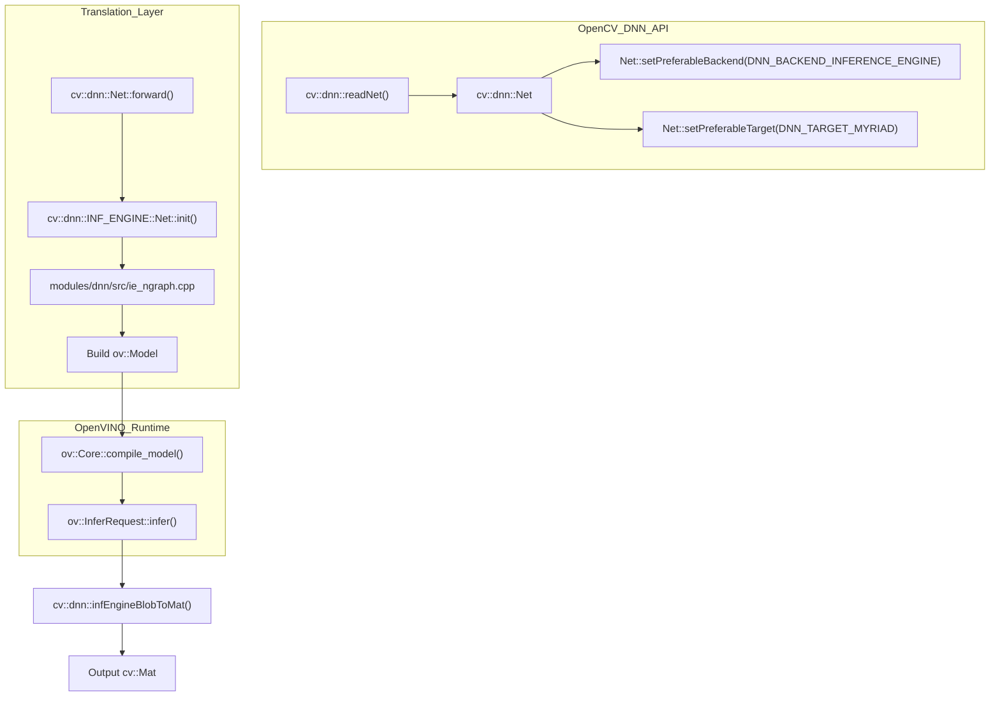
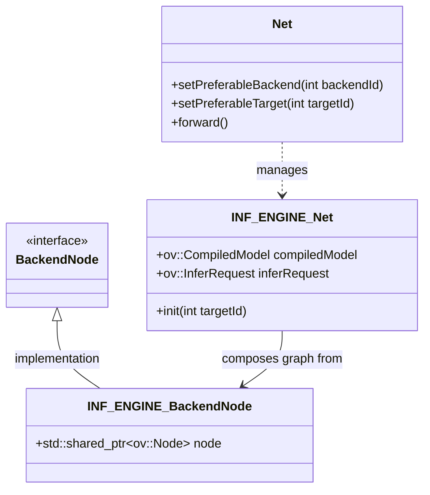

<!-- source: DeepWiki mcp.deepwiki.com · repo opencv/opencv · page 5.3 OpenVINO / Inference Engine Integration · fetched 2026-10-30 -->

# OpenVINO / Inference Engine Integration

Relevant source files

The following files were used as context for generating this wiki page:

- [cmake/OpenCVDetectInferenceEngine.cmake](cmake/OpenCVDetectInferenceEngine.cmake)
- [modules/dnn/CMakeLists.txt](modules/dnn/CMakeLists.txt)
- [modules/dnn/include/opencv2/dnn/all_layers.hpp](modules/dnn/include/opencv2/dnn/all_layers.hpp)
- [modules/dnn/include/opencv2/dnn/dnn.hpp](modules/dnn/include/opencv2/dnn/dnn.hpp)
- [modules/dnn/misc/js/gen_dict.json](modules/dnn/misc/js/gen_dict.json)
- [modules/dnn/misc/objc/gen_dict.json](modules/dnn/misc/objc/gen_dict.json)
- [modules/dnn/misc/python/test/test_dnn.py](modules/dnn/misc/python/test/test_dnn.py)
- [modules/dnn/perf/perf_layer.cpp](modules/dnn/perf/perf_layer.cpp)
- [modules/dnn/perf/perf_net.cpp](modules/dnn/perf/perf_net.cpp)
- [modules/dnn/src/dnn.cpp](modules/dnn/src/dnn.cpp)
- [modules/dnn/src/dnn_common.hpp](modules/dnn/src/dnn_common.hpp)
- [modules/dnn/src/dnn_read.cpp](modules/dnn/src/dnn_read.cpp)
- [modules/dnn/src/graph_block_layout.cpp](modules/dnn/src/graph_block_layout.cpp)
- [modules/dnn/src/graph_const_args.cpp](modules/dnn/src/graph_const_args.cpp)
- [modules/dnn/src/graph_simplifier.cpp](modules/dnn/src/graph_simplifier.cpp)
- [modules/dnn/src/graph_simplifier.hpp](modules/dnn/src/graph_simplifier.hpp)
- [modules/dnn/src/ie_ngraph.cpp](modules/dnn/src/ie_ngraph.cpp)
- [modules/dnn/src/ie_ngraph.hpp](modules/dnn/src/ie_ngraph.hpp)
- [modules/dnn/src/init.cpp](modules/dnn/src/init.cpp)
- [modules/dnn/src/layers/clip_layer.cpp](modules/dnn/src/layers/clip_layer.cpp)
- [modules/dnn/src/layers/conv2_common.cpp](modules/dnn/src/layers/conv2_common.cpp)
- [modules/dnn/src/layers/conv2_common.hpp](modules/dnn/src/layers/conv2_common.hpp)
- [modules/dnn/src/layers/convolution_layer.cpp](modules/dnn/src/layers/convolution_layer.cpp)
- [modules/dnn/src/layers/fully_connected_layer.cpp](modules/dnn/src/layers/fully_connected_layer.cpp)
- [modules/dnn/src/layers/layers_common.cpp](modules/dnn/src/layers/layers_common.cpp)
- [modules/dnn/src/layers/layers_common.hpp](modules/dnn/src/layers/layers_common.hpp)
- [modules/dnn/src/layers/layers_common.simd.hpp](modules/dnn/src/layers/layers_common.simd.hpp)
- [modules/dnn/src/layers/matmulnbits_layer.cpp](modules/dnn/src/layers/matmulnbits_layer.cpp)
- [modules/dnn/src/layers/nary_eltwise_layers.cpp](modules/dnn/src/layers/nary_eltwise_layers.cpp)
- [modules/dnn/src/layers/pooling_layer.cpp](modules/dnn/src/layers/pooling_layer.cpp)
- [modules/dnn/src/layers/randomnormallike_layer.cpp](modules/dnn/src/layers/randomnormallike_layer.cpp)
- [modules/dnn/src/layers/recurrent_layers.cpp](modules/dnn/src/layers/recurrent_layers.cpp)
- [modules/dnn/src/model.cpp](modules/dnn/src/model.cpp)
- [modules/dnn/src/net_openvino.cpp](modules/dnn/src/net_openvino.cpp)
- [modules/dnn/src/onnx/onnx_graph_simplifier.cpp](modules/dnn/src/onnx/onnx_graph_simplifier.cpp)
- [modules/dnn/src/onnx/onnx_graph_simplifier.hpp](modules/dnn/src/onnx/onnx_graph_simplifier.hpp)
- [modules/dnn/src/onnx/onnx_importer.cpp](modules/dnn/src/onnx/onnx_importer.cpp)
- [modules/dnn/src/onnx/onnx_importer2.cpp](modules/dnn/src/onnx/onnx_importer2.cpp)
- [modules/dnn/src/op_inf_engine.cpp](modules/dnn/src/op_inf_engine.cpp)
- [modules/dnn/src/op_inf_engine.hpp](modules/dnn/src/op_inf_engine.hpp)
- [modules/dnn/src/precomp.hpp](modules/dnn/src/precomp.hpp)
- [modules/dnn/src/tensorflow/tf_graph_simplifier.cpp](modules/dnn/src/tensorflow/tf_graph_simplifier.cpp)
- [modules/dnn/src/tensorflow/tf_graph_simplifier.hpp](modules/dnn/src/tensorflow/tf_graph_simplifier.hpp)
- [modules/dnn/src/tensorflow/tf_importer.cpp](modules/dnn/src/tensorflow/tf_importer.cpp)
- [modules/dnn/src/tflite/tflite_importer.cpp](modules/dnn/src/tflite/tflite_importer.cpp)
- [modules/dnn/test/test_backends.cpp](modules/dnn/test/test_backends.cpp)
- [modules/dnn/test/test_caffe_importer.cpp](modules/dnn/test/test_caffe_importer.cpp)
- [modules/dnn/test/test_common.hpp](modules/dnn/test/test_common.hpp)
- [modules/dnn/test/test_common.impl.hpp](modules/dnn/test/test_common.impl.hpp)
- [modules/dnn/test/test_darknet_importer.cpp](modules/dnn/test/test_darknet_importer.cpp)
- [modules/dnn/test/test_ie_models.cpp](modules/dnn/test/test_ie_models.cpp)
- [modules/dnn/test/test_layers.cpp](modules/dnn/test/test_layers.cpp)
- [modules/dnn/test/test_misc.cpp](modules/dnn/test/test_misc.cpp)
- [modules/dnn/test/test_model.cpp](modules/dnn/test/test_model.cpp)
- [modules/dnn/test/test_onnx_conformance.cpp](modules/dnn/test/test_onnx_conformance.cpp)
- [modules/dnn/test/test_onnx_conformance_layer_filter__openvino.inl.hpp](modules/dnn/test/test_onnx_conformance_layer_filter__openvino.inl.hpp)
- [modules/dnn/test/test_onnx_conformance_layer_filter_opencv_all_denylist.inl.hpp](modules/dnn/test/test_onnx_conformance_layer_filter_opencv_all_denylist.inl.hpp)
- [modules/dnn/test/test_onnx_conformance_layer_parser_denylist.inl.hpp](modules/dnn/test/test_onnx_conformance_layer_parser_denylist.inl.hpp)
- [modules/dnn/test/test_onnx_importer.cpp](modules/dnn/test/test_onnx_importer.cpp)
- [modules/dnn/test/test_tf_importer.cpp](modules/dnn/test/test_tf_importer.cpp)
- [modules/dnn/test/test_tflite_importer.cpp](modules/dnn/test/test_tflite_importer.cpp)

The `opencv_dnn` module integrates the Intel® Distribution of OpenVINO™ toolkit (formerly Inference Engine) as a high-performance computational backend. This integration allows OpenCV to offload neural network execution to specialized hardware, including Intel CPUs, integrated GPUs, VPUs (MyriadX/HDDL), and NPUs.

## Purpose and Scope
This page documents the internal mechanics of the OpenCV OpenVINO/Inference Engine integration. It details build-time discovery, runtime graph translation via `nGraph` (`ov::Model`), memory interoperability, supported hardware targets, class hierarchies, and conformance testing strategies.

---

## Architecture Overview

The integration acts as a glue layer that translates the OpenCV DNN internal representation (layers and blobs) into OpenVINO's graph representation. When `DNN_BACKEND_INFERENCE_ENGINE` is selected, `cv::dnn::Net` compiles the graph for the target device and delegates the `forward()` execution pass to the OpenVINO runtime.

### Data Flow and Translation

The following diagram illustrates how a network transitions from the standard OpenCV path to the OpenVINO backend, mapping system concepts to specific codebase entities.

**Graph Translation Flow**

**Sources:** `[modules/dnn/include/opencv2/dnn/dnn.hpp:71-89]()`, `[modules/dnn/src/op_inf_engine.cpp:42-61]()`, `[modules/dnn/src/ie_ngraph.cpp:1-50]()`

---

## Build-Time Detection and Configuration

OpenCV uses CMake scripts to detect the presence of OpenVINO libraries and headers.

- **Detection Script**: CMake configuration searches for the OpenVINO package using `find_package(OpenVINO)` or legacy Inference Engine paths in `cmake/OpenCVDetectInferenceEngine.cmake`.
- **Compilation Definitions**: When discovered, `HAVE_INF_ENGINE` and `HAVE_DNN_NGRAPH` are injected into `modules/dnn/CMakeLists.txt`.
- **Plugin Architecture**: The backend can interface dynamically or statically depending on whether OpenVINO is linked as a shared distribution package.

**Sources:** `[modules/dnn/CMakeLists.txt:195-201]()`, `[cmake/OpenCVDetectInferenceEngine.cmake:1-15]()`

---

## Backend Implementation Details

### The `ov::Core` Management
The integration maintains a global `ov::Core` instance via helper functions to manage device discovery and model compilation. OpenCV handles specific workarounds for core lifetimes on Windows environments to prevent DLL unloading crashes.

- **Key Function**: `cv::dnn::getCore(const std::string& id)` manages core initialization [modules/dnn/src/op_inf_engine.cpp:104-125]().
- **Hardware Discovery**: Functions like `detectArmPlugin_()` and `detectMyriadX_()` query `ov::Core` for available hardware strings [modules/dnn/src/op_inf_engine.cpp:128-162]().

### Layer Translation
Each layer implementation maps OpenCV structural parameters to OpenVINO `ov::op` nodes.

| OpenCV Layer | IE/nGraph Implementation | Source File |
| :--- | :--- | :--- |
| `ConvolutionLayer` | `ov::op::v1::Convolution` | `[modules/dnn/src/layers/convolution_layer.cpp:46-47]()` |
| `PoolingLayer` | `ov::op::v1::MaxPool` / `AvgPool` | `[modules/dnn/src/layers/pooling_layer.cpp:51-55]()` |
| `FullyConnected` | `ov::op::v0::MatMul` | `[modules/dnn/src/layers/fully_connected_layer.cpp:32-34]()` |

### Memory Interoperability
To avoid redundant data copies during inference, OpenCV directly references `ov::Tensor` allocations inside `cv::Mat` wrappers.

- **Blob to Mat Conversion**: `infEngineBlobToMat` converts an OpenVINO tensor to an OpenCV `cv::Mat` by sharing the underlying data pointer [modules/dnn/src/op_inf_engine.cpp:42-61]().
- **Precision Mapping**: Maps `ov::element::f32` to `CV_32F`, `ov::element::u8` to `CV_8U`, etc. [modules/dnn/src/op_inf_engine.cpp:49-59]().

**Sources:** `[modules/dnn/src/op_inf_engine.cpp:42-162]()`, `[modules/dnn/src/op_inf_engine.hpp:1-50]()`

---

## Runtime Backend Selection and Class Hierarchy

Users control the backend configuration via `cv::dnn::Net`. The architecture automatically handles fallback to `DNN_BACKEND_OPENCV` (CPU) if a specific layer lacks OpenVINO translation support.

**Code Entity Association**

**Sources:** `[modules/dnn/include/opencv2/dnn/dnn.hpp:166-172]()`, `[modules/dnn/src/op_inf_engine.hpp:24-35]()`

---

## Conformance Testing Strategy

The `opencv_dnn` module uses targeted regression suites to ensure parity between OpenVINO backend executions and reference CPU implementations.

### Test Architecture
1. **Accuracy Tests**: The `DNNTestLayer` class in `test_common.hpp` provides parameterized runners across multiple backends (`DNN_BACKEND_OPENCV`, `DNN_BACKEND_INFERENCE_ENGINE`) and hardware targets (`DNN_TARGET_CPU`, `DNN_TARGET_MYRIAD`).
2. **Norm Assertions**: Results are validated using `normAssert`, checking L1 and LInf error metrics against reference blobs [modules/dnn/test/test_backends.cpp:85-94]().
3. **Skip Tags**: Tests utilize skip tags like `CV_TEST_TAG_DNN_SKIP_IE_NGRAPH` to bypass known platform-specific or version-specific regressions [modules/dnn/test/test_tf_importer.cpp:138-141]().

### Key Test Files
- **`modules/dnn/test/test_backends.cpp`**: Validates standard topologies (AlexNet, ResNet, YOLO) specifically on IE/OpenVINO backends [modules/dnn/test/test_backends.cpp:121-186]().
- **`modules/dnn/test/test_ie_models.cpp`**: Contains specialized test coverage for topologies configured for OpenVINO execution targets.

**Sources:** `[modules/dnn/test/test_backends.cpp:70-94]`, `[modules/dnn/test/test_tf_importer.cpp:138-141]()`

---

