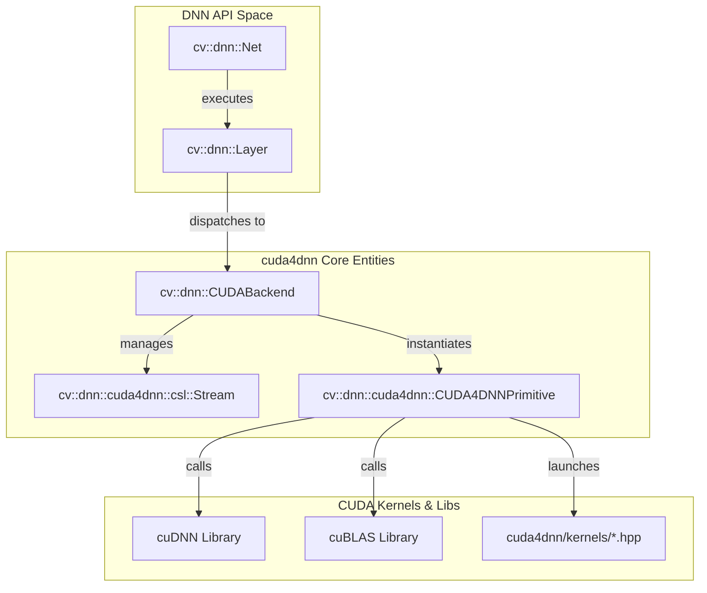
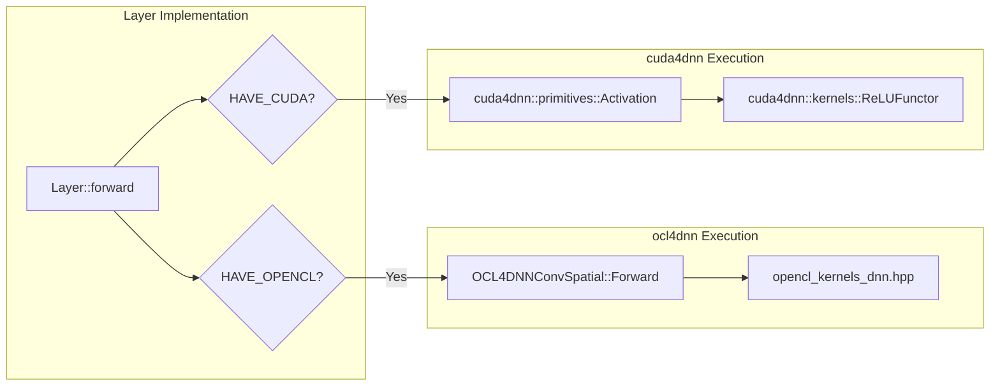

<!-- source: DeepWiki mcp.deepwiki.com · repo opencv/opencv · page 5.4 DNN OpenCL and CUDA Execution Paths (ocl4dnn, cuda4dnn) · fetched 2026-10-30 -->

# DNN OpenCL and CUDA Execution Paths (ocl4dnn, cuda4dnn)

Relevant source files

The following files were used as context for generating this wiki page:

- [cmake/FindCUDA.cmake](cmake/FindCUDA.cmake)
- [cmake/FindCUDA/make2cmake.cmake](cmake/FindCUDA/make2cmake.cmake)
- [cmake/FindCUDA/parse_cubin.cmake](cmake/FindCUDA/parse_cubin.cmake)
- [cmake/FindCUDA/run_nvcc.cmake](cmake/FindCUDA/run_nvcc.cmake)
- [cmake/FindCUDNNJIT.cmake](cmake/FindCUDNNJIT.cmake)
- [cmake/OpenCVDetectCUDA.cmake](cmake/OpenCVDetectCUDA.cmake)
- [cmake/OpenCVDetectCUDALanguage.cmake](cmake/OpenCVDetectCUDALanguage.cmake)
- [cmake/OpenCVDetectCUDAUtils.cmake](cmake/OpenCVDetectCUDAUtils.cmake)
- [cmake/OpenCVMinDepVersions.cmake](cmake/OpenCVMinDepVersions.cmake)
- [modules/core/cmake/parallel/detect_openmp.cmake](modules/core/cmake/parallel/detect_openmp.cmake)
- [modules/dnn/cmake/hooks/INIT_MODULE_SOURCES_opencv_dnn.cmake](modules/dnn/cmake/hooks/INIT_MODULE_SOURCES_opencv_dnn.cmake)
- [modules/dnn/src/cuda/activations.cu](modules/dnn/src/cuda/activations.cu)
- [modules/dnn/src/cuda/eltwise_ops.cu](modules/dnn/src/cuda/eltwise_ops.cu)
- [modules/dnn/src/cuda/functors.hpp](modules/dnn/src/cuda/functors.hpp)
- [modules/dnn/src/cuda4dnn/csl/cublas.hpp](modules/dnn/src/cuda4dnn/csl/cublas.hpp)
- [modules/dnn/src/cuda4dnn/csl/cudnn/cudnn.hpp](modules/dnn/src/cuda4dnn/csl/cudnn/cudnn.hpp)
- [modules/dnn/src/cuda4dnn/csl/stream.hpp](modules/dnn/src/cuda4dnn/csl/stream.hpp)
- [modules/dnn/src/cuda4dnn/kernels/activations.hpp](modules/dnn/src/cuda4dnn/kernels/activations.hpp)
- [modules/dnn/src/cuda4dnn/kernels/eltwise_ops.hpp](modules/dnn/src/cuda4dnn/kernels/eltwise_ops.hpp)
- [modules/dnn/src/cuda4dnn/primitives/activation.hpp](modules/dnn/src/cuda4dnn/primitives/activation.hpp)
- [modules/dnn/src/cuda4dnn/primitives/eltwise.hpp](modules/dnn/src/cuda4dnn/primitives/eltwise.hpp)
- [modules/dnn/src/layers/elementwise_layers.cpp](modules/dnn/src/layers/elementwise_layers.cpp)
- [modules/dnn/src/ocl4dnn/include/default_kernel_config.hpp](modules/dnn/src/ocl4dnn/include/default_kernel_config.hpp)
- [modules/dnn/src/ocl4dnn/include/ocl4dnn.hpp](modules/dnn/src/ocl4dnn/include/ocl4dnn.hpp)
- [modules/dnn/src/ocl4dnn/src/common.cpp](modules/dnn/src/ocl4dnn/src/common.cpp)
- [modules/dnn/src/ocl4dnn/src/math_functions.cpp](modules/dnn/src/ocl4dnn/src/math_functions.cpp)
- [modules/dnn/src/ocl4dnn/src/ocl4dnn_conv_spatial.cpp](modules/dnn/src/ocl4dnn/src/ocl4dnn_conv_spatial.cpp)
- [modules/dnn/src/ocl4dnn/src/ocl4dnn_lrn.cpp](modules/dnn/src/ocl4dnn/src/ocl4dnn_lrn.cpp)
- [modules/dnn/src/ocl4dnn/src/ocl4dnn_pool.cpp](modules/dnn/src/ocl4dnn/src/ocl4dnn_pool.cpp)
- [modules/dnn/src/ocl4dnn/src/ocl4dnn_softmax.cpp](modules/dnn/src/ocl4dnn/src/ocl4dnn_softmax.cpp)
- [modules/dnn/src/opencl/activations.cl](modules/dnn/src/opencl/activations.cl)
- [modules/dnn/src/opencl/conv_layer_spatial.cl](modules/dnn/src/opencl/conv_layer_spatial.cl)
- [modules/dnn/src/opencl/gemm_buffer.cl](modules/dnn/src/opencl/gemm_buffer.cl)
- [modules/dnn/src/opencl/ocl4dnn_pooling.cl](modules/dnn/src/opencl/ocl4dnn_pooling.cl)
- [modules/dnn/src/opencl/permute.cl](modules/dnn/src/opencl/permute.cl)
- [modules/dnn/src/opencl/softmax_loss.cl](modules/dnn/src/opencl/softmax_loss.cl)

This page details the implementation of high-performance execution paths in the OpenCV DNN module for OpenCL and NVIDIA CUDA backends. These paths are implemented via specialized internal sub-modules: `ocl4dnn` for OpenCL-based acceleration (primarily optimized for Intel GPUs) and `cuda4dnn` for NVIDIA GPUs using the CUDA toolkit.

## 1. OpenCL Execution Path (ocl4dnn)

The `ocl4dnn` component provides a set of optimized OpenCL kernels and a management layer to map DNN layers to GPU execution. It handles kernel selection, tuning, and memory layout optimizations.

### Kernel Selection and Tuning
For complex operations like convolutions, `ocl4dnn` uses a tuning mechanism to select the most efficient kernel based on the target hardware and layer parameters. It maintains a `kernelConfigMap` that stores pre-calculated or tuned configurations for specific hardware IDs [modules/dnn/src/ocl4dnn/src/ocl4dnn_conv_spatial.cpp:66-70]().

The initialization process loads built-in configurations for common Intel GPU architectures for both FP32 and FP16 precisions via `initializeGlobalBuiltinConfigurations` [modules/dnn/src/ocl4dnn/src/ocl4dnn_conv_spatial.cpp:112-156]().

### Data Layout and Tensors
`ocl4dnn` primarily operates on `cv::UMat` objects, which abstract OpenCL buffers. It handles specific data layouts required by optimized kernels, such as "swizzled" weights for SIMD-optimized convolutions [modules/dnn/src/ocl4dnn/include/ocl4dnn.hpp:114]().

### Mapping Layers to Kernels
The mapping is performed by specialized classes like `OCL4DNNConvSpatial` and `OCL4DNNPool`. These classes wrap the logic for kernel argument binding and execution:

| Layer Type | Implementation Class | Key Function | Kernel Source |
| :--- | :--- | :--- | :--- |
| Convolution | `OCL4DNNConvSpatial` | `Forward()` | `conv_layer_spatial.cl` |
| Pooling | `OCL4DNNPool` | `Forward()` | `ocl4dnn_pooling.cl` |
| Activation | `ActivationLayer` | `forward()` | `activations.cl` |

Sources: [modules/dnn/src/ocl4dnn/include/ocl4dnn.hpp:87-96](), [modules/dnn/src/ocl4dnn/src/ocl4dnn_pool.cpp:98-102](), [modules/dnn/src/layers/elementwise_layers.cpp:58-60]()

### Kernel Fusing
To reduce memory bandwidth overhead, `ocl4dnn` supports fusing activation functions (ReLU, PReLU, Power, TanH, ReLU6) and element-wise additions directly into the convolution kernel [modules/dnn/src/opencl/conv_layer_spatial.cl:51-85]().

Sources: [modules/dnn/src/ocl4dnn/src/ocl4dnn_conv_spatial.cpp:66-156](), [modules/dnn/src/ocl4dnn/include/ocl4dnn.hpp:87-114](), [modules/dnn/src/opencl/conv_layer_spatial.cl:51-85]()

---

## 2. CUDA Execution Path (cuda4dnn)

The `cuda4dnn` component implements DNN layers using CUDA kernels, cuBLAS, and cuDNN. It provides a C++ abstraction layer over the CUDA driver and runtime APIs.

### Backend Detection and Build Configuration
OpenCV uses a dedicated CMake infrastructure to detect the CUDA Toolkit, cuDNN, and target architectures.
- **Detection**: `OpenCVDetectCUDA.cmake` handles finding the `nvcc` compiler and required libraries like `npp`, `cublas`, and `cudnn` [cmake/OpenCVDetectCUDA.cmake:23-65]().
- **Architecture Support**: It maps GPU generations (e.g., Maxwell, Pascal, Ampere) to specific Compute Capability flags (`-gencode`) [cmake/OpenCVDetectCUDAUtils.cmake:96-112]().

### Code Entity Mapping: CUDA Backend
The following diagram illustrates how the DNN backend infrastructure interacts with CUDA-specific primitives.

**Diagram: DNN to CUDA Primitive Mapping**

Sources: [modules/dnn/src/cuda4dnn/csl/stream.hpp:1-20](), [modules/dnn/src/layers/elementwise_layers.cpp:62-65](), [cmake/OpenCVDetectCUDA.cmake:50-60]()

### Element-wise and Activation Functors
CUDA implementations for activations and element-wise operations are implemented as generic functors to allow reuse across different primitives [modules/dnn/src/cuda/functors.hpp:16-30]().

Example mappings in `cuda4dnn`:
- **ReLU**: `ReLUFunctor` implements $f(x) = \max(0, x) + slope \cdot \min(0, x)$ [modules/dnn/src/cuda/functors.hpp:31-47]().
- **Mish**: `MishFunctor` uses specialized fast math for FP32 to improve performance [modules/dnn/src/cuda/functors.hpp:117-136]().

Sources: [cmake/OpenCVDetectCUDA.cmake:23-65](), [cmake/OpenCVDetectCUDAUtils.cmake:96-112](), [modules/dnn/src/cuda/functors.hpp:16-136]()

---

## 3. Data Flow and Capability Checks

Before execution, the DNN module performs a per-layer check to determine if the selected backend (OpenCL or CUDA) can support the specific layer configuration.

### Capability Check Flow
1. **`Net::forward`**: Initiates the graph traversal.
2. **`Layer::supportBackend`**: The layer is queried if it supports the requested `DNN_BACKEND_OPENCV` (OpenCL) or `DNN_BACKEND_CUDA`.
3. **Target Check**: The system verifies if the data type (e.g., FP32, FP16) is supported by the hardware target (e.g., `DNN_TARGET_OPENCL` vs `DNN_TARGET_OPENCL_FP16`).

### Tensor Layout Considerations
- **ocl4dnn**: Prefers NCHW layout but uses specialized kernels for Intel-specific block layouts (e.g., `sub_group_block_read`) [modules/dnn/src/opencl/conv_layer_spatial.cl:116-136]().
- **cuda4dnn**: Leverages cuDNN's ability to handle multiple layouts (NCHW, NHWC) and uses `cv::cuda::GpuMat` for memory management [modules/dnn/src/layers/elementwise_layers.cpp:45]().

**Diagram: Layer Dispatch to Specialized Implementations**

Sources: [modules/dnn/src/layers/elementwise_layers.cpp:45-65](), [modules/dnn/src/ocl4dnn/src/ocl4dnn_conv_spatial.cpp:159-196](), [modules/dnn/src/cuda/functors.hpp:31-47](), [modules/dnn/src/opencl/conv_layer_spatial.cl:116-136]()

Sources: [modules/dnn/src/layers/elementwise_layers.cpp:45-65](), [modules/dnn/src/ocl4dnn/src/ocl4dnn_conv_spatial.cpp:159-196](), [modules/dnn/src/cuda/functors.hpp:31-47](), [modules/dnn/src/opencl/conv_layer_spatial.cl:116-136]()

---

## 4. Summary of Key Files

| File Path | Role |
| :--- | :--- |
| `modules/dnn/src/ocl4dnn/src/ocl4dnn_conv_spatial.cpp` | Main logic for OpenCL convolution tuning and execution [modules/dnn/src/ocl4dnn/src/ocl4dnn_conv_spatial.cpp:1-156](). |
| `modules/dnn/src/opencl/conv_layer_spatial.cl` | OpenCL kernel implementation for spatial convolutions [modules/dnn/src/opencl/conv_layer_spatial.cl:138-172](). |
| `modules/dnn/src/cuda/functors.hpp` | CUDA functors for activation and element-wise layers [modules/dnn/src/cuda/functors.hpp:16-115](). |
| `cmake/OpenCVDetectCUDA.cmake` | Build-time logic for CUDA/cuDNN feature detection [cmake/OpenCVDetectCUDA.cmake:1-137](). |
| `modules/dnn/src/ocl4dnn/include/ocl4dnn.hpp` | Public interface for the ocl4dnn internal component [modules/dnn/src/ocl4dnn/include/ocl4dnn.hpp:52-103](). |

Sources: [modules/dnn/src/ocl4dnn/src/ocl4dnn_conv_spatial.cpp:1-156](), [modules/dnn/src/opencl/conv_layer_spatial.cl:138-172](), [modules/dnn/src/cuda/functors.hpp:16-115](), [cmake/OpenCVDetectCUDA.cmake:1-137](), [modules/dnn/src/ocl4dnn/include/ocl4dnn.hpp:52-103]()

---

