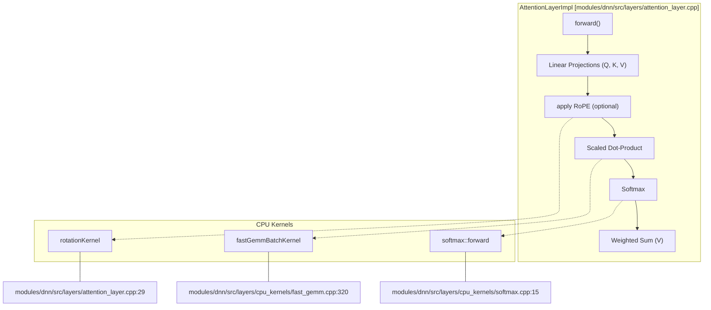
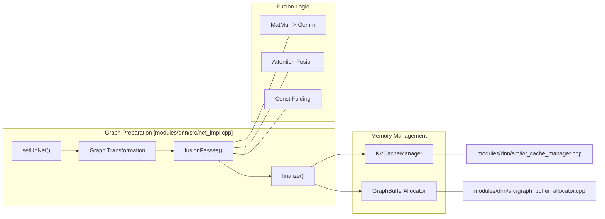

<!-- source: DeepWiki mcp.deepwiki.com · repo opencv/opencv · page 5.5 Modern DNN Layers: Attention, KV Cache, and Fusion · fetched 2026-10-30 -->

# Modern DNN Layers: Attention, KV Cache, and Fusion

Relevant source files

The following files were used as context for generating this wiki page:

- [modules/dnn/perf/perf_gemm.cpp](modules/dnn/perf/perf_gemm.cpp)
- [modules/dnn/src/cuda4dnn/primitives/max_unpooling.hpp](modules/dnn/src/cuda4dnn/primitives/max_unpooling.hpp)
- [modules/dnn/src/graph_buffer_allocator.cpp](modules/dnn/src/graph_buffer_allocator.cpp)
- [modules/dnn/src/graph_const_fold.cpp](modules/dnn/src/graph_const_fold.cpp)
- [modules/dnn/src/graph_fusion_basic.cpp](modules/dnn/src/graph_fusion_basic.cpp)
- [modules/dnn/src/kv_cache_manager.cpp](modules/dnn/src/kv_cache_manager.cpp)
- [modules/dnn/src/kv_cache_manager.hpp](modules/dnn/src/kv_cache_manager.hpp)
- [modules/dnn/src/layer.cpp](modules/dnn/src/layer.cpp)
- [modules/dnn/src/layer_internals.hpp](modules/dnn/src/layer_internals.hpp)
- [modules/dnn/src/layers/attention_layer.cpp](modules/dnn/src/layers/attention_layer.cpp)
- [modules/dnn/src/layers/attention_onnxai_layer.cpp](modules/dnn/src/layers/attention_onnxai_layer.cpp)
- [modules/dnn/src/layers/bitcast_layer.cpp](modules/dnn/src/layers/bitcast_layer.cpp)
- [modules/dnn/src/layers/conv2_layer.cpp](modules/dnn/src/layers/conv2_layer.cpp)
- [modules/dnn/src/layers/cpu_kernels/fast_gemm.cpp](modules/dnn/src/layers/cpu_kernels/fast_gemm.cpp)
- [modules/dnn/src/layers/cpu_kernels/fast_gemm.hpp](modules/dnn/src/layers/cpu_kernels/fast_gemm.hpp)
- [modules/dnn/src/layers/cpu_kernels/fast_gemm_kernels.default.hpp](modules/dnn/src/layers/cpu_kernels/fast_gemm_kernels.default.hpp)
- [modules/dnn/src/layers/cpu_kernels/fast_gemm_kernels.simd.hpp](modules/dnn/src/layers/cpu_kernels/fast_gemm_kernels.simd.hpp)
- [modules/dnn/src/layers/dft_layer.cpp](modules/dnn/src/layers/dft_layer.cpp)
- [modules/dnn/src/layers/einsum_layer.cpp](modules/dnn/src/layers/einsum_layer.cpp)
- [modules/dnn/src/layers/gemm_layer.cpp](modules/dnn/src/layers/gemm_layer.cpp)
- [modules/dnn/src/layers/matmul_layer.cpp](modules/dnn/src/layers/matmul_layer.cpp)
- [modules/dnn/src/layers/recurrent2_layers.cpp](modules/dnn/src/layers/recurrent2_layers.cpp)
- [modules/dnn/src/legacy_backend.cpp](modules/dnn/src/legacy_backend.cpp)
- [modules/dnn/src/net.cpp](modules/dnn/src/net.cpp)
- [modules/dnn/src/net_impl.cpp](modules/dnn/src/net_impl.cpp)
- [modules/dnn/src/net_impl.hpp](modules/dnn/src/net_impl.hpp)
- [modules/dnn/src/net_impl2.cpp](modules/dnn/src/net_impl2.cpp)
- [modules/dnn/src/net_impl_backend.cpp](modules/dnn/src/net_impl_backend.cpp)
- [modules/dnn/src/op_cuda.cpp](modules/dnn/src/op_cuda.cpp)
- [modules/dnn/src/op_cuda.hpp](modules/dnn/src/op_cuda.hpp)
- [modules/dnn/src/tokenizer/core_bpe.cpp](modules/dnn/src/tokenizer/core_bpe.cpp)
- [modules/dnn/src/tokenizer/core_bpe.hpp](modules/dnn/src/tokenizer/core_bpe.hpp)
- [modules/dnn/src/tokenizer/core_gemma.hpp](modules/dnn/src/tokenizer/core_gemma.hpp)
- [modules/dnn/src/tokenizer/tokenizer.cpp](modules/dnn/src/tokenizer/tokenizer.cpp)
- [modules/dnn/src/tokenizer/unicode-data.cpp](modules/dnn/src/tokenizer/unicode-data.cpp)
- [modules/dnn/src/tokenizer/unicode-data.hpp](modules/dnn/src/tokenizer/unicode-data.hpp)
- [modules/dnn/src/tokenizer/unicode.cpp](modules/dnn/src/tokenizer/unicode.cpp)
- [modules/dnn/src/tokenizer/unicode.hpp](modules/dnn/src/tokenizer/unicode.hpp)
- [modules/dnn/src/tokenizer/utils.hpp](modules/dnn/src/tokenizer/utils.hpp)
- [modules/dnn/test/test_graph_simplifier.cpp](modules/dnn/test/test_graph_simplifier.cpp)
- [modules/dnn/test/test_layers_1d.cpp](modules/dnn/test/test_layers_1d.cpp)
- [modules/dnn/test/test_tokenizer.cpp](modules/dnn/test/test_tokenizer.cpp)
- [samples/dnn/gemma3_inference.py](samples/dnn/gemma3_inference.py)
- [samples/dnn/qwen_inference.py](samples/dnn/qwen_inference.py)

This page documents specialized components and optimization passes within the `opencv_dnn` module designed to support modern transformer-based architectures, such as Large Language Models (LLMs). It covers the implementation of attention mechanisms, Key-Value (KV) cache management, text tokenizers, and graph fusion passes that combine granular operations into high-performance execution kernels.

## 1. Attention Layers

OpenCV implements multiple variants of the attention mechanism to support both standard ONNX operators and framework-specific extensions (e.g., Microsoft's `com.microsoft.Attention`).

### Implementation Details
The `AttentionLayerImpl` handles the core logic of multi-head attention (MHA), managing query (Q), key (K), and value (V) projections, scaling, and the optional application of Rotary Positional Embeddings (RoPE).

*   **RoPE (Rotary Positional Embeddings):** Implemented via precomputation tables and applied using specialized rotation kernels [modules/dnn/src/layers/attention_layer.cpp:29-124](). These functions use SIMD intrinsics to efficiently rotate feature vectors in complex space.
*   **Weight Packing:** To optimize linear projections, weights are often repacked for specialized GEMM kernels [modules/dnn/src/layers/attention_layer.cpp:14-26]().

### Code Entity Map: Attention Execution
The following diagram maps natural language attention stages to their corresponding C++ code entities and files.

**Attention Execution Flow**

**Sources:** [modules/dnn/src/layers/attention_layer.cpp:29-156](), [modules/dnn/src/layers/cpu_kernels/fast_gemm.cpp:320-350]().

---

## 2. KV Cache Management

For efficient autoregressive inference (e.g., LLM generation), OpenCV uses a `KVCacheManager` to persist the K and V tensors across forward passes, avoiding redundant computation of past tokens.

### Key Components
*   **`KVCacheManager`**: Integrated directly into `Net::Impl` [modules/dnn/src/net_impl.hpp:139](). It tracks cache state and handles memory allocation for the growing sequence length.
*   **Usage Toggle**: Controlled by the `useKVCache` flag in `Net::Impl` [modules/dnn/src/net_impl.hpp:119]().
*   **Paged Attention**: The engine supports paged attention kernels (`pagedAttnQKGemmKernel`, `pagedAttnAVGemmKernel`) to handle non-contiguous memory layouts in the cache [modules/dnn/src/layers/cpu_kernels/fast_gemm_kernels.simd.hpp:150-160]().

**Sources:** [modules/dnn/src/net_impl.hpp:119-139](), [modules/dnn/src/layers/cpu_kernels/fast_gemm_kernels.simd.hpp:150-160](), [modules/dnn/src/kv_cache_manager.hpp]().

---

## 3. Tokenizer Integration

To support end-to-end LLM text generation pipelines, the `opencv_dnn` module includes internal tokenizer utilities (such as Byte-Pair Encoding via `CoreBPE`) located under `modules/dnn/src/tokenizer/` [modules/dnn/src/tokenizer/tokenizer.cpp](). These components convert raw text prompts into token ID tensors before inference and decode output token IDs back into strings.

**Sources:** [modules/dnn/src/tokenizer/tokenizer.cpp](), [modules/dnn/src/tokenizer/core_bpe.hpp]().

---

## 4. Graph Fusion and Optimization Passes

To maximize performance, the DNN engine performs several graph-level transformations during the `setUpNet` phase [modules/dnn/src/net_impl.cpp:188-250](). These passes replace sequences of small nodes with a single optimized "fused" layer or eliminate redundant operations.

### Primary Fusion Types

| Fusion Type | Source File | Description |
| :--- | :--- | :--- |
| **MatMul to GEMM** | `graph_fusion_matmul_to_gemm.cpp` | Converts `MatMul` nodes into `Gemm` nodes when weights are constant, enabling pre-packing. |
| **Attention Fusion** | `graph_fusion_attention.cpp` | Detects patterns of MatMul, Scale, Softmax, and Transpose to form a single `Attention` layer. |
| **Constant Folding** | `graph_const_fold.cpp` | Evaluates subgraphs with constant inputs at compile time to reduce runtime overhead. |
| **Reshape/Transpose** | `graph_fusion_reshape_transpose.cpp` | Simplifies data layout changes, often folding them into subsequent compute kernels. |

### MatMul and GEMM Optimization
The engine distinguishes between generic `MatMul` and optimized `Gemm`:
*   **`GemmLayerImpl`**: Handles $Y = \alpha A B + \beta C$, supporting weight repacking for `mlas` or `fast_gemm` backends [modules/dnn/src/layers/gemm_layer.cpp:53-176]().
*   **`MatMulLayerImpl`**: Manages multidimensional matrix multiplication with NumPy-style broadcasting [modules/dnn/src/layers/matmul_layer.cpp:30-146]().
*   **Fast GEMM**: A specialized CPU kernel architecture providing SIMD-accelerated implementations for AVX, NEON, and RVV [modules/dnn/src/layers/cpu_kernels/fast_gemm_kernels.simd.hpp:18-44]().

**Sources:** [modules/dnn/src/layers/gemm_layer.cpp:53-176](), [modules/dnn/src/layers/matmul_layer.cpp:30-146](), [modules/dnn/src/layers/cpu_kernels/fast_gemm_kernels.simd.hpp:18-44](), [modules/dnn/src/net_impl.cpp:188-250]().

---

## 5. System Integration

The modern layer infrastructure is tied together by the `Net::Impl` class [modules/dnn/src/net_impl.hpp:88](), which manages the transition from a generic model graph to a hardware-optimized execution plan.

### Code Entity Map: Fusion and Allocation
The following diagram illustrates the lifecycle of a network from graph setup and fusion to memory allocation and execution.

**Network Optimization Pipeline**

### Important Functions
*   **`Net::Impl::finalize()`**: The final stage where backend-specific executors (such as CUDA or OpenVINO) are assigned to fused nodes [modules/dnn/src/net_impl.cpp:153]().
*   **`Net::Impl::wrap()`**: Maps host `cv::Mat` objects to backend-specific wrappers (e.g., `CUDABackendWrapper`) for optimized data transfer [modules/dnn/src/net_impl_backend.cpp:141-210]().

**Sources:** [modules/dnn/src/net_impl.cpp:153-250](), [modules/dnn/src/net_impl.hpp:88-140](), [modules/dnn/src/net_impl_backend.cpp:141-210]().

---

