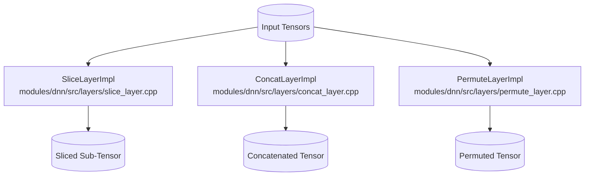
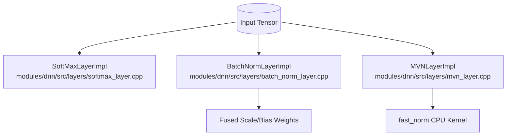
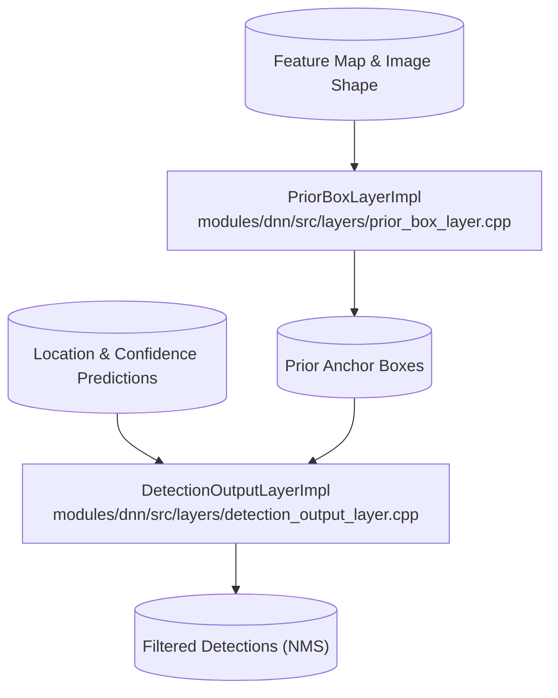
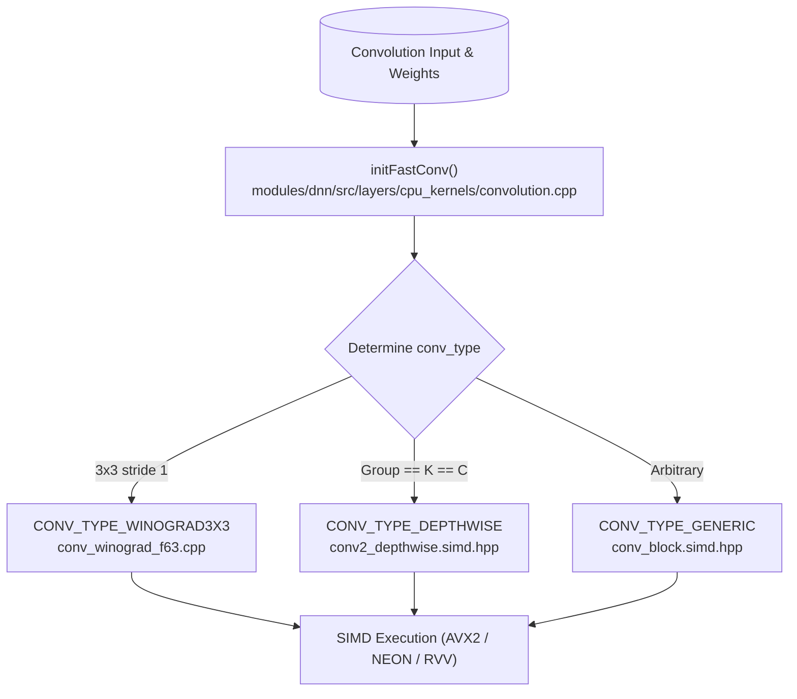
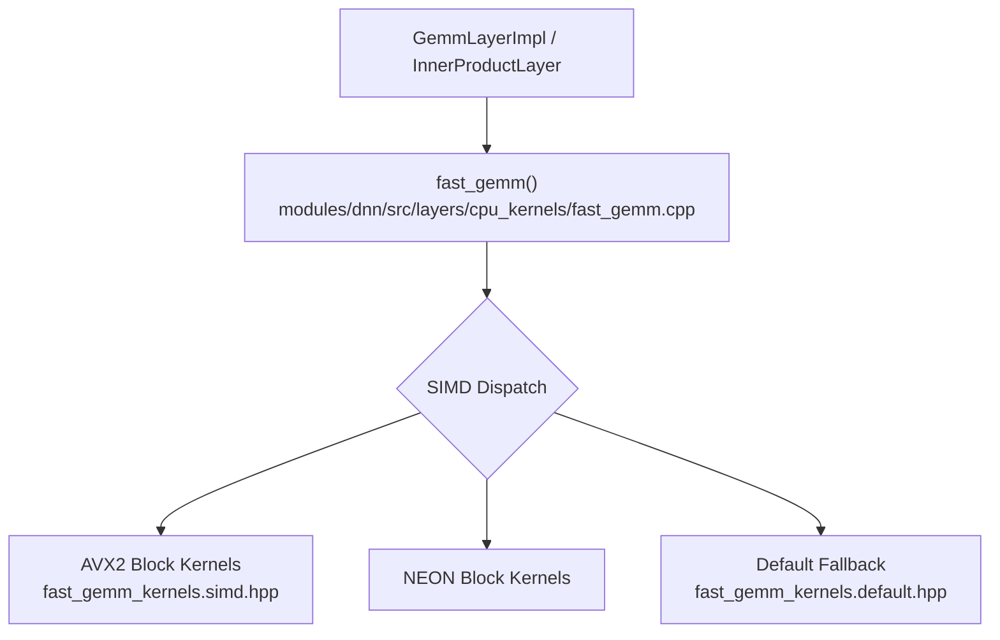
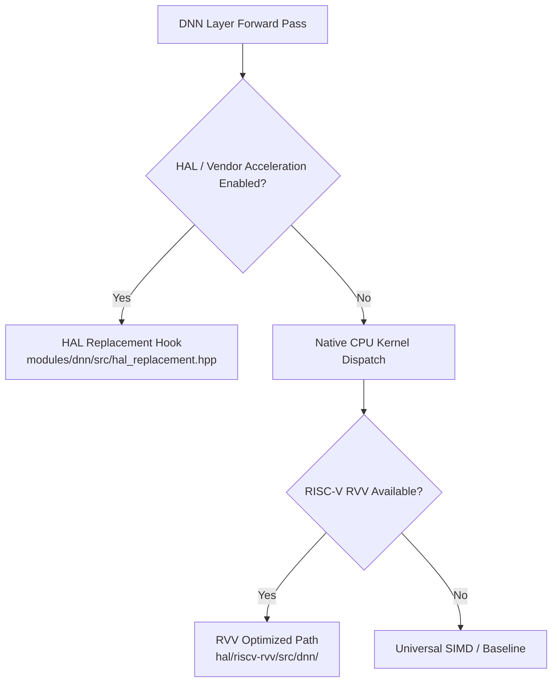

<!-- source: DeepWiki mcp.deepwiki.com · repo opencv/opencv · page 5.6 Layer Catalog and CPU Kernels · fetched 2026-10-30 -->

# Layer Catalog and CPU Kernels

Relevant source files

The following files were used as context for generating this wiki page:

- [hal/riscv-rvv/CMakeLists.txt](hal/riscv-rvv/CMakeLists.txt)
- [hal/riscv-rvv/include/dnn.hpp](hal/riscv-rvv/include/dnn.hpp)
- [hal/riscv-rvv/include/features2d.hpp](hal/riscv-rvv/include/features2d.hpp)
- [hal/riscv-rvv/rvv_hal.hpp](hal/riscv-rvv/rvv_hal.hpp)
- [hal/riscv-rvv/src/dnn/conv.cpp](hal/riscv-rvv/src/dnn/conv.cpp)
- [hal/riscv-rvv/src/dnn/depthwise.cpp](hal/riscv-rvv/src/dnn/depthwise.cpp)
- [hal/riscv-rvv/src/dnn/pooling.cpp](hal/riscv-rvv/src/dnn/pooling.cpp)
- [hal/riscv-rvv/src/features2d/common.hpp](hal/riscv-rvv/src/features2d/common.hpp)
- [hal/riscv-rvv/src/features2d/fast.cpp](hal/riscv-rvv/src/features2d/fast.cpp)
- [modules/dnn/perf/perf_convolution.cpp](modules/dnn/perf/perf_convolution.cpp)
- [modules/dnn/perf/perf_gemm.cpp](modules/dnn/perf/perf_gemm.cpp)
- [modules/dnn/perf/perf_precomp.hpp](modules/dnn/perf/perf_precomp.hpp)
- [modules/dnn/src/cuda/mvn.cu](modules/dnn/src/cuda/mvn.cu)
- [modules/dnn/src/cuda4dnn/kernels/mvn.hpp](modules/dnn/src/cuda4dnn/kernels/mvn.hpp)
- [modules/dnn/src/cuda4dnn/primitives/max_unpooling.hpp](modules/dnn/src/cuda4dnn/primitives/max_unpooling.hpp)
- [modules/dnn/src/cuda4dnn/primitives/mvn.hpp](modules/dnn/src/cuda4dnn/primitives/mvn.hpp)
- [modules/dnn/src/graph_fusion_basic.cpp](modules/dnn/src/graph_fusion_basic.cpp)
- [modules/dnn/src/hal_replacement.hpp](modules/dnn/src/hal_replacement.hpp)
- [modules/dnn/src/layers/avgpool_layer.cpp](modules/dnn/src/layers/avgpool_layer.cpp)
- [modules/dnn/src/layers/batch_norm2_layer.cpp](modules/dnn/src/layers/batch_norm2_layer.cpp)
- [modules/dnn/src/layers/batch_norm_layer.cpp](modules/dnn/src/layers/batch_norm_layer.cpp)
- [modules/dnn/src/layers/bitcast_layer.cpp](modules/dnn/src/layers/bitcast_layer.cpp)
- [modules/dnn/src/layers/blank_layer.cpp](modules/dnn/src/layers/blank_layer.cpp)
- [modules/dnn/src/layers/concat_layer.cpp](modules/dnn/src/layers/concat_layer.cpp)
- [modules/dnn/src/layers/conv2_layer.cpp](modules/dnn/src/layers/conv2_layer.cpp)
- [modules/dnn/src/layers/cpu_kernels/blocked_pointwise.hpp](modules/dnn/src/layers/cpu_kernels/blocked_pointwise.hpp)
- [modules/dnn/src/layers/cpu_kernels/conv2_deconv.cpp](modules/dnn/src/layers/cpu_kernels/conv2_deconv.cpp)
- [modules/dnn/src/layers/cpu_kernels/conv2_depthwise.simd.hpp](modules/dnn/src/layers/cpu_kernels/conv2_depthwise.simd.hpp)
- [modules/dnn/src/layers/cpu_kernels/conv2_kernels.simd.hpp](modules/dnn/src/layers/cpu_kernels/conv2_kernels.simd.hpp)
- [modules/dnn/src/layers/cpu_kernels/conv_block.simd.hpp](modules/dnn/src/layers/cpu_kernels/conv_block.simd.hpp)
- [modules/dnn/src/layers/cpu_kernels/conv_depthwise.cpp](modules/dnn/src/layers/cpu_kernels/conv_depthwise.cpp)
- [modules/dnn/src/layers/cpu_kernels/conv_depthwise.simd.hpp](modules/dnn/src/layers/cpu_kernels/conv_depthwise.simd.hpp)
- [modules/dnn/src/layers/cpu_kernels/conv_winograd_f63.cpp](modules/dnn/src/layers/cpu_kernels/conv_winograd_f63.cpp)
- [modules/dnn/src/layers/cpu_kernels/conv_winograd_f63.dispatch.cpp](modules/dnn/src/layers/cpu_kernels/conv_winograd_f63.dispatch.cpp)
- [modules/dnn/src/layers/cpu_kernels/conv_winograd_f63.simd.hpp](modules/dnn/src/layers/cpu_kernels/conv_winograd_f63.simd.hpp)
- [modules/dnn/src/layers/cpu_kernels/convolution.cpp](modules/dnn/src/layers/cpu_kernels/convolution.cpp)
- [modules/dnn/src/layers/cpu_kernels/convolution.hpp](modules/dnn/src/layers/cpu_kernels/convolution.hpp)
- [modules/dnn/src/layers/cpu_kernels/fast_gemm.cpp](modules/dnn/src/layers/cpu_kernels/fast_gemm.cpp)
- [modules/dnn/src/layers/cpu_kernels/fast_gemm.hpp](modules/dnn/src/layers/cpu_kernels/fast_gemm.hpp)
- [modules/dnn/src/layers/cpu_kernels/fast_gemm_kernels.default.hpp](modules/dnn/src/layers/cpu_kernels/fast_gemm_kernels.default.hpp)
- [modules/dnn/src/layers/cpu_kernels/fast_gemm_kernels.simd.hpp](modules/dnn/src/layers/cpu_kernels/fast_gemm_kernels.simd.hpp)
- [modules/dnn/src/layers/cpu_kernels/fast_norm.cpp](modules/dnn/src/layers/cpu_kernels/fast_norm.cpp)
- [modules/dnn/src/layers/cpu_kernels/fast_norm.hpp](modules/dnn/src/layers/cpu_kernels/fast_norm.hpp)
- [modules/dnn/src/layers/detection_output_layer.cpp](modules/dnn/src/layers/detection_output_layer.cpp)
- [modules/dnn/src/layers/dft_layer.cpp](modules/dnn/src/layers/dft_layer.cpp)
- [modules/dnn/src/layers/flatten_layer.cpp](modules/dnn/src/layers/flatten_layer.cpp)
- [modules/dnn/src/layers/gemm_layer.cpp](modules/dnn/src/layers/gemm_layer.cpp)
- [modules/dnn/src/layers/layer_norm2.cpp](modules/dnn/src/layers/layer_norm2.cpp)
- [modules/dnn/src/layers/lrn_layer.cpp](modules/dnn/src/layers/lrn_layer.cpp)
- [modules/dnn/src/layers/matmul_layer.cpp](modules/dnn/src/layers/matmul_layer.cpp)
- [modules/dnn/src/layers/maxpool_layer.cpp](modules/dnn/src/layers/maxpool_layer.cpp)
- [modules/dnn/src/layers/mvn_layer.cpp](modules/dnn/src/layers/mvn_layer.cpp)
- [modules/dnn/src/layers/normalize_bbox_layer.cpp](modules/dnn/src/layers/normalize_bbox_layer.cpp)
- [modules/dnn/src/layers/permute_layer.cpp](modules/dnn/src/layers/permute_layer.cpp)
- [modules/dnn/src/layers/prior_box_layer.cpp](modules/dnn/src/layers/prior_box_layer.cpp)
- [modules/dnn/src/layers/proposal_layer.cpp](modules/dnn/src/layers/proposal_layer.cpp)
- [modules/dnn/src/layers/reorg_layer.cpp](modules/dnn/src/layers/reorg_layer.cpp)
- [modules/dnn/src/layers/reshape_layer.cpp](modules/dnn/src/layers/reshape_layer.cpp)
- [modules/dnn/src/layers/resize2_layer.cpp](modules/dnn/src/layers/resize2_layer.cpp)
- [modules/dnn/src/layers/scale_layer.cpp](modules/dnn/src/layers/scale_layer.cpp)
- [modules/dnn/src/layers/slice_layer.cpp](modules/dnn/src/layers/slice_layer.cpp)
- [modules/dnn/src/layers/softmax_layer.cpp](modules/dnn/src/layers/softmax_layer.cpp)
- [modules/dnn/src/op_cuda.cpp](modules/dnn/src/op_cuda.cpp)
- [modules/dnn/src/op_cuda.hpp](modules/dnn/src/op_cuda.hpp)
- [modules/dnn/src/opencl/mvn.cl](modules/dnn/src/opencl/mvn.cl)
- [modules/dnn/src/opencl/prior_box.cl](modules/dnn/src/opencl/prior_box.cl)

This page documents the internal architecture, layer implementations, and optimized CPU execution paths in the OpenCV Deep Learning framework (`modules/dnn`). It covers the layer catalog located in `modules/dnn/src/layers/`, data layout handling, shape inference, and low-level SIMD/HAL accelerated CPU kernels including Winograd convolutions, `fast_gemm`, `fast_norm`, and RISC-V RVV paths.

---

## 1. Layer Catalog and Implementations (`modules/dnn/src/layers`)

The `modules/dnn/src/layers/` directory houses concrete implementations of neural network operations. Each layer inherits from a base class defined in public headers and implements shape propagation (`getMemoryShapes`), backend capability checks (`supportBackend`), and forward execution paths for CPU (`forward`) and accelerators.

### Slice, Concat, and Data Shuffling Layers
* **Slice Layer**: Implemented by `SliceLayerImpl` in `modules/dnn/src/layers/slice_layer.cpp:147-158` [modules/dnn/src/layers/slice_layer.cpp:147-158](), extracts sub-tensors along a specified axis using configured `begin`, `end`, `step`, or `slice_point` parameters. It normalizes ranges to handle negative indices and supports dynamic shapes via `has_dynamic_shapes` [modules/dnn/src/layers/slice_layer.cpp:153-156]().
* **Concat Layer**: Concatenates multiple input tensors along an existing or expanded axis.
* **Permute Layer**: Implemented by `PermuteLayerImpl` in `modules/dnn/src/layers/permute_layer.cpp:69-83` [modules/dnn/src/layers/permute_layer.cpp:69-83](), reorders tensor dimensions based on an `order` parameter, serving as a data shuffling pass [modules/dnn/src/layers/permute_layer.cpp:150-150]() with support for CPU, CUDA, CANN, and WebNN backends [modules/dnn/src/layers/permute_layer.cpp:120-148]().

*Sources: `modules/dnn/src/layers/slice_layer.cpp`, `modules/dnn/src/layers/concat_layer.cpp`, `modules/dnn/src/layers/permute_layer.cpp`*

### Normalization and Activation Layers
* **Softmax Layer**: Implemented by `SoftMaxLayerImpl` in `modules/dnn/src/layers/softmax_layer.cpp:72-82` [modules/dnn/src/layers/softmax_layer.cpp:72-82](), computes normalized exponential distributions along a given `axis` with support for `log_softmax` [modules/dnn/src/layers/softmax_layer.cpp:78-79](). It delegates acceleration to `OCL4DNNSoftmax` on OpenCL [modules/dnn/src/layers/softmax_layer.cpp:85-85]() or `nGraph` on Inference Engine.
* **Batch Normalization**: Implemented by `BatchNormLayerImpl` in `modules/dnn/src/layers/batch_norm_layer.cpp:34-42` [modules/dnn/src/layers/batch_norm_layer.cpp:34-42](), fuses mean, variance, scale, and bias parameters into equivalent linear weights (`weights_`, `bias_`) during `finalize` [modules/dnn/src/layers/batch_norm_layer.cpp:113-117](). It supports weight fusion with subsequent layers via `tryFuse` [modules/dnn/src/layers/batch_norm_layer.cpp:125-165]().
* **MVN Layer**: Mean Variance Normalization implemented in `modules/dnn/src/layers/mvn_layer.cpp:68-84` [modules/dnn/src/layers/mvn_layer.cpp:68-84](), normalizing across spatial or channel axes using `fast_norm` CPU kernels [modules/dnn/src/layers/mvn_layer.cpp:49-49]().

*Sources: `modules/dnn/src/layers/softmax_layer.cpp`, `modules/dnn/src/layers/batch_norm_layer.cpp`, `modules/dnn/src/layers/mvn_layer.cpp`*

### Object Detection Layers
* **Detection Output Layer**: Implemented by `DetectionOutputLayerImpl` in `modules/dnn/src/layers/detection_output_layer.cpp:108-135` [modules/dnn/src/layers/detection_output_layer.cpp:108-135](), parses bounding box locations and confidences, decodes box coordinates according to code types (`CENTER_SIZE` or `CORNER`) [modules/dnn/src/layers/detection_output_layer.cpp:183-190](), and applies Non-Maximum Suppression (NMS).
* **Prior Box Layer**: Implemented by `PriorBoxLayerImpl` in `modules/dnn/src/layers/prior_box_layer.cpp:74-76` [modules/dnn/src/layers/prior_box_layer.cpp:74-76](), generates default anchor boxes (priors) with specific aspect ratios [modules/dnn/src/layers/prior_box_layer.cpp:117-142]() and variances [modules/dnn/src/layers/prior_box_layer.cpp:160-193]() for SSD-style object detectors.
* **Normalize BBox Layer**: Implemented by `NormalizeBBoxLayerImpl` in `modules/dnn/src/layers/normalize_bbox_layer.cpp:56-60` [modules/dnn/src/layers/normalize_bbox_layer.cpp:56-60](), normalizes L1/L2 norms across spatial dimensions or channel groups [modules/dnn/src/layers/normalize_bbox_layer.cpp:62-79]().

*Sources: `modules/dnn/src/layers/detection_output_layer.cpp`, `modules/dnn/src/layers/prior_box_layer.cpp`, `modules/dnn/src/layers/normalize_bbox_layer.cpp`*

---

## 2. Optimized CPU Kernels and Architectures

Performance-critical layers utilize hand-optimized SIMD routines, blocking strategies, and architecture-specific code paths located in `modules/dnn/src/layers/cpu_kernels/`.

### Convolution and Winograd Acceleration
The convolution engine (`FastConv`) is initialized via `initFastConv` in `modules/dnn/src/layers/cpu_kernels/convolution.cpp:87-101` [modules/dnn/src/layers/cpu_kernels/convolution.cpp:87-101](). It dispatches to several specialized execution strategies depending on kernel shapes, strides, and SIMD capabilities:
* **Generic Im2Col + GEMM**: Used for arbitrary kernel sizes.
* **Depthwise Separable Convolutions**: Optimized paths for 3x3 depthwise filters (`conv2_depthwise.simd.hpp`) [modules/dnn/src/layers/cpu_kernels/convolution.cpp:142-164]().
* **Winograd F(6x6, 3x3)**: Enabled via `CONV_TYPE_WINOGRAD3X3` when 3x3 filters, unit stride, and dilation of 1 are present alongside AVX, NEON, or RVV support [modules/dnn/src/layers/cpu_kernels/convolution.cpp:166-175](). Implemented in `conv_winograd_f63.cpp` [modules/dnn/src/layers/cpu_kernels/conv_winograd_f63.cpp]().

*Sources: `modules/dnn/src/layers/cpu_kernels/convolution.cpp`, `modules/dnn/src/layers/cpu_kernels/conv_winograd_f63.cpp`*

### Fast GEMM and Fast Norm
* **`fast_gemm`**: Implemented in `modules/dnn/src/layers/cpu_kernels/fast_gemm.cpp` [modules/dnn/src/layers/cpu_kernels/fast_gemm.cpp]() and dispatched via SIMD-specific implementations in `fast_gemm_kernels.simd.hpp` [modules/dnn/src/layers/cpu_kernels/fast_gemm_kernels.simd.hpp](). It provides high-performance General Matrix Multiplication tailored for inner product and fully connected layers, packing blocks into CPU caches.
* **`fast_norm`**: Implemented in `modules/dnn/src/layers/cpu_kernels/fast_norm.cpp` [modules/dnn/src/layers/cpu_kernels/fast_norm.cpp](), accelerating normalization routines like LayerNorm and MVN across CPU backends.

*Sources: `modules/dnn/src/layers/cpu_kernels/fast_gemm.cpp`, `modules/dnn/src/layers/cpu_kernels/fast_norm.cpp`*

### DNN HAL and RISC-V RVV Paths
OpenCV provides Hardware Abstraction Layer (HAL) hooks for DNN primitives (`modules/dnn/src/hal_replacement.hpp`) [modules/dnn/src/hal_replacement.hpp]() allowing third-party libraries (like Intel IPP or vendor accelerators) to intercept tensor operations.
Additionally, architecture-specific backends provide direct vector extensions. For RISC-V Vector (RVV) extensions, optimized implementations reside under `hal/riscv-rvv/src/dnn/`, providing vectorized pooling (`hal/riscv-rvv/src/dnn/pooling.cpp`) [hal/riscv-rvv/src/dnn/pooling.cpp]() and depthwise convolutions (`hal/riscv-rvv/src/dnn/depthwise.cpp`) [hal/riscv-rvv/src/dnn/depthwise.cpp]() utilizing RVV intrinsics (`__riscv_vsetvlmax_e32m1`) [modules/dnn/src/layers/cpu_kernels/convolution.cpp:176-178]().

*Sources: `modules/dnn/src/hal_replacement.hpp`, `hal/riscv-rvv/src/dnn/pooling.cpp`, `hal/riscv-rvv/src/dnn/depthwise.cpp`*

---

