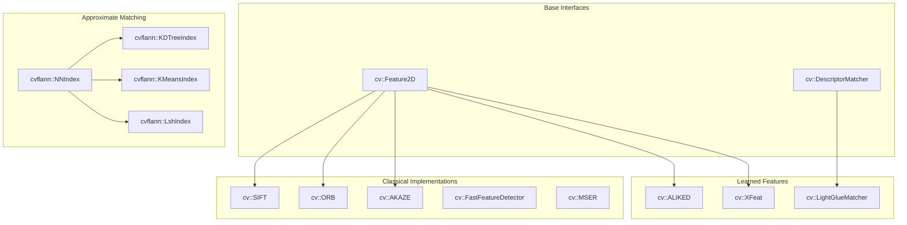
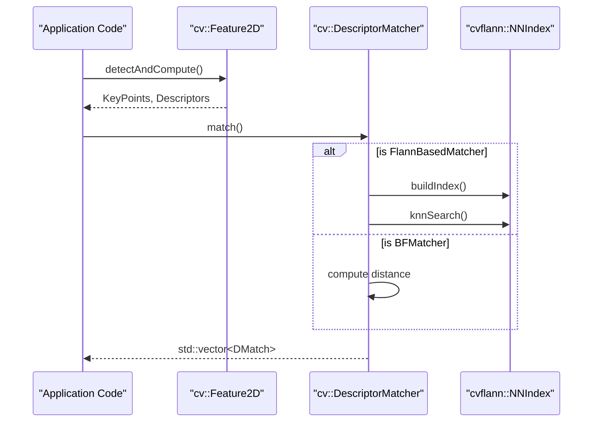

<!-- source: DeepWiki mcp.deepwiki.com · repo opencv/opencv · page 6 Feature Detection and Matching (features2d) · fetched 2026-10-30 -->

# Feature Detection and Matching (features2d)

Relevant source files

The following files were used as context for generating this wiki page:

- [doc/opencv.bib](doc/opencv.bib)
- [modules/dnn/src/layers/topk2_layer.cpp](modules/dnn/src/layers/topk2_layer.cpp)
- [modules/features/include/opencv2/features.hpp](modules/features/include/opencv2/features.hpp)
- [modules/features/src/aliked_context.hpp](modules/features/src/aliked_context.hpp)
- [modules/features/src/feature2d_aliked.cpp](modules/features/src/feature2d_aliked.cpp)
- [modules/features/src/feature2d_xfeat.cpp](modules/features/src/feature2d_xfeat.cpp)
- [modules/features/src/matchers.cpp](modules/features/src/matchers.cpp)
- [modules/features/src/matchers_lightglue.cpp](modules/features/src/matchers_lightglue.cpp)
- [modules/features/src/precomp.hpp](modules/features/src/precomp.hpp)
- [modules/features/test/test_aliked_lightglue.cpp](modules/features/test/test_aliked_lightglue.cpp)
- [modules/features/test/test_main.cpp](modules/features/test/test_main.cpp)
- [modules/features/test/test_matchers_algorithmic.cpp](modules/features/test/test_matchers_algorithmic.cpp)
- [modules/features/test/test_xfeat.cpp](modules/features/test/test_xfeat.cpp)
- [modules/geometry/doc/geometry.bib](modules/geometry/doc/geometry.bib)
- [modules/imgproc/include/opencv2/imgproc.hpp](modules/imgproc/include/opencv2/imgproc.hpp)
- [modules/imgproc/src/lsd.cpp](modules/imgproc/src/lsd.cpp)
- [modules/imgproc/test/test_lsd.cpp](modules/imgproc/test/test_lsd.cpp)
- [modules/objdetect/doc/objdetect.bib](modules/objdetect/doc/objdetect.bib)
- [samples/cpp/aliked_lightglue.cpp](samples/cpp/aliked_lightglue.cpp)

## Purpose and Scope

The `features2d` module provides fundamental computer vision capabilities for detecting, describing, and matching local image features. This module forms the foundation for tasks such as object recognition, image stitching, structure-from-motion, and visual SLAM. It implements both classical feature detectors (SIFT, ORB, AKAZE) and descriptor matching algorithms, along with supporting infrastructure for feature evaluation and visualization.

Recent updates to the OpenCV repository have introduced the `features` module (distinct from `features2d`), which hosts modern, learned local features such as **ALIKED** and **XFeat**, as well as neural matchers like **LightGlue**.

For detailed information about specific feature detection algorithms, see [Feature Detectors and Descriptors](#6.1). For in-depth coverage of matching strategies and the Bag-of-Words framework, see [Descriptor Matching and Bag-of-Words](#6.2). For modern deep-learning based features, see [Learned Local Features and Matchers (ALIKED, XFeat, LightGlue)](#6.3).

Sources: [modules/imgproc/include/opencv2/imgproc.hpp:49-53](), [modules/features/include/opencv2/features.hpp:58-82](), [modules/features/src/matchers.cpp:1-40]()

---

## Module Architecture

The feature detection ecosystem is organized into unified interfaces that transform images into feature-based representations and establish correspondences.

### Component Hierarchy

The central abstraction remains `cv::Feature2D`. However, newer learned features in the `features` module also follow similar patterns or provide specialized wrappers for DNN-based inference.

Diagram: Feature Module Class Hierarchy

Sources: [modules/features/include/opencv2/features.hpp:100-135](), [modules/features/src/feature2d_aliked.cpp:15-40](), [modules/features/src/feature2d_xfeat.cpp:10-30](), [modules/flann/include/opencv2/flann/nn_index.h:80-90]()

---

## Core Data Structures

### KeyPoint and DMatch
These structures are shared across the framework to represent local geometry and correspondences.

| Field | Type | Description |
|-------|------|-------------|
| `KeyPoint::pt` | `Point2f` | Feature location (x, y) |
| `KeyPoint::response` | `float` | Detector strength |
| `DMatch::distance` | `float` | Descriptor distance (Hamming/L2) |

Sources: [modules/features/include/opencv2/features.hpp:90-95](), [modules/features/src/matchers.cpp:158-160]()

---

## Descriptor Matching and Search Engines

OpenCV supports multiple backends for finding the nearest descriptors. While `cv::BFMatcher` (Brute-Force) is exhaustive, the `flann` module provides several specialized indices for high-dimensional search.

### FLANN Index Types
The `flann` module provides automated and manual configuration of search trees.

| Index Class | Description | Implementation |
|-------------|-------------|----------------|
| `cvflann::KDTreeIndex` | Randomized kd-trees for vector space distances | [modules/flann/include/opencv2/flann/kdtree_index.h:75-110]() |
| `cvflann::KMeansIndex` | Hierarchical k-means clustering tree | [modules/flann/include/opencv2/flann/kmeans_index.h:89-106]() |
| `cvflann::LshIndex` | Locality-sensitive hashing for binary descriptors | [modules/flann/include/opencv2/flann/lsh_index.h:82-106]() |
| `cvflann::AutotunedIndex` | Automatically selects best index and params | [modules/flann/include/opencv2/flann/autotuned_index.h:72-88]() |

Sources: [modules/flann/include/opencv2/flann/flann_base.hpp:116-135](), [modules/flann/include/opencv2/flann/lsh_table.h:137-160]()

---

## Learned Features and Neural Matchers

The `features` module introduces deep-learning based pipelines that often combine detection and description into a single forward pass.

### ALIKED and XFeat
- **ALIKED**: A lighter keypoint and descriptor extraction network using deformable transformations [doc/opencv.bib:30-36]().
- **XFeat**: Optimized for efficient local feature extraction, often used in mobile or real-time scenarios [modules/features/src/feature2d_xfeat.cpp:20-50]().

### LightGlue Neural Matcher
`cv::LightGlueMatcher` provides a high-accuracy matching backend that replaces traditional distance-based thresholds with a neural attention mechanism [modules/features/src/matchers_lightglue.cpp:10-40]().

Sources: [modules/features/src/aliked_context.hpp:10-21](), [modules/features/test/test_aliked_lightglue.cpp:1-20]()

---

## Feature Pipeline Overview

The interaction between the high-level API and the low-level search engines is illustrated below.

Diagram: Feature Detection and Matching Sequence

Sources: [modules/flann/include/opencv2/flann/flann_base.hpp:230-234](), [modules/features/src/matchers.cpp:579-600](), [modules/flann/include/opencv2/flann/kdtree_index.h:219-233]()

---

## Integration with Other Modules

- **core**: Foundations like `cv::Mat` and `cv::Algorithm`.
- **flann**: Advanced search structures for `cv::DescriptorMatcher`. [modules/flann/include/opencv2/flann/flann_base.hpp:44-46]()
- **dnn**: Powering the inference for `cv::ALIKED`, `cv::XFeat`, and `cv::LightGlueMatcher`. [modules/features/include/opencv2/features.hpp:53-55]()
- **imgproc**: Provides `cv::LineSegmentDetector` and corner detection utilities (e.g., `cv::goodFeaturesToTrack`). [modules/imgproc/src/lsd.cpp:168-185](), [modules/features/include/opencv2/features.hpp:137-163]()

Sources: [modules/features/include/opencv2/features.hpp:46-56](), [modules/flann/src/flann.cpp:1-20]()

---

