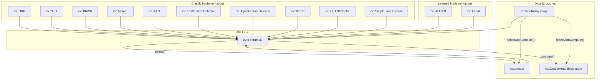
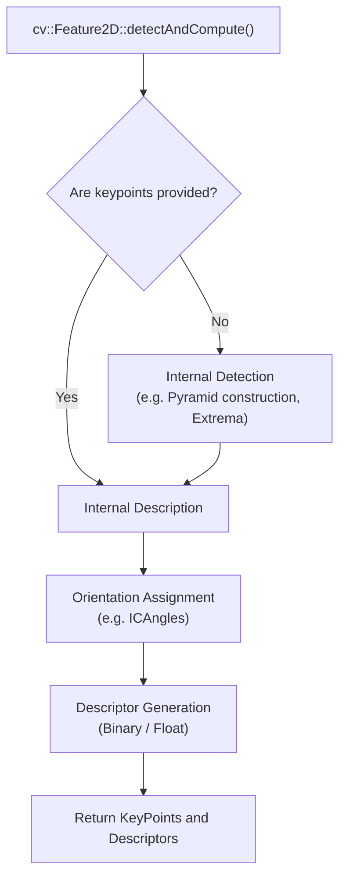

<!-- source: DeepWiki mcp.deepwiki.com · repo opencv/opencv · page 6.1 Feature Detectors and Descriptors · fetched 2026-10-30 -->

# Feature Detectors and Descriptors

Relevant source files

The following files were used as context for generating this wiki page:

- [doc/opencv.bib](doc/opencv.bib)
- [modules/calib/CMakeLists.txt](modules/calib/CMakeLists.txt)
- [modules/calib/misc/java/gen_dict.json](modules/calib/misc/java/gen_dict.json)
- [modules/calib/misc/objc/gen_dict.json](modules/calib/misc/objc/gen_dict.json)
- [modules/calib/misc/objc/test/CalibTest.swift](modules/calib/misc/objc/test/CalibTest.swift)
- [modules/calib/src/precomp.hpp](modules/calib/src/precomp.hpp)
- [modules/calib/test/test_cameracalibration_artificial.cpp](modules/calib/test/test_cameracalibration_artificial.cpp)
- [modules/calib/test/test_cameracalibration_tilt.cpp](modules/calib/test/test_cameracalibration_tilt.cpp)
- [modules/dnn/src/layers/topk2_layer.cpp](modules/dnn/src/layers/topk2_layer.cpp)
- [modules/features/include/opencv2/features.hpp](modules/features/include/opencv2/features.hpp)
- [modules/features/src/aliked_context.hpp](modules/features/src/aliked_context.hpp)
- [modules/features/src/feature2d_aliked.cpp](modules/features/src/feature2d_aliked.cpp)
- [modules/features/src/feature2d_xfeat.cpp](modules/features/src/feature2d_xfeat.cpp)
- [modules/features/src/matchers.cpp](modules/features/src/matchers.cpp)
- [modules/features/src/matchers_lightglue.cpp](modules/features/src/matchers_lightglue.cpp)
- [modules/features/src/precomp.hpp](modules/features/src/precomp.hpp)
- [modules/features/test/test_aliked_lightglue.cpp](modules/features/test/test_aliked_lightglue.cpp)
- [modules/features/test/test_main.cpp](modules/features/test/test_main.cpp)
- [modules/features/test/test_matchers_algorithmic.cpp](modules/features/test/test_matchers_algorithmic.cpp)
- [modules/features/test/test_xfeat.cpp](modules/features/test/test_xfeat.cpp)
- [modules/geometry/doc/geometry.bib](modules/geometry/doc/geometry.bib)
- [modules/geometry/include/opencv2/geometry/2d.hpp](modules/geometry/include/opencv2/geometry/2d.hpp)
- [modules/geometry/include/opencv2/geometry/3d.hpp](modules/geometry/include/opencv2/geometry/3d.hpp)
- [modules/geometry/misc/java/test/GeometryTest.java](modules/geometry/misc/java/test/GeometryTest.java)
- [modules/geometry/perf/perf_2d.cpp](modules/geometry/perf/perf_2d.cpp)
- [modules/geometry/src/fundam.cpp](modules/geometry/src/fundam.cpp)
- [modules/geometry/src/geometry.cpp](modules/geometry/src/geometry.cpp)
- [modules/geometry/src/ptsetreg.cpp](modules/geometry/src/ptsetreg.cpp)
- [modules/geometry/test/test_affine2d_estimator.cpp](modules/geometry/test/test_affine2d_estimator.cpp)
- [modules/geometry/test/test_affine_partial2d_estimator.cpp](modules/geometry/test/test_affine_partial2d_estimator.cpp)
- [modules/geometry/test/test_boundingrect.cpp](modules/geometry/test/test_boundingrect.cpp)
- [modules/imgproc/include/opencv2/imgproc.hpp](modules/imgproc/include/opencv2/imgproc.hpp)
- [modules/imgproc/misc/java/gen_dict.json](modules/imgproc/misc/java/gen_dict.json)
- [modules/imgproc/misc/java/test/ImgprocTest.java](modules/imgproc/misc/java/test/ImgprocTest.java)
- [modules/imgproc/perf/perf_contours.cpp](modules/imgproc/perf/perf_contours.cpp)
- [modules/imgproc/src/contours_common.cpp](modules/imgproc/src/contours_common.cpp)
- [modules/imgproc/src/lsd.cpp](modules/imgproc/src/lsd.cpp)
- [modules/imgproc/src/precomp.hpp](modules/imgproc/src/precomp.hpp)
- [modules/imgproc/test/test_lsd.cpp](modules/imgproc/test/test_lsd.cpp)
- [modules/objdetect/doc/objdetect.bib](modules/objdetect/doc/objdetect.bib)
- [modules/photo/misc/java/test/PhotoTest.java](modules/photo/misc/java/test/PhotoTest.java)
- [modules/python/test/test_legacy.py](modules/python/test/test_legacy.py)
- [modules/video/misc/java/test/BackgroundSubtractorMOGTest.java](modules/video/misc/java/test/BackgroundSubtractorMOGTest.java)
- [samples/android/color-blob-detection/src/org/opencv/samples/colorblobdetect/ColorBlobDetector.java](samples/android/color-blob-detection/src/org/opencv/samples/colorblobdetect/ColorBlobDetector.java)
- [samples/cpp/aliked_lightglue.cpp](samples/cpp/aliked_lightglue.cpp)

This page documents the `Feature2D` interface and its concrete implementations within the OpenCV features framework (`features2d`), covering keypoint detection, descriptor extraction, and the integrated `detectAndCompute` workflow for both classic algorithms (ORB, SIFT, FAST, AGAST, MSER, BRISK, KAZE, AKAZE, GFTT, SimpleBlobDetector) and learned pipelines (ALIKED, XFeat).

## The Feature2D Interface

The `Feature2D` class is the abstract base class for all 2D image feature detectors and descriptor extractors. It inherits from `cv::Algorithm`, providing a unified API for detection and description [modules/features/include/opencv2/features.hpp:135-139]().

### Key Methods

| Method | Description | Source Code Reference |
| :--- | :--- | :--- |
| `detect` | Identifies `KeyPoint` locations in an image or image set. | [modules/features/include/opencv2/features.hpp:151-164]() |
| `compute` | Computes descriptor vectors for a provided set of keypoints. | [modules/features/include/opencv2/features.hpp:166-180]() |
| `detectAndCompute` | Performs both detection and description in a single pass with potential optimizations. | [modules/features/include/opencv2/features.hpp:182-187]() |

### Class Hierarchy and Data Flow

Title: "Feature2D Class Hierarchy and Data Flow"

Sources: [modules/features/include/opencv2/features.hpp:135-212](), [modules/features/src/feature2d_aliked.cpp:1-50](), [modules/features/src/feature2d_xfeat.cpp:1-50]()

## Concrete Implementations

### ORB (Oriented FAST and Rotated BRIEF)
ORB combines the FAST keypoint detector with the BRIEF descriptor, adding orientation compensation.
- **Orientation**: Computes intensity centroid around the keypoint via `ICAngles` to assign rotation invariance.
- **Descriptor**: Steered BRIEF descriptor that rotates the binary test pattern according to the keypoint orientation.
Sources: [modules/features/include/opencv2/features.hpp:135-212]()

### SIFT (Scale-Invariant Feature Transform)
SIFT detects scale- and rotation-invariant features using scale-space extrema.
- **Implementation**: Constructs a Gaussian pyramid and calculates Difference-of-Gaussian (DoG) scale-space extrema.
- **Optimization**: Leverages SIMD intrinsics for gradient calculations and orientation histograms.
Sources: [modules/features/include/opencv2/features.hpp:135-212]()

### FAST and AGAST
High-speed corner detectors evaluating local pixel circles.
- **FAST (`cv::FastFeatureDetector`)**: Examines a 16-pixel circular neighborhood [modules/python/test/test_legacy.py:53-56]().
- **AGAST (`cv::AgastFeatureDetector`)**: Uses optimized decision trees for faster threshold comparisons.
Sources: [modules/python/test/test_legacy.py:53-56]()

### KAZE and AKAZE
Non-linear scale space feature detectors.
- **KAZE (`cv::KAZE`)**: Uses Fast Explicit Diffusion (FED) [doc/opencv.bib:1-14]() to smooth images while preserving object boundaries.
- **AKAZE (`cv::AKAZE`)**: Accelerated-KAZE utilizing M-LDB binary descriptors.
Sources: [doc/opencv.bib:1-14]()

### MSER, BRISK, GFTT, and SimpleBlobDetector
- **MSER (`cv::MSER`)**: Maximally Stable Extremal Regions for blob detection across multiple intensity thresholds.
- **BRISK (`cv::BRISK`)**: Binary Robust Invariant Scalable Keypoints, using a scale-space of FAST detectors and a circular sampling pattern descriptor.
- **GFTT (`cv::GFTTDetector`)**: Good Features to Track corner detector based on Shi-Tomasi eigenvalue criteria.
- **SimpleBlobDetector (`cv::SimpleBlobDetector`)**: Filters connected components based on circularity, convexity, and inertia.
Sources: [modules/features/include/opencv2/features.hpp:135-212]()

### Learned Features: ALIKED and XFeat
Modern feature pipelines integrated into the `Feature2D` interface via the `dnn` module.
- **ALIKED (`cv::ALIKED`)**: Network producing 128-dimensional float descriptors (`CV_32F`) [modules/features/test/test_aliked_lightglue.cpp:20-24]().
- **XFeat (`cv::XFeat`)**: Lightweight neural feature extractor designed for real-time edge processing.
Sources: [modules/features/test/test_aliked_lightglue.cpp:14-76](), [modules/features/src/feature2d_xfeat.cpp:1-50]()

## Execution Flow: detectAndCompute

The `detectAndCompute` method performs detection and description in a single pass to eliminate redundant computations.

Title: "detectAndCompute Execution Flow"

Sources: [modules/features/include/opencv2/features.hpp:182-187](), [modules/features/test/test_aliked_lightglue.cpp:33-34]()

## Hardware Acceleration and Learned Matchers

Many features benefit from OpenCL acceleration (`UMat`) or DNN inference backends.

| Component | Acceleration / Backend | Source Reference |
| :--- | :--- | :--- |
| **BFMatcher** | OpenCL `BruteForceMatch_Match` / `KnnMatch` kernels | [modules/features/src/matchers.cpp:110-210]() |
| **ALIKED / XFeat** | DNN Module (CUDA, OpenCL, CPU) | [modules/features/test/test_aliked_lightglue.cpp:14-76]() |
| **LightGlueMatcher** | `cv::dnn::Net` inference (`aliked_lightglue.onnx`) | [modules/features/test/test_aliked_lightglue.cpp:78-148]() |

Sources: [modules/features/src/matchers.cpp:110-210](), [modules/features/test/test_aliked_lightglue.cpp:14-148]()

---

