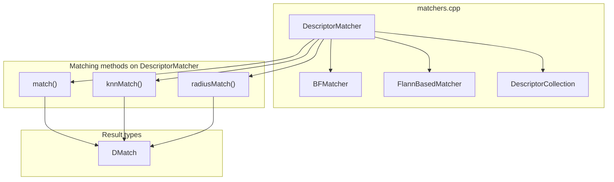
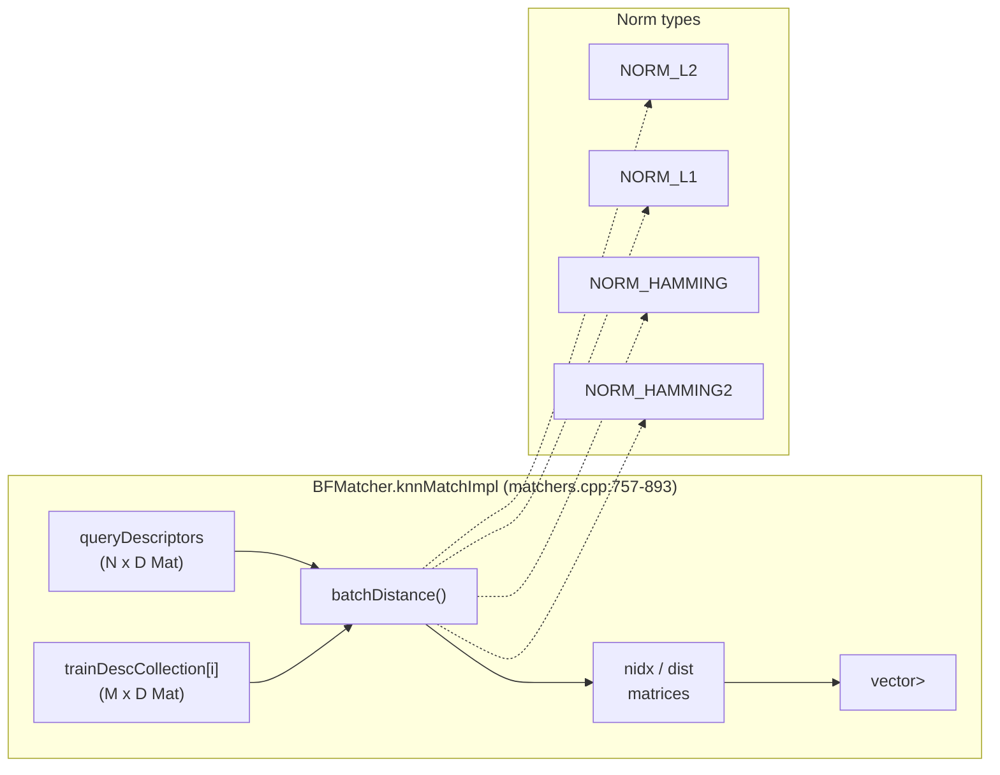
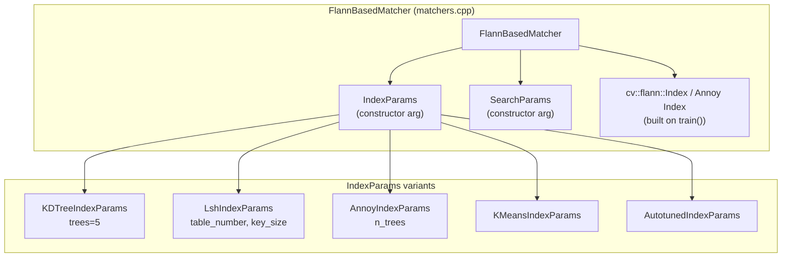
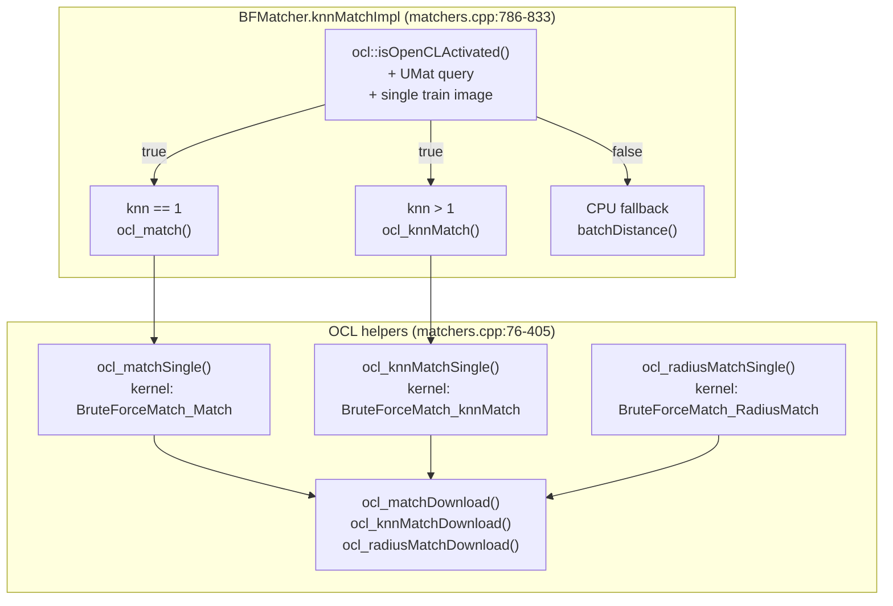
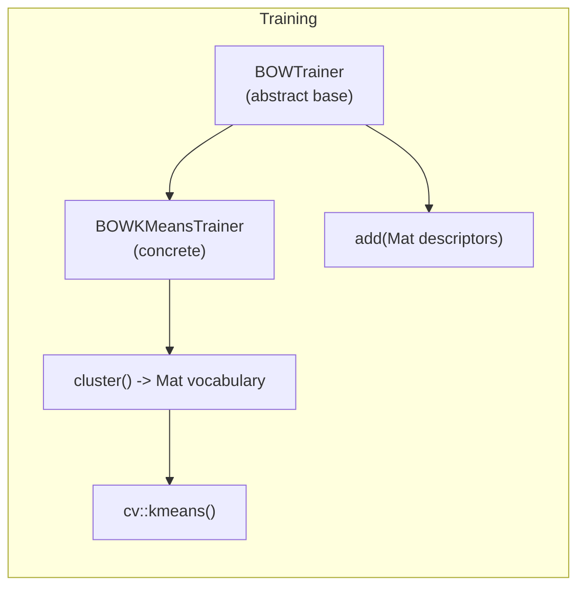
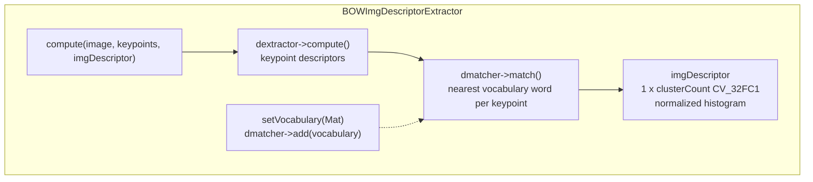
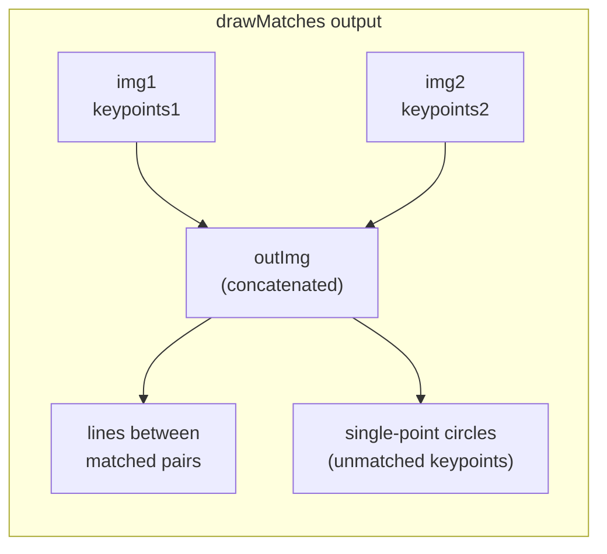

<!-- source: DeepWiki mcp.deepwiki.com · repo opencv/opencv · page 6.2 Descriptor Matching and Bag-of-Words · fetched 2026-10-30 -->

# Descriptor Matching and Bag-of-Words

Relevant source files

The following files were used as context for generating this wiki page:

- [.github/workflows/PR-5.x.yaml](.github/workflows/PR-5.x.yaml)
- [cmake/checks/cpu_neon.cpp](cmake/checks/cpu_neon.cpp)
- [cmake/checks/cpu_vsx_asm.cpp](cmake/checks/cpu_vsx_asm.cpp)
- [doc/opencv.bib](doc/opencv.bib)
- [hal/carotene/include/carotene/types.hpp](hal/carotene/include/carotene/types.hpp)
- [modules/core/include/opencv2/core/affine.hpp](modules/core/include/opencv2/core/affine.hpp)
- [modules/core/include/opencv2/core/fast_math.hpp](modules/core/include/opencv2/core/fast_math.hpp)
- [modules/core/include/opencv2/core/vsx_utils.hpp](modules/core/include/opencv2/core/vsx_utils.hpp)
- [modules/core/perf/perf_gemm.cpp](modules/core/perf/perf_gemm.cpp)
- [modules/core/test/test_allocator.cpp](modules/core/test/test_allocator.cpp)
- [modules/dnn/perf/perf_utils.cpp](modules/dnn/perf/perf_utils.cpp)
- [modules/dnn/src/dnn_utils.cpp](modules/dnn/src/dnn_utils.cpp)
- [modules/dnn/src/layers/topk2_layer.cpp](modules/dnn/src/layers/topk2_layer.cpp)
- [modules/features/3rdparty/annoy/annoylib.h](modules/features/3rdparty/annoy/annoylib.h)
- [modules/features/include/opencv2/features.hpp](modules/features/include/opencv2/features.hpp)
- [modules/features/src/aliked_context.hpp](modules/features/src/aliked_context.hpp)
- [modules/features/src/annoy.cpp](modules/features/src/annoy.cpp)
- [modules/features/src/feature2d_aliked.cpp](modules/features/src/feature2d_aliked.cpp)
- [modules/features/src/feature2d_xfeat.cpp](modules/features/src/feature2d_xfeat.cpp)
- [modules/features/src/matchers.cpp](modules/features/src/matchers.cpp)
- [modules/features/src/matchers_lightglue.cpp](modules/features/src/matchers_lightglue.cpp)
- [modules/features/src/precomp.hpp](modules/features/src/precomp.hpp)
- [modules/features/test/test_aliked_lightglue.cpp](modules/features/test/test_aliked_lightglue.cpp)
- [modules/features/test/test_main.cpp](modules/features/test/test_main.cpp)
- [modules/features/test/test_matchers_algorithmic.cpp](modules/features/test/test_matchers_algorithmic.cpp)
- [modules/features/test/test_xfeat.cpp](modules/features/test/test_xfeat.cpp)
- [modules/flann/include/opencv2/flann.hpp](modules/flann/include/opencv2/flann.hpp)
- [modules/flann/include/opencv2/flann/all_indices.h](modules/flann/include/opencv2/flann/all_indices.h)
- [modules/flann/include/opencv2/flann/defines.h](modules/flann/include/opencv2/flann/defines.h)
- [modules/flann/include/opencv2/flann/dist.h](modules/flann/include/opencv2/flann/dist.h)
- [modules/flann/include/opencv2/flann/miniflann.hpp](modules/flann/include/opencv2/flann/miniflann.hpp)
- [modules/flann/src/miniflann.cpp](modules/flann/src/miniflann.cpp)
- [modules/flann/test/test_radius_search.cpp](modules/flann/test/test_radius_search.cpp)
- [modules/geometry/doc/geometry.bib](modules/geometry/doc/geometry.bib)
- [modules/imgproc/include/opencv2/imgproc.hpp](modules/imgproc/include/opencv2/imgproc.hpp)
- [modules/imgproc/src/lsd.cpp](modules/imgproc/src/lsd.cpp)
- [modules/imgproc/test/test_lsd.cpp](modules/imgproc/test/test_lsd.cpp)
- [modules/objdetect/doc/objdetect.bib](modules/objdetect/doc/objdetect.bib)
- [modules/objdetect/src/aruco/apriltag/unionfind.hpp](modules/objdetect/src/aruco/apriltag/unionfind.hpp)
- [modules/photo/src/ccm/ccm.cpp](modules/photo/src/ccm/ccm.cpp)
- [modules/photo/src/ccm/color.hpp](modules/photo/src/ccm/color.hpp)
- [modules/photo/src/ccm/colorspace.hpp](modules/photo/src/ccm/colorspace.hpp)
- [modules/photo/src/ccm/illumobserver.hpp](modules/photo/src/ccm/illumobserver.hpp)
- [modules/photo/src/ccm/linearize.hpp](modules/photo/src/ccm/linearize.hpp)
- [modules/photo/src/ccm/operations.hpp](modules/photo/src/ccm/operations.hpp)
- [samples/cpp/aliked_lightglue.cpp](samples/cpp/aliked_lightglue.cpp)

This page documents the descriptor matching and bag-of-words subsystems within `opencv_features2d`. It covers the `DescriptorMatcher` base interface, the `BFMatcher` (brute-force) and `FlannBasedMatcher` implementations, kNN and radius matching, ANNOY-based indices, the Bag-of-Words model, and keypoint drawing utilities.

For feature detection and descriptor computation, see page 6.1. For geometric uses of matches (homography, pose estimation), see page 8.2.

Sources: [modules/features/include/opencv2/features.hpp:858-1014]()

## Core Matching Architecture

The matching system is built around `DescriptorMatcher` as an abstract base class [modules/features/include/opencv2/features.hpp:858-861](). Two concrete implementations are provided: `BFMatcher` (exhaustive search) [modules/features/include/opencv2/features.hpp:1016-1035]() and `FlannBasedMatcher` (approximate nearest-neighbor search via the `opencv_flann` module and ANNOY indices) [modules/features/include/opencv2/features.hpp:1037-1055]().

**Class hierarchy and matching API diagram:**

Sources: [modules/features/src/matchers.cpp:411-678](), [modules/features/include/opencv2/features.hpp:858-1014]()

### DescriptorMatcher Base Class

`DescriptorMatcher` in [modules/features/src/matchers.cpp]() manages the training descriptor collection and dispatches the three matching modes to subclass implementations (`knnMatchImpl`, `radiusMatchImpl`) [modules/features/src/matchers.cpp:515-678]().

Training descriptors are stored in two parallel collections:
- `trainDescCollection` — `vector<Mat>` for CPU descriptors [modules/features/include/opencv2/features.hpp:1008-1008]()
- `utrainDescCollection` — `vector<UMat>` for OpenCL-backed descriptors [modules/features/include/opencv2/features.hpp:1009-1009]()

The internal `DescriptorCollection` helper [modules/features/src/matchers.cpp:411-510]() merges all training images' descriptors into a single `mergedDescriptors` matrix and records `startIdxs` per image to translate global indices back to `(imgIdx, localDescIdx)` pairs.

| Method | Description | Output type |
|--------|-------------|-------------|
| `add()` | Append train descriptors [modules/features/include/opencv2/features.hpp:915-915]() | — |
| `train()` | Build index (subclass override) [modules/features/include/opencv2/features.hpp:920-920]() | — |
| `match()` | Best match per query descriptor [modules/features/include/opencv2/features.hpp:930-935]() | `vector<DMatch>` |
| `knnMatch()` | k nearest matches per query [modules/features/include/opencv2/features.hpp:940-955]() | `vector<vector<DMatch>>` |
| `radiusMatch()` | All matches within distance threshold [modules/features/include/opencv2/features.hpp:960-975]() | `vector<vector<DMatch>>` |
| `create()` | Factory: create by string name [modules/features/include/opencv2/features.hpp:995-1000]() | `Ptr<DescriptorMatcher>` |

`match()` internally calls `knnMatch()` with `k=1` and flattens the result via `convertMatches()` [modules/features/src/matchers.cpp:515-526]().

Sources: [modules/features/src/matchers.cpp:411-678](), [modules/features/include/opencv2/features.hpp:858-1014]()

### BFMatcher

`BFMatcher` performs an exhaustive comparison of every query descriptor against every training descriptor using `batchDistance()` [modules/features/src/matchers.cpp:757-893](). It guarantees exact nearest-neighbor results at the cost of O(N·M) comparisons.

**BFMatcher internal flow:**

Constructor parameters:
- `normType` — distance metric; must match descriptor type (e.g. `NORM_HAMMING` for ORB/BRISK, `NORM_L2` for SIFT) [modules/features/src/matchers.cpp:712-713]()
- `crossCheck` — when `true`, a match `(i,j)` is only returned if descriptor `j` also finds `i` as its best match, reducing false positives [modules/features/src/matchers.cpp:714-714]()

The `create()` factory method [modules/features/src/matchers.cpp:1022-1048]() accepts string aliases: `"BruteForce"` (L2), `"BruteForce-L1"`, `"BruteForce-Hamming"`, `"BruteForce-Hamming(2)"`, `"BruteForce-SL2"`.

Sources: [modules/features/src/matchers.cpp:708-1015]()

### FlannBasedMatcher and ANNOY-Based Indices

`FlannBasedMatcher` wraps approximate nearest-neighbor index structures. Beyond traditional FLANN indices (kd-trees, LSH, k-means trees), OpenCV integrates **ANNOY** (Approximate Nearest Neighbors Oh Yeah) via [modules/features/src/annoy.cpp]() and [modules/features/3rdparty/annoy/annoylib.h](), providing high-performance tree-based vector searching for high-dimensional feature spaces.

**FlannBasedMatcher and ANNOY integration:**

Sources: [modules/features/src/matchers.cpp:1053-1229](), [modules/features/src/annoy.cpp:1-150](), [modules/features/3rdparty/annoy/annoylib.h:1-100]()

Index type selection guidance:

| IndexParams | Best for | Notes |
|---|---|---|
| `KDTreeIndexParams` | Float descriptors (SIFT) | Fast, approximate; multiple trees improve recall [modules/flann/src/miniflann.cpp:199-204]() |
| `LshIndexParams` | Binary descriptors (ORB) | Hash-based LSH tables [modules/flann/src/miniflann.cpp:257-263]() |
| `AnnoyIndexParams` | High-dimensional float vectors | Random projection trees implemented in [modules/features/src/annoy.cpp]() |
| `AutotunedIndexParams` | Unknown descriptor type | Benchmarks and selects best index [modules/flann/src/miniflann.cpp:229-242]() |

`train()` builds the underlying index on merged training descriptors [modules/features/src/matchers.cpp:1115-1152](), and `knnMatchImpl` executes searches [modules/features/src/matchers.cpp:1154-1191]().

Sources: [modules/features/src/matchers.cpp:1053-1229](), [modules/features/src/annoy.cpp:1-150]()

### OpenCL Acceleration in BFMatcher

`BFMatcher` has an OpenCL fast path for `knnMatch` and `radiusMatch` that activates when OpenCL is available and query descriptors are `UMat` [modules/features/src/matchers.cpp:786-833]().

**OpenCL kernel dispatch for BFMatcher:**

The kernels use a `BLOCK_SIZE` of 16 [modules/features/src/matchers.cpp:98-98]() and determine `MAX_DESC_LEN` based on descriptor dimensions [modules/features/src/matchers.cpp:101-104]().

Sources: [modules/features/src/matchers.cpp:76-405](), [modules/features/src/matchers.cpp:786-960]()

## Keypoint Filtering Utilities

`KeyPointsFilter` provides static helper methods for post-processing raw keypoint lists [modules/features/include/opencv2/features.hpp:100-135]().

| Method | Behavior |
|--------|----------|
| `retainBest(keypoints, n)` | Keep top-N by `response` [modules/features/include/opencv2/features.hpp:134-134]() |
| `runByImageBorder(keypoints, imageSize, borderSize)` | Remove keypoints near image edges [modules/features/include/opencv2/features.hpp:108-108]() |
| `runByKeypointSize(keypoints, minSize, maxSize)` | Remove keypoints outside size range [modules/features/include/opencv2/features.hpp:112-113]() |
| `runByPixelsMask(keypoints, mask)` | Remove keypoints at masked-out pixels [modules/features/include/opencv2/features.hpp:117-117]() |
| `removeDuplicated(keypoints)` | Remove exact duplicates [modules/features/include/opencv2/features.hpp:125-125]() |

Sources: [modules/features/include/opencv2/features.hpp:100-135]()

## Bag-of-Words Model

The bag-of-words (BoW) system provides a two-phase pipeline for image classification: vocabulary training and per-image histogram extraction.

### Vocabulary Training

**BoW training class hierarchy:**

`BOWTrainer` accumulates descriptor matrices into an internal collection. `BOWKMeansTrainer` merges these and runs `cv::kmeans()` to find cluster centers (visual words).

Sources: [modules/features/include/opencv2/features.hpp:700-750]()

### Image Descriptor Extraction

`BOWImgDescriptorExtractor` converts keypoint descriptors from a single image into a fixed-length normalized histogram using a pre-built vocabulary [modules/features/include/opencv2/features.hpp:760-820]().

**BOWImgDescriptorExtractor data flow:**

`compute()` iterates over matches and increments the corresponding bin in the histogram, then normalizes by the number of descriptors.

Sources: [modules/features/include/opencv2/features.hpp:760-820]()

## Keypoint and Match Drawing Utilities

Visualization utilities are provided for debugging and display.

### drawKeypoints
`drawKeypoints` draws keypoints as circles. If `DRAW_RICH_KEYPOINTS` is passed, circles are scaled by keypoint size and lines show orientation [modules/features/include/opencv2/features.hpp:57-82]().

### drawMatches
`drawMatches` concatenates two images and draws lines between matched points [modules/features/include/opencv2/features.hpp:57-82]().

**drawMatches output layout:**

Sources: [modules/features/include/opencv2/features.hpp:57-82]()

---

