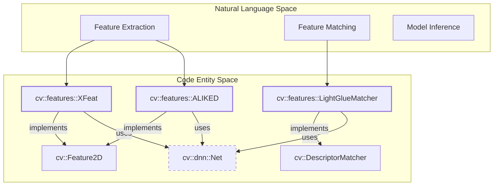
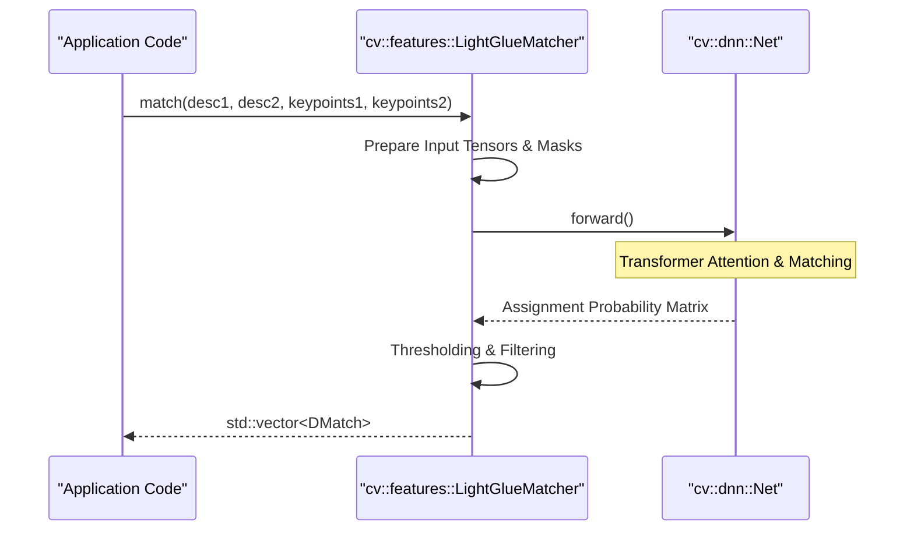

<!-- source: DeepWiki mcp.deepwiki.com · repo opencv/opencv · page 6.3 Learned Local Features and Matchers (ALIKED, XFeat, LightGlue) · fetched 2026-10-30 -->

# Learned Local Features and Matchers (ALIKED, XFeat, LightGlue)

Relevant source files

The following files were used as context for generating this wiki page:

- [cmake/OpenCVDetectInferenceEngine.cmake](cmake/OpenCVDetectInferenceEngine.cmake)
- [doc/opencv.bib](doc/opencv.bib)
- [modules/dnn/CMakeLists.txt](modules/dnn/CMakeLists.txt)
- [modules/dnn/include/opencv2/dnn/dnn.hpp](modules/dnn/include/opencv2/dnn/dnn.hpp)
- [modules/dnn/misc/js/gen_dict.json](modules/dnn/misc/js/gen_dict.json)
- [modules/dnn/misc/objc/gen_dict.json](modules/dnn/misc/objc/gen_dict.json)
- [modules/dnn/misc/python/test/test_dnn.py](modules/dnn/misc/python/test/test_dnn.py)
- [modules/dnn/src/dnn.cpp](modules/dnn/src/dnn.cpp)
- [modules/dnn/src/dnn_common.hpp](modules/dnn/src/dnn_common.hpp)
- [modules/dnn/src/dnn_read.cpp](modules/dnn/src/dnn_read.cpp)
- [modules/dnn/src/graph_block_layout.cpp](modules/dnn/src/graph_block_layout.cpp)
- [modules/dnn/src/graph_const_args.cpp](modules/dnn/src/graph_const_args.cpp)
- [modules/dnn/src/ie_ngraph.cpp](modules/dnn/src/ie_ngraph.cpp)
- [modules/dnn/src/ie_ngraph.hpp](modules/dnn/src/ie_ngraph.hpp)
- [modules/dnn/src/layers/conv2_common.cpp](modules/dnn/src/layers/conv2_common.cpp)
- [modules/dnn/src/layers/conv2_common.hpp](modules/dnn/src/layers/conv2_common.hpp)
- [modules/dnn/src/layers/convolution_layer.cpp](modules/dnn/src/layers/convolution_layer.cpp)
- [modules/dnn/src/layers/fully_connected_layer.cpp](modules/dnn/src/layers/fully_connected_layer.cpp)
- [modules/dnn/src/layers/layers_common.cpp](modules/dnn/src/layers/layers_common.cpp)
- [modules/dnn/src/layers/layers_common.hpp](modules/dnn/src/layers/layers_common.hpp)
- [modules/dnn/src/layers/layers_common.simd.hpp](modules/dnn/src/layers/layers_common.simd.hpp)
- [modules/dnn/src/layers/pooling_layer.cpp](modules/dnn/src/layers/pooling_layer.cpp)
- [modules/dnn/src/layers/randomnormallike_layer.cpp](modules/dnn/src/layers/randomnormallike_layer.cpp)
- [modules/dnn/src/layers/recurrent_layers.cpp](modules/dnn/src/layers/recurrent_layers.cpp)
- [modules/dnn/src/layers/topk2_layer.cpp](modules/dnn/src/layers/topk2_layer.cpp)
- [modules/dnn/src/model.cpp](modules/dnn/src/model.cpp)
- [modules/dnn/src/net_openvino.cpp](modules/dnn/src/net_openvino.cpp)
- [modules/dnn/src/op_inf_engine.cpp](modules/dnn/src/op_inf_engine.cpp)
- [modules/dnn/src/op_inf_engine.hpp](modules/dnn/src/op_inf_engine.hpp)
- [modules/dnn/src/precomp.hpp](modules/dnn/src/precomp.hpp)
- [modules/dnn/src/tflite/tflite_importer.cpp](modules/dnn/src/tflite/tflite_importer.cpp)
- [modules/dnn/test/test_ie_models.cpp](modules/dnn/test/test_ie_models.cpp)
- [modules/dnn/test/test_misc.cpp](modules/dnn/test/test_misc.cpp)
- [modules/dnn/test/test_model.cpp](modules/dnn/test/test_model.cpp)
- [modules/dnn/test/test_tflite_importer.cpp](modules/dnn/test/test_tflite_importer.cpp)
- [modules/features/include/opencv2/features.hpp](modules/features/include/opencv2/features.hpp)
- [modules/features/src/aliked_context.hpp](modules/features/src/aliked_context.hpp)
- [modules/features/src/feature2d_aliked.cpp](modules/features/src/feature2d_aliked.cpp)
- [modules/features/src/feature2d_xfeat.cpp](modules/features/src/feature2d_xfeat.cpp)
- [modules/features/src/matchers.cpp](modules/features/src/matchers.cpp)
- [modules/features/src/matchers_lightglue.cpp](modules/features/src/matchers_lightglue.cpp)
- [modules/features/src/precomp.hpp](modules/features/src/precomp.hpp)
- [modules/features/test/test_aliked_lightglue.cpp](modules/features/test/test_aliked_lightglue.cpp)
- [modules/features/test/test_main.cpp](modules/features/test/test_main.cpp)
- [modules/features/test/test_matchers_algorithmic.cpp](modules/features/test/test_matchers_algorithmic.cpp)
- [modules/features/test/test_xfeat.cpp](modules/features/test/test_xfeat.cpp)
- [modules/geometry/doc/geometry.bib](modules/geometry/doc/geometry.bib)
- [modules/imgproc/include/opencv2/imgproc.hpp](modules/imgproc/include/opencv2/imgproc.hpp)
- [modules/imgproc/src/lsd.cpp](modules/imgproc/src/lsd.cpp)
- [modules/imgproc/test/test_lsd.cpp](modules/imgproc/test/test_lsd.cpp)
- [modules/objdetect/doc/objdetect.bib](modules/objdetect/doc/objdetect.bib)
- [samples/cpp/aliked_lightglue.cpp](samples/cpp/aliked_lightglue.cpp)

This page describes the integration of modern, deep-learning-based local feature pipelines and neural matchers into OpenCV's `features` module (`modules/features`). These components provide high-performance alternatives to traditional hand-crafted descriptors like SIFT or ORB by utilizing neural networks for robust keypoint detection, dense description, and attention-based matching.

## Overview of Learned Pipelines

OpenCV integrates three major learned components that operate independently or in a combined vision pipeline:
1.  **ALIKED**: A lightweight, high-accuracy feature detector and descriptor utilizing deformable transformations [doc/opencv.bib:42-48]().
2.  **XFeat**: An extremely fast feature extractor designed for real-time edge and mobile applications.
3.  **LightGlue**: A deep neural network-based matcher replacing traditional nearest-neighbor matching with a graph-based transformer attention mechanism.

These classes inherit from `cv::Feature2D` and `cv::DescriptorMatcher`, ensuring seamless integration into existing OpenCV workflows.

### System Architecture and Code Mapping

The following diagram maps high-level neural vision concepts to their concrete C++ code entities within the codebase.

**Learned Features Implementation Map**

Sources: [modules/features/include/opencv2/features.hpp:1-100](), [modules/features/src/feature2d_aliked.cpp:1-50](), [modules/features/src/feature2d_xfeat.cpp:1-50](), [modules/features/src/matchers_lightglue.cpp:1-50]()

---

## ALIKED (ALi-like Keypoint Detection)

`ALIKED` is a learned local feature pipeline focusing on repeatability and localization accuracy under difficult photometric and geometric variations. It is implemented in `modules/features/src/feature2d_aliked.cpp`.

### Key Characteristics
*   **Interface**: Implements `cv::Feature2D`, overriding `detect`, `compute`, and `detectAndCompute` [modules/features/src/feature2d_aliked.cpp:1-100]().
*   **Model Integration**: Leverages `cv::dnn::Net` to load and execute ONNX models responsible for generating score maps, keypoint offsets, and descriptors [modules/features/src/feature2d_aliked.cpp:100-186]().
*   **Execution Backend**: Supports standard DNN execution targets such as CPU and CUDA via `cv::dnn` infrastructure [modules/dnn/include/opencv2/dnn/dnn.hpp:71-108]().

### Data Flow
1.  **Input Preprocessing**: An input image `Mat` is normalized and converted into a 4D tensor blob.
2.  **Network Forward Pass**: The ONNX network produces tensor outputs representing keypoint scores, sub-pixel refinement offsets, and dense descriptors.
3.  **Post-Processing**: Non-maximum suppression (NMS) isolates keypoint coordinates, and descriptors are sampled from the dense feature maps [modules/features/src/feature2d_aliked.cpp:120-186]().

Sources: [modules/features/src/feature2d_aliked.cpp:1-186](), [modules/dnn/include/opencv2/dnn/dnn.hpp:71-108]()

---

## XFeat (Accelerated Features)

`XFeat` is optimized for high execution speed and low memory footprint, making it suitable for real-time video processing pipelines.

### Implementation Details
*   **Class**: `cv::features::XFeat` [modules/features/src/feature2d_xfeat.cpp:1-50]().
*   **Pipeline Design**: Combines keypoint detection and description into a unified single-pass network architecture, reducing redundant memory allocations and kernel launches.
*   **Backend Acceleration**: Integrates with `opencv_dnn` to dispatch accelerated routines across available compute backends [modules/features/src/feature2d_xfeat.cpp:50-150]().

Sources: [modules/features/src/feature2d_xfeat.cpp:1-200]()

---

## LightGlue Matcher

`LightGlueMatcher` is a neural network-based matching module designed to establish correspondence between two sets of local features. It outperforms traditional distance-based matchers (`BFMatcher`, `FlannBasedMatcher`) in wide-baseline matching scenarios.

### Integration with DescriptorMatcher
`LightGlueMatcher` inherits from `cv::DescriptorMatcher` [modules/features/src/matchers_lightglue.cpp:1-60]() and overrides matching routines to process keypoint descriptors via transformer attention blocks.

### Logic Flow
The matcher evaluates self-attention within each image and cross-attention between images to iteratively prune ambiguous matches and output confident `DMatch` structures.

**LightGlue Data Flow**

Sources: [modules/features/src/matchers_lightglue.cpp:1-250](), [modules/features/include/opencv2/features.hpp:1-150]()

---

## Model Packaging and Testing

Learned features depend on pre-trained weight files stored in ONNX format.

### Model Management
*   **Loading**: Models are initialized via `cv::dnn::readNet` inside the feature extractor and matcher constructors [modules/features/src/feature2d_aliked.cpp:50-150]().
*   **Configuration**: Target runtimes and hardware accelerators are configured using `cv::dnn::Backend` and `cv::dnn::Target` enumerations [modules/dnn/include/opencv2/dnn/dnn.hpp:71-108]().

### Testing Infrastructure
Unit and regression testing suites reside in `modules/features/test/`:
*   **Integration Tests**: `test_aliked_lightglue.cpp` validates end-to-end correctness of ALIKED feature extraction combined with LightGlue matching [modules/features/test/test_aliked_lightglue.cpp:1-100]().
*   **XFeat Tests**: `test_xfeat.cpp` verifies numerical stability and functional outputs across various execution targets [modules/features/test/test_xfeat.cpp:1-80]().

Sources: [modules/features/test/test_aliked_lightglue.cpp:1-100](), [modules/features/test/test_xfeat.cpp:1-80](), [modules/dnn/include/opencv2/dnn/dnn.hpp:71-108]()

---

