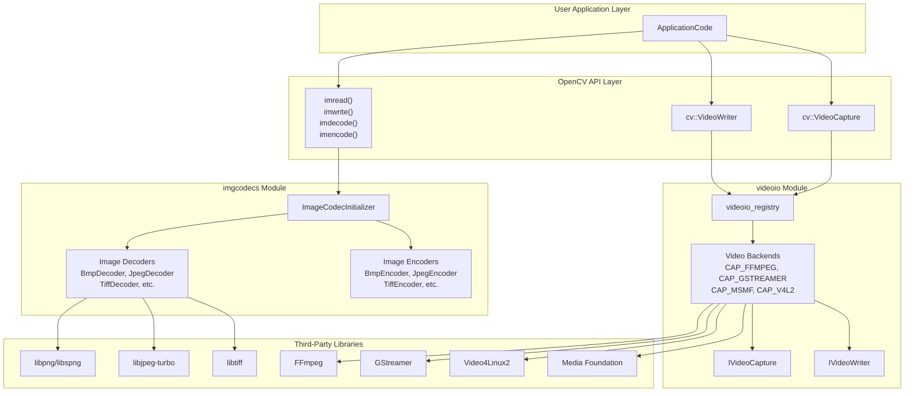
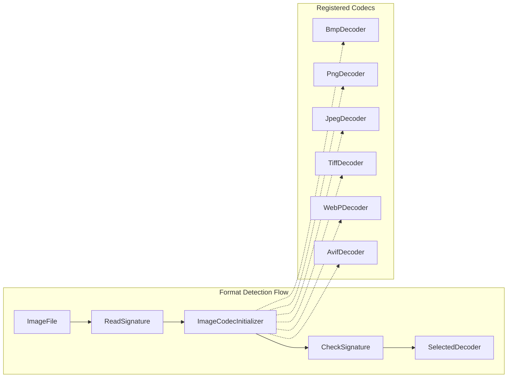
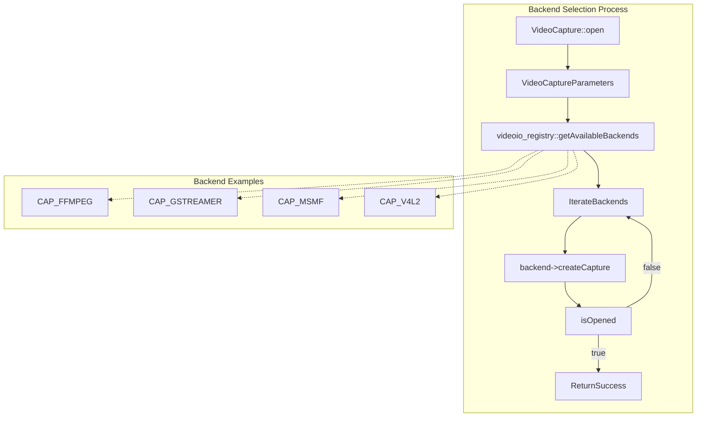

<!-- source: DeepWiki mcp.deepwiki.com · repo opencv/opencv · page 7 Media I/O · fetched 2026-10-30 -->

# Media I/O

Relevant source files

The following files were used as context for generating this wiki page:

- [.gitattributes](.gitattributes)
- [3rdparty/ffmpeg/.gitignore](3rdparty/ffmpeg/.gitignore)
- [3rdparty/ffmpeg/ffmpeg-download.ps1.in](3rdparty/ffmpeg/ffmpeg-download.ps1.in)
- [3rdparty/ffmpeg/ffmpeg.cmake](3rdparty/ffmpeg/ffmpeg.cmake)
- [3rdparty/ffmpeg/readme.txt](3rdparty/ffmpeg/readme.txt)
- [cmake/OpenCVFindLibsGrfmt.cmake](cmake/OpenCVFindLibsGrfmt.cmake)
- [cmake/OpenCVFindOpenEXR.cmake](cmake/OpenCVFindOpenEXR.cmake)
- [cmake/templates/vs_version.rc.in](cmake/templates/vs_version.rc.in)
- [modules/imgcodecs/CMakeLists.txt](modules/imgcodecs/CMakeLists.txt)
- [modules/imgcodecs/include/opencv2/imgcodecs.hpp](modules/imgcodecs/include/opencv2/imgcodecs.hpp)
- [modules/imgcodecs/perf/perf_jpeg.cpp](modules/imgcodecs/perf/perf_jpeg.cpp)
- [modules/imgcodecs/perf/perf_png.cpp](modules/imgcodecs/perf/perf_png.cpp)
- [modules/imgcodecs/src/exif.cpp](modules/imgcodecs/src/exif.cpp)
- [modules/imgcodecs/src/exif.hpp](modules/imgcodecs/src/exif.hpp)
- [modules/imgcodecs/src/grfmt_avif.cpp](modules/imgcodecs/src/grfmt_avif.cpp)
- [modules/imgcodecs/src/grfmt_avif.hpp](modules/imgcodecs/src/grfmt_avif.hpp)
- [modules/imgcodecs/src/grfmt_base.cpp](modules/imgcodecs/src/grfmt_base.cpp)
- [modules/imgcodecs/src/grfmt_base.hpp](modules/imgcodecs/src/grfmt_base.hpp)
- [modules/imgcodecs/src/grfmt_exr.cpp](modules/imgcodecs/src/grfmt_exr.cpp)
- [modules/imgcodecs/src/grfmt_exr.hpp](modules/imgcodecs/src/grfmt_exr.hpp)
- [modules/imgcodecs/src/grfmt_gif.cpp](modules/imgcodecs/src/grfmt_gif.cpp)
- [modules/imgcodecs/src/grfmt_gif.hpp](modules/imgcodecs/src/grfmt_gif.hpp)
- [modules/imgcodecs/src/grfmt_jpeg.cpp](modules/imgcodecs/src/grfmt_jpeg.cpp)
- [modules/imgcodecs/src/grfmt_jpeg.hpp](modules/imgcodecs/src/grfmt_jpeg.hpp)
- [modules/imgcodecs/src/grfmt_jpeg2000.cpp](modules/imgcodecs/src/grfmt_jpeg2000.cpp)
- [modules/imgcodecs/src/grfmt_png.cpp](modules/imgcodecs/src/grfmt_png.cpp)
- [modules/imgcodecs/src/grfmt_png.hpp](modules/imgcodecs/src/grfmt_png.hpp)
- [modules/imgcodecs/src/grfmt_spng.cpp](modules/imgcodecs/src/grfmt_spng.cpp)
- [modules/imgcodecs/src/grfmt_tiff.cpp](modules/imgcodecs/src/grfmt_tiff.cpp)
- [modules/imgcodecs/src/grfmt_tiff.hpp](modules/imgcodecs/src/grfmt_tiff.hpp)
- [modules/imgcodecs/src/grfmt_webp.cpp](modules/imgcodecs/src/grfmt_webp.cpp)
- [modules/imgcodecs/src/grfmt_webp.hpp](modules/imgcodecs/src/grfmt_webp.hpp)
- [modules/imgcodecs/src/grfmts.hpp](modules/imgcodecs/src/grfmts.hpp)
- [modules/imgcodecs/src/loadsave.cpp](modules/imgcodecs/src/loadsave.cpp)
- [modules/imgcodecs/test/test_animation.cpp](modules/imgcodecs/test/test_animation.cpp)
- [modules/imgcodecs/test/test_avif.cpp](modules/imgcodecs/test/test_avif.cpp)
- [modules/imgcodecs/test/test_exif.cpp](modules/imgcodecs/test/test_exif.cpp)
- [modules/imgcodecs/test/test_gif.cpp](modules/imgcodecs/test/test_gif.cpp)
- [modules/imgcodecs/test/test_grfmt.cpp](modules/imgcodecs/test/test_grfmt.cpp)
- [modules/imgcodecs/test/test_jpeg.cpp](modules/imgcodecs/test/test_jpeg.cpp)
- [modules/imgcodecs/test/test_png.cpp](modules/imgcodecs/test/test_png.cpp)
- [modules/imgcodecs/test/test_read_write.cpp](modules/imgcodecs/test/test_read_write.cpp)
- [modules/imgcodecs/test/test_tiff.cpp](modules/imgcodecs/test/test_tiff.cpp)
- [modules/imgcodecs/test/test_webp.cpp](modules/imgcodecs/test/test_webp.cpp)
- [modules/python/test/test_imread.py](modules/python/test/test_imread.py)
- [modules/videoio/CMakeLists.txt](modules/videoio/CMakeLists.txt)
- [modules/videoio/include/opencv2/videoio.hpp](modules/videoio/include/opencv2/videoio.hpp)
- [modules/videoio/src/backend_plugin.cpp](modules/videoio/src/backend_plugin.cpp)
- [modules/videoio/src/cap.cpp](modules/videoio/src/cap.cpp)
- [modules/videoio/src/cap_ffmpeg.cpp](modules/videoio/src/cap_ffmpeg.cpp)
- [modules/videoio/src/cap_ffmpeg_impl.hpp](modules/videoio/src/cap_ffmpeg_impl.hpp)
- [modules/videoio/src/cap_gstreamer.cpp](modules/videoio/src/cap_gstreamer.cpp)
- [modules/videoio/src/cap_interface.hpp](modules/videoio/src/cap_interface.hpp)
- [modules/videoio/src/cap_mjpeg_decoder.cpp](modules/videoio/src/cap_mjpeg_decoder.cpp)
- [modules/videoio/src/cap_mjpeg_encoder.cpp](modules/videoio/src/cap_mjpeg_encoder.cpp)
- [modules/videoio/src/cap_msmf.cpp](modules/videoio/src/cap_msmf.cpp)
- [modules/videoio/src/cap_msmf.hpp](modules/videoio/src/cap_msmf.hpp)
- [modules/videoio/src/cap_v4l.cpp](modules/videoio/src/cap_v4l.cpp)
- [modules/videoio/src/precomp.hpp](modules/videoio/src/precomp.hpp)
- [modules/videoio/src/videoio_registry.cpp](modules/videoio/src/videoio_registry.cpp)
- [modules/videoio/src/videoio_registry.hpp](modules/videoio/src/videoio_registry.hpp)
- [modules/videoio/test/test_audio.cpp](modules/videoio/test/test_audio.cpp)
- [modules/videoio/test/test_ffmpeg.cpp](modules/videoio/test/test_ffmpeg.cpp)
- [modules/videoio/test/test_gstreamer.cpp](modules/videoio/test/test_gstreamer.cpp)
- [modules/videoio/test/test_orientation.cpp](modules/videoio/test/test_orientation.cpp)
- [modules/videoio/test/test_precomp.hpp](modules/videoio/test/test_precomp.hpp)
- [modules/videoio/test/test_v4l2.cpp](modules/videoio/test/test_v4l2.cpp)
- [modules/videoio/test/test_video_io.cpp](modules/videoio/test/test_video_io.cpp)

## Purpose and Scope

The Media I/O system provides unified APIs for reading and writing images and video streams across multiple platforms and formats. This document covers the high-level architecture of both subsystems and their interaction patterns. For detailed information about specific components:

- Image file reading/writing, codec system, and format support: see [Image File I/O and Codec System](#7.1)
- Video capture/writing, backend architecture, and camera/stream access: see [Video Capture and Backend Architecture](#7.2)
- Platform-specific details for V4L2, MSMF, AVFoundation, and DirectShow: see [Platform Backends: V4L2, MSMF, AVFoundation, DirectShow](#7.3)
- Plugin registry and dynamic loading mechanics: see [videoio Plugin Loading and Registry](#7.4)

The Media I/O system abstracts platform-specific implementations through a registry-based plugin architecture, allowing OpenCV to support diverse hardware and software backends while maintaining a consistent API surface.

Sources:
- [modules/imgcodecs/include/opencv2/imgcodecs.hpp:49-55]()
- [modules/videoio/include/opencv2/videoio.hpp:48-64]()

---

## System Architecture Overview

The Media I/O system consists of two primary modules, `opencv_imgcodecs` and `opencv_videoio`, which operate independently but share common design patterns such as the registry of implementations.

Diagram: Component Relationship Architecture

Sources:
- [modules/imgcodecs/src/loadsave.cpp:157-245]()
- [modules/videoio/src/videoio_registry.cpp:1-23]()
- [modules/videoio/src/cap.cpp:49-64]()

---

## Module Organization and Responsibilities

| Module | Primary Purpose | Key Classes/Functions | Configuration |
|--------|----------------|----------------------|---------------|
| **imgcodecs** | Still image file I/O | `imread()`, `imwrite()`, `imdecode()`, `imencode()`, `ImageDecoder`, `ImageEncoder` | Format support via `ImageCodecInitializer` [modules/imgcodecs/src/loadsave.cpp:157-186]() |
| **videoio** | Video stream I/O | `VideoCapture`, `VideoWriter`, `IVideoCapture`, `IVideoWriter` | Backend selection via `videoio_registry` [modules/videoio/src/videoio_registry.cpp:1-30]() |

Both modules implement a registry pattern where format and backend support are determined at initialization time based on build configuration and available libraries. For detailed format registration and decoder/encoder implementation classes, see [Image File I/O and Codec System](#7.1).

Sources:
- [modules/imgcodecs/include/opencv2/imgcodecs.hpp:49-65]()
- [modules/videoio/include/opencv2/videoio.hpp:49-65]()
- [modules/imgcodecs/src/loadsave.cpp:157-186]()
- [modules/videoio/src/videoio_registry.cpp:1-30]()

---

## Backend Abstraction Pattern

### Image Codec Registry

The `imgcodecs` module uses signature-based format detection and a static registry of decoders and encoders managed by `ImageCodecInitializer` [modules/imgcodecs/src/loadsave.cpp:157-162]().

Diagram: Image Codec Selection Flow

The `ImageCodecInitializer` struct maintains vectors of available decoders and encoders, populated at static initialization based on compile-time feature flags [modules/imgcodecs/src/loadsave.cpp:165-210](). Decoders are selected by comparing file signatures, while encoders match file extensions. For complete details on individual decoders and metadata parsing, refer to [Image File I/O and Codec System](#7.1).

Sources:
- [modules/imgcodecs/src/loadsave.cpp:157-252]()
- [modules/imgcodecs/src/grfmt_tiff.cpp:200-203]()

### Video Backend Registry

The `videoio` module implements a runtime backend selection system via `videoio_registry` [modules/videoio/src/videoio_registry.cpp:1-23]().

Diagram: Video Backend Selection Flow

Backends are identified by the `VideoCaptureAPIs` enum [modules/videoio/include/opencv2/videoio.hpp:92-129](). The selection logic iterates through available backends based on `apiPreference` and priority [modules/videoio/src/cap.cpp:127-150](). For further details on capture workflows, property constants, and audio support, see [Video Capture and Backend Architecture](#7.2). Platform-specific backend implementations and debugging strategies are covered in [Platform Backends: V4L2, MSMF, AVFoundation, DirectShow](#7.3), and plugin loading mechanics are detailed in [videoio Plugin Loading and Registry](#7.4).

Sources:
- [modules/videoio/src/cap.cpp:112-177]()
- [modules/videoio/include/opencv2/videoio.hpp:82-132]()
- [modules/videoio/src/videoio_registry.cpp:1-23]()

---

## Plugin Architecture

OpenCV supports both static (compiled-in) and dynamic (plugin) backends for video I/O. This design keeps the core library lightweight while loading heavy dependencies like FFmpeg or GStreamer only when requested [modules/videoio/src/backend_plugin.cpp:1-35]().

Plugins are configured via CMake flags such as `VIDEOIO_PLUGIN_LIST` [modules/videoio/CMakeLists.txt:1-20](). When built as a plugin, a backend exposes a C ABI interface loaded at runtime by `backend_plugin.cpp`. For details on building, shipping, and priority resolution for plugins, see [videoio Plugin Loading and Registry](#7.4).

Sources:
- [modules/videoio/src/backend_plugin.cpp:10-30]()
- [modules/videoio/CMakeLists.txt:1-24]()

---

## Key API Entry Points

### Image I/O Functions

| Function | Purpose | Key Parameters |
|----------|---------|----------------|
| `cv::imread()` | Load image from file | `filename`, `flags` (`ImreadModes`) [modules/imgcodecs/include/opencv2/imgcodecs.hpp:69-85]() |
| `cv::imwrite()` | Save image to file | `filename`, `img`, `params` (`ImwriteFlags`) [modules/imgcodecs/include/opencv2/imgcodecs.hpp:87-104]() |
| `cv::imdecode()` | Decode image from memory | `buf`, `flags` |
| `cv::imencode()` | Encode image to memory | `ext`, `img`, `buf`, `params` |

For deep coverage of decoding flags, multi-page TIFFs, animation decoding (GIF), and EXIF metadata handling, consult [Image File I/O and Codec System](#7.1).

Sources:
- [modules/imgcodecs/include/opencv2/imgcodecs.hpp:69-108]()
- [modules/imgcodecs/src/loadsave.cpp:400-700]()

### Video I/O Classes

The `cv::VideoCapture` and `cv::VideoWriter` classes delegate execution to backend-specific implementations via the `IVideoCapture` and `IVideoWriter` interfaces [modules/videoio/src/cap_interface.hpp:40-80](). Properties are queried and configured using `CAP_PROP_*` constants (e.g., `CAP_PROP_POS_MSEC`, `CAP_PROP_FPS`) [modules/videoio/include/opencv2/videoio.hpp:131-170]().

Sources:
- [modules/videoio/include/opencv2/videoio.hpp:131-170]()
- [modules/videoio/src/cap_interface.hpp:40-80]()

---

## Common Backend Implementations

- **FFmpeg (`CAP_FFMPEG`):** Broad codec and container support via `libavcodec` and `libavformat` [modules/videoio/src/cap_ffmpeg_impl.hpp:80-100](), with optional hardware decoding paths (`USE_AV_HW_CODECS`) [modules/videoio/src/cap_ffmpeg_impl.hpp:172-179]().
- **Microsoft Media Foundation (`CAP_MSMF`):** Windows-native capture backend utilizing `mfapi.h` and a custom `ComPtr` wrapper [modules/videoio/src/cap_msmf.cpp:23-158]().
- **GStreamer (`CAP_GSTREAMER`):** Pipeline-based media framework integration using `GSafePtr` resource management [modules/videoio/src/cap_gstreamer.cpp:62-130]().
- **Video4Linux2 (`CAP_V4L2`):** Linux camera capture backend managing pixel formats, mmap buffers, and controls [modules/videoio/src/cap_v4l.cpp:90-130]().

For exhaustive implementation details on these backends and platform-specific device handling, see [Platform Backends: V4L2, MSMF, AVFoundation, DirectShow](#7.3).

Sources:
- [modules/videoio/src/cap_ffmpeg_impl.hpp:80-179]()
- [modules/videoio/src/cap_msmf.cpp:23-158]()
- [modules/videoio/src/cap_gstreamer.cpp:62-130]()
- [modules/videoio/src/cap_v4l.cpp:90-130]()

---

## Configuration and Environment Variables

The Media I/O subsystem reads environment variables to govern resource limits and diagnostics:
- **Limits:** `OPENCV_IO_MAX_IMAGE_WIDTH`, `OPENCV_IO_MAX_IMAGE_HEIGHT`, and `OPENCV_IO_MAX_IMAGE_PIXELS` restrict allocations to prevent denial-of-service vulnerabilities [modules/imgcodecs/src/loadsave.cpp:67-81]().
- **Debugging:** `OPENCV_VIDEOIO_DEBUG`, `OPENCV_VIDEOCAPTURE_DEBUG`, and `OPENCV_VIDEOWRITER_DEBUG` enable verbose backend tracing [modules/videoio/src/cap.cpp:49-64]().

Sources:
- [modules/imgcodecs/src/loadsave.cpp:67-81]()
- [modules/videoio/src/cap.cpp:49-64]()

---

