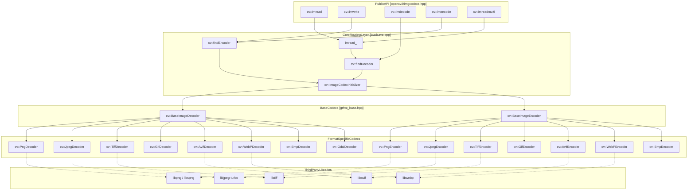
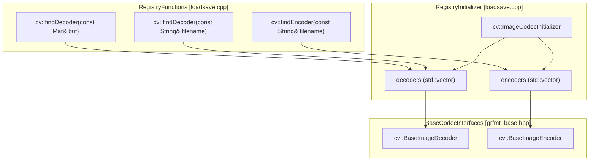

<!-- source: DeepWiki mcp.deepwiki.com · repo opencv/opencv · page 7.1 Image File I/O and Codec System · fetched 2026-10-30 -->

# Image File I/O and Codec System

<details>
<summary>Relevant source files</summary>

The following files were used as context for generating this wiki page:

- [cmake/OpenCVFindLibsGrfmt.cmake](cmake/OpenCVFindLibsGrfmt.cmake)
- [cmake/OpenCVFindOpenEXR.cmake](cmake/OpenCVFindOpenEXR.cmake)
- [modules/imgcodecs/CMakeLists.txt](modules/imgcodecs/CMakeLists.txt)
- [modules/imgcodecs/include/opencv2/imgcodecs.hpp](modules/imgcodecs/include/opencv2/imgcodecs.hpp)
- [modules/imgcodecs/perf/perf_jpeg.cpp](modules/imgcodecs/perf/perf_jpeg.cpp)
- [modules/imgcodecs/perf/perf_png.cpp](modules/imgcodecs/perf/perf_png.cpp)
- [modules/imgcodecs/src/bitstrm.cpp](modules/imgcodecs/src/bitstrm.cpp)
- [modules/imgcodecs/src/bitstrm.hpp](modules/imgcodecs/src/bitstrm.hpp)
- [modules/imgcodecs/src/exif.cpp](modules/imgcodecs/src/exif.cpp)
- [modules/imgcodecs/src/exif.hpp](modules/imgcodecs/src/exif.hpp)
- [modules/imgcodecs/src/grfmt_avif.cpp](modules/imgcodecs/src/grfmt_avif.cpp)
- [modules/imgcodecs/src/grfmt_avif.hpp](modules/imgcodecs/src/grfmt_avif.hpp)
- [modules/imgcodecs/src/grfmt_base.cpp](modules/imgcodecs/src/grfmt_base.cpp)
- [modules/imgcodecs/src/grfmt_base.hpp](modules/imgcodecs/src/grfmt_base.hpp)
- [modules/imgcodecs/src/grfmt_bmp.cpp](modules/imgcodecs/src/grfmt_bmp.cpp)
- [modules/imgcodecs/src/grfmt_bmp.hpp](modules/imgcodecs/src/grfmt_bmp.hpp)
- [modules/imgcodecs/src/grfmt_exr.cpp](modules/imgcodecs/src/grfmt_exr.cpp)
- [modules/imgcodecs/src/grfmt_exr.hpp](modules/imgcodecs/src/grfmt_exr.hpp)
- [modules/imgcodecs/src/grfmt_gdal.cpp](modules/imgcodecs/src/grfmt_gdal.cpp)
- [modules/imgcodecs/src/grfmt_gdal.hpp](modules/imgcodecs/src/grfmt_gdal.hpp)
- [modules/imgcodecs/src/grfmt_gdcm.cpp](modules/imgcodecs/src/grfmt_gdcm.cpp)
- [modules/imgcodecs/src/grfmt_gdcm.hpp](modules/imgcodecs/src/grfmt_gdcm.hpp)
- [modules/imgcodecs/src/grfmt_gif.cpp](modules/imgcodecs/src/grfmt_gif.cpp)
- [modules/imgcodecs/src/grfmt_gif.hpp](modules/imgcodecs/src/grfmt_gif.hpp)
- [modules/imgcodecs/src/grfmt_hdr.cpp](modules/imgcodecs/src/grfmt_hdr.cpp)
- [modules/imgcodecs/src/grfmt_hdr.hpp](modules/imgcodecs/src/grfmt_hdr.hpp)
- [modules/imgcodecs/src/grfmt_jpeg.cpp](modules/imgcodecs/src/grfmt_jpeg.cpp)
- [modules/imgcodecs/src/grfmt_jpeg.hpp](modules/imgcodecs/src/grfmt_jpeg.hpp)
- [modules/imgcodecs/src/grfmt_jpeg2000.cpp](modules/imgcodecs/src/grfmt_jpeg2000.cpp)
- [modules/imgcodecs/src/grfmt_jpeg2000.hpp](modules/imgcodecs/src/grfmt_jpeg2000.hpp)
- [modules/imgcodecs/src/grfmt_jpeg2000_openjpeg.cpp](modules/imgcodecs/src/grfmt_jpeg2000_openjpeg.cpp)
- [modules/imgcodecs/src/grfmt_jpeg2000_openjpeg.hpp](modules/imgcodecs/src/grfmt_jpeg2000_openjpeg.hpp)
- [modules/imgcodecs/src/grfmt_pam.cpp](modules/imgcodecs/src/grfmt_pam.cpp)
- [modules/imgcodecs/src/grfmt_pam.hpp](modules/imgcodecs/src/grfmt_pam.hpp)
- [modules/imgcodecs/src/grfmt_pfm.cpp](modules/imgcodecs/src/grfmt_pfm.cpp)
- [modules/imgcodecs/src/grfmt_png.cpp](modules/imgcodecs/src/grfmt_png.cpp)
- [modules/imgcodecs/src/grfmt_png.hpp](modules/imgcodecs/src/grfmt_png.hpp)
- [modules/imgcodecs/src/grfmt_pxm.cpp](modules/imgcodecs/src/grfmt_pxm.cpp)
- [modules/imgcodecs/src/grfmt_pxm.hpp](modules/imgcodecs/src/grfmt_pxm.hpp)
- [modules/imgcodecs/src/grfmt_spng.cpp](modules/imgcodecs/src/grfmt_spng.cpp)
- [modules/imgcodecs/src/grfmt_sunras.cpp](modules/imgcodecs/src/grfmt_sunras.cpp)
- [modules/imgcodecs/src/grfmt_sunras.hpp](modules/imgcodecs/src/grfmt_sunras.hpp)
- [modules/imgcodecs/src/grfmt_tiff.cpp](modules/imgcodecs/src/grfmt_tiff.cpp)
- [modules/imgcodecs/src/grfmt_tiff.hpp](modules/imgcodecs/src/grfmt_tiff.hpp)
- [modules/imgcodecs/src/grfmt_webp.cpp](modules/imgcodecs/src/grfmt_webp.cpp)
- [modules/imgcodecs/src/grfmt_webp.hpp](modules/imgcodecs/src/grfmt_webp.hpp)
- [modules/imgcodecs/src/grfmts.hpp](modules/imgcodecs/src/grfmts.hpp)
- [modules/imgcodecs/src/loadsave.cpp](modules/imgcodecs/src/loadsave.cpp)
- [modules/imgcodecs/src/utils.cpp](modules/imgcodecs/src/utils.cpp)
- [modules/imgcodecs/src/utils.hpp](modules/imgcodecs/src/utils.hpp)
- [modules/imgcodecs/test/test_animation.cpp](modules/imgcodecs/test/test_animation.cpp)
- [modules/imgcodecs/test/test_avif.cpp](modules/imgcodecs/test/test_avif.cpp)
- [modules/imgcodecs/test/test_exif.cpp](modules/imgcodecs/test/test_exif.cpp)
- [modules/imgcodecs/test/test_gdal.cpp](modules/imgcodecs/test/test_gdal.cpp)
- [modules/imgcodecs/test/test_gif.cpp](modules/imgcodecs/test/test_gif.cpp)
- [modules/imgcodecs/test/test_grfmt.cpp](modules/imgcodecs/test/test_grfmt.cpp)
- [modules/imgcodecs/test/test_jpeg.cpp](modules/imgcodecs/test/test_jpeg.cpp)
- [modules/imgcodecs/test/test_png.cpp](modules/imgcodecs/test/test_png.cpp)
- [modules/imgcodecs/test/test_read_write.cpp](modules/imgcodecs/test/test_read_write.cpp)
- [modules/imgcodecs/test/test_sunraster.cpp](modules/imgcodecs/test/test_sunraster.cpp)
- [modules/imgcodecs/test/test_tiff.cpp](modules/imgcodecs/test/test_tiff.cpp)
- [modules/imgcodecs/test/test_webp.cpp](modules/imgcodecs/test/test_webp.cpp)
- [modules/python/test/test_imread.py](modules/python/test/test_imread.py)
- [modules/videoio/src/cap_openni2.cpp](modules/videoio/src/cap_openni2.cpp)

</details>


This document describes the `imgcodecs` module's architecture for reading and writing image files in various formats. It covers the codec system design, format support, metadata handling, multi-page/animation capabilities, and the public API for image file I/O operations.

For video file I/O, see [7.2 Video Capture and Backend Architecture]().

Sources: `[modules/imgcodecs/include/opencv2/imgcodecs.hpp:48-55]()`, `[modules/imgcodecs/src/loadsave.cpp:61-81]()`

---

## System Overview

The `imgcodecs` module provides format-agnostic image file reading and writing through a modular codec architecture. The system automatically detects file formats by signature matching and routes I/O operations to the appropriate codec implementation.

### High-Level Architecture and Data Flow

The following diagram bridges natural language space to code entity space by illustrating the flow from public API calls (`cv::imread`, `cv::imwrite`, `cv::imdecode`, `cv::imencode`) to format-specific third-party libraries through internal routing routines and codec classes.

**Image I/O Data Flow**


Sources: `[modules/imgcodecs/include/opencv2/imgcodecs.hpp:48-60]()`, `[modules/imgcodecs/src/loadsave.cpp:157-252]`, `[modules/imgcodecs/src/grfmt_base.hpp:25-160]()`

---

## Core API Functions

The primary interface consists of file-based and memory-based I/O functions accepting format-specific flags and parameters defined in `opencv2/imgcodecs.hpp`.

### Image Reading Functions

| Function | Purpose | Key Features |
|----------|---------|-------------|
| `cv::imread()` | Load single image from file | Format auto-detection, EXIF orientation, color conversion [modules/imgcodecs/include/opencv2/imgcodecs.hpp:67-85]() |
| `cv::imdecode()` | Decode image from memory buffer | Same features as `imread()` |
| `cv::imreadmulti()` | Load multi-page/multi-frame images | TIFF pages, animated formats [modules/imgcodecs/test/test_grfmt.cpp:59-70]() |
| `cv::imreadanimation()` | Load animation with timing | Returns animation frames and durations |
| `cv::imcount()` | Count pages/frames in file | Returns frame count without full decode |

### Image Writing Functions

| Function | Purpose | Key Features |
|----------|---------|-------------|
| `cv::imwrite()` | Save single image to file | Extension-based format selection |
| `cv::imencode()` | Encode image to memory buffer | Format specified by extension string |
| `cv::imwriteanimation()` | Save animation to file | GIF, AVIF, APNG, WebP support |

### ImreadModes Flags

The `ImreadModes` enum controls how images are loaded and processed during decoding:

```cpp
IMREAD_UNCHANGED            = -1, //!< Return loaded image as is (preserve alpha, ignore EXIF orientation)
IMREAD_GRAYSCALE            = 0,  //!< Convert to single-channel grayscale
IMREAD_COLOR_BGR            = 1,  //!< Convert to 3-channel BGR color image (default)
IMREAD_COLOR                = 1,  //!< Same as IMREAD_COLOR_BGR
IMREAD_ANYDEPTH             = 2   //!< Return 16-bit/32-bit image when input has matching depth
IMREAD_ANYCOLOR             = 4,  //!< Read image in any possible color format
IMREAD_LOAD_GDAL            = 8,  //!< Use GDAL driver for loading
IMREAD_REDUCED_GRAYSCALE_2  = 16, //!< Grayscale with size reduced by 1/2
IMREAD_REDUCED_COLOR_2      = 17, //!< Color BGR with size reduced by 1/2
IMREAD_IGNORE_ORIENTATION   = 128,//!< Do not rotate image according to EXIF orientation flag
IMREAD_COLOR_RGB            = 256 //!< Convert to 3-channel RGB color image
```

Sources: `[modules/imgcodecs/include/opencv2/imgcodecs.hpp:67-85]`, `[modules/imgcodecs/src/loadsave.cpp:84-111]()`

---

## Codec Architecture and Registry Pattern

The codec system relies on abstract base classes (`cv::BaseImageDecoder`, `cv::BaseImageEncoder`) implemented by concrete format handlers. Codecs are registered via `cv::ImageCodecInitializer` and selected dynamically.

### Codec Registry and Initialization Mapping

The following diagram links the registry pattern and helper classes to code entities responsible for codec discovery and instantiation.

**Codec Registry and Dispatch Architecture**


Sources: `[modules/imgcodecs/src/loadsave.cpp:157-186]`, `[modules/imgcodecs/src/grfmt_base.hpp:25-160]()`

### Base Decoder & Encoder Interfaces

- **`cv::BaseImageDecoder::checkSignature(const String&)`**: Validates file format by examining header signature bytes. [modules/imgcodecs/src/grfmt_base.hpp:67-67]()
- **`cv::BaseImageDecoder::readHeader()`**: Parses metadata to populate image dimensions (`m_width`, `m_height`) and type (`m_type`). [modules/imgcodecs/src/grfmt_base.hpp:69-69]()
- **`cv::BaseImageDecoder::readData(Mat&)`**: Decodes pixel data into the target `Mat`. [modules/imgcodecs/src/grfmt_base.hpp:71-71]()
- **`cv::BaseImageEncoder::write(const Mat&, const std::vector<int>&)`**: Encodes single image buffers using format options. [modules/imgcodecs/src/grfmt_base.hpp:144-144]()

Sources: `[modules/imgcodecs/src/grfmt_base.hpp:25-160]()`

---

## Format-Specific Codecs and Libraries

OpenCV integrates multiple third-party image compression libraries, controlled via CMake flags (`cmake/OpenCVFindLibsGrfmt.cmake` and `modules/imgcodecs/CMakeLists.txt`).

| Format | Extension | Codec Classes | Third-Party Dependency / Backend |
|--------|-----------|---------------|----------------------------------|
| BMP | `.bmp` | `cv::BmpDecoder`, `cv::BmpEncoder` | Built-in [modules/imgcodecs/src/grfmt_bmp.cpp:44-63]() |
| PNG | `.png` | `cv::PngDecoder`, `cv::PngEncoder` | `libpng` / `libspng` [modules/imgcodecs/src/grfmt_png.cpp:48-55]() |
| JPEG | `.jpg`, `.jpeg` | `cv::JpegDecoder`, `cv::JpegEncoder` | `libjpeg-turbo` [modules/imgcodecs/src/grfmt_jpeg.cpp:45-78]() |
| TIFF | `.tif`, `.tiff` | `cv::TiffDecoder`, `cv::TiffEncoder` | `libtiff` [modules/imgcodecs/src/grfmt_tiff.cpp:50-60]() |
| WebP | `.webp` | `cv::WebPDecoder`, `cv::WebPEncoder` | `libwebp` |
| AVIF | `.avif` | `cv::AvifDecoder`, `cv::AvifEncoder` | `libavif` |
| GIF | `.gif` | `cv::GifDecoder`, `cv::GifEncoder` | Built-in / internal |
| EXR | `.exr` | `cv::ExrDecoder`, `cv::ExrEncoder` | `OpenEXR` |
| GDAL | various | `cv::GdalDecoder` | `GDAL` [modules/imgcodecs/src/grfmt_gdal.cpp:46-151]() |

Sources: `[modules/imgcodecs/CMakeLists.txt:16-118]`, `[cmake/OpenCVFindLibsGrfmt.cmake:5-187]()`

---

## Metadata and EXIF Handling

OpenCV extracts and processes EXIF metadata, primarily for automatic orientation correction.

### EXIF Orientation

The `ExifReader` class parses APP1 segments in JPEG files and equivalent tags in TIFF/PNG structures. [modules/imgcodecs/src/loadsave.cpp:49]() Unless `IMREAD_IGNORE_ORIENTATION` is specified, `loadsave.cpp` applies geometric transformations to align the loaded `Mat` with the correct orientation. [modules/imgcodecs/src/loadsave.cpp:382-417]()

| EXIF Orientation Tag | Geometric Transformation |
|----------------------|--------------------------|
| 1 | None |
| 3 | Rotate 180° |
| 6 | Rotate 90° CW |
| 8 | Rotate 270° CW |

Sources: `[modules/imgcodecs/src/loadsave.cpp:382-417]`, `[modules/imgcodecs/src/exif.cpp:33-150]()`

---

## Memory Buffer I/O and Configuration Limits

`cv::imdecode` and `cv::imencode` allow processing image memory buffers without disk I/O.

### Memory Decompression Limits
To mitigate vulnerabilities from malformed files (decompression bombs), `loadsave.cpp` enforces strict validation on image dimensions and pixel counts:
- **Max Width/Height**: 1,048,576 pixels (configurable via `OPENCV_IO_MAX_IMAGE_WIDTH` / `OPENCV_IO_MAX_IMAGE_HEIGHT`). [modules/imgcodecs/src/loadsave.cpp:68-69]()
- **Max Total Pixels**: 1,073,741,824 pixels (configurable via `OPENCV_IO_MAX_IMAGE_PIXELS`). [modules/imgcodecs/src/loadsave.cpp:70-70]()

Sources: `[modules/imgcodecs/src/loadsave.cpp:67-81]()`

---

## ImwriteFlags Reference

Format-specific parameters are passed to `cv::imwrite` or `cv::imencode` as a `std::vector<int>` key-value sequence.

| Flag Enum | Target Format | Description |
|-----------|---------------|-------------|
| `IMWRITE_JPEG_QUALITY` | JPEG | Quality level from 0 to 100 (default: 95). [modules/imgcodecs/include/opencv2/imgcodecs.hpp:89-89]() |
| `IMWRITE_JPEG_PROGRESSIVE` | JPEG | Enable progressive JPEG (0 or 1). [modules/imgcodecs/include/opencv2/imgcodecs.hpp:90-90]() |
| `IMWRITE_PNG_COMPRESSION` | PNG | Compression level from 0 to 9 (default: 1). [modules/imgcodecs/include/opencv2/imgcodecs.hpp:96-96]() |
| `IMWRITE_PXM_BINARY` | PXM | Binary (1) vs ASCII (0) format for PPM/PGM/PBM. [modules/imgcodecs/include/opencv2/imgcodecs.hpp:101-101]() |
| `IMWRITE_EXR_TYPE` | EXR | Override EXR storage type (FLOAT vs HALF). [modules/imgcodecs/include/opencv2/imgcodecs.hpp:102-102]() |

Sources: `[modules/imgcodecs/include/opencv2/imgcodecs.hpp:88-129]()`

---

