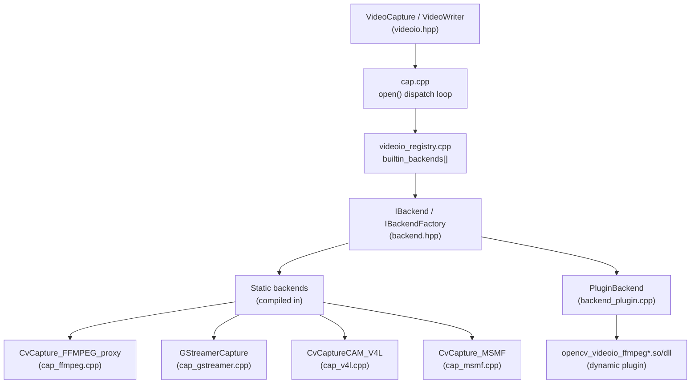
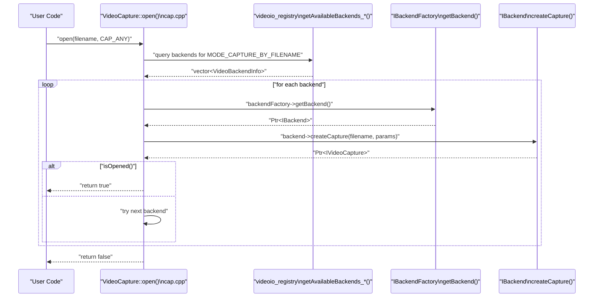
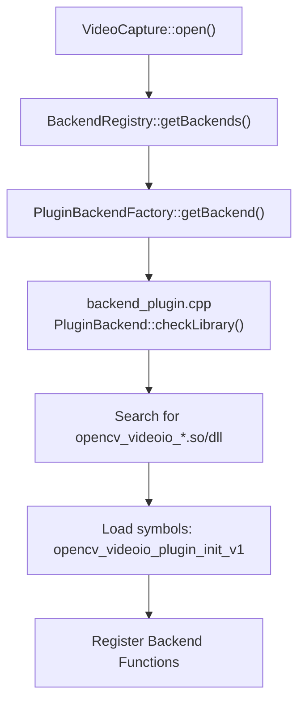

<!-- source: DeepWiki mcp.deepwiki.com · repo opencv/opencv · page 7.2 Video Capture and Backend Architecture · fetched 2026-10-30 -->

# Video Capture and Backend Architecture

Relevant source files

The following files were used as context for generating this wiki page:

- [.gitattributes](.gitattributes)
- [3rdparty/ffmpeg/.gitignore](3rdparty/ffmpeg/.gitignore)
- [3rdparty/ffmpeg/ffmpeg-download.ps1.in](3rdparty/ffmpeg/ffmpeg-download.ps1.in)
- [3rdparty/ffmpeg/ffmpeg.cmake](3rdparty/ffmpeg/ffmpeg.cmake)
- [3rdparty/ffmpeg/readme.txt](3rdparty/ffmpeg/readme.txt)
- [cmake/templates/vs_version.rc.in](cmake/templates/vs_version.rc.in)
- [modules/videoio/CMakeLists.txt](modules/videoio/CMakeLists.txt)
- [modules/videoio/include/opencv2/videoio.hpp](modules/videoio/include/opencv2/videoio.hpp)
- [modules/videoio/src/backend_plugin.cpp](modules/videoio/src/backend_plugin.cpp)
- [modules/videoio/src/cap.cpp](modules/videoio/src/cap.cpp)
- [modules/videoio/src/cap_ffmpeg.cpp](modules/videoio/src/cap_ffmpeg.cpp)
- [modules/videoio/src/cap_ffmpeg_impl.hpp](modules/videoio/src/cap_ffmpeg_impl.hpp)
- [modules/videoio/src/cap_gstreamer.cpp](modules/videoio/src/cap_gstreamer.cpp)
- [modules/videoio/src/cap_interface.hpp](modules/videoio/src/cap_interface.hpp)
- [modules/videoio/src/cap_mjpeg_decoder.cpp](modules/videoio/src/cap_mjpeg_decoder.cpp)
- [modules/videoio/src/cap_mjpeg_encoder.cpp](modules/videoio/src/cap_mjpeg_encoder.cpp)
- [modules/videoio/src/cap_msmf.cpp](modules/videoio/src/cap_msmf.cpp)
- [modules/videoio/src/cap_msmf.hpp](modules/videoio/src/cap_msmf.hpp)
- [modules/videoio/src/cap_v4l.cpp](modules/videoio/src/cap_v4l.cpp)
- [modules/videoio/src/precomp.hpp](modules/videoio/src/precomp.hpp)
- [modules/videoio/src/videoio_registry.cpp](modules/videoio/src/videoio_registry.cpp)
- [modules/videoio/src/videoio_registry.hpp](modules/videoio/src/videoio_registry.hpp)
- [modules/videoio/test/test_audio.cpp](modules/videoio/test/test_audio.cpp)
- [modules/videoio/test/test_ffmpeg.cpp](modules/videoio/test/test_ffmpeg.cpp)
- [modules/videoio/test/test_gstreamer.cpp](modules/videoio/test/test_gstreamer.cpp)
- [modules/videoio/test/test_orientation.cpp](modules/videoio/test/test_orientation.cpp)
- [modules/videoio/test/test_precomp.hpp](modules/videoio/test/test_precomp.hpp)
- [modules/videoio/test/test_v4l2.cpp](modules/videoio/test/test_v4l2.cpp)
- [modules/videoio/test/test_video_io.cpp](modules/videoio/test/test_video_io.cpp)

This page describes the `opencv_videoio` module: the `VideoCapture` and `VideoWriter` public classes, the internal backend abstraction and registry, the plugin loading system, and the major platform-specific capture backends including FFmpeg, GStreamer, V4L2, MSMF, AVFoundation, and DirectShow, along with property constants and audio support.

---

## Overview

The `videoio` module provides a unified API for reading from video files, network streams, and cameras, and for writing encoded video. Internally it is structured as a backend registry — at open time the public `VideoCapture` or `VideoWriter` object selects from a prioritized list of compiled-in or dynamically loaded backends, each of which implements a common C++ interface.

**Architecture Diagram: Public API → Registry → Backend**

Sources: [modules/videoio/src/cap.cpp:127-142](), [modules/videoio/src/videoio_registry.cpp:66-130](), [modules/videoio/src/backend_plugin.cpp:40-75]()

---

## Public API

### VideoCapture

Defined in [modules/videoio/include/opencv2/videoio.hpp](), `VideoCapture` is the primary class for reading frames. It holds a `Ptr<IVideoCapture> icap` that is created and owned by the selected backend.

Key constructors:
- `VideoCapture(const String& filename, int apiPreference = CAP_ANY)` [modules/videoio/src/cap.cpp:73-77]()
- `VideoCapture(int index, int apiPreference = CAP_ANY)` [modules/videoio/src/cap.cpp:93-97]()
- `VideoCapture(const Ptr<IStreamReader>& source, int apiPreference, const std::vector<int>& params)` [modules/videoio/src/cap.cpp:86-91]()

Key methods:

| Method | Description |
|---|---|
| `open()` | Opens a file, URL, or camera index [modules/videoio/src/cap.cpp:112-115]() |
| `isOpened()` | Returns true if a backend was successfully created [modules/videoio/src/cap.cpp:258-261]() |
| `grab()` | Advances the capture clock; fast, does not decode [modules/videoio/src/cap.cpp:273-277]() |
| `retrieve(Mat&, int channel=0)` | Decodes and returns the grabbed frame [modules/videoio/src/cap.cpp:285-289]() |
| `read(Mat&)` | Combines `grab()` and `retrieve()` [modules/videoio/src/cap.cpp:297-306]() |
| `get(int propId)` | Reads a `CAP_PROP_*` property [modules/videoio/src/cap.cpp:315-319]() |
| `set(int propId, double value)` | Writes a `CAP_PROP_*` property [modules/videoio/src/cap.cpp:325-329]() |
| `release()` | Destroys the backend and frees resources [modules/videoio/src/cap.cpp:263-267]() |

### VideoWriter

Also declared in [modules/videoio/include/opencv2/videoio.hpp](), `VideoWriter` holds a `Ptr<IVideoWriter> iwriter`. Key parameters to `open()` are the filename, `fourcc`, `fps`, and `frameSize`. A `std::vector<int>` params argument passes `VIDEOWRITER_PROP_*` key-value pairs at construction time.

Sources: [modules/videoio/include/opencv2/videoio.hpp:70-240](), [modules/videoio/src/cap.cpp:70-110]()

---

## Backend Registry

### VideoCaptureAPIs Enum

Every backend has a unique integer identifier declared in the `VideoCaptureAPIs` enum [modules/videoio/include/opencv2/videoio.hpp:91-122](). Passing `CAP_ANY = 0` to `open()` causes the dispatcher to try all applicable backends in priority order.

| Constant | Value | Backend |
|---|---|---|
| `CAP_ANY` | 0 | Auto-detect |
| `CAP_V4L` / `CAP_V4L2` | 200 | Video4Linux2 (Linux) |
| `CAP_DSHOW` | 700 | DirectShow (Windows) |
| `CAP_AVFOUNDATION` | 1200 | AVFoundation (macOS/iOS) |
| `CAP_MSMF` | 1400 | Microsoft Media Foundation |
| `CAP_GSTREAMER` | 1800 | GStreamer |
| `CAP_FFMPEG` | 1900 | FFmpeg |
| `CAP_IMAGES` | 2000 | OpenCV image sequence |
| `CAP_OPENCV_MJPEG` | 2200 | Built-in MJPEG |
| `CAP_INTEL_MFX` | 2300 | Intel MediaSDK/oneVPL |

Sources: [modules/videoio/include/opencv2/videoio.hpp:91-122]()

### Dispatch in cap.cpp

**Backend Selection Flow**

Sources: [modules/videoio/src/cap.cpp:117-156]()

---

## Internal Interface

All backends implement one of two internal abstract classes, defined in [modules/videoio/src/cap_interface.hpp]().

### IVideoCapture & IVideoWriter

`IVideoCapture` exposes core methods such as `grabFrame()`, `retrieveFrame()`, `getProperty()`, and `setProperty()`. `IVideoWriter` defines `open()`, `isOpened()`, `write()`, `get()`, and `set()`.

Sources: [modules/videoio/src/cap_interface.hpp:40-120]()

---

## Major Backends

### FFmpeg (`CAP_FFMPEG`)

**Files:** [modules/videoio/src/cap_ffmpeg.cpp](), [modules/videoio/src/cap_ffmpeg_impl.hpp]()

The FFmpeg backend is the primary backend for file and network stream access. The public-facing proxy is `CvCapture_FFMPEG_proxy`, which wraps the internal `CvCapture_FFMPEG` struct [modules/videoio/src/cap_ffmpeg.cpp:68-164](). On Windows, the FFmpeg libraries can be downloaded dynamically via CMake build scripts [3rdparty/ffmpeg/ffmpeg.cmake:8-37]().

**Key internals:**
- `AVFormatContext* ic` for container demuxing.
- `AVCodecContext* context` for per-stream decoding.
- `SwsContext* img_convert_ctx` for `libswscale` color conversion [modules/videoio/src/cap_ffmpeg_impl.hpp:80-140]().

### GStreamer (`CAP_GSTREAMER`)

**File:** [modules/videoio/src/cap_gstreamer.cpp]()

`GStreamerCapture` builds and controls GStreamer pipelines using `GSafePtr` templates to manage reference counts for `GstElement`, `GstCaps`, and `GstBuffer` objects [modules/videoio/src/cap_gstreamer.cpp:100-132]().

### V4L2 (`CAP_V4L2`, Linux)

**File:** [modules/videoio/src/cap_v4l.cpp]()

`CvCaptureCAM_V4L` opens `/dev/video<N>` via the V4L2 kernel API, utilizing `mmap` for buffer management and supporting formats like `YUYV`, `MJPEG`, and `Bayer` [modules/videoio/src/cap_v4l.cpp:91-144]().

### Microsoft Media Foundation (`CAP_MSMF`, Windows)

**File:** [modules/videoio/src/cap_msmf.cpp]()

The MSMF backend uses the `IMFSourceReader` API and supports hardware acceleration via DXVA when `HAVE_MSMF_DXVA` is enabled, dynamically resolving `MFCreateDXGIDeviceManager` [modules/videoio/src/cap_msmf.cpp:18-74]().

### AVFoundation (`CAP_AVFOUNDATION`, macOS/iOS)

Provides camera access via `CvCaptureCAM` and file access via `CvCaptureFile`, utilizing asynchronous frame delivery delegates.

### DirectShow (`CAP_DSHOW`, Windows)

**File:** [modules/videoio/src/cap_dshow.cpp]()

Uses COM interfaces such as `ICaptureGraphBuilder2` and `ISampleGrabber` to capture frames from DirectShow-compatible devices [modules/videoio/src/cap_dshow.cpp:100-165]().

Sources: [modules/videoio/src/cap_ffmpeg.cpp:68-164](), [modules/videoio/src/cap_gstreamer.cpp:100-132](), [modules/videoio/src/cap_v4l.cpp:91-144](), [modules/videoio/src/cap_msmf.cpp:18-74](), [modules/videoio/src/cap_dshow.cpp:100-165]()

---

## Plugin Loading and Registry

The `videoio` module supports loading backends as dynamic plugins, decoupling heavy dependencies like FFmpeg or GStreamer from the main core library.

**Plugin Discovery Logic**

Sources: [modules/videoio/src/backend_plugin.cpp:40-100](), [modules/videoio/src/videoio_registry.cpp:58-130](), [modules/videoio/CMakeLists.txt:1-25]()

---

## Audio Support and CAP_PROP Constants

Audio capture is integrated into `VideoCapture` via properties such as `CAP_PROP_AUDIO_STREAM` and `CAP_PROP_AUDIO_SAMPLES_PER_SECOND` [modules/videoio/include/opencv2/videoio.hpp:131-240](). Standard capture properties include position in milliseconds (`CAP_PROP_POS_MSEC`), frame index (`CAP_PROP_POS_FRAMES`), frame width/height, FPS, and FOURCC codes [modules/videoio/include/opencv2/videoio.hpp:131-150]().

Sources: [modules/videoio/include/opencv2/videoio.hpp:131-240]()

---

