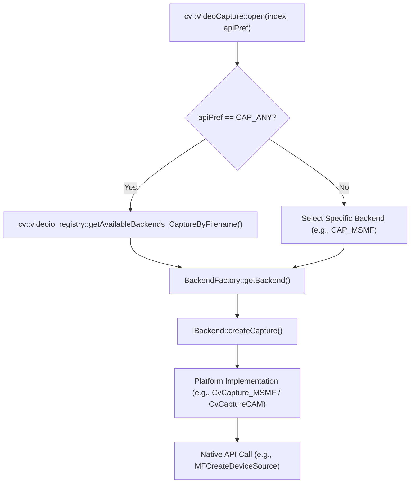
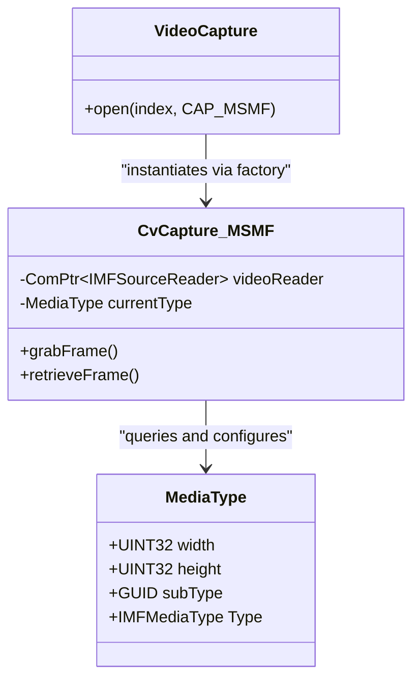
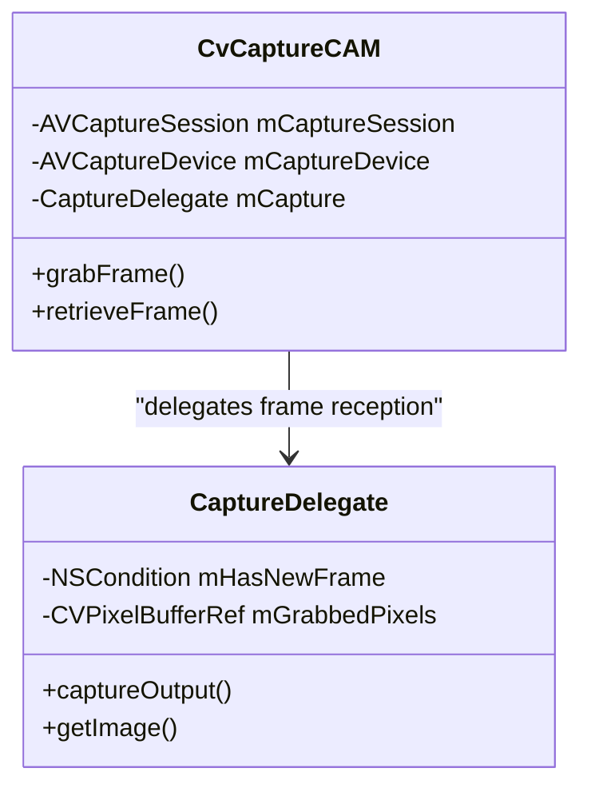

<!-- source: DeepWiki mcp.deepwiki.com · repo opencv/opencv · page 7.3 Platform Backends: V4L2, MSMF, AVFoundation, DirectShow · fetched 2026-10-30 -->

# Platform Backends: V4L2, MSMF, AVFoundation, DirectShow

Relevant source files

The following files were used as context for generating this wiki page:

- [.gitattributes](.gitattributes)
- [3rdparty/ffmpeg/.gitignore](3rdparty/ffmpeg/.gitignore)
- [3rdparty/ffmpeg/ffmpeg-download.ps1.in](3rdparty/ffmpeg/ffmpeg-download.ps1.in)
- [3rdparty/ffmpeg/ffmpeg.cmake](3rdparty/ffmpeg/ffmpeg.cmake)
- [3rdparty/ffmpeg/readme.txt](3rdparty/ffmpeg/readme.txt)
- [cmake/templates/vs_version.rc.in](cmake/templates/vs_version.rc.in)
- [modules/core/include/opencv2/core/parallel/backend/parallel_for.openmp.hpp](modules/core/include/opencv2/core/parallel/backend/parallel_for.openmp.hpp)
- [modules/core/include/opencv2/core/parallel/backend/parallel_for.tbb.hpp](modules/core/include/opencv2/core/parallel/backend/parallel_for.tbb.hpp)
- [modules/core/include/opencv2/core/parallel/parallel_backend.hpp](modules/core/include/opencv2/core/parallel/parallel_backend.hpp)
- [modules/core/misc/plugins/parallel_openmp/CMakeLists.txt](modules/core/misc/plugins/parallel_openmp/CMakeLists.txt)
- [modules/core/misc/plugins/parallel_tbb/CMakeLists.txt](modules/core/misc/plugins/parallel_tbb/CMakeLists.txt)
- [modules/core/src/parallel/plugin_parallel_wrapper.impl.hpp](modules/core/src/parallel/plugin_parallel_wrapper.impl.hpp)
- [modules/highgui/src/plugin_wrapper.impl.hpp](modules/highgui/src/plugin_wrapper.impl.hpp)
- [modules/videoio/CMakeLists.txt](modules/videoio/CMakeLists.txt)
- [modules/videoio/cmake/detect_ffmpeg.cmake](modules/videoio/cmake/detect_ffmpeg.cmake)
- [modules/videoio/cmake/init.cmake](modules/videoio/cmake/init.cmake)
- [modules/videoio/include/opencv2/videoio.hpp](modules/videoio/include/opencv2/videoio.hpp)
- [modules/videoio/include/opencv2/videoio/cap_ios.h](modules/videoio/include/opencv2/videoio/cap_ios.h)
- [modules/videoio/misc/plugin_ffmpeg/CMakeLists.txt](modules/videoio/misc/plugin_ffmpeg/CMakeLists.txt)
- [modules/videoio/misc/plugin_gstreamer/CMakeLists.txt](modules/videoio/misc/plugin_gstreamer/CMakeLists.txt)
- [modules/videoio/src/backend_plugin.cpp](modules/videoio/src/backend_plugin.cpp)
- [modules/videoio/src/cap.cpp](modules/videoio/src/cap.cpp)
- [modules/videoio/src/cap_avfoundation.mm](modules/videoio/src/cap_avfoundation.mm)
- [modules/videoio/src/cap_avfoundation_mac.mm](modules/videoio/src/cap_avfoundation_mac.mm)
- [modules/videoio/src/cap_dshow.cpp](modules/videoio/src/cap_dshow.cpp)
- [modules/videoio/src/cap_dshow.hpp](modules/videoio/src/cap_dshow.hpp)
- [modules/videoio/src/cap_ffmpeg.cpp](modules/videoio/src/cap_ffmpeg.cpp)
- [modules/videoio/src/cap_ffmpeg_impl.hpp](modules/videoio/src/cap_ffmpeg_impl.hpp)
- [modules/videoio/src/cap_gstreamer.cpp](modules/videoio/src/cap_gstreamer.cpp)
- [modules/videoio/src/cap_images.cpp](modules/videoio/src/cap_images.cpp)
- [modules/videoio/src/cap_interface.hpp](modules/videoio/src/cap_interface.hpp)
- [modules/videoio/src/cap_ios_abstract_camera.mm](modules/videoio/src/cap_ios_abstract_camera.mm)
- [modules/videoio/src/cap_ios_photo_camera.mm](modules/videoio/src/cap_ios_photo_camera.mm)
- [modules/videoio/src/cap_ios_video_camera.mm](modules/videoio/src/cap_ios_video_camera.mm)
- [modules/videoio/src/cap_mjpeg_decoder.cpp](modules/videoio/src/cap_mjpeg_decoder.cpp)
- [modules/videoio/src/cap_mjpeg_encoder.cpp](modules/videoio/src/cap_mjpeg_encoder.cpp)
- [modules/videoio/src/cap_msmf.cpp](modules/videoio/src/cap_msmf.cpp)
- [modules/videoio/src/cap_msmf.hpp](modules/videoio/src/cap_msmf.hpp)
- [modules/videoio/src/cap_pvapi.cpp](modules/videoio/src/cap_pvapi.cpp)
- [modules/videoio/src/cap_v4l.cpp](modules/videoio/src/cap_v4l.cpp)
- [modules/videoio/src/precomp.hpp](modules/videoio/src/precomp.hpp)
- [modules/videoio/src/videoio_registry.cpp](modules/videoio/src/videoio_registry.cpp)
- [modules/videoio/src/videoio_registry.hpp](modules/videoio/src/videoio_registry.hpp)
- [modules/videoio/test/test_audio.cpp](modules/videoio/test/test_audio.cpp)
- [modules/videoio/test/test_camera.cpp](modules/videoio/test/test_camera.cpp)
- [modules/videoio/test/test_ffmpeg.cpp](modules/videoio/test/test_ffmpeg.cpp)
- [modules/videoio/test/test_gstreamer.cpp](modules/videoio/test/test_gstreamer.cpp)
- [modules/videoio/test/test_images.cpp](modules/videoio/test/test_images.cpp)
- [modules/videoio/test/test_orientation.cpp](modules/videoio/test/test_orientation.cpp)
- [modules/videoio/test/test_precomp.hpp](modules/videoio/test/test_precomp.hpp)
- [modules/videoio/test/test_v4l2.cpp](modules/videoio/test/test_v4l2.cpp)
- [modules/videoio/test/test_video_io.cpp](modules/videoio/test/test_video_io.cpp)
- [platforms/ios/cmake/Modules/Platform/iOS.cmake](platforms/ios/cmake/Modules/Platform/iOS.cmake)
- [samples/cpp/tutorial_code/core/parallel_backend/CMakeLists.txt](samples/cpp/tutorial_code/core/parallel_backend/CMakeLists.txt)

This page provides a technical deep dive into the platform-specific backends that implement video capture and writing in the `videoio` module. These backends bridge the gap between OpenCV's generic `cv::VideoCapture` and `cv::VideoWriter` interfaces and the underlying OS media frameworks, handling camera properties, pixel format negotiations, orientation, and audio channels.

## Backend Architecture and Registry

OpenCV utilizes a registry-based system to manage multiple capture backends. At runtime, the library iterates through available backends based on an internal priority list or a user-specified `apiPreference` [modules/videoio/src/cap.cpp:127-132](). The core dispatcher `cv::VideoCapture::open` invokes backend factories via the `cv::videoio_registry` namespace to instantiate native capture objects [modules/videoio/src/cap.cpp:142-147]().

### Data Flow: Capture Initialization

**VideoCapture Dispatch Flow**

**Sources:** [modules/videoio/src/cap.cpp:117-158](), [modules/videoio/src/videoio_registry.cpp:180-210]()

---

## 1. Video4Linux2 (V4L2)
**Platform:** Linux
**ID:** `CAP_V4L2` / `CAP_V4L` [modules/videoio/include/opencv2/videoio.hpp:93-94]().

V4L2 is the primary backend for USB webcams and capture cards on Linux. It supports both legacy V4L1 and modern V4L2 specifications, utilizing memory-mapped buffers (`mmap`) or standard `read` operations [modules/videoio/src/cap_v4l.cpp:92-93]().

### Key Capabilities & Mappings
*   **Device Discovery:** Enumerates `/dev/videoN` device nodes dynamically [modules/videoio/src/cap_v4l.cpp:39-48]().
*   **Pixel Formats:** Supports hardware and software decoding of `YUYV`, `MJPEG`, `YUV420P`, and Bayer patterns (`BA81`) [modules/videoio/src/cap_v4l.cpp:135-138]().
*   **Properties:** Maps properties like `CAP_PROP_BRIGHTNESS`, `CAP_PROP_CONTRAST`, `CAP_PROP_SATURATION`, and `CAP_PROP_HUE` directly to V4L2 control identifiers (`V4L2_CID_BRIGHTNESS`, etc.) [modules/videoio/src/cap_v4l.cpp:129-132]().

**Sources:** [modules/videoio/src/cap_v4l.cpp:1-150]()

---

## 2. Microsoft Media Foundation (MSMF)
**Platform:** Windows (7, 8, 10, 11)
**ID:** `CAP_MSMF` [modules/videoio/include/opencv2/videoio.hpp:105]().

MSMF is the modern Windows media capture and playback framework, replacing DirectShow. It integrates deeply with Windows imaging pipelines and supports hardware-accelerated decoding/encoding.

### Implementation Details
*   **Core Classes:** Managed through `CvCapture_MSMF`, which wraps `IMFSourceReader` and `IMFMediaSource` [modules/videoio/src/cap_msmf.cpp:172-233]().
*   **Hardware Acceleration:** Can be configured via environment flags such as `OPENCV_VIDEOIO_MSMF_ENABLE_HW_TRANSFORMS` [modules/videoio/include/opencv2/videoio.hpp:87-89]().
*   **Format Negotiation:** Uses `MediaType` structures to query and set attributes like `MF_MT_SUBTYPE` (mapping to formats such as `MFVideoFormat_RGB24`, `MFVideoFormat_YUY2`, and `MFVideoFormat_NV12`) [modules/videoio/src/cap_msmf.cpp:172-232]().

**MSMF Code Entity Mapping**

**Sources:** [modules/videoio/src/cap_msmf.cpp:96-233](), [modules/videoio/include/opencv2/videoio.hpp:105]()

---

## 3. AVFoundation and iOS Camera Classes
**Platform:** macOS, iOS
**ID:** `CAP_AVFOUNDATION` [modules/videoio/include/opencv2/videoio.hpp:104]().

AVFoundation provides unified media capture across macOS and iOS platforms. 

### Implementation Details
*   **Core Classes:** On macOS/iOS, `CvCaptureCAM` manages the `AVCaptureSession`, `AVCaptureDeviceInput`, and `AVCaptureVideoDataOutput` [modules/videoio/src/cap_avfoundation_mac.mm:110-114]().
*   **Delegate Pattern:** `CaptureDelegate` implements `AVCaptureVideoDataOutputSampleBufferDelegate` to receive frames asynchronously on a background thread via `captureOutput:didOutputSampleBuffer:fromConnection:` [modules/videoio/src/cap_avfoundation_mac.mm:71-82](). Frames are synchronized using an `NSCondition` lock.
*   **iOS Specific Extensions:** Additional classes like `CvAbstractCamera`, `CvVideoCamera`, and `CvPhotoCamera` (defined in `modules/videoio/include/opencv2/videoio/cap_ios.h`) provide UIKit integration, UIViewController orientation management, and direct `cv::Mat` delivery for iOS applications.

**AVFoundation Entity Mapping**

**Sources:** [modules/videoio/src/cap_avfoundation_mac.mm:45-130](), [modules/videoio/include/opencv2/videoio/cap_ios.h:1-80]()

---

## 4. DirectShow (DShow)
**Platform:** Windows (Legacy)
**ID:** `CAP_DSHOW` [modules/videoio/include/opencv2/videoio.hpp:100]().

DirectShow is a legacy Windows backend maintained for compatibility with older capture hardware and specialized industrial cameras lacking MSMF support.

### Key Implementation Details
*   **Filter Graph Architecture:** Constructs COM filter graphs using `CLSID_CaptureGraphBuilder2`, `CLSID_FilterGraph`, and `CLSID_SampleGrabber` [modules/videoio/src/cap_dshow.cpp:152-155]().
*   **Control Interfaces:** Interfaces with camera hardware controls via `IAMCameraControl` (focus, zoom, exposure) and `IAMVideoProcAmp` (brightness, contrast, saturation, gain) [modules/videoio/src/cap_dshow.cpp:160-163]().

**Sources:** [modules/videoio/src/cap_dshow.cpp:46-165]()

---

## 5. Image Sequence Capture
**Platform:** Cross-Platform
**ID:** `CAP_IMAGES` [modules/videoio/include/opencv2/videoio.hpp:115]().

The image sequence backend allows a series of numbered still images (e.g., `frame_%03d.jpg`) to be opened and read sequentially as if they were a video file.

*   **Implementation:** Handled by `cap_images.cpp`, which parses printf-style filename format specifiers.
*   **Properties:** Supports seeking via `CAP_PROP_POS_FRAMES` and setting start indices.

**Sources:** [modules/videoio/src/cap_images.cpp:1-100](), [modules/videoio/include/opencv2/videoio.hpp:115]()

---

## Summary of Property Mappings

| Property | V4L2 (Linux) | MSMF (Windows) | AVFoundation (macOS/iOS) |
| :--- | :--- | :--- | :--- |
| `CAP_PROP_FRAME_WIDTH` | `V4L2_CID_...` / `VIDIOC_S_FMT` | `MF_MT_FRAME_SIZE` | `setWidthHeight()` |
| `CAP_PROP_BRIGHTNESS` | `V4L2_CID_BRIGHTNESS` | `IAMVideoProcAmp` | `AVCaptureDevice` properties |
| `CAP_PROP_FOURCC` | `v4l2_pix_format` | `MF_MT_SUBTYPE` | `mFormat` |
| `CAP_PROP_FPS` | `v4l2_streamparm` | `MF_MT_FRAME_RATE` | `AVAssetTrack.nominalFrameRate` |

**Sources:** [modules/videoio/include/opencv2/videoio.hpp:131-160](), [modules/videoio/src/cap_v4l.cpp:119-132](), [modules/videoio/src/cap_msmf.cpp:226-231](), [modules/videoio/src/cap_avfoundation_mac.mm:104-105]()

---

## Debugging Backend Selection Failures

When `VideoCapture::open()` fails and returns `false`, developers can use the following diagnostic strategies:

1.  **Enable Verbose Logging:** Set the environment variables `OPENCV_VIDEOIO_DEBUG=1` or `OPENCV_VIDEOCAPTURE_DEBUG=1`. This activates diagnostic print statements in `cap.cpp` tracking backend attempts and error codes [modules/videoio/src/cap.cpp:49-57]().
2.  **Verify Backend Availability:** Call `cv::videoio_registry::hasBackend(apiPref)` to confirm whether the specific backend was included in the active CMake build configuration [modules/videoio/test/test_video_io.cpp:47-48]().
3.  **Inspect Plugin Loading:** If the backend is built as a plugin (e.g., FFmpeg or GStreamer plugins), ensure runtime libraries and `.so`/`.dll` plugin files reside in the application search path [modules/videoio/src/cap.cpp:133-140]().
4.  **Explicit Backend Selection:** Bypass auto-detection (`CAP_ANY`) by explicitly providing the backend enum (e.g., `CAP_MSMF` or `CAP_DSHOW`) to `VideoCapture::open()` [modules/videoio/src/cap.cpp:131-132]().

**Sources:** [modules/videoio/src/cap.cpp:49-158](), [modules/videoio/test/test_video_io.cpp:45-66]()

---

