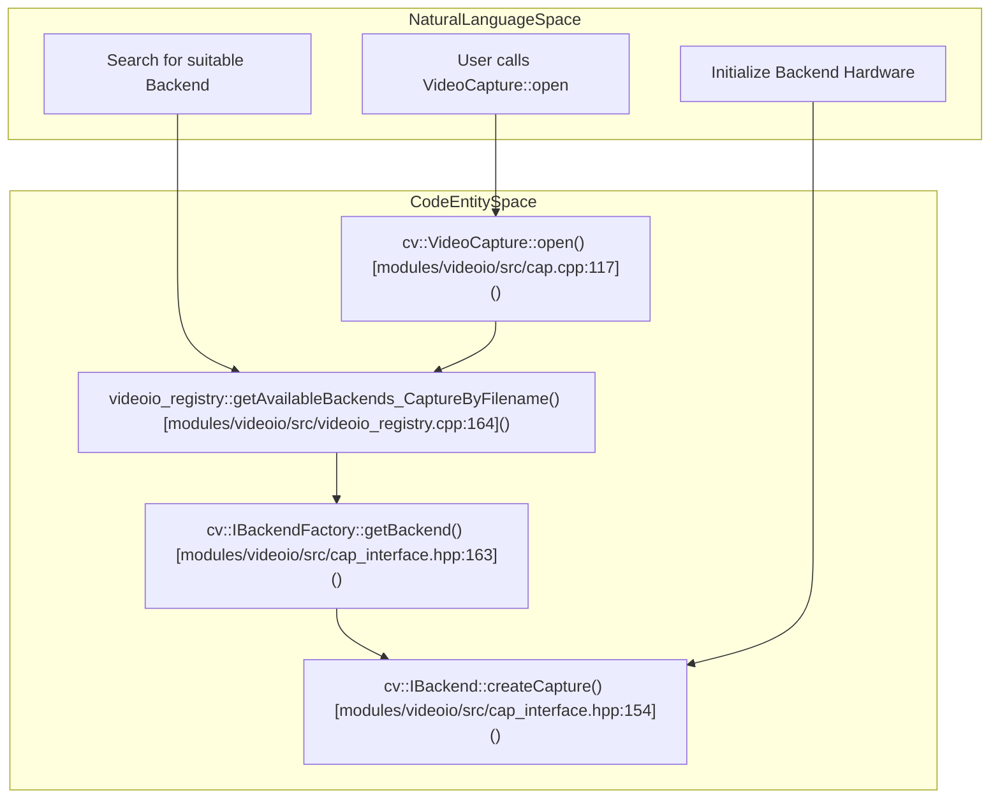
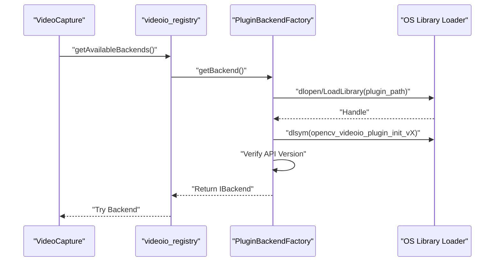

<!-- source: DeepWiki mcp.deepwiki.com · repo opencv/opencv · page 7.4 videoio Plugin Loading and Registry · fetched 2026-10-30 -->

# videoio Plugin Loading and Registry

Relevant source files

The following files were used as context for generating this wiki page:

- [.gitattributes](.gitattributes)
- [3rdparty/ffmpeg/.gitignore](3rdparty/ffmpeg/.gitignore)
- [3rdparty/ffmpeg/ffmpeg-download.ps1.in](3rdparty/ffmpeg/ffmpeg-download.ps1.in)
- [3rdparty/ffmpeg/ffmpeg.cmake](3rdparty/ffmpeg/ffmpeg.cmake)
- [3rdparty/ffmpeg/readme.txt](3rdparty/ffmpeg/readme.txt)
- [cmake/templates/vs_version.rc.in](cmake/templates/vs_version.rc.in)
- [modules/core/include/opencv2/core/parallel/backend/parallel_for.openmp.hpp](modules/core/include/opencv2/core/parallel/backend/parallel_for.openmp.hpp)
- [modules/core/include/opencv2/core/parallel/backend/parallel_for.tbb.hpp](modules/core/include/opencv2/core/parallel/backend/parallel_for.tbb.hpp)
- [modules/core/include/opencv2/core/parallel/parallel_backend.hpp](modules/core/include/opencv2/core/parallel/parallel_backend.hpp)
- [modules/core/include/opencv2/core/utils/filesystem.hpp](modules/core/include/opencv2/core/utils/filesystem.hpp)
- [modules/core/include/opencv2/core/utils/filesystem.private.hpp](modules/core/include/opencv2/core/utils/filesystem.private.hpp)
- [modules/core/include/opencv2/core/utils/plugin_loader.private.hpp](modules/core/include/opencv2/core/utils/plugin_loader.private.hpp)
- [modules/core/misc/plugins/parallel_openmp/CMakeLists.txt](modules/core/misc/plugins/parallel_openmp/CMakeLists.txt)
- [modules/core/misc/plugins/parallel_tbb/CMakeLists.txt](modules/core/misc/plugins/parallel_tbb/CMakeLists.txt)
- [modules/core/src/glob.cpp](modules/core/src/glob.cpp)
- [modules/core/src/parallel/plugin_parallel_wrapper.impl.hpp](modules/core/src/parallel/plugin_parallel_wrapper.impl.hpp)
- [modules/core/src/utils/datafile.cpp](modules/core/src/utils/datafile.cpp)
- [modules/core/src/utils/filesystem.cpp](modules/core/src/utils/filesystem.cpp)
- [modules/core/src/utils/plugin_loader.impl.hpp](modules/core/src/utils/plugin_loader.impl.hpp)
- [modules/core/src/utils/samples.cpp](modules/core/src/utils/samples.cpp)
- [modules/highgui/src/plugin_wrapper.impl.hpp](modules/highgui/src/plugin_wrapper.impl.hpp)
- [modules/videoio/CMakeLists.txt](modules/videoio/CMakeLists.txt)
- [modules/videoio/cmake/detect_ffmpeg.cmake](modules/videoio/cmake/detect_ffmpeg.cmake)
- [modules/videoio/cmake/init.cmake](modules/videoio/cmake/init.cmake)
- [modules/videoio/cmake/plugin.cmake](modules/videoio/cmake/plugin.cmake)
- [modules/videoio/include/opencv2/videoio.hpp](modules/videoio/include/opencv2/videoio.hpp)
- [modules/videoio/misc/plugin_ffmpeg/CMakeLists.txt](modules/videoio/misc/plugin_ffmpeg/CMakeLists.txt)
- [modules/videoio/misc/plugin_gstreamer/CMakeLists.txt](modules/videoio/misc/plugin_gstreamer/CMakeLists.txt)
- [modules/videoio/src/backend_plugin.cpp](modules/videoio/src/backend_plugin.cpp)
- [modules/videoio/src/cap.cpp](modules/videoio/src/cap.cpp)
- [modules/videoio/src/cap_dshow.cpp](modules/videoio/src/cap_dshow.cpp)
- [modules/videoio/src/cap_dshow.hpp](modules/videoio/src/cap_dshow.hpp)
- [modules/videoio/src/cap_ffmpeg.cpp](modules/videoio/src/cap_ffmpeg.cpp)
- [modules/videoio/src/cap_ffmpeg_impl.hpp](modules/videoio/src/cap_ffmpeg_impl.hpp)
- [modules/videoio/src/cap_gstreamer.cpp](modules/videoio/src/cap_gstreamer.cpp)
- [modules/videoio/src/cap_interface.hpp](modules/videoio/src/cap_interface.hpp)
- [modules/videoio/src/cap_mjpeg_decoder.cpp](modules/videoio/src/cap_mjpeg_decoder.cpp)
- [modules/videoio/src/cap_mjpeg_encoder.cpp](modules/videoio/src/cap_mjpeg_encoder.cpp)
- [modules/videoio/src/cap_msmf.cpp](modules/videoio/src/cap_msmf.cpp)
- [modules/videoio/src/cap_msmf.hpp](modules/videoio/src/cap_msmf.hpp)
- [modules/videoio/src/cap_pvapi.cpp](modules/videoio/src/cap_pvapi.cpp)
- [modules/videoio/src/cap_v4l.cpp](modules/videoio/src/cap_v4l.cpp)
- [modules/videoio/src/cap_winrt/CaptureFrameGrabber.cpp](modules/videoio/src/cap_winrt/CaptureFrameGrabber.cpp)
- [modules/videoio/src/cap_winrt/CaptureFrameGrabber.hpp](modules/videoio/src/cap_winrt/CaptureFrameGrabber.hpp)
- [modules/videoio/src/cap_winrt/MFIncludes.hpp](modules/videoio/src/cap_winrt/MFIncludes.hpp)
- [modules/videoio/src/cap_winrt/MediaSink.hpp](modules/videoio/src/cap_winrt/MediaSink.hpp)
- [modules/videoio/src/cap_winrt/MediaStreamSink.hpp](modules/videoio/src/cap_winrt/MediaStreamSink.hpp)
- [modules/videoio/src/precomp.hpp](modules/videoio/src/precomp.hpp)
- [modules/videoio/src/videoio_registry.cpp](modules/videoio/src/videoio_registry.cpp)
- [modules/videoio/src/videoio_registry.hpp](modules/videoio/src/videoio_registry.hpp)
- [modules/videoio/test/test_audio.cpp](modules/videoio/test/test_audio.cpp)
- [modules/videoio/test/test_camera.cpp](modules/videoio/test/test_camera.cpp)
- [modules/videoio/test/test_ffmpeg.cpp](modules/videoio/test/test_ffmpeg.cpp)
- [modules/videoio/test/test_gstreamer.cpp](modules/videoio/test/test_gstreamer.cpp)
- [modules/videoio/test/test_orientation.cpp](modules/videoio/test/test_orientation.cpp)
- [modules/videoio/test/test_precomp.hpp](modules/videoio/test/test_precomp.hpp)
- [modules/videoio/test/test_v4l2.cpp](modules/videoio/test/test_v4l2.cpp)
- [modules/videoio/test/test_video_io.cpp](modules/videoio/test/test_video_io.cpp)
- [platforms/wince/arm-wince-headless-overrides.cmake](platforms/wince/arm-wince-headless-overrides.cmake)
- [platforms/wince/readme.md](platforms/wince/readme.md)
- [samples/cpp/tutorial_code/core/parallel_backend/CMakeLists.txt](samples/cpp/tutorial_code/core/parallel_backend/CMakeLists.txt)

The `videoio` module employs a flexible backend architecture that allows OpenCV to interface with various multimedia frameworks (FFmpeg, GStreamer, MSMF, V4L2, etc.) through a unified API. To manage these diverse implementations, OpenCV uses a **Backend Registry** and a **Dynamic Plugin Loading** mechanism. This design allows OpenCV to be shipped with a core library while loading specific heavy dependencies (like FFmpeg) at runtime only if available, or even allowing users to provide their own backend implementations as standalone shared libraries.

## Backend Registry and Priority

The registry acts as the central authority for discovering and selecting backends. Each backend is identified by a `cv::VideoCaptureAPIs` enum value [modules/videoio/include/opencv2/videoio.hpp:91-122]().

### Backend Information Structure
The registry stores metadata for each backend using the `VideoBackendInfo` structure [modules/videoio/src/videoio_registry.hpp:20-29]():
*   **ID**: The `VideoCaptureAPIs` identifier.
*   **Priority**: A numerical value determining the order of auto-detection (higher is better).
*   **Name**: A string representation (e.g., "FFMPEG", "GSTREAMER").
*   **Factory**: A pointer to an `IBackendFactory` used to instantiate the backend.

### Selection Logic
When `cv::VideoCapture::open` is called with `CAP_ANY` (the default), the system iterates through available backends sorted by priority [modules/videoio/src/cap.cpp:127-132](). The first backend that successfully initializes the resource (file or camera) is selected.

**Natural Language to Code Space: Registry Discovery**

Sources: [modules/videoio/src/cap.cpp:117-158](), [modules/videoio/src/videoio_registry.cpp:164-175](), [modules/videoio/src/cap_interface.hpp:150-165]()

## Dynamic Plugin Loading

Plugins allow OpenCV to load backend implementations from external `.so`, `.dll`, or `.dylib` files at runtime. This is primarily managed by the `PluginBackendFactory` class [modules/videoio/src/backend_plugin.cpp:388]().

### Plugin Discovery
OpenCV looks for plugins in the same directory as the `opencv_videoio` library. The naming convention is `opencv_videoio_<name>_<suffix>`, where suffix includes the version and debug postfix [modules/videoio/src/backend_plugin.cpp:50-70]().

### The Plugin API
A `videoio` plugin must export a specific C-style entry point: `opencv_videoio_plugin_init_v1` (or latest version). This function returns a structure of function pointers mapping to the `IVideoCapture` and `IVideoWriter` interfaces [modules/videoio/src/backend_plugin.cpp:100-140]().

**Plugin Loading Sequence**

Sources: [modules/videoio/src/backend_plugin.cpp:388-420](), [modules/videoio/src/cap.cpp:127-142]()

## Configuration and Build System

The build system controls whether backends are compiled into the main `opencv_videoio` binary (static/builtin) or as separate plugins.

### CMake Variables
*   `VIDEOIO_ENABLE_PLUGINS`: Global toggle for plugin support [modules/videoio/CMakeLists.txt:7]().
*   `VIDEOIO_PLUGIN_LIST`: A comma-separated list of backends to build as plugins (e.g., `ffmpeg,gstreamer`) [modules/videoio/CMakeLists.txt:6]().

### Plugin Creation Macro
The `ocv_create_builtin_videoio_plugin` macro in `plugin.cmake` handles the boilerplate of creating a separate shared library target for a backend, ensuring it doesn't link against `opencv_videoio` to avoid circular dependencies [modules/videoio/cmake/plugin.cmake:2-30]().

| Backend | Plugin Target Name | Entry Point Source |
| :--- | :--- | :--- |
| FFmpeg | `opencv_videoio_ffmpeg` | `cap_ffmpeg.cpp` |
| GStreamer | `opencv_videoio_gstreamer` | `cap_gstreamer.cpp` |
| MSMF | `opencv_videoio_msmf` | `cap_msmf.cpp` |

Sources: [modules/videoio/CMakeLists.txt:1-24](), [modules/videoio/cmake/plugin.cmake:2-40]()

## Implementation Details

### Key Classes

| Class | Responsibility |
| :--- | :--- |
| `cv::VideoCapture` | Public entry point; manages the lifetime of an `IVideoCapture` instance [modules/videoio/src/cap.cpp:70](). |
| `cv::IBackend` | Internal interface that backends must implement to create captures and writers [modules/videoio/src/cap_interface.hpp:150](). |
| `cv::videoio_registry::VideoBackendInfo` | Storage for backend metadata and factories [modules/videoio/src/videoio_registry.hpp:20](). |
| `cv::StaticBackendFactory` | Wraps a backend compiled directly into the library [modules/videoio/src/backend_static.cpp:12](). |
| `cv::PluginBackendFactory` | Handles dynamic loading and symbol resolution for external backends [modules/videoio/src/backend_plugin.cpp:388](). |

### Debugging Backend Loading
Loading issues can be diagnosed by setting environment variables to enable verbose logging:
*   `OPENCV_VIDEOIO_DEBUG=1`: Enables general debug messages [modules/videoio/src/cap.cpp:49]().
*   `OPENCV_VIDEOCAPTURE_DEBUG=1`: Specifically logs `VideoCapture` initialization steps [modules/videoio/src/cap.cpp:50]().

Sources: [modules/videoio/src/cap.cpp:49-63](), [modules/videoio/src/cap_interface.hpp:130-165](), [modules/videoio/src/videoio_registry.hpp:20-40]()

---

