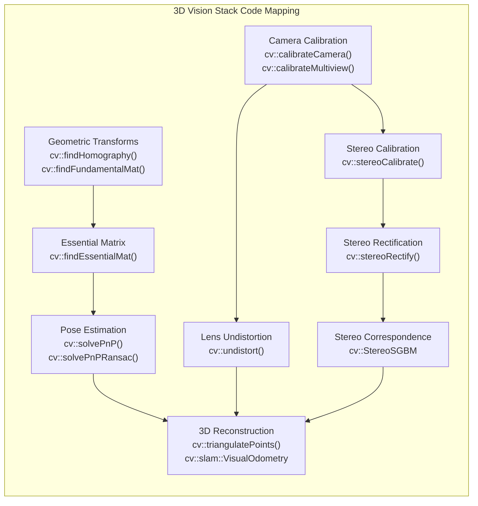
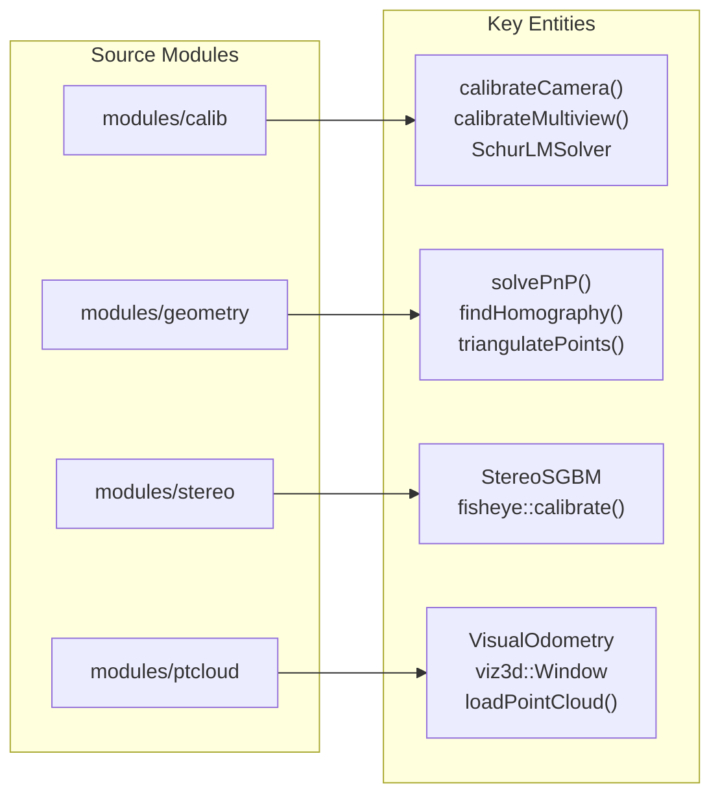

<!-- source: DeepWiki mcp.deepwiki.com · repo opencv/opencv · page 8 Camera Calibration and 3D Vision (calib3d) · fetched 2026-10-30 -->

# Camera Calibration and 3D Vision (calib3d)

Relevant source files

The following files were used as context for generating this wiki page:

- [apps/multiview-calibration/multiview_calibration.py](apps/multiview-calibration/multiview_calibration.py)
- [apps/multiview-calibration/requirements.txt](apps/multiview-calibration/requirements.txt)
- [doc/tutorials/calib3d/camera_multiview_calibration/multiview_calibration.markdown](doc/tutorials/calib3d/camera_multiview_calibration/multiview_calibration.markdown)
- [modules/calib/CMakeLists.txt](modules/calib/CMakeLists.txt)
- [modules/calib/include/opencv2/calib.hpp](modules/calib/include/opencv2/calib.hpp)
- [modules/calib/misc/java/gen_dict.json](modules/calib/misc/java/gen_dict.json)
- [modules/calib/misc/java/test/CalibTest.java](modules/calib/misc/java/test/CalibTest.java)
- [modules/calib/misc/objc/gen_dict.json](modules/calib/misc/objc/gen_dict.json)
- [modules/calib/misc/objc/test/CalibTest.swift](modules/calib/misc/objc/test/CalibTest.swift)
- [modules/calib/misc/python/test/test_calibration.py](modules/calib/misc/python/test/test_calibration.py)
- [modules/calib/src/calibration.cpp](modules/calib/src/calibration.cpp)
- [modules/calib/src/fisheye.cpp](modules/calib/src/fisheye.cpp)
- [modules/calib/src/multiview_calibration.cpp](modules/calib/src/multiview_calibration.cpp)
- [modules/calib/src/precomp.hpp](modules/calib/src/precomp.hpp)
- [modules/calib/test/test_cameracalibration.cpp](modules/calib/test/test_cameracalibration.cpp)
- [modules/calib/test/test_cameracalibration_artificial.cpp](modules/calib/test/test_cameracalibration_artificial.cpp)
- [modules/calib/test/test_cameracalibration_tilt.cpp](modules/calib/test/test_cameracalibration_tilt.cpp)
- [modules/calib/test/test_fisheye.cpp](modules/calib/test/test_fisheye.cpp)
- [modules/calib/test/test_multiview_calib.cpp](modules/calib/test/test_multiview_calib.cpp)
- [modules/geometry/include/opencv2/geometry/2d.hpp](modules/geometry/include/opencv2/geometry/2d.hpp)
- [modules/geometry/include/opencv2/geometry/3d.hpp](modules/geometry/include/opencv2/geometry/3d.hpp)
- [modules/geometry/misc/java/test/GeometryTest.java](modules/geometry/misc/java/test/GeometryTest.java)
- [modules/geometry/perf/perf_2d.cpp](modules/geometry/perf/perf_2d.cpp)
- [modules/geometry/src/fundam.cpp](modules/geometry/src/fundam.cpp)
- [modules/geometry/src/geometry.cpp](modules/geometry/src/geometry.cpp)
- [modules/geometry/src/ptsetreg.cpp](modules/geometry/src/ptsetreg.cpp)
- [modules/geometry/test/test_affine2d_estimator.cpp](modules/geometry/test/test_affine2d_estimator.cpp)
- [modules/geometry/test/test_affine_partial2d_estimator.cpp](modules/geometry/test/test_affine_partial2d_estimator.cpp)
- [modules/geometry/test/test_boundingrect.cpp](modules/geometry/test/test_boundingrect.cpp)
- [modules/imgproc/misc/java/gen_dict.json](modules/imgproc/misc/java/gen_dict.json)
- [modules/imgproc/misc/java/test/ImgprocTest.java](modules/imgproc/misc/java/test/ImgprocTest.java)
- [modules/imgproc/perf/perf_contours.cpp](modules/imgproc/perf/perf_contours.cpp)
- [modules/imgproc/src/contours_common.cpp](modules/imgproc/src/contours_common.cpp)
- [modules/imgproc/src/precomp.hpp](modules/imgproc/src/precomp.hpp)
- [modules/photo/misc/java/test/PhotoTest.java](modules/photo/misc/java/test/PhotoTest.java)
- [modules/python/test/test_legacy.py](modules/python/test/test_legacy.py)
- [modules/stereo/src/stereo_geom.cpp](modules/stereo/src/stereo_geom.cpp)
- [modules/stereo/test/test_geometry.cpp](modules/stereo/test/test_geometry.cpp)
- [modules/video/misc/java/test/BackgroundSubtractorMOGTest.java](modules/video/misc/java/test/BackgroundSubtractorMOGTest.java)
- [samples/android/color-blob-detection/src/org/opencv/samples/colorblobdetect/ColorBlobDetector.java](samples/android/color-blob-detection/src/org/opencv/samples/colorblobdetect/ColorBlobDetector.java)
- [samples/cpp/multiview_calibration_sample.cpp](samples/cpp/multiview_calibration_sample.cpp)

The `calib3d` functionality provides algorithms and tools for working with real-world cameras and performing 3D geometry operations. It bridges 2D images and 3D world geometry, covering camera calibration, lens distortion correction (including fisheye), stereo vision, pose estimation, and 3D reconstruction.

**Note:** In OpenCV 5.x, the former `calib3d` scope is distributed across several modules: `modules/geometry`, `modules/calib`, `modules/stereo`, and `modules/ptcloud`. This page provides a unified conceptual view.

## Overview

The calibration and 3D vision stack contains algorithms for:
- **Camera Calibration:** Determining intrinsic and extrinsic parameters using patterns like chessboards or circles grids.
- **Pose Estimation:** Solving the Perspective-n-Point (PnP) problem and estimating homographies.
- **Stereo Vision:** Rectification and correspondence for depth estimation.
- **3D Reconstruction:** Building point clouds and volumetric models (TSDF).

Sources: [modules/calib/include/opencv2/calib.hpp:13-31](), [modules/geometry/include/opencv2/geometry/3d.hpp:13-31]()

### Module Source Map
The diagram below maps the principal source files across the new module structure to their key exported code entities, bridging natural language spaces to code entity spaces.

**Vision Source Files to Key Code Entities**

Sources: [modules/calib/src/calibration.cpp:59-64](), [modules/calib/src/multiview_calibration.cpp:134-136]()

## Camera Model and Calibration

OpenCV implements the standard pinhole camera model where a 3D world point $P_w$ is projected onto the 2D image plane via intrinsic parameters $A$ and extrinsic parameters $R$ and $t$. Real lenses incorporate radial and tangential distortion coefficients. 

Calibration relies on non-linear optimization routines such as Levenberg-Marquardt implemented via `SchurLMSolver` to minimize reprojection error across multiple views. For multi-camera rigs, `calibrateMultiview` handles global optimization.

For details, see [Camera Models and Calibration Algorithms](#8.1).
Sources: [modules/calib/include/opencv2/calib.hpp:15-32](), [modules/calib/src/calibration.cpp:59-108](), [modules/calib/src/multiview_calibration.cpp:134-136]()

## Pose Estimation and Geometric Transforms

Pose estimation addresses the Perspective-n-Point (PnP) problem, recovering camera rotation and translation from 3D-to-2D point correspondences. OpenCV provides multiple algorithms including EPnP, P3P, AP3P, IPPE, and SQPnP, alongside robust estimation wrappers like `solvePnPRansac`. Geometric transforms further encompass homography matrix estimation and point triangulation.

For details, see [Pose Estimation (solvePnP) and Geometric Transforms](#8.2).
Sources: [modules/geometry/include/opencv2/geometry/3d.hpp:15-35]()

## Stereo Vision and Fisheye Camera Model

The stereo module handles two-view geometry, disparity computation, and stereo rectification to enable dense depth perception. Additionally, the `cv::fisheye` namespace provides specialized calibration, projection, and undistortion routines tailored for wide-angle equidistant fisheye lenses.

For details, see [Stereo Vision and Fisheye Camera Model](#8.3).
Sources: [modules/calib/test/test_fisheye.cpp:130-134]()

## Point Cloud, Volumetric Reconstruction, and SLAM (ptcloud)

The `ptcloud` module integrates lower-level geometric primitives into high-level 3D processing pipelines. It includes input/output support for point clouds and meshes (such as PLY and OBJ formats), RGB-D odometry, truncated signed distance function (TSDF) volumetric reconstruction, and monocular visual odometry building blocks interfacing with visualization tools.

For details, see [Point Cloud, Volumetric Reconstruction, and SLAM (ptcloud)](#8.4).
Sources: [modules/geometry/include/opencv2/geometry/3d.hpp:1-15]()

## Related Child Pages
- [Camera Models and Calibration Algorithms](#8.1) — Document the pinhole camera model with distortion coefficients, calibrateCamera, multiview calibration, chessboard and circles grid detection, USAC robust estimation, and the interactive calibration app.
- [Pose Estimation (solvePnP) and Geometric Transforms](#8.2) — Explain the Perspective-n-Point problem, solvePnP/solvePnPRansac and their methods (EPnP, P3P, AP3P, IPPE, SQPnP), homography estimation, triangulation, and the real-time pose estimation sample pipeline.
- [Stereo Vision and Fisheye Camera Model](#8.3) — Document stereo correspondence and rectification (modules/stereo), disparity computation, the fisheye camera model with its calibration and undistortion functions, and stereo sample programs.
- [Point Cloud, Volumetric Reconstruction, and SLAM (ptcloud)](#8.4) — Introduce the ptcloud module: point cloud/mesh I/O, RGB-D pipelines, volumetric (TSDF) reconstruction, and SLAM/visual odometry building blocks, with a map of submodules and their dependencies on core/geometry/calib.

---

