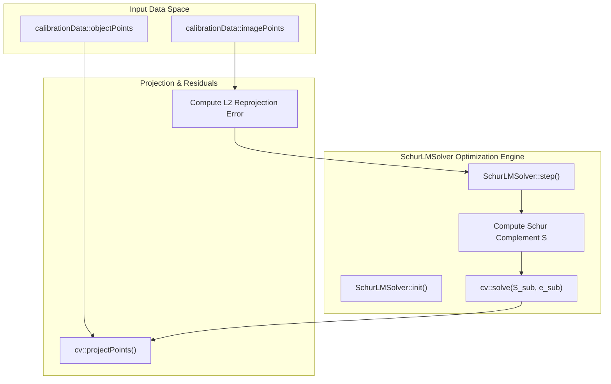
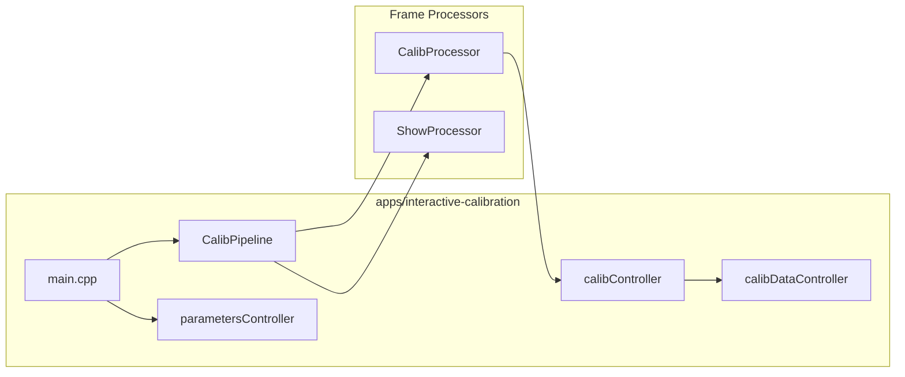

<!-- source: DeepWiki mcp.deepwiki.com · repo opencv/opencv · page 8.1 Camera Models and Calibration Algorithms · fetched 2026-10-30 -->

# Camera Models and Calibration Algorithms

Relevant source files

The following files were used as context for generating this wiki page:

- [apps/interactive-calibration/CMakeLists.txt](apps/interactive-calibration/CMakeLists.txt)
- [apps/interactive-calibration/calibCommon.hpp](apps/interactive-calibration/calibCommon.hpp)
- [apps/interactive-calibration/calibController.cpp](apps/interactive-calibration/calibController.cpp)
- [apps/interactive-calibration/calibController.hpp](apps/interactive-calibration/calibController.hpp)
- [apps/interactive-calibration/calibPipeline.cpp](apps/interactive-calibration/calibPipeline.cpp)
- [apps/interactive-calibration/calibPipeline.hpp](apps/interactive-calibration/calibPipeline.hpp)
- [apps/interactive-calibration/defaultConfig.xml](apps/interactive-calibration/defaultConfig.xml)
- [apps/interactive-calibration/frameProcessor.cpp](apps/interactive-calibration/frameProcessor.cpp)
- [apps/interactive-calibration/frameProcessor.hpp](apps/interactive-calibration/frameProcessor.hpp)
- [apps/interactive-calibration/main.cpp](apps/interactive-calibration/main.cpp)
- [apps/interactive-calibration/parametersController.cpp](apps/interactive-calibration/parametersController.cpp)
- [apps/interactive-calibration/parametersController.hpp](apps/interactive-calibration/parametersController.hpp)
- [apps/interactive-calibration/rotationConverters.cpp](apps/interactive-calibration/rotationConverters.cpp)
- [apps/multiview-calibration/multiview_calibration.py](apps/multiview-calibration/multiview_calibration.py)
- [apps/multiview-calibration/requirements.txt](apps/multiview-calibration/requirements.txt)
- [doc/js_tutorials/js_assets/webnn-electron/package.json](doc/js_tutorials/js_assets/webnn-electron/package.json)
- [doc/tutorials/calib3d/camera_calibration/camera_calibration.markdown](doc/tutorials/calib3d/camera_calibration/camera_calibration.markdown)
- [doc/tutorials/calib3d/camera_multiview_calibration/multiview_calibration.markdown](doc/tutorials/calib3d/camera_multiview_calibration/multiview_calibration.markdown)
- [doc/tutorials/calib3d/interactive_calibration/interactive_calibration.markdown](doc/tutorials/calib3d/interactive_calibration/interactive_calibration.markdown)
- [doc/tutorials/calib3d/real_time_pose/real_time_pose.markdown](doc/tutorials/calib3d/real_time_pose/real_time_pose.markdown)
- [doc/tutorials/calib3d/table_of_content_calib3d.markdown](doc/tutorials/calib3d/table_of_content_calib3d.markdown)
- [doc/tutorials/calib3d/usac.markdown](doc/tutorials/calib3d/usac.markdown)
- [doc/tutorials/objdetect/aruco_board_detection/aruco_board_detection.markdown](doc/tutorials/objdetect/aruco_board_detection/aruco_board_detection.markdown)
- [doc/tutorials/objdetect/charuco_detection/charuco_detection.markdown](doc/tutorials/objdetect/charuco_detection/charuco_detection.markdown)
- [modules/calib/include/opencv2/calib.hpp](modules/calib/include/opencv2/calib.hpp)
- [modules/calib/misc/java/test/CalibTest.java](modules/calib/misc/java/test/CalibTest.java)
- [modules/calib/misc/python/test/test_calibration.py](modules/calib/misc/python/test/test_calibration.py)
- [modules/calib/src/calibration.cpp](modules/calib/src/calibration.cpp)
- [modules/calib/src/fisheye.cpp](modules/calib/src/fisheye.cpp)
- [modules/calib/src/multiview_calibration.cpp](modules/calib/src/multiview_calibration.cpp)
- [modules/calib/test/test_cameracalibration.cpp](modules/calib/test/test_cameracalibration.cpp)
- [modules/calib/test/test_fisheye.cpp](modules/calib/test/test_fisheye.cpp)
- [modules/calib/test/test_multiview_calib.cpp](modules/calib/test/test_multiview_calib.cpp)
- [modules/stereo/src/stereo_geom.cpp](modules/stereo/src/stereo_geom.cpp)
- [modules/stereo/test/test_geometry.cpp](modules/stereo/test/test_geometry.cpp)
- [samples/cpp/calibration.cpp](samples/cpp/calibration.cpp)
- [samples/cpp/imagelist_creator.cpp](samples/cpp/imagelist_creator.cpp)
- [samples/cpp/multiview_calibration_sample.cpp](samples/cpp/multiview_calibration_sample.cpp)
- [samples/cpp/select3dobj.cpp](samples/cpp/select3dobj.cpp)
- [samples/cpp/tutorial_code/calib3d/camera_calibration/camera_calibration.cpp](samples/cpp/tutorial_code/calib3d/camera_calibration/camera_calibration.cpp)
- [samples/cpp/tutorial_code/calib3d/camera_calibration/in_VID5.xml](samples/cpp/tutorial_code/calib3d/camera_calibration/in_VID5.xml)

## Purpose and Scope

This document describes the camera models, calibration algorithms, pattern detection utilities, robust estimation frameworks, and interactive tools implemented in OpenCV's `calib` module (formerly part of `calib3d`). It covers the mathematical foundations of the pinhole camera model, lens distortion parameterization, nonlinear optimization via Levenberg-Marquardt (`SchurLMSolver`), robust estimation with USAC (Universal Sample Consensus), pattern detection routines, multi-view calibration, and the interactive calibration application.

**Sources:** [modules/calib/include/opencv2/calib.hpp:12-223](), [modules/calib/src/calibration.cpp:49-55](), [doc/tutorials/calib3d/usac.markdown]()

---

## Camera Model Foundations

### Pinhole Camera Model
OpenCV implements the standard pinhole camera model where a 3D point $P_w$ in world coordinates projects to a 2D pixel $p$ through the perspective transformation:
$$s \; p = A \begin{bmatrix} R|t \end{bmatrix} P_w$$

The **camera intrinsic matrix** $A$ (also denoted $K$) maps camera coordinates to pixel coordinates:
$$A = \begin{bmatrix}f_x & 0 & c_x \\ 0 & f_y & c_y \\ 0 & 0 & 1\end{bmatrix}$$

**Sources:** [modules/calib/include/opencv2/calib.hpp:23-47]()

### Distortion Models
OpenCV supports multiple distortion parameterizations to model lens imperfections.

#### Standard Distortion Model
Transforms normalized coordinates $(x', y')$ to distorted coordinates $(x'', y'')$ using radial, tangential, and thin-prism components:
$$\begin{bmatrix}x'' \\ y''\end{bmatrix} = \begin{bmatrix}x' \frac{1 + k_1 r^2 + k_2 r^4 + k_3 r^6}{1 + k_4 r^2 + k_5 r^4 + k_6 r^6} + 2 p_1 x' y' + p_2(r^2 + 2 x'^2) + s_1 r^2 + s_2 r^4 \\ y' \frac{1 + k_1 r^2 + k_2 r^4 + k_3 r^6}{1 + k_4 r^2 + k_5 r^4 + k_6 r^6} + p_1 (r^2 + 2 y'^2) + 2 p_2 x' y' + s_3 r^2 + s_4 r^4 \end{bmatrix}$$

**Sources:** [modules/calib/include/opencv2/calib.hpp:184-223]()

#### Fisheye Camera Model
Designed for wide-angle and fisheye lenses, the model uses an angular representation where the distorted radius depends on the incident angle $\theta = \operatorname{atan}(r)$:
$$\theta_d = \theta (1 + k_1 \theta^2 + k_2 \theta^4 + k_3 \theta^6 + k_4 \theta^8)$$
Projection functions for this model are implemented under `cv::fisheye::projectPoints`.

**Sources:** [modules/calib/src/fisheye.cpp:61-154](), [modules/calib/test/test_fisheye.cpp:132-136]()

---

## Calibration Pattern Detection

Accurate calibration requires establishing robust 2D-3D point correspondences using standardized calibration targets.

### Supported Patterns and Detection Functions
The `CalibProcessor` class and related helpers handle pattern parsing for different target geometries:

| Pattern Type | Detection / Parsing Entity | Description & Refinement |
| :--- | :--- | :--- |
| **Chessboard** | `cv::findChessboardCorners` | Locates inner corners, refined via `cv::cornerSubPix`. [apps/interactive-calibration/frameProcessor.cpp:59-72]() |
| **Circles Grid** | `cv::findCirclesGrid` | Detects symmetric and asymmetric circle configurations using `cv::SimpleBlobDetector`. [apps/interactive-calibration/frameProcessor.cpp:103-121]() |
| **ChArUco Board** | `cv::aruco::CharucoDetector` | Combines ArUco markers with chessboard corners for occlusion-resistant setups. [apps/interactive-calibration/frameProcessor.cpp:75-101]() |
| **Dual Circles Grid** | `cv::findCirclesGrid` + bitwise inversion | Detects white-on-black and black-on-white asymmetric grids simultaneously. [apps/interactive-calibration/frameProcessor.cpp:123-145]() |

**Sources:** [apps/interactive-calibration/frameProcessor.cpp:59-145](), [apps/interactive-calibration/frameProcessor.hpp:28-69]()

---

## Calibration Algorithms and Nonlinear Optimization

### Levenberg-Marquardt Optimization (`calibrateCamera`)
The `cv::calibrateCamera` function estimates camera intrinsics and per-view extrinsics by minimizing total reprojection error. OpenCV implements a specialized Bundle Adjustment solver named `SchurLMSolver` to exploit the sparse block structure of the calibration Jacobian.

**Diagram: SchurLMSolver Optimization Flow**
**Sources:** [modules/calib/src/calibration.cpp:59-206](), [apps/interactive-calibration/calibCommon.hpp:37-62]()

### Schur Complement Speedup
The solver partitions the Hessian matrix into global intrinsic parameters (`U`) and local extrinsic parameters per image (`V`). The interaction blocks (`W`) are eliminated via the Schur complement `S`, drastically reducing computational complexity when optimizing across numerous views.

**Sources:** [modules/calib/src/calibration.cpp:77-109](), [modules/calib/src/calibration.cpp:155-165]()

---

## Robust Estimation with USAC

OpenCV integrates the **USAC (Universal Sample Consensus)** framework for robust geometric model estimation (such as fundamental matrix, homography, and relative pose estimation) in the presence of severe outliers. USAC extends standard RANSAC with advanced sampling strategies, sequential probability ratio test (SPRT) verification, local optimization, and graph-cut based consensus set evaluation.

**Sources:** [doc/tutorials/calib3d/usac.markdown]()

---

## Multi-View Calibration

OpenCV supports simultaneous calibration of camera networks via `calibrateMultiview`.

### Minimum Spanning Tree (MST) Initialization
To compute initial extrinsics across multi-camera rigs, OpenCV constructs a graph where cameras are nodes and shared board observations form weighted edges. It extracts a Maximum Spanning Tree (MST) using Prim's algorithm to establish a consistent global coordinate system.

| Entity | Role | File Reference |
| :--- | :--- | :--- |
| `maximumSpanningTree` | Builds camera connectivity graph and computes MST | [modules/calib/src/multiview_calibration.cpp:91-150]() |
| `imagePointsArea` | Computes target coverage for edge weighting | [modules/calib/src/multiview_calibration.cpp:152-170]() |
| `calibrateMultiview` | Primary entry point for multi-camera calibration | [modules/calib/test/test_multiview_calib.cpp:135-136]() |

**Sources:** [modules/calib/src/multiview_calibration.cpp:91-150](), [modules/calib/test/test_multiview_calib.cpp:11-149]()

---

## Interactive Calibration App

Located in `apps/interactive-calibration`, this tool provides a live GUI pipeline for capturing calibration frames, inspecting board detections, and saving intrinsic parameters.

**Diagram: Interactive Calibration App Component Architecture**
**Sources:** [apps/interactive-calibration/main.cpp:113-170](), [apps/interactive-calibration/calibPipeline.cpp:32-145](), [apps/interactive-calibration/calibController.hpp:1-50]()

### Core Architecture Components
*   **`CalibPipeline`**: Manages video capture loops, device configuration, and event polling (`cv::waitKey`). [apps/interactive-calibration/calibPipeline.cpp:73-142]()
*   **`CalibProcessor`**: Executes pattern detection algorithms and accumulates valid `objectPoints` and `imagePoints`. [apps/interactive-calibration/frameProcessor.cpp:147-185]()
*   **`calibController`**: Governs calibration state transitions and triggers solver executions once frame quotas are met. [apps/interactive-calibration/calibController.cpp:1-50]()
*   **`parametersController`**: Parses command-line arguments and loads configuration profiles from XML/YAML files. [apps/interactive-calibration/parametersController.cpp:88-165]()

**Sources:** [apps/interactive-calibration/calibPipeline.hpp:1-45](), [apps/interactive-calibration/calibCommon.hpp:77-114](), [apps/interactive-calibration/parametersController.hpp:1-35]()

---

