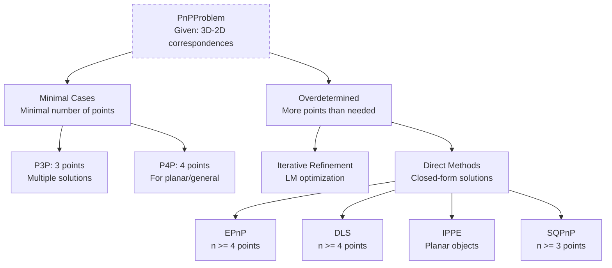
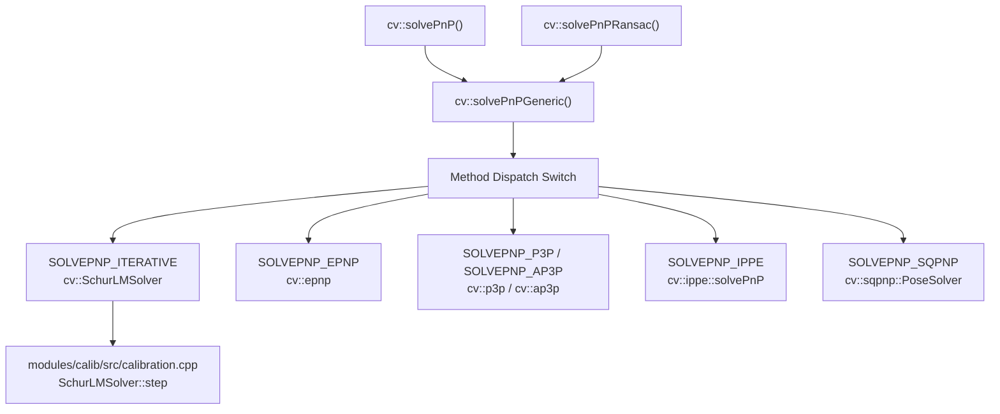
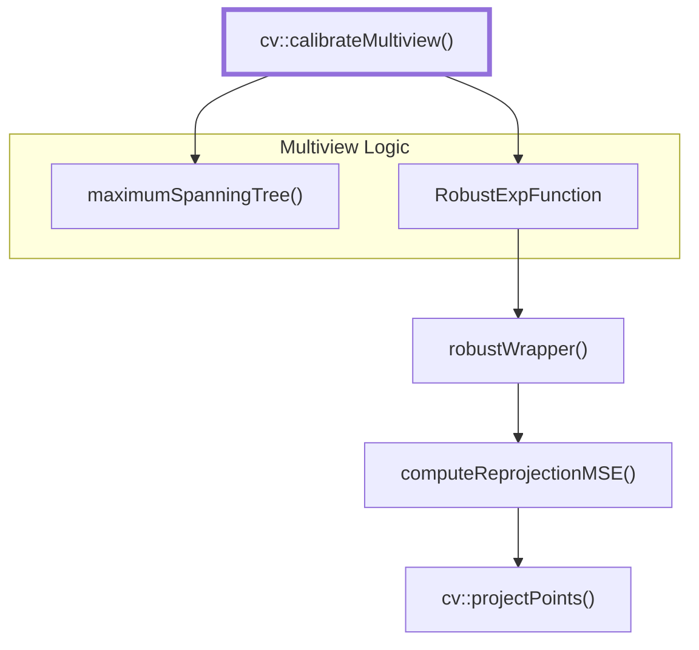
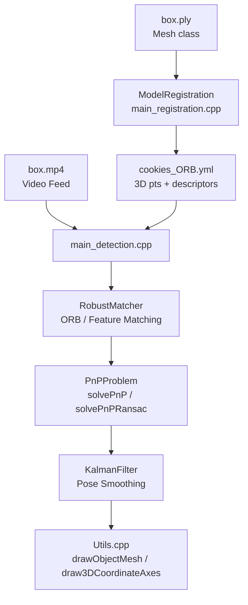

<!-- source: DeepWiki mcp.deepwiki.com · repo opencv/opencv · page 8.2 Pose Estimation (solvePnP) and Geometric Transforms · fetched 2026-10-30 -->

# Pose Estimation (solvePnP) and Geometric Transforms

Relevant source files

The following files were used as context for generating this wiki page:

- [3rdparty/include/opencl/1.2/CL/cl_va_api_media_sharing_intel.h](3rdparty/include/opencl/1.2/CL/cl_va_api_media_sharing_intel.h)
- [cmake/OpenCVFindVA.cmake](cmake/OpenCVFindVA.cmake)
- [modules/calib/CMakeLists.txt](modules/calib/CMakeLists.txt)
- [modules/calib/misc/java/gen_dict.json](modules/calib/misc/java/gen_dict.json)
- [modules/calib/misc/objc/gen_dict.json](modules/calib/misc/objc/gen_dict.json)
- [modules/calib/misc/objc/test/CalibTest.swift](modules/calib/misc/objc/test/CalibTest.swift)
- [modules/calib/src/precomp.hpp](modules/calib/src/precomp.hpp)
- [modules/calib/test/test_cameracalibration_artificial.cpp](modules/calib/test/test_cameracalibration_artificial.cpp)
- [modules/calib/test/test_cameracalibration_tilt.cpp](modules/calib/test/test_cameracalibration_tilt.cpp)
- [modules/core/include/opencv2/core/va_intel.hpp](modules/core/include/opencv2/core/va_intel.hpp)
- [modules/geometry/include/opencv2/geometry/2d.hpp](modules/geometry/include/opencv2/geometry/2d.hpp)
- [modules/geometry/include/opencv2/geometry/3d.hpp](modules/geometry/include/opencv2/geometry/3d.hpp)
- [modules/geometry/misc/java/test/GeometryTest.java](modules/geometry/misc/java/test/GeometryTest.java)
- [modules/geometry/perf/perf_2d.cpp](modules/geometry/perf/perf_2d.cpp)
- [modules/geometry/src/fundam.cpp](modules/geometry/src/fundam.cpp)
- [modules/geometry/src/geometry.cpp](modules/geometry/src/geometry.cpp)
- [modules/geometry/src/ptsetreg.cpp](modules/geometry/src/ptsetreg.cpp)
- [modules/geometry/test/test_affine2d_estimator.cpp](modules/geometry/test/test_affine2d_estimator.cpp)
- [modules/geometry/test/test_affine_partial2d_estimator.cpp](modules/geometry/test/test_affine_partial2d_estimator.cpp)
- [modules/geometry/test/test_boundingrect.cpp](modules/geometry/test/test_boundingrect.cpp)
- [modules/imgproc/misc/java/gen_dict.json](modules/imgproc/misc/java/gen_dict.json)
- [modules/imgproc/misc/java/test/ImgprocTest.java](modules/imgproc/misc/java/test/ImgprocTest.java)
- [modules/imgproc/perf/perf_contours.cpp](modules/imgproc/perf/perf_contours.cpp)
- [modules/imgproc/src/contours_common.cpp](modules/imgproc/src/contours_common.cpp)
- [modules/imgproc/src/precomp.hpp](modules/imgproc/src/precomp.hpp)
- [modules/photo/misc/java/test/PhotoTest.java](modules/photo/misc/java/test/PhotoTest.java)
- [modules/python/test/test_legacy.py](modules/python/test/test_legacy.py)
- [modules/video/misc/java/test/BackgroundSubtractorMOGTest.java](modules/video/misc/java/test/BackgroundSubtractorMOGTest.java)
- [samples/android/color-blob-detection/src/org/opencv/samples/colorblobdetect/ColorBlobDetector.java](samples/android/color-blob-detection/src/org/opencv/samples/colorblobdetect/ColorBlobDetector.java)
- [samples/cpp/tutorial_code/calib3d/real_time_pose_estimation/CMakeLists.txt](samples/cpp/tutorial_code/calib3d/real_time_pose_estimation/CMakeLists.txt)
- [samples/cpp/tutorial_code/calib3d/real_time_pose_estimation/src/Mesh.cpp](samples/cpp/tutorial_code/calib3d/real_time_pose_estimation/src/Mesh.cpp)
- [samples/cpp/tutorial_code/calib3d/real_time_pose_estimation/src/Mesh.h](samples/cpp/tutorial_code/calib3d/real_time_pose_estimation/src/Mesh.h)
- [samples/cpp/tutorial_code/calib3d/real_time_pose_estimation/src/Model.cpp](samples/cpp/tutorial_code/calib3d/real_time_pose_estimation/src/Model.cpp)
- [samples/cpp/tutorial_code/calib3d/real_time_pose_estimation/src/Model.h](samples/cpp/tutorial_code/calib3d/real_time_pose_estimation/src/Model.h)
- [samples/cpp/tutorial_code/calib3d/real_time_pose_estimation/src/ModelRegistration.cpp](samples/cpp/tutorial_code/calib3d/real_time_pose_estimation/src/ModelRegistration.cpp)
- [samples/cpp/tutorial_code/calib3d/real_time_pose_estimation/src/ModelRegistration.h](samples/cpp/tutorial_code/calib3d/real_time_pose_estimation/src/ModelRegistration.h)
- [samples/cpp/tutorial_code/calib3d/real_time_pose_estimation/src/PnPProblem.cpp](samples/cpp/tutorial_code/calib3d/real_time_pose_estimation/src/PnPProblem.cpp)
- [samples/cpp/tutorial_code/calib3d/real_time_pose_estimation/src/PnPProblem.h](samples/cpp/tutorial_code/calib3d/real_time_pose_estimation/src/PnPProblem.h)
- [samples/cpp/tutorial_code/calib3d/real_time_pose_estimation/src/RobustMatcher.cpp](samples/cpp/tutorial_code/calib3d/real_time_pose_estimation/src/RobustMatcher.cpp)
- [samples/cpp/tutorial_code/calib3d/real_time_pose_estimation/src/RobustMatcher.h](samples/cpp/tutorial_code/calib3d/real_time_pose_estimation/src/RobustMatcher.h)
- [samples/cpp/tutorial_code/calib3d/real_time_pose_estimation/src/Utils.cpp](samples/cpp/tutorial_code/calib3d/real_time_pose_estimation/src/Utils.cpp)
- [samples/cpp/tutorial_code/calib3d/real_time_pose_estimation/src/Utils.h](samples/cpp/tutorial_code/calib3d/real_time_pose_estimation/src/Utils.h)
- [samples/cpp/tutorial_code/calib3d/real_time_pose_estimation/src/main_detection.cpp](samples/cpp/tutorial_code/calib3d/real_time_pose_estimation/src/main_detection.cpp)
- [samples/cpp/tutorial_code/calib3d/real_time_pose_estimation/src/main_registration.cpp](samples/cpp/tutorial_code/calib3d/real_time_pose_estimation/src/main_registration.cpp)
- [samples/directx/CMakeLists.txt](samples/directx/CMakeLists.txt)
- [samples/dnn/CMakeLists.txt](samples/dnn/CMakeLists.txt)
- [samples/opencl/CMakeLists.txt](samples/opencl/CMakeLists.txt)
- [samples/tapi/CMakeLists.txt](samples/tapi/CMakeLists.txt)
- [samples/va_intel/CMakeLists.txt](samples/va_intel/CMakeLists.txt)
- [samples/va_intel/display.cpp.inc](samples/va_intel/display.cpp.inc)
- [samples/va_intel/va_intel_interop.cpp](samples/va_intel/va_intel_interop.cpp)

## Purpose and Scope

This document covers the pose estimation and geometric transformation estimation capabilities provided by the `calib` and `geometry` modules (formerly unified in `calib3d`). Specifically, it details:

- **Pose Estimation (PnP)**: Computing camera pose (rotation and translation) from 3D-2D point correspondences using various algorithms.
- **Homography Estimation**: Finding planar projective transformations between two views.
- **Fundamental and Essential Matrix Estimation**: Estimating epipolar geometry from point correspondences.
- **Robust Estimation**: Using RANSAC and the USAC framework to handle outliers.
- **Point Triangulation**: Reconstructing 3D points from multiple 2D views.
- **Real-Time Pose Estimation Sample Pipeline**: End-to-end tutorial tracking objects using feature matching and PnP algorithms.

**Sources**: [modules/calib/include/opencv2/calib.hpp:13-24](), [modules/geometry/include/opencv2/geometry/3d.hpp:13-24]()

---

## The Perspective-n-Point (PnP) Problem

The PnP problem seeks to determine the camera's pose (rotation `R` and translation `t`) given a set of $n$ 3D object points in world coordinates $\{P_w\}$, their corresponding 2D projections $\{p\}$, and the camera intrinsic matrix $A$ (or $K$).

The relationship follows the pinhole camera model:
$s \cdot p = A \begin{bmatrix} R|t \end{bmatrix} P_w$

### Problem Variants

The complexity and algorithm choice depend on the number of points and their spatial distribution (planar vs. non-planar).

**Sources**: [modules/calib/include/opencv2/calib.hpp:184-224](), [modules/geometry/include/opencv2/geometry/3d.hpp:186-224]()

---

## Core PnP API: solvePnP and solvePnPGeneric

### Main Functions: `solvePnP` and `solvePnPRansac`

The primary entry point for pose estimation is `solvePnP`, which internally utilizes `solvePnPGeneric` to handle multiple possible solutions and returns the best fit. Robust estimation with outlier rejection is handled by `solvePnPRansac` [samples/cpp/tutorial_code/calib3d/real_time_pose_estimation/src/PnPProblem.cpp:101-148]().

### Available PnP Methods

OpenCV provides several solvers via the `SolvePnPMethod` enum:

| Flag | Algorithm | Description |
|---|---|---|
| `SOLVEPNP_ITERATIVE` | Levenberg-Marquardt | Non-linear optimization minimizing reprojection error using `SchurLMSolver` [modules/calib/src/calibration.cpp:59-109](). |
| `SOLVEPNP_EPNP` | EPnP | Efficient PnP for $n \ge 4$ points. |
| `SOLVEPNP_P3P` | P3P | Minimal solver for 3 points based on Gao's method. |
| `SOLVEPNP_AP3P` | AP3P | Algebraic P3P for better numerical stability. |
| `SOLVEPNP_IPPE` | IPPE | Optimized for planar objects using homography decomposition. |
| `SOLVEPNP_SQPNP` | SQPnP | Sequential Quadratic Programming for globally optimal PnP. |

### Implementation Dispatch (Code Entity Space)

**Sources**: [modules/calib/src/calibration.cpp:59-153](), [samples/cpp/tutorial_code/calib3d/real_time_pose_estimation/src/PnPProblem.cpp:101-148]()

---

## Robust Pose Estimation and Multiview Calibration

### Robust Estimation and USAC
Robust estimation handles outliers in point correspondences. The system can utilize either classic RANSAC or the USAC framework. For multiview scenarios, `calibrateMultiview` uses a robust function to weight reprojection errors [modules/calib/src/multiview_calibration.cpp:47-63]().

### Multiview Calibration Flow
The `calibrateMultiview` function orchestrates pose estimation across multiple cameras and frames, building a Maximum Spanning Tree (MST) to initialize extrinsics [modules/calib/src/multiview_calibration.cpp:91-150]().

**Sources**: [modules/calib/src/multiview_calibration.cpp:11-45](), [modules/calib/src/multiview_calibration.cpp:91-122](), [modules/calib/test/test_multiview_calib.cpp:134-136]()

---

## Geometric Transforms and Primitives

### Homography and Fundamental Matrices
Homography estimation (2D-2D planar transform) and Fundamental matrix estimation (epipolar geometry) are implemented in the `geometry` module [modules/geometry/src/fundam.cpp]().

### Geometric Primitives
The `geometry` module provides utilities for 2D and 3D geometric analysis:
- **Contour Analysis**: `contourArea` for computing the area of a polygon [modules/imgproc/misc/java/test/ImgprocTest.java:89]().
- **Convex Hull**: Used in multiview calibration to determine the coverage of image points [modules/calib/src/multiview_calibration.cpp:164-165]().
- **Bounding Boxes**: `minAreaRect` and `fitEllipse` for analyzing point sets [modules/python/test/test_legacy.py:79-80]().

### Point Triangulation
Triangulation reconstructs 3D points from 2D correspondences and projection matrices. The system supports both pinhole and fisheye models during projection and error calculation [modules/calib/src/multiview_calibration.cpp:74-81]().

**Sources**: [modules/geometry/src/fundam.cpp:1-50](), [modules/calib/src/multiview_calibration.cpp:74-81]()

---

## Real-Time Pose Estimation Sample Pipeline

OpenCV includes an end-to-end tutorial sample for real-time 6DOF pose estimation located at `samples/cpp/tutorial_code/calib3d/real_time_pose_estimation/` [samples/cpp/tutorial_code/calib3d/real_time_pose_estimation/CMakeLists.txt:1-19]().

### Sample Components and Data Flow

- **`Mesh`**: Loads 3D CAD model geometry from PLY format files [samples/cpp/tutorial_code/calib3d/real_time_pose_estimation/src/main_registration.cpp:123]().
- **`ModelRegistration`**: Interactively registers 2D keypoints in a reference image with corresponding 3D vertices using mouse callbacks [samples/cpp/tutorial_code/calib3d/real_time_pose_estimation/src/main_registration.cpp:62-79]().
- **`RobustMatcher`**: Performs feature extraction (e.g., ORB, KAZE) and robust matching via ratio and symmetry tests [samples/cpp/tutorial_code/calib3d/real_time_pose_estimation/src/RobustMatcher.h:65-76]().
- **`PnPProblem`**: Wraps `cv::solvePnP`, `cv::solvePnPRansac`, and point backprojection routines [samples/cpp/tutorial_code/calib3d/real_time_pose_estimation/src/PnPProblem.cpp:101-148]().
- **`Utils`**: Provides helper functions for drawing 3D bounding boxes, coordinate axes, and error metrics calculation [samples/cpp/tutorial_code/calib3d/real_time_pose_estimation/src/Utils.cpp:133-172]().

**Sources**: [samples/cpp/tutorial_code/calib3d/real_time_pose_estimation/CMakeLists.txt:1-19](), [samples/cpp/tutorial_code/calib3d/real_time_pose_estimation/src/main_detection.cpp:33-135](), [samples/cpp/tutorial_code/calib3d/real_time_pose_estimation/src/PnPProblem.cpp:101-148]()

---

## Summary of Key Entities

| Component | Entity Name | Role |
|---|---|---|
| **Pose Optimization** | `SchurLMSolver` | Levenberg-Marquardt solver using Schur complement [modules/calib/src/calibration.cpp:59](). |
| **Robust Function** | `RobustExpFunction` | Exponential weight function for robust estimation [modules/calib/src/multiview_calibration.cpp:19](). |
| **Multiview Entry** | `calibrateMultiview` | Calibrates a network of cameras [modules/calib/src/multiview_calibration.cpp:135](). |
| **Sample PnP Helper** | `PnPProblem` | Wrapper class for `solvePnP` and `solvePnPRansac` in tutorial samples [samples/cpp/tutorial_code/calib3d/real_time_pose_estimation/src/PnPProblem.cpp:63-75](). |
| **Sample Matcher** | `RobustMatcher` | Feature detection and ratio/symmetry matching [samples/cpp/tutorial_code/calib3d/real_time_pose_estimation/src/RobustMatcher.h:17-90](). |
| **Fisheye Model** | `cv::fisheye` | Specialized calibration and projection for fisheye lenses [modules/calib/test/test_fisheye.cpp:132](). |

**Sources**: [modules/calib/include/opencv2/calib.hpp:1-224](), [modules/calib/src/multiview_calibration.cpp:1-165](), [samples/cpp/tutorial_code/calib3d/real_time_pose_estimation/src/PnPProblem.cpp:1-188]()

---

