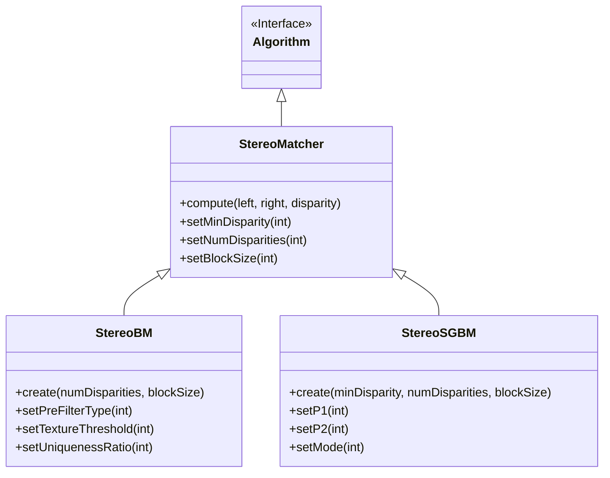
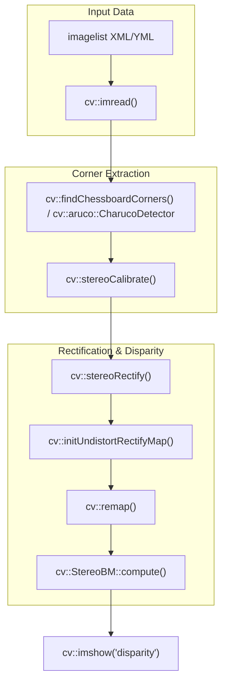
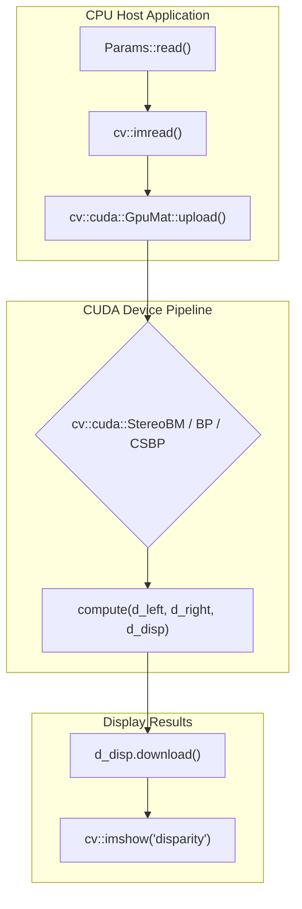
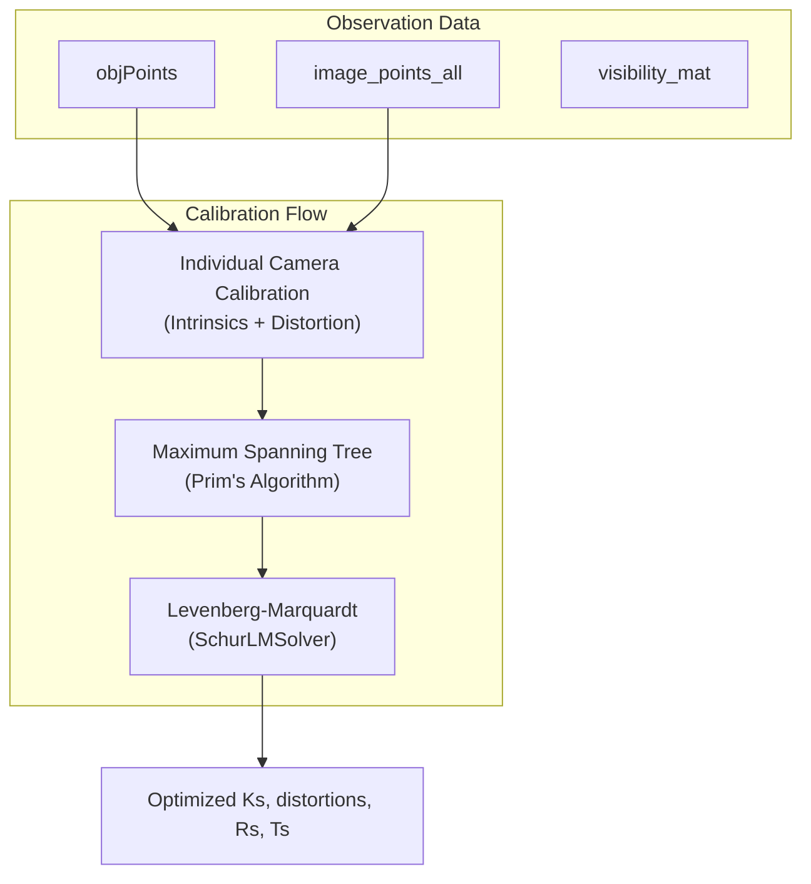

<!-- source: DeepWiki mcp.deepwiki.com · repo opencv/opencv · page 8.3 Stereo Vision and Fisheye Camera Model · fetched 2026-10-30 -->

# Stereo Vision and Fisheye Camera Model

Relevant source files

The following files were used as context for generating this wiki page:

- [.github/ISSUE_TEMPLATE.md](.github/ISSUE_TEMPLATE.md)
- [.github/ISSUE_TEMPLATE/bug_report.yml](.github/ISSUE_TEMPLATE/bug_report.yml)
- [.github/ISSUE_TEMPLATE/config.yml](.github/ISSUE_TEMPLATE/config.yml)
- [.github/ISSUE_TEMPLATE/documentation.yml](.github/ISSUE_TEMPLATE/documentation.yml)
- [.github/ISSUE_TEMPLATE/feature_request.yml](.github/ISSUE_TEMPLATE/feature_request.yml)
- [.github/PULL_REQUEST_TEMPLATE.md](.github/PULL_REQUEST_TEMPLATE.md)
- [COPYRIGHT](COPYRIGHT)
- [LICENSE](LICENSE)
- [apps/multiview-calibration/multiview_calibration.py](apps/multiview-calibration/multiview_calibration.py)
- [apps/multiview-calibration/requirements.txt](apps/multiview-calibration/requirements.txt)
- [cmake/OpenCVPackaging.cmake](cmake/OpenCVPackaging.cmake)
- [doc/LICENSE_BSD.txt](doc/LICENSE_BSD.txt)
- [doc/py_tutorials/py_setup/py_intro/py_intro.markdown](doc/py_tutorials/py_setup/py_intro/py_intro.markdown)
- [doc/tutorials/calib3d/camera_multiview_calibration/multiview_calibration.markdown](doc/tutorials/calib3d/camera_multiview_calibration/multiview_calibration.markdown)
- [doc/tutorials/introduction/android_binary_package/android_dev_intro.markdown](doc/tutorials/introduction/android_binary_package/android_dev_intro.markdown)
- [doc/tutorials/introduction/android_binary_package/dev_with_OCV_on_Android.markdown](doc/tutorials/introduction/android_binary_package/dev_with_OCV_on_Android.markdown)
- [doc/tutorials/introduction/clojure_dev_intro/clojure_dev_intro.markdown](doc/tutorials/introduction/clojure_dev_intro/clojure_dev_intro.markdown)
- [doc/tutorials/introduction/windows_install/windows_install.markdown](doc/tutorials/introduction/windows_install/windows_install.markdown)
- [modules/calib/include/opencv2/calib.hpp](modules/calib/include/opencv2/calib.hpp)
- [modules/calib/misc/java/test/CalibTest.java](modules/calib/misc/java/test/CalibTest.java)
- [modules/calib/misc/python/test/test_calibration.py](modules/calib/misc/python/test/test_calibration.py)
- [modules/calib/src/calibration.cpp](modules/calib/src/calibration.cpp)
- [modules/calib/src/fisheye.cpp](modules/calib/src/fisheye.cpp)
- [modules/calib/src/multiview_calibration.cpp](modules/calib/src/multiview_calibration.cpp)
- [modules/calib/test/test_cameracalibration.cpp](modules/calib/test/test_cameracalibration.cpp)
- [modules/calib/test/test_fisheye.cpp](modules/calib/test/test_fisheye.cpp)
- [modules/calib/test/test_multiview_calib.cpp](modules/calib/test/test_multiview_calib.cpp)
- [modules/js/perf/package.json](modules/js/perf/package.json)
- [modules/stereo/src/stereo_geom.cpp](modules/stereo/src/stereo_geom.cpp)
- [modules/stereo/test/test_geometry.cpp](modules/stereo/test/test_geometry.cpp)
- [samples/cpp/3calibration.cpp](samples/cpp/3calibration.cpp)
- [samples/cpp/multiview_calibration_sample.cpp](samples/cpp/multiview_calibration_sample.cpp)
- [samples/cpp/stereo_calib.cpp](samples/cpp/stereo_calib.cpp)
- [samples/gpu/multi.cpp](samples/gpu/multi.cpp)
- [samples/gpu/stereo_match.cpp](samples/gpu/stereo_match.cpp)
- [samples/gpu/stereo_multi.cpp](samples/gpu/stereo_multi.cpp)

This page documents the technical implementation of stereo correspondence, disparity computation, rectification workflows, the fisheye camera model for wide-angle lenses, and associated sample programs within the OpenCV codebase.

---

## Stereo Vision and Disparity Estimation

Stereo vision in OpenCV focuses on computing a disparity map from a pair of rectified images. The library provides two primary CPU implementations for this task: `cv::StereoBM` (Block Matching) and `cv::StereoSGBM` (Semi-Global Block Matching), alongside CUDA-accelerated counterparts in the CUDA modules.

### Stereo Matcher Hierarchy
Both algorithms inherit from the `cv::StereoMatcher` base class, which defines the standard interface for disparity calculation.

Sources: [modules/calib/include/opencv2/calib.hpp:1008-1065](), [modules/calib/src/calibration.cpp:59-109]()

### Disparity Computation Logic
Disparity represents the horizontal shift between matching pixels in the left and right rectified images. 
*   `cv::StereoBM` computes Sum of Absolute Differences (SAD) over local rectangular windows. It is computationally lightweight and supports OpenCL acceleration.
*   `cv::StereoSGBM` implements a semi-global matching strategy, minimizing a global energy function over multiple 1D scanline directions (5 or 8 paths), which yields superior results in textureless and occluded areas.

Sources: [modules/stereo/src/stereo_geom.cpp:9-114](), [modules/calib/test/test_cameracalibration.cpp:52-74]()

---

## Fisheye Camera Model

Standard pinhole projection models break down for wide-angle and fisheye lenses with fields of view exceeding 120°. The `cv::fisheye` namespace implements a specialized model based on equi-angular or equidistant projection principles where radial distance from the image center is proportional to the incident angle $\theta$.

### Mathematical Projection
A 3D point $P_c = (X_c, Y_c, Z_c)$ in the camera coordinate system projects to pixel coordinates $(u, v)$ through the following sequence:
1.  **Normalized coordinates**: $x = X_c/Z_c$, $y = Y_c/Z_c$
2.  **Radius in plane**: $r = \sqrt{x^2 + y^2}$
3.  **Incident angle**: $\theta = \text{atan}(r)$
4.  **Distortion polynomial**: $\theta_d = \theta(1 + k_1\theta^2 + k_2\theta^4 + k_3\theta^6 + k_4\theta^8)$
5.  **Distorted normalized coordinates**: $x' = (\theta_d/r)x$, $y' = (\theta_d/r)y$
6.  **Pixel mapping**: $u = f_x x' + c_x$, $v = f_y y' + c_y$

Sources: [modules/calib/src/fisheye.cpp:57-163](), [modules/calib/test/test_fisheye.cpp:100-137]()

### Fisheye API and Data Flow
Key functions handle calibration, point projection, undistortion, and rectification within `cv::fisheye`:

| Function / Class | File | Role |
| :--- | :--- | :--- |
| `cv::fisheye::calibrate` | `modules/calib/src/fisheye.cpp` | Estimates intrinsic matrix $K$ and distortion vector $D$ from multi-view calibration boards. |
| `cv::fisheye::projectPoints` | `modules/calib/src/fisheye.cpp` | Projects 3D points onto the image plane using the fisheye distortion model. |
| `cv::fisheye::undistortImage` | `modules/calib/src/fisheye.cpp` | Corrects wide-angle distortion to produce a rectilinear perspective image. |
| `cv::fisheye::stereoRectify` | `modules/calib/src/fisheye.cpp` | Computes rectification transformations for a stereo fisheye camera pair. |

Sources: [modules/calib/src/fisheye.cpp:57-163](), [modules/calib/test/test_multiview_calib.cpp:88-94]()

---

## Stereo Rectification Procedures

Rectification transforms a pair of stereo images so that epipolar lines coincide with horizontal scanlines, reducing 2D point correspondence searching to a 1D horizontal scan.

### Pinhole vs. Fisheye Rectification
*   **Pinhole Stereo (`cv::stereoRectify`)**: Uses the relative rotation $R$ and translation $T$ between camera frames to compute projection matrices $P_1, P_2$ and rectification rotations $R_1, R_2$.
*   **Fisheye Stereo (`cv::fisheye::stereoRectify`)**: Operates similarly but accounts for the non-linear $\theta$-mapping geometry specific to wide-angle projection models.

### Implementation and 3D Reprojection
The underlying geometry routines (`modules/stereo/src/stereo_geom.cpp`) compute an optimal common viewing plane rotation and calculate scaling factors to preserve image content. Once disparity maps are generated, `cv::reprojectImageTo3D` uses the 4x4 reprojection matrix $Q$ to convert image coordinates $(u, v, d)$ into 3D metric points $(X, Y, Z)$.

Sources: [modules/stereo/src/stereo_geom.cpp:116-210](), [modules/calib/src/fisheye.cpp:57-163]()

---

## Stereo Sample Programs and Execution Flow

OpenCV provides sample programs that illustrate calibration, rectification, and disparity computation pipelines for both CPU and GPU backends.

### Stereo Calibration and Rectification Pipeline (`samples/cpp/stereo_calib.cpp`)
The sample reads pairs of calibration pattern images (chessboard or ChArUco), extracts corners, and performs stereo calibration.

Sources: [samples/cpp/stereo_calib.cpp:70-174](), [samples/cpp/stereo_calib.cpp:175-210]()

### GPU-Accelerated Stereo Matching (`samples/gpu/stereo_match.cpp`)
The CUDA sample demonstrates real-time disparity estimation using GPU blocks (`cv::cuda::StereoBM`, `cv::cuda::StereoBeliefPropagation`, and `cv::cuda::StereoConstantSpaceBP`).

Sources: [samples/gpu/stereo_match.cpp:40-100](), [samples/gpu/stereo_match.cpp:160-218]()

---

## Multi-View Calibration

OpenCV provides global calibration capabilities via `cv::calibrateMultiview`, extending two-camera stereo setups to multi-camera configurations using bundle adjustment.

### Multi-View Calibration Pipeline

Sources: [modules/calib/src/multiview_calibration.cpp:91-150](), [modules/calib/src/calibration.cpp:59-109]()

Sources: 
- [modules/calib/include/opencv2/calib.hpp:1008-1065]()
- [modules/calib/src/calibration.cpp:59-109]()
- [modules/stereo/src/stereo_geom.cpp:9-114]()
- [modules/calib/src/fisheye.cpp:57-163]()
- [modules/calib/test/test_fisheye.cpp:100-137]()
- [modules/calib/test/test_multiview_calib.cpp:88-94]()
- [modules/stereo/src/stereo_geom.cpp:116-210]()
- [samples/cpp/stereo_calib.cpp:70-210]()
- [samples/gpu/stereo_match.cpp:40-218]()
- [modules/calib/src/multiview_calibration.cpp:91-150]()

---

