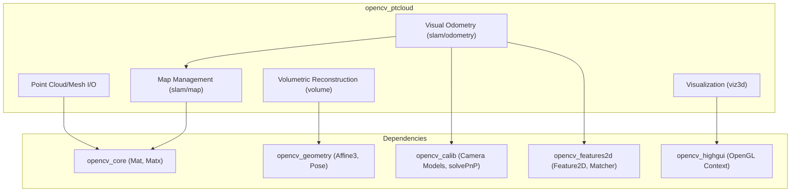
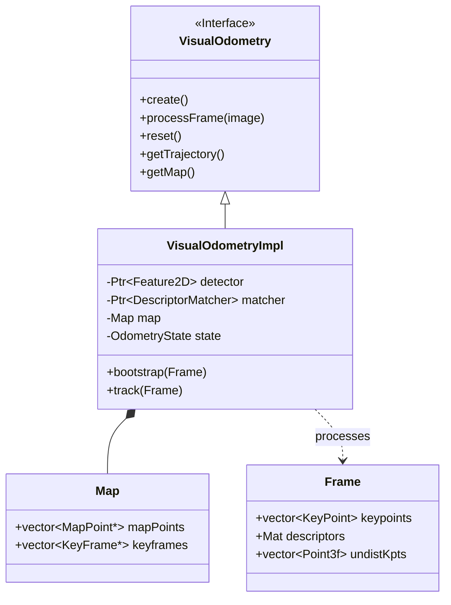

<!-- source: DeepWiki mcp.deepwiki.com · repo opencv/opencv · page 8.4 Point Cloud, Volumetric Reconstruction, and SLAM (ptcloud) · fetched 2026-10-30 -->

# Point Cloud, Volumetric Reconstruction, and SLAM (ptcloud)

Relevant source files

The following files were used as context for generating this wiki page:

- [apps/multiview-calibration/multiview_calibration.py](apps/multiview-calibration/multiview_calibration.py)
- [apps/multiview-calibration/requirements.txt](apps/multiview-calibration/requirements.txt)
- [doc/tutorials/calib3d/camera_multiview_calibration/multiview_calibration.markdown](doc/tutorials/calib3d/camera_multiview_calibration/multiview_calibration.markdown)
- [modules/calib/include/opencv2/calib.hpp](modules/calib/include/opencv2/calib.hpp)
- [modules/calib/misc/java/test/CalibTest.java](modules/calib/misc/java/test/CalibTest.java)
- [modules/calib/misc/python/test/test_calibration.py](modules/calib/misc/python/test/test_calibration.py)
- [modules/calib/src/calibration.cpp](modules/calib/src/calibration.cpp)
- [modules/calib/src/fisheye.cpp](modules/calib/src/fisheye.cpp)
- [modules/calib/src/multiview_calibration.cpp](modules/calib/src/multiview_calibration.cpp)
- [modules/calib/test/test_cameracalibration.cpp](modules/calib/test/test_cameracalibration.cpp)
- [modules/calib/test/test_fisheye.cpp](modules/calib/test/test_fisheye.cpp)
- [modules/calib/test/test_multiview_calib.cpp](modules/calib/test/test_multiview_calib.cpp)
- [modules/highgui/cmake/detect_wayland.cmake](modules/highgui/cmake/detect_wayland.cmake)
- [modules/highgui/src/window_wayland.cpp](modules/highgui/src/window_wayland.cpp)
- [modules/highgui/test/test_gui.cpp](modules/highgui/test/test_gui.cpp)
- [modules/ptcloud/CMakeLists.txt](modules/ptcloud/CMakeLists.txt)
- [modules/ptcloud/include/opencv2/ptcloud.hpp](modules/ptcloud/include/opencv2/ptcloud.hpp)
- [modules/ptcloud/include/opencv2/ptcloud/viz3d.hpp](modules/ptcloud/include/opencv2/ptcloud/viz3d.hpp)
- [modules/ptcloud/src/viz3d/grid_ticks.hpp](modules/ptcloud/src/viz3d/grid_ticks.hpp)
- [modules/ptcloud/src/viz3d/viz3d.cpp](modules/ptcloud/src/viz3d/viz3d.cpp)
- [modules/ptcloud/src/viz3d/viz3d_private.hpp](modules/ptcloud/src/viz3d/viz3d_private.hpp)
- [modules/ptcloud/test/test_viz3d.cpp](modules/ptcloud/test/test_viz3d.cpp)
- [modules/stereo/src/stereo_geom.cpp](modules/stereo/src/stereo_geom.cpp)
- [modules/stereo/test/test_geometry.cpp](modules/stereo/test/test_geometry.cpp)
- [samples/cpp/multiview_calibration_sample.cpp](samples/cpp/multiview_calibration_sample.cpp)
- [samples/data/rgbd-color.jpg](samples/data/rgbd-color.jpg)
- [samples/data/rgbd-depth.png](samples/data/rgbd-depth.png)

The `ptcloud` module provides foundational building blocks for 3D computer vision, moving beyond traditional 2D imagery and stereo matching into spatial modeling, point cloud and mesh I/O, RGB-D data processing, Truncated Signed Distance Field (TSDF) volumetric reconstruction, and visual Simultaneous Localization and Mapping (SLAM). 

This module relies on `core` for foundational arrays, `geometry` for coordinate transformations and spatial primitives, and `calib` for camera models. Additionally, it integrates with `highgui` for 3D visualization via OpenGL (`viz3d`) and `features2d` for visual odometry tracking.

### Module Architecture and Dependencies

The `ptcloud` module is organized into functional sub-components that cooperate to build complete 3D pipelines.

**ptcloud System Relationships**

**Sources:**
- [modules/ptcloud/CMakeLists.txt:1-11]()
- [modules/ptcloud/src/viz3d/viz3d.cpp:38-65]()

---

### Key Sub-components

#### 1. Point Cloud and Mesh I/O and Data Layout
The `ptcloud` module supplies standardized functions for loading and saving 3D geometries, supporting common file formats such as PLY and OBJ. Internally, point clouds are managed as `cv::Mat` instances where rows represent individual geometric entities (points or vertices) and columns encode attributes like 3D spatial coordinates (`X`, `Y`, `Z`), surface normals, or RGB color values.

For details on public I/O APIs, shape/dtype conventions, supported formats, and common pitfalls, see [Point Cloud and Mesh I/O + Basic Data Layout](#8.4.1).

**Sources:**
- [modules/ptcloud/include/opencv2/ptcloud.hpp:1-15]()

#### 2. RGB-D Odometry and TSDF Volume Reconstruction
For RGB-D sensor streams, `ptcloud` includes specialized odometry frame representations and TSDF (Truncated Signed Distance Field) volumetric integration algorithms. These tools enable real-time camera tracking and the fusion of noisy depth frames into clean, continuous 3D surface representations.

For details on odometry frame structures, volume configuration settings, and TSDF update patterns, see [RGB-D Odometry and TSDF/Volume Reconstruction](#8.4.2).

**Sources:**
- [modules/ptcloud/include/opencv2/ptcloud/slam/odometry_params.hpp:1-30]()

#### 3. Visual Odometry and SLAM Pipeline
The SLAM and visual odometry subsystem exposes core entry points such as `cv::slam::VisualOdometry`. This component handles frame-to-frame tracking, keyframe selection, two-view bootstrapping, PnP-based map estimation, and map expansion.

**SLAM Pipeline Class Association**

For details on execution flow, keyframe management, and visualization integration via `viz3d`, see [Monocular Visual Odometry and SLAM Pipeline](#8.4.3).

**Sources:**
- [modules/ptcloud/include/opencv2/ptcloud/slam/visual_odometry.hpp:15-50]()
- [modules/ptcloud/src/slam/odometry/visual_odometry.cpp:18-33]()

#### 4. 3D Visualization (viz3d)
The `viz3d` component provides a lightweight OpenGL-backed visualization engine integrated directly into OpenCV windows via `highgui`. It lets developers render point clouds, polygonal meshes, geometric primitives, and camera trajectories.

**Key Visualization Classes:**
*   `cv::viz3d::Window`: Manages the underlying OpenGL rendering context and event dispatching [modules/ptcloud/src/viz3d/viz3d_private.hpp:94-110]().
*   `cv::viz3d::Object`: Serves as the base class for renderable scene items such as `Mesh`, `Lines`, and `PointCloud` [modules/ptcloud/src/viz3d/viz3d_private.hpp:67-91]().
*   `cv::viz3d::View`: Controls camera perspective, view matrices, and mouse navigation [modules/ptcloud/src/viz3d/viz3d_private.hpp:23-56]().

**Sources:**
- [modules/ptcloud/src/viz3d/viz3d.cpp:38-65]()
- [modules/ptcloud/src/viz3d/viz3d_private.hpp:129-205]()

---

### Interaction with Calibration and Geometry
`ptcloud` relies extensively on camera calibration primitives from `calib` and geometric transforms from `geometry`. For instance, visual odometry pipelines require camera intrinsics (`K`) and distortion coefficients to undistort keypoints prior to pose estimation.

| Entity | Role in ptcloud | Source |
| :--- | :--- | :--- |
| `cv::calibrateCamera` | Provides camera intrinsics for metric SLAM | [modules/calib/include/opencv2/calib.hpp:38-46]() |
| `cv::undistortPoints` | Normalizes feature point coordinates for tracking | [modules/ptcloud/src/slam/odometry/visual_odometry.cpp:125-128]() |
| `cv::solvePnP` | Estimates camera pose relative to the active map | [modules/ptcloud/include/opencv2/ptcloud/slam/visual_odometry.hpp:10-20]() |

**Sources:**
- [modules/calib/include/opencv2/calib.hpp:38-46]()
- [modules/ptcloud/src/slam/odometry/visual_odometry.cpp:101-129]()

---

