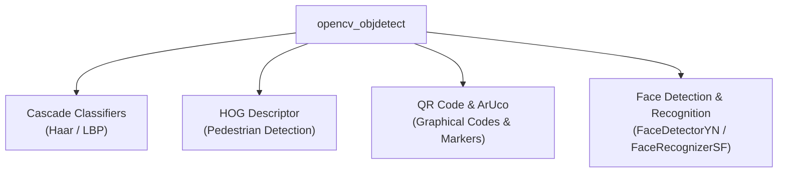
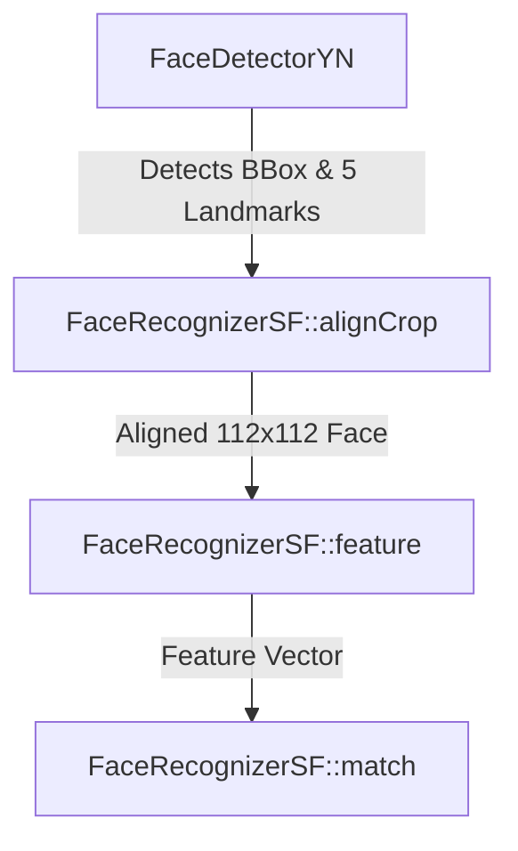

<!-- source: DeepWiki mcp.deepwiki.com · repo opencv/opencv · page 9 Object Detection (objdetect) · fetched 2026-10-30 -->

# Object Detection (objdetect)

Relevant source files

The following files were used as context for generating this wiki page:

- [doc/tutorials/dnn/dnn_face/dnn_face.markdown](doc/tutorials/dnn/dnn_face/dnn_face.markdown)
- [modules/flann/CMakeLists.txt](modules/flann/CMakeLists.txt)
- [modules/objdetect/CMakeLists.txt](modules/objdetect/CMakeLists.txt)
- [modules/objdetect/doc/pics/lena-face-detection.jpg](modules/objdetect/doc/pics/lena-face-detection.jpg)
- [modules/objdetect/include/opencv2/objdetect/face.hpp](modules/objdetect/include/opencv2/objdetect/face.hpp)
- [modules/objdetect/include/opencv2/objdetect/objdetect.hpp](modules/objdetect/include/opencv2/objdetect/objdetect.hpp)
- [modules/objdetect/src/face_detect.cpp](modules/objdetect/src/face_detect.cpp)
- [modules/objdetect/src/face_recognize.cpp](modules/objdetect/src/face_recognize.cpp)
- [modules/objdetect/src/precomp.hpp](modules/objdetect/src/precomp.hpp)
- [modules/objdetect/test/test_face.cpp](modules/objdetect/test/test_face.cpp)
- [modules/objdetect/test/test_main.cpp](modules/objdetect/test/test_main.cpp)
- [modules/video/src/precomp.hpp](modules/video/src/precomp.hpp)
- [samples/dnn/face_detect.cpp](samples/dnn/face_detect.cpp)
- [samples/dnn/face_detect.py](samples/dnn/face_detect.py)

The `opencv_objdetect` module provides a comprehensive suite of algorithms for detecting objects, graphical codes, fiducial markers, and facial features in images and video streams. Declared as a core module depending on `opencv_core`, `opencv_imgproc`, `opencv_features`, and `opencv_geometry` (with optional `opencv_dnn` support) [modules/objdetect/CMakeLists.txt:1-14](), it bridges classical computer vision detection pipelines with modern deep learning-based detectors.

---

## Module Overview and Architecture

The `opencv_objdetect` module encompasses several decoupled subsystems, ranging from traditional cascade classifiers and histograms of oriented gradients to modern DNN-based face detection and recognition, graphical code reading/encoding, and ArUco/ChArUco fiducial marker tracking.

Sources: [modules/objdetect/CMakeLists.txt:1-14]()

---

## 9.1. Cascade Classifiers and Haar Features

The cascade classifier framework implements boosted tree classifiers using Haar-like features or Local Binary Patterns (LBP) for rapid object detection (such as faces, eyes, and upper bodies). The public interface is centered around the `CascadeClassifier` class, which manages feature evaluators and stage-based threshold rejection.

For full architectural details, implementation specifics, multi-scale detection via `detectMultiScale`, rectangular grouping via `groupRectangles`, and OpenCL-accelerated execution paths, see [Cascade Classifiers and Haar Features](#9.1).

Sources: [modules/objdetect/src/precomp.hpp:46-51]()

---

## 9.2. HOG Descriptor and SVM Detection

The Histogram of Oriented Gradients (HOG) subsystem provides dense feature extraction and linear Support Vector Machine (SVM) classification, primarily utilized for pedestrian and object detection. The `HOGDescriptor` class handles gradient computation, block normalization, and multi-scale sliding window search.

For details on configuration parameters, custom SVM weights via `setSVMDetector`, multi-scale detection, and OpenCL acceleration kernels, see [HOG Descriptor and SVM Detection](#9.2).

Sources: [modules/objdetect/include/opencv2/objdetect.hpp:48-52]()

---

## 9.3. QR Code and ArUco Marker Detection

The graphical code and fiducial marker subsystems provide robust localization and decoding for 2D barcodes and camera calibration targets. This includes `QRCodeDetector` and `QRCodeEncoder` for QR codes, as well as `aruco::ArucoDetector` and `aruco::CharucoDetector` for square fiducial markers and ChArUco boards.

For details on finder pattern localization, Reed-Solomon error correction, dictionary configuration, pose estimation, and parameter tuning, see [QR Code and ArUco Marker Detection](#9.3).

Sources: [modules/objdetect/include/opencv2/objdetect/objdetect.hpp:44-48](), [modules/objdetect/src/precomp.hpp:48-48]()

---

## 9.4. Face Detection APIs and DNN-based Helpers

The objdetect module provides specialized face analysis APIs defined in `face.hpp`, leveraging the `opencv_dnn` module for high-accuracy neural network inference [modules/objdetect/include/opencv2/objdetect/face.hpp:8-12](). 

Key classes include:
- `FaceDetectorYN`: A lightweight DNN-based face detector (typically using models like YuNet) returning bounding boxes and facial landmarks [modules/objdetect/include/opencv2/objdetect/face.hpp:20-22](), [doc/tutorials/dnn/dnn_face/dnn_face.markdown:17-22]().
- `FaceRecognizerSF`: A DNN-based face feature extractor and matcher (such as SFace) supporting cosine and L2 distance metrics for face recognition [modules/objdetect/include/opencv2/objdetect/face.hpp:118-129](), [doc/tutorials/dnn/dnn_face/dnn_face.markdown:23-33]().

Sources: [modules/objdetect/include/opencv2/objdetect/face.hpp:20-152](), [doc/tutorials/dnn/dnn_face/dnn_face.markdown:13-34]()

For details on setting up detector parameters, execution backends (`backend_id`, `target_id`), landmark formatting, and integration with DNN pipelines, see [Face Detection APIs and DNN-based Helpers](#9.4).

Sources: [modules/objdetect/include/opencv2/objdetect/face.hpp:20-116](), [modules/objdetect/src/face_detect.cpp:20-52](), [modules/objdetect/src/face_recognize.cpp:18-40](), [doc/tutorials/dnn/dnn_face/dnn_face.markdown:13-34]()

---

