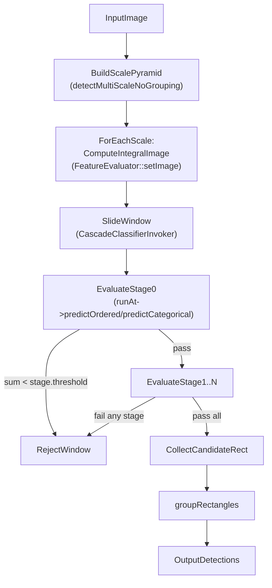
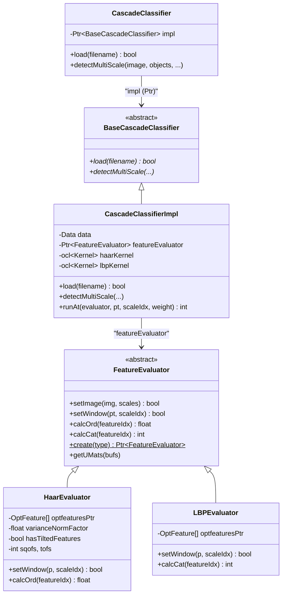
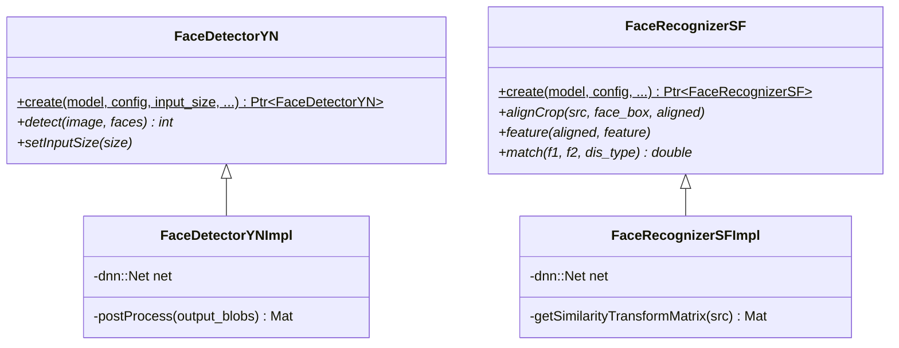

<!-- source: DeepWiki mcp.deepwiki.com · repo opencv/opencv · page 9.1 Cascade Classifiers and Haar Features · fetched 2026-10-30 -->

# Cascade Classifiers and Haar Features

Relevant source files

The following files were used as context for generating this wiki page:

- [doc/tutorials/dnn/dnn_face/dnn_face.markdown](doc/tutorials/dnn/dnn_face/dnn_face.markdown)
- [modules/flann/CMakeLists.txt](modules/flann/CMakeLists.txt)
- [modules/objdetect/CMakeLists.txt](modules/objdetect/CMakeLists.txt)
- [modules/objdetect/doc/pics/lena-face-detection.jpg](modules/objdetect/doc/pics/lena-face-detection.jpg)
- [modules/objdetect/include/opencv2/objdetect/face.hpp](modules/objdetect/include/opencv2/objdetect/face.hpp)
- [modules/objdetect/include/opencv2/objdetect/objdetect.hpp](modules/objdetect/include/opencv2/objdetect/objdetect.hpp)
- [modules/objdetect/src/face_detect.cpp](modules/objdetect/src/face_detect.cpp)
- [modules/objdetect/src/face_recognize.cpp](modules/objdetect/src/face_recognize.cpp)
- [modules/objdetect/src/precomp.hpp](modules/objdetect/src/precomp.hpp)
- [modules/objdetect/test/test_face.cpp](modules/objdetect/test/test_face.cpp)
- [modules/objdetect/test/test_main.cpp](modules/objdetect/test/test_main.cpp)
- [modules/video/src/precomp.hpp](modules/video/src/precomp.hpp)
- [samples/dnn/face_detect.cpp](samples/dnn/face_detect.cpp)
- [samples/dnn/face_detect.py](samples/dnn/face_detect.py)

## Purpose and Scope

This page documents the cascade classifier system in OpenCV's `objdetect` module. It covers the `CascadeClassifier` public API, the internal `CascadeClassifierImpl`, the `HaarEvaluator` and `LBPEvaluator` feature computation classes, the multi-scale detection loop, rectangle grouping, and the OpenCL-accelerated detection path. It also addresses the `traincascade` application used for training custom classifiers and the newer DNN-based face detection and recognition APIs (`FaceDetectorYN` and `FaceRecognizerSF`).

For the HOG-based detector, see [HOG Descriptor and SVM Detection](9.2). For QR code and ArUco detection, see [QR Code and ArUco Marker Detection](9.3).

Sources: [modules/objdetect/CMakeLists.txt:1-14](), [modules/objdetect/include/opencv2/objdetect/face.hpp:20-156]()

---

## Algorithm Overview

A cascade classifier is a chain of boosted classification stages. Each stage is a strong classifier consisting of a collection of decision trees (weak classifiers). An input window is classified as positive only if it passes every stage. Early stages are cheap and fast, rejecting most negative windows; later stages are more discriminative.

At detection time, the input image is scanned at multiple scales. For each scale, an integral image is computed. A sliding window is evaluated by the cascade: if any stage's weighted tree sum falls below that stage's threshold, the window is rejected immediately without evaluating further stages.

Title: Cascade Detection Data Flow

Sources: [modules/objdetect/src/cascadedetect.cpp:916-1099](), [modules/objdetect/src/cascadedetect.hpp:77-228]()

---

## Class Hierarchy

The public `CascadeClassifier` class is a thin wrapper around `BaseCascadeClassifier`. The concrete implementation is `CascadeClassifierImpl`.

Title: Cascade Classifier Entity Association

Sources: [modules/objdetect/src/cascadedetect.hpp:11-74](), [modules/objdetect/src/cascadedetect.hpp:77-228]()

---

## DNN-based Face Detection and Recognition

OpenCV provides high-level APIs for DNN-based face detection (`FaceDetectorYN`) and recognition (`FaceRecognizerSF`). These classes encapsulate model loading, blob preprocessing, and output post-processing.

### FaceDetectorYN
This class implements YuNet for face detection [modules/objdetect/include/opencv2/objdetect/face.hpp:16-19](). It supports setting score thresholds, NMS thresholds, and input sizes dynamically [modules/objdetect/include/opencv2/objdetect/face.hpp:25-55]().

*   **Implementation**: `FaceDetectorYNImpl` is defined in [modules/objdetect/src/face_detect.cpp:20-216]().
*   **Forward Pass**: Uses `dnn::readNet` to load models and `net.forward` to get output blobs for classification, objectness, bounding boxes, and facial landmarks [modules/objdetect/src/face_detect.cpp:34-161]().
*   **Output Format**: A 2D `Mat` of shape `[num_faces, 15]` where columns 0-3 represent bounding box coordinates $(x, y, w, h)$, columns 4-13 represent 5 facial landmarks (right eye, left eye, nose tip, right mouth corner, left mouth corner), and column 14 stores the confidence score [modules/objdetect/include/opencv2/objdetect/face.hpp:62-71](), [doc/tutorials/dnn/dnn_face/dnn_face.markdown:66-71]().

### FaceRecognizerSF
This class implements SFace for face recognition [modules/objdetect/include/opencv2/objdetect/face.hpp:118-121]().

*   **Implementation**: `FaceRecognizerSFImpl` is defined in [modules/objdetect/src/face_recognize.cpp:18-76]().
*   **Feature Extraction**: Aligns and crops the detected face using an estimated similarity transform before extracting a normalized feature embedding [modules/objdetect/src/face_recognize.cpp:42-61]().
*   **Matching**: Supports `FR_COSINE` and `FR_NORM_L2` distance metrics for comparing feature vectors [modules/objdetect/src/face_recognize.cpp:62-76]().

Title: DNN Face API Association

Sources: [modules/objdetect/include/opencv2/objdetect/face.hpp:20-156](), [modules/objdetect/src/face_detect.cpp:20-84](), [modules/objdetect/src/face_recognize.cpp:18-76](), [doc/tutorials/dnn/dnn_face/dnn_face.markdown:1-110]()

---

## Cascade Data Model

`CascadeClassifierImpl::Data` holds the fully deserialized cascade in a set of flat arrays to optimize cache locality.

When all trees are single-node stumps (`maxNodesPerTree == 1`), the data is packed into the optimized `stumps` vector [modules/objdetect/src/cascadedetect.hpp:185-196](). Otherwise, the generic `nodes`/`leaves` layout is used.

Sources: [modules/objdetect/src/cascadedetect.hpp:162-213]()

---

## Feature Types

### Haar Features (`HaarEvaluator`)
A Haar feature is the weighted sum of axis-aligned or 45°-tilted rectangles. The `OptFeature::calc()` method computes the feature value using precomputed integral image offsets. Tilted features use a separate tilted integral image channel [modules/objdetect/src/cascadedetect.cpp:543-714]().

### LBP Features (`LBPEvaluator`)
LBP features describe a rectangle divided into a 3×3 grid. The center cell is compared against neighbors to produce an 8-bit code. LBP nodes use categorical prediction via bitmasks [modules/objdetect/src/cascadedetect.cpp:776-906]().

Sources: [modules/objdetect/src/cascadedetect.cpp:543-906]()

---

## detectMultiScale and groupRectangles

The `detectMultiScale` algorithm builds a scale pyramid and invokes the classifier at each level [modules/objdetect/src/cascadedetect.cpp:968-1099]().

After collection, raw candidate rectangles are clustered by `groupRectangles()`. It uses `partition()` with `SimilarRects(eps)` to group overlapping detections and averages them [modules/objdetect/src/cascadedetect.cpp:63-173]().

Sources: [modules/objdetect/src/cascadedetect.cpp:63-173](), [modules/objdetect/src/cascadedetect.cpp:968-1099]()

---

## OpenCL Acceleration Path

When OpenCL is available, `detectMultiScale` calls `ocl_detectMultiScaleNoGrouping()` [modules/objdetect/src/cascadedetect.cpp:1103-1213](). The kernel `runHaarClassifier` in `cascadedetect.cl` implements a split-stage strategy where early stages are evaluated per-work-item and later stages are cooperative [modules/objdetect/src/opencl/cascadedetect.cl:72-360]().

Sources: [modules/objdetect/src/cascadedetect.cpp:1103-1213]()

---

## Custom Classifier Training (`traincascade`)

The `traincascade` application supports training HAAR, LBP, and HOG features [apps/traincascade/cascadeclassifier.cpp:10-10](). It utilizes a `CvCascadeImageReader` to process positive samples from `.vec` files and negative samples from background images [apps/traincascade/imagestorage.cpp:13-185]().

Sources: [apps/traincascade/traincascade.cpp:12-130](), [apps/traincascade/cascadeclassifier.cpp:129-186](), [apps/traincascade/boost.cpp:179-209]()

---

